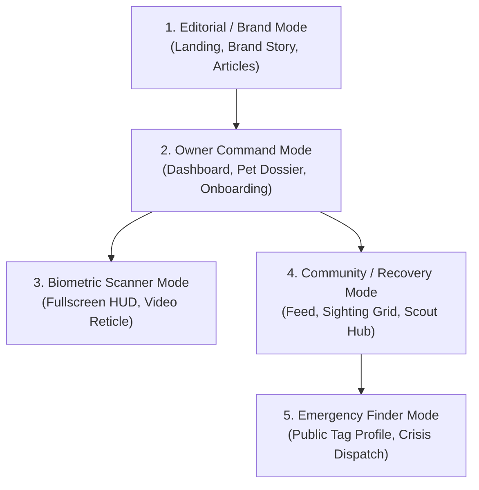

# SafePaws — Panel A Design System Specification & Component Catalog (Remediated)

**Document Status:** Approved & Remediated Foundation  
**Milestone:** UX-03 Step 1.1 — Panel A Accessibility Remediation & Acceptance Closure  
**Lead Author:** Principal Design Systems Engineer & Accessibility Remediation Lead  
**Implementation Source:** [frontend/src/index.css](file:///home/samudra/Projects/VisualSCode/VisualCode/Vscoding/Projects/SAFEPAWS/safepaws_sih/frontend/src/index.css) | [frontend/src/components/ui/](file:///home/samudra/Projects/VisualSCode/VisualCode/Vscoding/Projects/SAFEPAWS/safepaws_sih/frontend/src/components/ui/)  
**Git Baseline Reference:** Commit `57e63848ed48c275a97d180e4d094f3077ff00df` | Branch `frontend`  

---

## 1. Overview & Coordinated Modes

Panel A establishes the unified visual, typographic, tactile, and component foundation for all five SafePaws experience modes:



All modes share the same semantic tokens, touch targets, focus rings, and component primitives, ensuring SafePaws feels like one coherent, award-winning product.

---

## 2. Master Design Tokens & Contrast Verification

### 2.1 Color Palette & Semantic Roles

| Token Name | CSS Custom Property | Hex Value | Semantic Purpose |
| :--- | :--- | :--- | :--- |
| **Bone** | `--color-bone` | `#F6F1E7` | Warm, inviting paper canvas for Editorial, Command, and Recovery modes. |
| **Carbon Ink** | `--color-ink` | `#1C1A17` | High-contrast body text ink, dark button surfaces, and bold headings. |
| **Marigold** | `--color-marigold` / `--color-accent` | `#E2811F` | Brand safety gold, active scanner reticle brackets, button backgrounds. |
| **Marigold Text**| `--color-accent-text` | `#8B4A00` | Dedicated accessible text token for Marigold labels on light canvas (**6.06:1 AA**). |
| **Scout Trail**| `--color-trail` | `#63684B` | Volunteer network green, neighborhood scout badges, subtle card dividers. |
| **Alert Clay** | `--color-alert-clay` / `--color-alert` | `#B3452F` | Emergency alert banners, lost pet headers, urgent crisis notifications. |
| **Soft Ink** | `--color-ink-soft` | `#6E665C` | Remediated secondary metadata labels (**5.02:1 AA** on Bone, **5.65:1 AA** on White). |
| **Surface** | `--color-surface` | `#FFFFFF` | Structured card surfaces, dialog sheets, input backgrounds. |
| **Surface Raised**| `--color-surface-raised` | `rgba(255,255,255,0.85)` | Translucent glass cards with `backdrop-blur-md`. |
| **Canvas Dark**| `--color-canvas-dark` | `#121110` | Deep Carbon background for Biometric Scanner Mode (`/scan`). |
| **Surface Dark**| `--color-surface-dark` | `#1C1A17` | Dark HUD card surfaces and camera overlays. |
| **Border** | `--color-border` | `#E5E0D8` | 1px boundary dividers on light surfaces. |
| **Border Dark**| `--color-border-dark` | `rgba(255,255,255,0.08)`| Translucent 1px inner borders on dark surfaces (Linear style). |
| **Success** | `--color-success` | `#4C7A52` | Verified status badges, safe indicators, confirmation toasts. |
| **Danger** | `--color-danger` | `#D32F2F` | Destructive account/pet deletion actions, form validation errors. |

### 2.2 Mathematical Contrast Verification (WCAG 2.2 Baseline)

Contrast ratios mathematically computed using official W3C relative luminance:

| Foreground Color | Background Canvas | Contrast Ratio | WCAG 2.2 Compliance Level | Verdict & Remediation Status |
| :--- | :--- | :--- | :--- | :--- |
| Carbon Ink (`#1C1A17`) | Bone Canvas (`#F6F1E7`) | **15.42:1** | Level AAA (>7.0:1) | **PASS** — Standard body text on canvas. |
| Carbon Ink (`#1C1A17`) | White Surface (`#FFFFFF`) | **17.36:1** | Level AAA (>7.0:1) | **PASS** — Card and input text. |
| Carbon Ink (`#1C1A17`) | Marigold (`#E2811F`) | **6.11:1** | Level AA (>4.5:1) | **PASS (REMEDIATED)** — Button `variant="accent"` foreground. |
| Marigold Text (`#8B4A00`) | Bone Canvas (`#F6F1E7`) | **6.06:1** | Level AA (>4.5:1) | **PASS (REMEDIATED)** — Accessible accent text on canvas. |
| Soft Ink (`#6E665C`) | Bone Canvas (`#F6F1E7`) | **5.02:1** | Level AA (>4.5:1) | **PASS (REMEDIATED)** — Darkened from `#8A8175` (`3.41:1`). |
| Soft Ink (`#6E665C`) | White Surface (`#FFFFFF`) | **5.65:1** | Level AA (>4.5:1) | **PASS (REMEDIATED)** — Secondary labels on cards. |
| Alert Clay (`#B3452F`) | Bone Canvas (`#F6F1E7`) | **4.90:1** | Level AA (>4.5:1) | **PASS** — Emergency text on canvas. |
| White (`#FFFFFF`) | Alert Clay (`#B3452F`) | **5.51:1** | Level AA (>4.5:1) | **PASS** — Emergency button surface contrast. |
| Trail Olive (`#63684B`)| Bone Canvas (`#F6F1E7`) | **5.16:1** | Level AA (>4.5:1) | **PASS** — Volunteer scout badges & tags. |
| White (`#FFFFFF`) | Trail Olive (`#63684B`) | **5.81:1** | Level AA (>4.5:1) | **PASS** — Scout pill badge surfaces. |
| White (`#FFFFFF`) | Danger Red (`#D32F2F`) | **4.98:1** | Level AA (>4.5:1) | **PASS** — Destructive button contrast. |
| White (`#FFFFFF`) | Success Green (`#4C7A52`)| **4.98:1** | Level AA (>4.5:1) | **PASS** — Safe status badge contrast. |
| Bone (`#F6F1E7`) | Canvas Dark (`#121110`) | **16.75:1** | Level AAA (>7.0:1) | **PASS** — HUD heading text on dark canvas. |
| Ink Dark Soft (`#A8A196`)| Canvas Dark (`#121110`) | **7.37:1** | Level AAA (>7.0:1) | **PASS** — HUD telemetry labels on dark canvas. |
| Marigold (`#E2811F`) | Canvas Dark (`#121110`) | **6.64:1** | Level AA (>4.5:1) | **PASS** — Scanner reticle brackets on dark canvas. |

---

## 3. Component Catalog & Implementation Guide

All primitives are located in [frontend/src/components/ui/](file:///home/samudra/Projects/VisualSCode/VisualCode/Vscoding/Projects/SAFEPAWS/safepaws_sih/frontend/src/components/ui/) and exported via `index.ts`:

### 3.1 `Button`
- **File:** `components/ui/Button.tsx`
- **Remediated Variant (`accent`):** Uses `bg-[var(--color-accent)] text-[var(--color-ink)]` ensuring **6.11:1** WCAG AA contrast on Marigold buttons.
- **Other Variants:** `primary` (Ink), `secondary` (White border), `outline` (2px Ink), `ghost`, `alert` (Clay), `danger` (Red), `scanner` (Deep Carbon).
- **Sizes:** `sm` (h-9), `default` (h-11), `lg` (h-14), `icon` (h-11 w-11).
- **Features:** `isLoading` with accessible spinner (`aria-busy="true"`), `leftIcon`, `rightIcon`, active scale depression (`active:scale-[0.98] motion-reduce:active:scale-100`), minimum 44x44px touch target.

### 3.2 Accessible `FormField` & Form Controls
- **Files:** `components/ui/FormField.tsx`, `Input.tsx`, `Textarea.tsx`, `Select.tsx`
- **Automatic Context Architecture:**
  `<FormField>` creates a `FormFieldContext` generating a stable, collision-free ID via `React.useId()`.
  - `<FormLabel>` automatically receives `htmlFor={fieldId}`.
  - `<FormHelperText>` automatically receives `id={descriptionId}`.
  - `<FormError>` automatically receives `id={errorId}` and `role="alert"`.
  - `<Input>`, `<Textarea>`, `<Select>` automatically consume `id={fieldId}`, `aria-describedby`, and `aria-invalid={hasError}`.
- **Outer Layout Control (`wrapperClassName`):** `<Input>`, `<Textarea>`, `<Select>` provide an optional `wrapperClassName` prop so consumers can control outer layout width/margins (`wrapperClassName="w-64"`) without altering native input classes.

```tsx
// Reusable Accessible FormField Usage Example
import { FormField, FormLabel, FormHelperText, FormError, Input } from '../components/ui';

export function PetContactForm() {
  const [phone, setPhone] = useState('');
  const [error, setError] = useState('Please enter a valid phone number');

  return (
    <FormField hasError={Boolean(error)}>
      <FormLabel required>Emergency Phone</FormLabel>
      <Input
        type="tel"
        placeholder="(555) 000-0000"
        value={phone}
        onChange={(e) => setPhone(e.target.value)}
        wrapperClassName="max-w-md"
      />
      <FormHelperText>Visible to finders who scan your pet's collar tag.</FormHelperText>
      <FormError>{error}</FormError>
    </FormField>
  );
}
```

### 3.3 `NumberTicker`
- **File:** `components/ui/number-ticker.tsx`
- **Remediated Accessibility Strategy:**
  - The rapidly mutating visual counter element is marked `aria-hidden="true"`, preventing screen readers from being flooded with 60 intermediate values per second during the spring animation.
  - A stable accessible representation `<span className="sr-only">{formattedFinalValue}</span>` immediately provides the intended value to screen readers.
  - Reduced-motion mode renders the static final number immediately without spring delays.

### 3.4 `3DCard`
- **File:** `components/ui/3d-card.tsx`
- **Remediated Reduced-Motion Strategy:**
  - `handleMouseMove` explicitly checks `window.matchMedia('(prefers-reduced-motion: reduce)').matches`. If true, pointer-driven 3D transforms are bypassed.
  - Dynamic media query listener resets `containerRef.current.style.transform = 'rotateY(0deg) rotateX(0deg)'` whenever reduced-motion preference changes.
  - Card elements feature `motion-reduce:transform-none`.

### 3.5 `Spotlight`
- **File:** `components/ui/spotlight.tsx`
- **Remediated Identifier Strategy:**
  - Uses `React.useId()` to generate a deterministic, unique filter identifier per component instance (`spotlight-filter-:r0:`).
  - Eliminates SVG filter ID collisions when multiple spotlights are rendered across sections.

---

## 4. Verification & Linting Results

- **TypeScript Compilation:** `npm run lint` (`tsc --noEmit`) passes with **0 errors** across all frontend files.
- **Rollup Native Binary Note:** In accordance with Section 2 instructions, the Linux Rollup environment binary was intentionally untouched.
