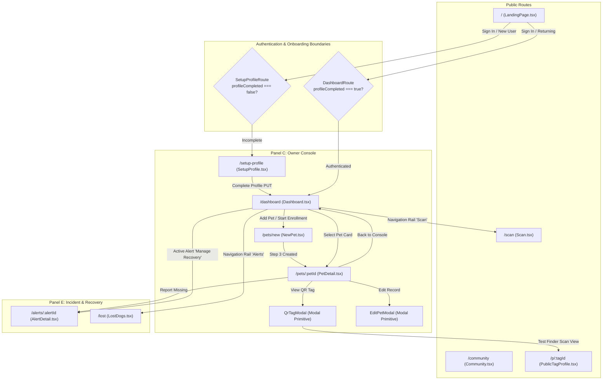
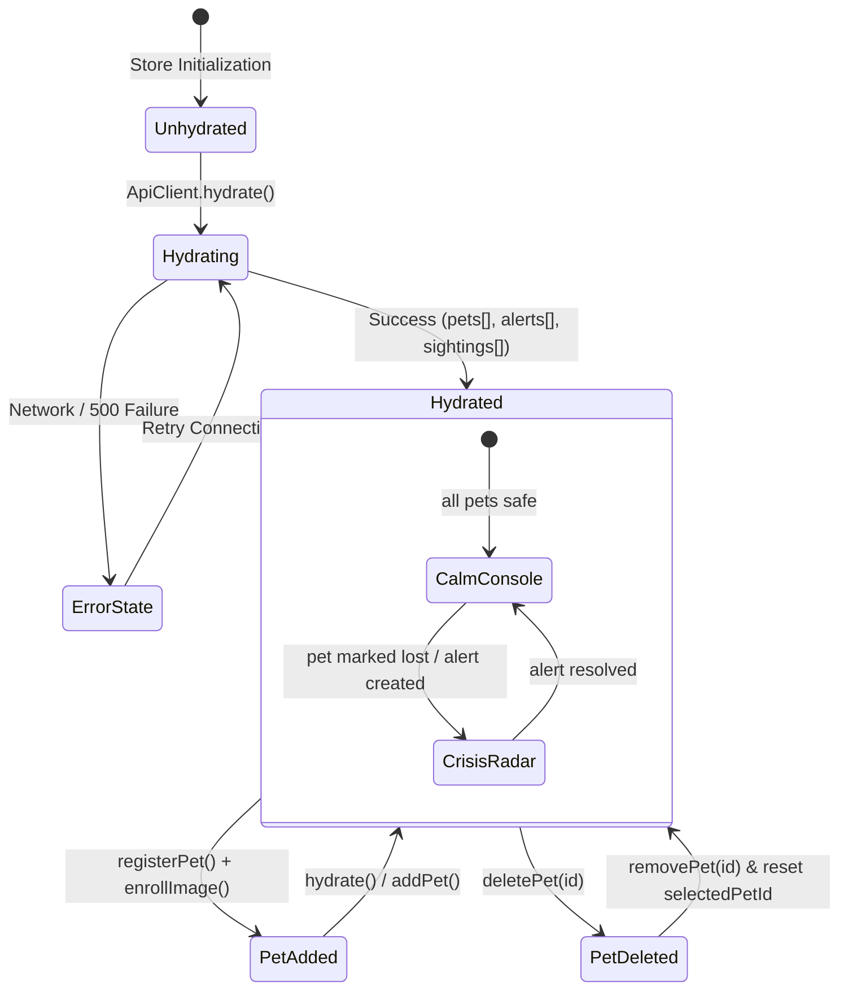
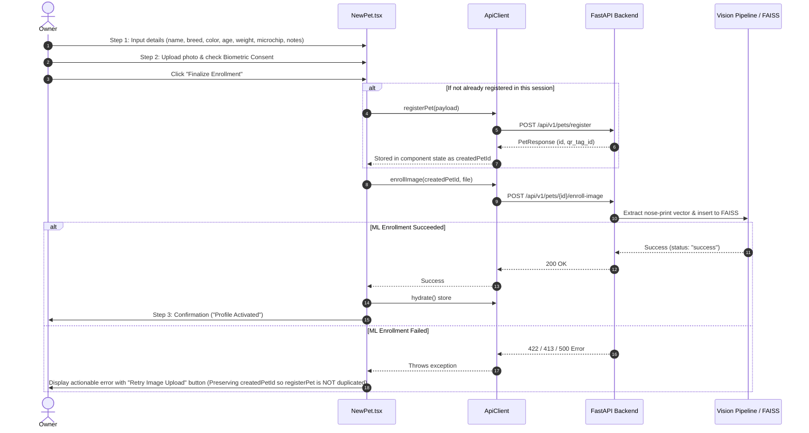
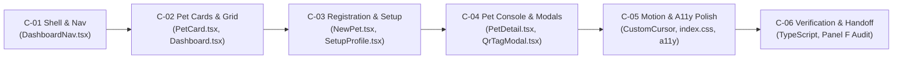

# SAFEPAWS — PANEL C: OWNER CONSOLE & PET MANAGEMENT
## Master Architecture, Component Design & Implementation Roadmap

**Document Reference:** `docs/PANEL_C_OWNER_CONSOLE_ARCHITECTURE.md`  
**Milestone:** UX-03 Step 3.0 — Panel C Architecture & Execution  
**Preceding Milestones:** 
- Panel A (Design System Primitives) — Formally ACCEPTED with remediations  
- Panel B (Marketing & Landing Experience) — Formally ACCEPTED at 96/100 by Panel F  
**Lead Roles:** Principal Product Architect, Owner Experience Design Lead, Frontend Engineering Lead & Multi-Agent Orchestrator  
**Baseline Git Commit:** `5d15982822bbf794f536405f9490e935eaaa567c` (`frontend`)  

---

## 1. Executive Summary & Synthesis of Specialist Audits

Panel C transforms the authenticated owner experience—the operational heart of SafePaws. Following the acceptance of the marketing experience (Panel B) at 96/100, Panel C elevates the owner console from an administrative database interface into an emotionally resonant, editorial, and tactile product experience that reinforces the core principles of **Safety, Privacy, and Convenience**.

Between November 21, 2026, six concurrent read-only specialist subagents (C1 through C6) performed an exhaustive audit across Information Architecture, Data Lifecycle, Interaction Design, Privacy & Security, Visual Accessibility, and Cross-Route Integration. 

### Key Audit Findings & Remediation Directives

1. **Resolution of Component Fragmentation (C3):**
   - `PetCard.tsx` was completely orphaned (0 usages), while `Dashboard.tsx` inlined its own uncoordinated list row and split-card implementations.
   - *Directive:* Consolidate into a unified polymorphic `<PetCard />` utilizing Panel A primitives (`Card.tsx`, `Badge.tsx`), supporting `grid`, `row`, and `crisis-banner` modes.
2. **Critical Pet Safety Classification Bug (C3):**
   - `Dashboard.tsx` partitioned pets strictly by `status === 'lost'` vs `status !== 'lost'`, causing pets with status `'sightings_reported'` to be categorized as "Safe" with an emerald badge.
   - *Directive:* Implement rigorous 3-tier status handling: `safe` (emerald), `lost` (clay red), and `sightings_reported` (trail olive/amber with active radar pulse).
3. **Privacy Vulnerability & Wire Hardening (C4):**
   - While `PublicTagProfile.tsx` hides owner phone and email in the DOM, backend `GET /api/v1/pets/tag/{qr_tag_id}` serializes `owner_phone`, `owner_name`, and `microchip_id` in plain text to any unauthenticated caller over HTTP.
   - `QrTagModal.tsx` claimed finders immediately see emergency contact numbers, contradicting `PublicTagProfile.tsx` and the Panel B privacy contract.
   - *Directive:* Hardcode public tag serialization to withhold phone numbers and names, and align `QrTagModal.tsx` copy with the mediated contact disclosure.
4. **Data Lifecycle & Two-Step Enrollment Atomicity (C2):**
   - In `NewPet.tsx`, `registerPet` commits to the database before `enrollImage`. If ML nose-print extraction fails, an orphaned pet record is created, and user retries create duplicate database records.
   - `distinctiveFeatures`, `medicalNotes`, and `microchipId` exist in the DB schema but were omitted from the registration form.
   - *Directive:* Expand `NewPet.tsx` to collect all metadata fields; introduce compensatory retry state without duplicating database records; delete dead code (`AddPetModal.tsx`).
5. **Flash of Empty State & Silent Failure (C1):**
   - `Dashboard.tsx` checked `pets.length === 0` before asynchronous store hydration completed, displaying a jarring "No Biometric Profiles Found" empty state on initial load.
   - Errors were silently swallowed in `petStore.ts`, causing offline or API failures to masquerade as deleted pets.
   - *Directive:* Add loading skeletons, explicit `hydrated` and `isLoading` checks, and actionable error banners.
6. **Accessibility & WCAG 2.2 AA Conformance (C5):**
   - Identified 33 hardcoded hex codes, contrast failures from `text-[var(--color-accent)]` on light surfaces (`2.52:1`), missing `id`/`htmlFor` bindings across all form inputs, and custom `<div>` modal overlays lacking focus trapping.
   - *Directive:* Replace `text-[var(--color-accent)]` with accessible `text-[var(--color-accent-text)]` (`#8B4A00`, 6.06:1 on Bone); tokenize `QrTagModal.tsx`; use Radix `<Dialog>` primitives; fix `prefers-reduced-motion` layout jumps.
7. **Strict Non-Interference Boundary (C6):**
   - Protect all Panel B landing files (`LandingPage.tsx`, `Hero.tsx`, `FeaturesSection.tsx`, etc.) with zero git diff.

---

## 2. Information Architecture & Navigation Map



### Route Inventory & Access Constraints

| Route Pattern | Target Component | Access Guard | Primary Capabilities |
| :--- | :--- | :--- | :--- |
| `/dashboard` | `pages/Dashboard.tsx` | `DashboardRoute` | Central console, active recovery radar, secured identities collection, quick telemetry. |
| `/setup-profile` | `pages/SetupProfile.tsx` | `SetupProfileRoute` | First-time recovery contact onboarding: coarse neighborhood zone & phone number. |
| `/pets/new` | `pages/pets/NewPet.tsx` | `DashboardRoute` | 3-step biometric enrollment wizard: basic metadata, ML nose-print capture, network activation. |
| `/pets/:petId` | `pages/pets/PetDetail.tsx` | `DashboardRoute` | Deep pet identity console: physical characteristics, medical notes, QR tag modal, missing report trigger, edit, and deletion purge. |
| `/p/:tagId` | `pages/PublicTagProfile.tsx`| Public (Open) | Rescuer-facing collar landing page with guardian contact privacy protections. |

---

## 3. Data Models, State Lifecycles & API Contracts

### 3.1 Domain Schemas (`frontend/src/types.ts`)

```typescript
export interface Pet {
  id: string;
  name: string;
  species: 'dog' | 'cat' | 'other';
  breed: string;
  color?: string;
  age?: string;
  weight?: string;
  ownerName?: string;
  ownerPhone?: string;
  neighborhood?: string;
  medicalNotes?: string;
  distinctiveFeatures?: string[];
  microchipId?: string;
  photoUrl: string;
  status: 'safe' | 'lost' | 'sightings_reported';
  qrTagId?: string;
}

export interface NeighborhoodAlert {
  id: string;
  petId: string;
  petName: string;
  breed: string;
  photoUrl: string;
  status: 'active' | 'resolved';
  broadcastRadiusKm: number;
  notifiedNeighborsCount: number;
  timeAgo: string;
  lastSeenAddress: string;
  description: string;
  sightingsCount: number;
}
```

### 3.2 State Synchronization & Pet Store Lifecycle (`store/petStore.ts`)



### 3.3 Atomic Two-Step Enrollment Pipeline (`NewPet.tsx`)

To prevent the **Orphaned Pet Vulnerability** identified by Subagent C2:



---

## 4. Visual Design Direction, Motion & Component Hierarchy

### 4.1 Editorial Identity & Design Token Palette
Panel C strictly implements the SafePaws design system tokens established in Panel A and documented in `index.css`:

```css
/* Core Canvas & Inks */
--color-bone: #F6F1E7;                /* Primary background canvas */
--color-surface: #FFFFFF;             /* Elevated card and modal surface */
--color-ink: #1C1A17;                 /* Dominant typographic ink and high-contrast accents */
--color-ink-soft: #6E665C;            /* Secondary metadata ink (5.02:1 WCAG AA contrast on Bone) */

/* Accents & States */
--color-marigold: #E2811F;            /* Primary brand marigold */
--color-accent-text: #8B4A00;         /* Dedicated accessible text token (6.06:1 on Bone, 6.82:1 on White) */
--color-accent-hover: #C9721B;        /* Interactive hover state */
--color-alert-clay: #B3452F;          /* Urgent crisis banner, missing alerts */
--color-success: #4C7A52;             /* Safe status badges and confirmation signals */
--color-danger: #D32F2F;              /* Destructive action triggers */
--color-focus: var(--color-marigold); /* Accessible focus ring token */

/* Typography Roles */
--font-serif: "Newsreader", Georgia, serif;
--font-sans: "Plus Jakarta Sans", sans-serif;
--font-mono: "JetBrains Mono", monospace;
```

### 4.2 Component Architecture & Roster

Panel C eliminates custom inline cards and orphaned files, unifying the component tree:

```
frontend/src/
├── components/
│   ├── DashboardNav.tsx          [Refactored: Subroute prefix matching, accessible landmarks, profile drawer trigger]
│   ├── PetCard.tsx               [Unified: Polymorphic card supporting Grid, Row, and Crisis modes using Card & Badge]
│   ├── modals/
│   │   ├── QrTagModal.tsx        [Refactored: Fully tokenized, dynamic origin URL, Radix Dialog, phone withholding copy]
│   │   ├── EditPetModal.tsx      [New: Accessible Radix modal for updating pet profile attributes]
│   │   └── DeletePetModal.tsx    [New: Accessible Radix modal replacing raw <div> confirmation overlay]
│   └── ui/                       [Panel A Primitives: Card, Badge, Button, FormField, Input, Select, Textarea, Dialog]
├── pages/
│   ├── Dashboard.tsx             [Refactored: Responsive Bento/Grid, loading skeletons, crisis radar, zero dimming]
│   ├── SetupProfile.tsx          [Refactored: FormField primitives, accessible labels, phone regex, token compliance]
│   └── pets/
│       ├── NewPet.tsx            [Refactored: Complete field coverage, accessible dropzone, atomic enrollment retry]
│       └── PetDetail.tsx         [Refactored: Editorial layout, token adherence, Radix modals, heading hierarchy]
```

---

## 5. File Boundaries & Scoped Workstream Breakdown

To guarantee complete repo safety and eliminate race conditions or overlapping edits, work is strictly partitioned into six sequential workstreams:



### Workstream C-01: Navigation Shell & Route Preservation (`DashboardNav.tsx`)
- **Owned File:** `frontend/src/components/DashboardNav.tsx`
- **Actions:**
  1. Update `isCurrent` to perform subroute prefix matching (`/pets/*` maps to `/dashboard`, `/alerts/*` maps to `/lost`, `/community/*` maps to `/community`).
  2. Add distinct accessible names: `aria-label="Sidebar navigation"` (desktop) and `aria-label="Mobile navigation"` (mobile).
  3. Add `aria-current={isCurrent(item.path) ? 'page' : undefined}` to all active links.
  4. Fix contrast: Replace `text-[var(--color-accent)]` with `text-[var(--color-accent-text)]` on mobile scan button label.
  5. Touch target: Ensure all interactive targets enforce `min-h-[44px] min-w-[44px]`.
  6. Add keyboard focus rings: `focus:outline-none focus-visible:ring-2 focus-visible:ring-[var(--color-focus)] focus-visible:ring-offset-2`.
  7. Mobile tab bar optimization: Move destructive Logout from primary bottom slot to user drawer/popover.

### Workstream C-02: Unified Pet Card & Dashboard Grid (`PetCard.tsx`, `Dashboard.tsx`, `petStore.ts`)
- **Owned Files:** `frontend/src/components/PetCard.tsx`, `frontend/src/pages/Dashboard.tsx`, `frontend/src/store/petStore.ts`
- **Actions:**
  1. Refactor `PetCard.tsx` into a polymorphic component accepting `viewMode?: 'grid' | 'row' | 'crisis'`. Consume `Card.tsx` (`variant="interactive"` or `"crisis"`) and `Badge.tsx`.
  2. Implement 3-tier status handling: `safe` (emerald), `lost` (clay red), `sightings_reported` (trail olive/amber with active pulse).
  3. In `petStore.ts`, add `isLoading: boolean` and `error: string | null` to `PetState`. Fix `removePet` boundary condition when deleting the only pet.
  4. In `Dashboard.tsx`:
     - Eliminate Flash of Empty State (FOES) with animated loading skeleton cards during hydration.
     - Add informative error banner with retry connection button when hydration fails.
     - Eliminate `opacity-40` dimming on safe pets during crisis mode (preserves WCAG 4.5:1 contrast).
     - Render responsive Bento / Multi-column Grid for 1–4 pets, with density support for 5+ pets.
     - Replace hardcoded hexes (`#F4EDE4`, `#2A2723`, `#A93F2B`) with design tokens.
     - Expand touch target of "+ Add" link to ≥ 44×44px.

### Workstream C-03: Registration & Onboarding Transformation (`NewPet.tsx`, `SetupProfile.tsx`)
- **Owned Files:** `frontend/src/pages/pets/NewPet.tsx`, `frontend/src/pages/SetupProfile.tsx`
- **Actions:**
  1. In `NewPet.tsx`:
     - Add missing fields to Step 1 form: `distinctiveFeatures`, `medicalNotes`, `microchipId`.
     - Make image upload zone fully accessible: replace raw `<div>` click target with accessible keyboard-focusable container (`role="button"`, `tabIndex={0}`, Space/Enter listeners).
     - Add client-side file size validation (max 5MB) and mime-type check before proceeding.
     - Implement atomic retry state: retain `createdPetId` on ML enrollment failure so users can retry photo upload without creating duplicate pet records.
     - Replace `text-[var(--color-accent)]` with accessible `text-[var(--color-accent-text)]`.
     - Associate all form labels with inputs via `id` and `htmlFor`.
  2. In `SetupProfile.tsx`:
     - Associate all form labels with inputs via `id` and `htmlFor`.
     - Replace raw buttons and inputs with Panel A primitives (`Button`, `FormField`, `Input`).
     - Add phone number format validation.
     - Provide a "Back" button from Step 2 to Step 1.
     - Enforce visible focus rings and minimum 44px touch targets.
  3. Delete orphaned dead code: `frontend/src/components/modals/AddPetModal.tsx`.

### Workstream C-04: Pet Detail Console & Modals (`PetDetail.tsx`, `QrTagModal.tsx`)
- **Owned Files:** `frontend/src/pages/pets/PetDetail.tsx`, `frontend/src/components/modals/QrTagModal.tsx`
- **Actions:**
  1. In `PetDetail.tsx`:
     - Correct heading hierarchy: replace `<h3>Record Details</h3>` with `<h2>`.
     - Replace raw `<div>` delete confirmation overlay with accessible Radix `<Dialog>` primitive with automated focus trapping and ESC dismissal.
     - Introduce "Edit Profile" modal backed by backend `PUT /api/v1/pets/{pet_id}`.
     - Replace hardcoded hex values (`#F4EDE4`, `#9A3926`, `#B31D1D`) with design tokens.
     - Add visible focus rings (`focus-visible:ring-2`) and expand touch targets of "Back to Console" and action buttons to ≥ 44×44px.
     - When a pet is deleted, call `usePetStore.getState().removePet(petId)` to prevent localStorage drift.
  2. In `QrTagModal.tsx`:
     - Tokenize all 26 hardcoded hex codes using Panel A tokens (`var(--color-ink)`, `var(--color-bone)`, `var(--color-border)`, `var(--color-accent)`).
     - Dynamic origin URL: use `window.location.origin` with fallback to `https://safepaws.app`.
     - Null-guard QR tag ID: if `pet.qrTagId` is null/undefined, fall back gracefully to `pet.id`.
     - Privacy copy alignment: update modal text to match the mediated disclosure: *"When scanned, rescuers can securely send an instant location ping or emergency sighting without exposing your private phone number."*
     - Remove duplicate close button and expand CTA touch targets to ≥ 44×44px.

### Workstream C-05: Motion, Lifecycle Cleanup & Token Hygiene (`index.css`, `CustomCursor.tsx`)
- **Owned Files:** `frontend/src/index.css`, `frontend/src/components/CustomCursor.tsx`
- **Actions:**
  1. In `index.css`:
     - Remove `transform: none !important;` from `@media (prefers-reduced-motion: reduce) *` to prevent coordinate layout collapses (`-translate-y-1/2`, `-translate-x-1/2`).
     - Add `motion-reduce:animate-none` fallbacks to continuous pulse/ping animations.
  2. In `CustomCursor.tsx`:
     - Wrap GSAP animations in `gsap.context()` and properly revert tweens on unmount.
  3. In `frontend/src/components/scan/ResultView.tsx`:
     - Fix dead-end route: update `navigate('/setup')` to `navigate('/pets/new')`.

### Workstream C-06: Verification, Quality Gate & Panel F Audit Handoff
- **Owned Files:** Documentation & verification runners.
- **Actions:**
  1. Run `npm --prefix frontend run lint` (`tsc --noEmit`) to verify 0 compiler errors.
  2. Verify zero git diff on all protected Panel B landing files.
  3. Update `docs/UI_UX_TRANSFORMATION_TRACKER.md`.
  4. Compile and format the formal handoff report for Panel F independent audit.

---

## 6. Panel F Acceptance Gate & Quality Scorecard

Panel F will independently evaluate Panel C against the following 18 criteria across 5 categories:

```
[ ] AC-A1 (Route Integrity): Authenticated users with profileCompleted === false redirect to /setup-profile.
[ ] AC-A2 (Route Integrity): Users with profileCompleted === true bounce from /setup-profile to /dashboard.
[ ] AC-A3 (Route Integrity): Unauthenticated visitors are redirected from /dashboard and /pets/* to /.
[ ] AC-A4 (Route Integrity): PetDetail renders pet records cleanly; non-existent pet IDs render "Record Not Found" card.
[ ] AC-A5 (Route Integrity): Zero dead-end routes; all registration links route cleanly to /pets/new.

[ ] AC-B1 (State & Data): usePetStore hydrates pets, selectedPetId, alerts, sightings without silent failure.
[ ] AC-B2 (State & Data): LocalStorage safepaws_selected_pet_id syncs cleanly on selection and resets on deletion.
[ ] AC-B3 (State & Data): Three-tier status handling: safe, lost, and sightings_reported correctly mapped.

[ ] AC-C1 (User Journeys): "Report Missing" triggers alert API, updates UI state, and syncs store without unmounting.
[ ] AC-C2 (User Journeys): Active lost pet triggers pulsing "Active Recovery Protocol" radar header and Urgent Alerts banner.
[ ] AC-C3 (User Journeys): All pets safe renders calm "Network Secure" header and zero dimming on secured identities.
[ ] AC-C4 (User Journeys): /pets/new completes across Step 1, Step 2 (consent + image), and Step 3 (confirmation).
[ ] AC-C5 (User Journeys): QrTagModal generates valid QR code, copies dynamic URL, and aligns with privacy withholding.
[ ] AC-C6 (User Journeys): DashboardNav rail and mobile bottom bar are responsive, accessible, and retain active states.

[ ] AC-D1 (Panel B Isolation): git diff on Panel B landing roster outputs exactly 0 lines.
[ ] AC-D2 (Panel B Isolation): Zero console errors on landing page; GSAP scroll unaffected.

[ ] AC-E1 (Accessibility): Every interactive button, link, and control enforces >= 44x44px touch bounding box.
[ ] AC-E2 (Accessibility): All text tokens meet WCAG 2.2 AA (>= 4.5:1 contrast); no text-[var(--color-accent)] on light surfaces.
[ ] AC-E3 (Accessibility): All interactive elements render visible focus rings (focus-visible:ring-2).
[ ] AC-E4 (Accessibility): All form fields have explicit id/htmlFor bindings; modals have focus trapping and ESC listeners.
```

---
*Architecture approved for implementation. Proceeding to Execution Workstreams C-01 through C-06.*
