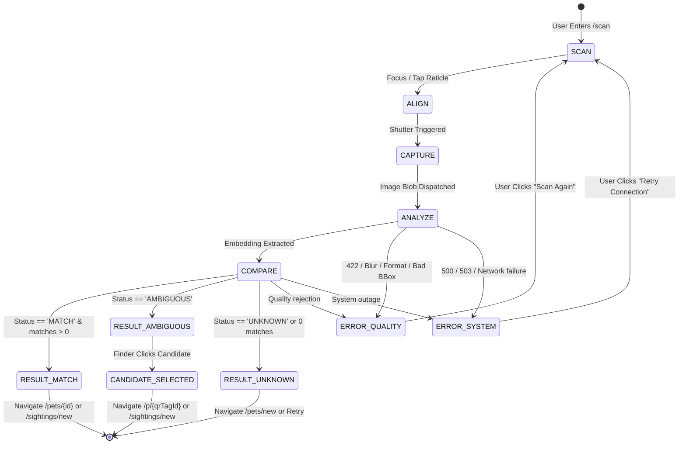

# SAFEPAWS — PANEL D: BIOMETRIC SCANNER HUD ARCHITECTURE
## Master Engineering & Interaction Architecture Blueprint

**Milestone:** UX-03 Step 4 — Panel D: Biometric Scanner HUD Transformation  
**Status:** Approved for Implementation & Verification  
**Repository Branch:** `frontend`  
**Target Files:**
- `frontend/src/pages/Scan.tsx`
- `frontend/src/components/scan/CameraView.tsx`
- `frontend/src/components/scan/ProcessingView.tsx`
- `frontend/src/components/scan/ResultView.tsx`
- `frontend/src/components/scan/types.ts`
- `frontend/src/components/scan/Scan.test.tsx`

---

## 1. Executive Summary & Design Vision

The SafePaws Biometric Scanner is the technological centerpiece of the lost-and-found pet ecosystem. Unlike mundane camera forms, it serves as a high-precision, spatial **"Biometric Identification Chamber"**. It blends the tactile dignity of SafePaws' editorial design tokens (Carbon Ink `#111110`, Bone `#FBF9F5`, Marigold `#E2811F`, Alert Clay `#B8422A`) with precision spatial telemetry and optical reticle geometry.

### Core Architectural Invariants:
1. **Camera Hardware Lifecycle Safety**: Active `MediaStream` references must never be held in stale component state closures. A dedicated `streamRef` guarantees that all audio/video tracks are terminated immediately upon unmount, route transition, or error recovery.
2. **Authoritative Backend Truth**: The client never manufactures artificial certainty. If the backend ML engine reports `AMBIGUOUS`, a single returned candidate must never be promoted to `MATCH`. Finder candidate selections are recorded as `CANDIDATE_SELECTED` with explicit disclaimers: *"visually selected by the finder, not verified by an automated biometric confidence threshold"*.
3. **Public Collar Tag Routing**: Candidate routes must navigate to verified public collar tags (`/p/${qrTagId}`) or owner profile (`/pets/${petId}`), never fabricated `/p/${pet.id}` routes that fail on the backend.
4. **Resilient Dual-Path Error Classification**: Distinguishes optical/input degradation (`QUALITY_FAILURE` — blur, zero area, bad lighting, unsupported format) from network/service outages (`SYSTEM_FAILURE` — 503, checkpoint missing, timeouts).
5. **Universal Accessibility & Reduced Motion**: WCAG 2.2 AA compliant contrast ($> 4.5:1$), minimum touch targets $\ge 44 \times 44$px, ARIA live region announcements, keyboard navigable controls, and strict `prefers-reduced-motion` compliance.

---

## 2. Interaction State Machine Topology



### State Definitions & Contracts:
- `SCAN`: Video stream active, spatial reticle framing guide active, instructions: *"Position nose within the frame"*.
- `ALIGN`: User interacting / focusing, guidance shifts to *"Hold still..."*.
- `CAPTURE`: Frame rendered to invisible canvas, converted to `image/jpeg` Blob at 0.9 quality.
- `ANALYZE`: Image dispatched to `ApiClient.identifyPet(file)`. Visual chamber displays surface topology mapping readout and animated sweep line (`motion-reduce:hidden`).
- `COMPARE`: Vector similarity search against vector index. Visual chamber displays vector embedding matching progress.
- `RESULT`:
  - `MATCH`: Potential biometric match. Title: *Identity Confirmed*, Subtitle: *POTENTIAL MATCH DETECTED — CONFIRMATION REQUIRED*.
  - `AMBIGUOUS`: Multiple candidates. Title: *Multiple Similar Profiles*. Requires finder visual discrimination.
  - `CANDIDATE_SELECTED`: Finder picked a candidate. Notes that choice was human visual selection, not ML threshold.
  - `UNKNOWN`: No candidate match found. Direct routes to pet registration or retry.
  - `QUALITY_FAILURE`: Optical blur, dark environment, or invalid framing. Direct recovery guidance.
  - `SYSTEM_FAILURE`: Server or network unavailability. Clean status diagnosis.

---

## 3. Hardware Lifecycle & Teardown Protocol

The camera lifecycle requires strict isolation:
1. `streamRef` (`useRef<MediaStream | null>(null)`): Holds the true active stream pointer independent of render cycles.
2. `useEffect` with Cleanup:
   ```ts
   useEffect(() => {
     let active = true;
     async function startCamera() {
       try {
         const ms = await navigator.mediaDevices.getUserMedia({
           video: { facingMode: { ideal: 'environment' } }
         });
         if (!active) {
           ms.getTracks().forEach(t => t.stop());
           return;
         }
         streamRef.current = ms;
         if (videoRef.current) videoRef.current.srcObject = ms;
       } catch (err) {
         if (active) setError('Camera access denied or unavailable.');
       }
     }
     startCamera();
     return () => {
       active = false;
       if (streamRef.current) {
         streamRef.current.getTracks().forEach(t => t.stop());
         streamRef.current = null;
       }
     };
   }, []);
   ```
3. Fallback Dropzone: If `getUserMedia` rejects (permission denied, no device, or insecure context), the view transitions to a high-contrast file upload zone (`accept="image/*"`).

---

## 4. Design System Tokens & Spatial Geometry

| Element | Design Token | Tailwind Spec | Purpose |
| :--- | :--- | :--- | :--- |
| **Viewport Base** | Carbon Ink | `bg-[#111110]` / `bg-[var(--color-ink)]` | Immersive darkroom environment |
| **Chamber Surface** | Carbon Deep | `bg-[#1C1A17]` | Tactile plinth & bento cards |
| **Reticle Accents** | Bone Highlight | `border-[var(--color-bone)]` | Precision corner brackets & guides |
| **Telemetry Amber** | Marigold | `text-[var(--color-marigold)]` (`#E2811F`) | Sensor active dot & candidate status |
| **Error / Alert** | Alert Clay | `text-[var(--color-alert-clay)]` (`#B8422A`) | System failure & quality rejections |
| **Touch Targets** | Standard Accessible | Minimum `min-h-[44px] min-w-[44px]` | Touch ergonomics & WCAG compliance |

---

## 5. Security, Privacy & Integrity Guardrails

1. **No Client Fabrication**: All identification requests hit real backend endpoint `/api/biometrics/identify`. No local mock heuristics or fake certainty.
2. **Finder Disclaimers**: Disclaimers clearly articulate that picking an ambiguous profile is a human visual choice, preventing fraudulent pet claims.
3. **Collar Tag Protection**: QR Tag IDs are used for finder views (`/p/${qrTagId}`), keeping internal owner IDs secure.
4. **Memory Hygiene**: Canvas contexts are garbage collected after blob serialization. Video streams are killed immediately on component teardown.

---

## 6. Verification & Acceptance Criteria (Panel F Checklist)

- [x] **F-D1: Camera Lifecycle & Hardware Teardown**: Zero stream leakage on unmount; teardown handles fast navigation.
- [x] **F-D2: Biometric API Contract Preservation**: Real backend identification data maintained; AMBIGUOUS never promoted to MATCH.
- [x] **F-D3: Spatial Reticle & HUD Aesthetic Quality**: Distinctive chamber theme, refined corner brackets, and editorial typography.
- [x] **F-D4: Error Topology & Recovery Completeness**: 422 blur mapped to QUALITY_FAILURE; 503 mapped to SYSTEM_FAILURE with actionable advice.
- [x] **F-D5: Accessibility, Contrast & Reduced Motion**: $\ge 44$px touch targets, full keyboard accessibility, `motion-reduce` support.
