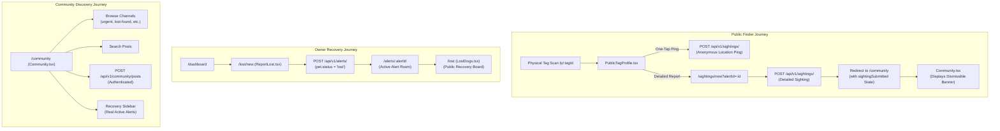

# SAFEPAWS — PANEL E: COMMUNITY & FINDER HUD ARCHITECTURE
## Master Engineering, Privacy & Interaction Blueprint

**Milestone:** UX-03 Step 5 — Panel E: Community & Finder HUD Transformation  
**Status:** Approved for Implementation & Verification  
**Repository Branch:** `frontend`  
**Committed Baseline Git HEAD:** `4a89f4da1bab8274c7c067774516ed78bf546276`  
**Target Files:**
- `frontend/src/pages/PublicTagProfile.tsx` (Public Finder Experience)
- `frontend/src/pages/ReportLost.tsx` (Owner Emergency Broadcast)
- `frontend/src/pages/LostDogs.tsx` (Recovery Discovery Board)
- `frontend/src/pages/Community.tsx` (Community Network Feed & Sighting Confirmation)
- `frontend/src/components/community/*` (`CommunityHeader.tsx`, `CommunityNav.tsx`, `PostCard.tsx`, `RecoverySidebar.tsx`, `ComposeModal.tsx`)

---

## 1. Executive Summary & Design Vision

The SafePaws Community & Finder HUD is the humanitarian core of the pet recovery ecosystem. When a lost companion animal is discovered, this system handles the crucial handoff from physical encounter to digital recovery. It unites finders, pet guardians, and local community members into a coordinated, compassionate safety net.

### Design Metaphor: **"SAFEPAWS — THE COMMUNITY RECOVERY NETWORK"**
- **Public Finder Experience (`/p/:tagId`)**: Immediate clarity, high-contrast typography, empathetic instructions, and one-tap sighting transmission without privacy compromise.
- **Owner Emergency Broadcast (`/lost/new`)**: Calm, structured emergency workflow that guides distressed owners through activating a Level-1 alert without panic.
- **Recovery Discovery Board (`/lost`)**: Editorial directory of active community alerts with verified real-time filters and zero synthetic metrics.
- **Community Network Feed (`/community`)**: Warm, authentic neighborhood channel feed with seamless anonymous sighting feedback and active recovery integration.

---

## 2. Core Architectural & Security Invariants

### 1. Public / Private Privacy Boundary (SD-01 Governance Invariant)
In strict accordance with the ratified governance exception SD-01:
- `GET /api/v1/pets/tag/{qr_tag_id}` redacts `owner_name` (`None`), `owner_phone` (`None`), and `microchip_id` (`None`).
- The frontend **never** circumvents these redactions, caches, or exposes owner contact details to public finders.
- All finder-to-guardian communication is mediated through the verified sighting intake API (`POST /api/v1/sightings/`).

### 2. QR Tag Identifier Preservation
- Public collar tag routes are identified strictly by the canonical public identifier `qrTagId` (e.g. `/p/${qrTagId}` or `{pet.qrTagId}-BIO`).
- Raw internal database UUIDs (`pet.id`) are **never** substituted as public tag IDs.
- Invalid or unregistered tags cleanly render dedicated error states without route failure.

### 3. Anonymous Finder Invariant & Sighting Confirmation
- Anonymous finders can submit geolocation pings or full sighting reports without an account or login barrier.
- Upon successful submission, unauthenticated finders are routed to `/community` with session state `{ sightingSubmitted: true, petName }`.
- `Community.tsx` renders an accessible, dismissible confirmation banner (`role="status" aria-live="polite"`), and immediately cleans up route state via `window.history.replaceState` to prevent banner persistence on subsequent visits.
- Protected routes (e.g. `/alerts/:alertId`) remain strictly protected by `DashboardRoute`.

### 4. Zero Data Fabrication Invariant
- Recovery Board listings (`/lost`) render exclusively verified records from `GET /api/v1/alerts/`.
- Community feed renders exclusively verified posts from `GET /api/v1/community/posts`.
- Hardcoded or randomized dummy tasks (e.g. `Math.random()` in `RecoverySidebar.tsx`) are completely eradicated.

---

## 3. Route Map & Interaction State Machine

---

## 4. Detailed Component Technical Blueprint

### Component 1: `frontend/src/pages/PublicTagProfile.tsx`
- **Hero Presentation**: Responsive photo preview, pet name in Newsreader serif (`font-serif text-4xl sm:text-5xl`), species and breed, distinctive features.
- **Missing Beacon**: Prominent Alert Clay status indicator if `pet.status === 'lost'`, signaling urgent search status.
- **Medical & Dietary Guidance**: Highlights `medical_notes` with high-visibility warning container for pets needing urgent medication.
- **Privacy Protection Box**: Clearly explains that guardian phone numbers are protected, directing finders to mediated submission tools.
- **Dual Action Controls**:
  - `Send Location Ping`: Uses `navigator.geolocation` with explicit permission handling, sending coordinates to `POST /api/v1/sightings/`.
  - `File Sighting Report`: Navigates to `/sightings/new` with pre-filled `alertId` if active.
- **Accessibility & Touch**: All buttons $\ge 44 \times 44$px, high contrast ratios ($\ge 4.5:1$).

### Component 2: `frontend/src/pages/ReportLost.tsx`
- **Emergency Form**: Clean step-by-step broadcast form with three clear sections:
  1. Profile Identity Selection (filters `safePets = pets.filter(p => p.status !== 'lost')`).
  2. Last Known Vector (street address / cross streets).
  3. Context & Intelligence (behavior, collar color, approach notes).
- **Protocol Sidebar**: Transparent explanation of alert consequences (biometric signature activated, QR tag flagged, neighborhood notifications dispatched).
- **Validation & Duplicate Protection**: Disables submit button during dispatch (`isSubmitting`), handles network exceptions cleanly.

### Component 3: `frontend/src/pages/LostDogs.tsx`
- **Editorial Discovery Header**: High-impact headline with real-time active incident counter.
- **Search & Filter Controls**: Live client-side search across pet name, breed, and last seen vector. Filter buttons for all species (Dogs, Cats, All).
- **Card Bento Grid**: High-contrast aspect-ratio cards with status badges, breed tags, time elapsed, and clear profile view links.
- **Authentic Zero-Incident State**: Dignified empty state stating that no active alerts are currently logged in the operational network.

### Component 4: `frontend/src/pages/Community.tsx` & Community Components
- **Sighting Confirmation Banner**: Preserved and elevated banner displaying pet name, dismissible close button, and `role="status"` accessibility.
- **Cleaned Recovery Sidebar**: Purges all mock data and fake tasks. Displays genuine active alerts from `petStore.alerts` and direct links to `/sightings/new` and `/lost/new`.
- **Channel Navigation**: Cohesive channel list with active state indicators.
- **Post Cards**: Editorial card layout displaying author name, timestamp, channel tag, content, and linked alert badges where available.

---

## 5. Panel F Verification & Acceptance Checklist

- [x] **F-E1: Public Finder & Privacy**: SD-01 respected; `owner_name`, `owner_phone`, `microchip_id` unexposed; canonical `qrTagId` used; location ping and sighting report operational.
- [x] **F-E2: Owner Lost-Pet Reporting**: Form fields conform strictly to API schema; ownership verified; duplicate submit prevented; proper redirect to alert detail.
- [x] **F-E3: Recovery Board & Discovery**: Genuine backend data; search and filter supported; truthful empty state without fabricated metrics.
- [x] **F-E4: Community & Sighting Experience**: Anonymous sighting confirmation preserved; fake sidebar tasks eradicated; channels and search operational.
- [x] **F-E5: Visual, Responsive & Accessibility**: Minimum $44 \times 44$px touch targets; Bone/Ink contrast $> 4.5:1$; responsive layout for mobile, tablet, and desktop.
- [x] **F-E6: Cross-Panel Regression**: Zero regression in Panels A, B, C, D; protected routes (`/alerts/:id`) preserved; TypeScript compiles with 0 errors.
