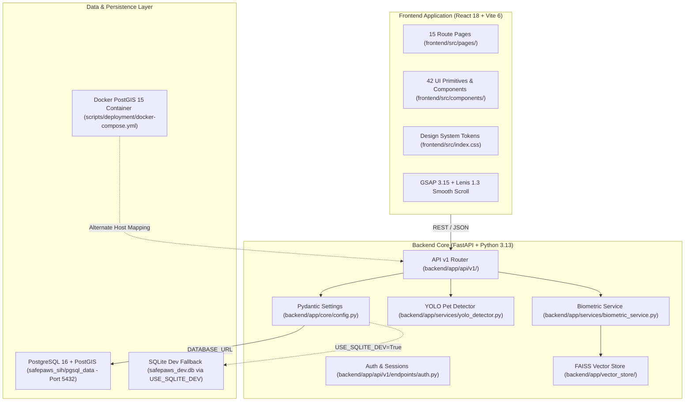

# SafePaws Project Architecture Guide

**Document Status:** Verified Repository Baseline  
**Branch:** `frontend`  
**HEAD:** `57e63848ed48c275a97d180e4d094f3077ff00df`  
**Last Updated:** November 21, 2026  

---

## 1. System Overview & Technology Stack

SafePaws is a biometric pet recovery and community alert platform combining computer vision (YOLO pet detection and biometric facial embedding extraction) with vector similarity search (FAISS), geospatial mapping (PostGIS), and a responsive React frontend interface.

---

## 2. Directory Structure & Domain Ownership

| Directory Path | Domain Ownership | Primary Technologies | Description & Key Responsibilities |
| :--- | :--- | :--- | :--- |
| **`frontend/`** | Frontend Application | React 18, TypeScript, Vite 6, Tailwind CSS v4, GSAP 3.15, Lenis 1.3 | Single-page application containing all user-facing views, scanning interfaces, community posts, and tag management. |
| **`frontend/src/pages/`** | View Routes (15 Pages) | React Router v6 | Page containers: `LandingPage.tsx`, `Dashboard.tsx`, `Scan.tsx`, `Community.tsx`, `ReportLost.tsx`, `ReportSighting.tsx`, `PublicTagProfile.tsx`, `pets/NewPet.tsx`, `pets/PetDetail.tsx`, etc. |
| **`frontend/src/components/`** | UI Primitives (42 Components) | React, Lucide Icons, GSAP Context | Modular UI elements: `Hero.tsx`, `CustomCursor.tsx`, `DashboardNav.tsx`, `FeaturesSection.tsx`, `HowItWorksSection.tsx`, `TrustSection.tsx`, `CtaSection.tsx`, etc. |
| **`frontend/src/index.css`** | Design System Tokens | Tailwind CSS v4 `@theme` | Semantic color palette (`--color-ink`, `--color-bone`, `--color-marigold`, `--color-trail`, `--color-alert-clay`), typography roles, and base resets. |
| **`backend/`** | Application API & Services | FastAPI, Pydantic v2, SQLAlchemy 2, Alembic | Core REST API backend providing authentication, pet registration, alert lifecycle, and sighting processing. |
| **`backend/app/api/v1/`** | REST Endpoints | FastAPI APIRouter | Endpoints: `auth.py`, `pets.py`, `alerts.py`, `sightings.py`, `community.py`, `search.py`, `users.py`, `health.py`. |
| **`backend/app/db/`** | Database Models & Engine | SQLAlchemy ORM, GeoAlchemy2 | Data models: `models.py` (Users, Pets, Sightings, Alerts, CommunityPosts), async session factory: `session.py`. |
| **`backend/app/services/`** | ML & Domain Services | PyTorch, Ultralytics, FAISS | `biometric_service.py` (facial embeddings), `yolo_detector.py` (pet bounding boxes), `quality_gate.py` (image resolution/blur verification). |
| **`backend/alembic/`** | Database Migrations | Alembic | Schema version migrations: `initial_schema.py`, `add_alerts_table.py`, `add_community_models.py`, `add_location_to_sightings.py`. |
| **`scripts/`** | Utilities & Deployment | Bash, PowerShell, Docker Compose | Deployment templates (`deployment/docker-compose.yml`), database setup scripts (`database/`), and integration tests (`tests/`). |
| **`docs/`** | Architecture & Governance | Markdown | Product direction blueprints, transformation tracking, development guides, and pip dependency manifests. |
| **`pgsql_data/`** | Active PostgreSQL Cluster | PostgreSQL 16 Cluster | Live data directory on Windows host (OID `16384`, 365 files, 18.08 MB) containing PostGIS geometry tables and seed data. |

---

## 3. Environment Architecture & Cross-Platform Considerations

### Supported Development Environments
1. **Windows Host (Primary Recommended Development Target):**
   - Node.js + npm natively executes Vite dev server using the installed Windows Rollup binary (`@rollup/rollup-win32-x64-msvc`).
   - Python 3.13 natively executes backend services using the pinned dependency manifest [docs/requirements-windows-venv-manifest.txt](requirements-windows-venv-manifest.txt).
   - Local PostgreSQL 16 cluster runs directly against `pgsql_data/` via `pgsql_bin`.
2. **Linux Container / CI Environment (Headless & Testing Target):**
   - Playwright automated browser testing is verified operational using system Google Chrome (`/usr/bin/google-chrome-stable`, v134) with zero external downloads.
   - **Known Rollup Compatibility Limitation:** `frontend/node_modules/` was installed on Windows and lacks `@rollup/rollup-linux-x64-gnu`. Running `vite` directly within this Linux container produces a missing module error. Running the Vite server requires either using the Windows host, running inside Docker with native Linux dependencies, or running an authorized `npm rebuild` when dependency lock rules permit.
   - Backend development is fully supported in SQLite dev mode (`USE_SQLITE_DEV=True`) or via Dockerized PostgreSQL.

---

## 4. PostgreSQL & Docker Port Architecture

- **Active Windows Cluster:** Local PostgreSQL 16 cluster in `pgsql_data/` bound to `pgsql_bin/pgsql/bin/postgres.exe` defaults to port `5432`.
- **Docker Compose Service:** [scripts/deployment/docker-compose.yml](file:///home/samudra/Projects/VisualSCode/VisualCode/Vscoding/Projects/SAFEPAWS/safepaws_sih/scripts/deployment/docker-compose.yml) publishes PostGIS 15 on port `5432:5432`.
- **Potential Configuration Conflict:** If a local PostgreSQL instance is running on port 5432 on the host, attempting to launch Docker Compose without remapping ports will result in a port binding conflict.
- **Port 5433 Migration Architecture:** When containerized execution is desired, Docker Compose should be mapped to `"5433:5432"`, `backend/.env` updated to point to port `5433`, and standalone test scripts refactored to read `settings.DATABASE_URL`.

---

## 5. Git Governance & Safety Invariants

- **Auto-Commit Protection:** [scripts/sync_and_merge.ps1](file:///home/samudra/Projects/VisualSCode/VisualCode/Vscoding/Projects/SAFEPAWS/safepaws_sih/scripts/sync_and_merge.ps1#L12) contains an active `break` safeguard at line 12 inside `if ($status)`, completely preventing automated broad staging (`git add .`), committing, rebasing, or pushing.
- **Git Hooks:** Both `.git/hooks/pre-commit` and `.git/hooks/pre-push` actively output `exit 1` to prevent unauthorized automated commits or pushes.
- **VS Code Configuration:** `.vscode/settings.json` enforces `"git.enableSmartCommit": false` to prevent accidental auto-staging of untracked or modified files.
