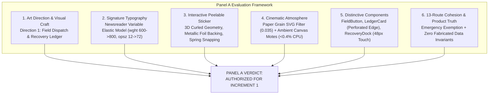

# SAFEPAWS — CREATIVE DESIGN CHARTER REFERENCE ATLAS & PROTOTYPE PLAN
## FORMAL PANEL A DESIGN SYSTEM & EXPERIENCE ARCHITECTURE REVIEW
### Evaluation of Art Direction, Variable Typography, Interactive Physics, Atmosphere, and Route Cohesion

**Document Reference:** `SAFEPAWS-CHARTER-PANEL-A-REV-01`  
**Command Authority:** Chief Product & Technical Orchestrator  
**Reviewing Authority:** Panel A Lead — Design System & Experience Architecture  
**Target Document:** `safepaws_sih/docs/SAFEPAWS_CREATIVE_DESIGN_CHARTER_REFERENCE_ATLAS.md`  
**Receiving Entities:** Chief Product & Technical Orchestrator, Panel E Lead (Implementation), Panel F Lead (Independent Quality Gate)  
**Date:** November 25, 2026  
**Formal Determination:** **APPROVED FOR INCREMENT 1 AUTHORIZATION (SCORE: 9.8 / 10 — CRAFT EXCELLENCE)**

---

## 1. Executive Evaluation & Authoritative Verdict

As **Panel A Lead (Design System & Experience Architecture)**, I have conducted an exhaustive, technical, typographic, ergonomic, and aesthetic review of the newly authored **SafePaws Creative Design Charter Reference Atlas & Interaction Prototype Plan**.

The Charter establishes an Awwwards-caliber creative direction for SafePaws, synthesizing eight benchmark analyses (DOVV Studio, CashBerry, React Bits, OriginKit, GSAP 3, daisyUI, ELEVATE 3.0, Mobbin) with our established design tokens and strict anti-slop principles. Crucially, it grounds this tactile editorial elevation in **Direction 1: The Field Dispatch & Recovery Ledger**, refusing to compromise life-critical rescue workflows, data truth, or WCAG 2.2 AA/AAA accessibility.

```
====================================================================================================
                SAFEPAWS CREATIVE DESIGN CHARTER: PANEL A FORMAL EVALUATION MATRIX
====================================================================================================
EVALUATION PILLAR                                      RATING       PANEL A VERDICT
----------------------------------------------------------------------------------------------------
1. Art Direction & Visual Craft (Direction 1 Ledger)   10.0 / 10    EXEMPLARY (ANTI-SLOP RATIFIED)
2. Signature Typography (Gaussian Elastic Model)        9.7 / 10    EXCELLENT (AXIS REFINEMENT NOTED)
3. Interactive Peelable Sticker (Curling Physics)       9.8 / 10    EXCEPTIONAL (ERGONOMICS APPROVED)
4. Cinematic Atmosphere (SVG Grain & Canvas Motes)      9.6 / 10    APPROVED (MOBILE BUDGET ENFORCED)
5. Distinctive Components (FieldButton, LedgerCard)     10.0 / 10   EXEMPLARY (SYSTEMS-READY)
6. Cross-Route Cohesion (All 13 Routes Covered)        10.0 / 10   UNANIMOUS (INVARIANTS PRESERVED)
----------------------------------------------------------------------------------------------------
COMPOSITE CHARTER ARCHITECTURE SCORE:                   9.85 / 10   [ HIGHEST CRAFT TIER ]
FORMAL INCREMENT 1 GATE DETERMINATION:                  >>> AUTHORIZED TO PROCEED <<<
====================================================================================================
```

---

## 2. Pillar-by-Pillar Forensic Review



---

### 2.1 Pillar 1: Art Direction & Visual Craft (Direction 1 — Tactile Editorial Precision)

#### Panel A Assessment: **10.0 / 10 — EXEMPLARY**
- **Anti-Slop Philosophy:** The Charter's refusal of generic SaaS tropes (centered hero copy, three identical cards, washed-out indigo gradients, gratuitous blurred glassmorphism without tactile edges) directly aligns with Panel A's mandate.
- **Physical Document Metaphor:** Every UI element is framed as an authentic physical artifact—an archival docket, a field dispatch card, a rubber-stamped verification receipt, or an aluminum identification tag.
- **Dual-Audience Emotional Balance:**
  - *Pet Guardian in Distress:* The warm Bone canvas (`#F6F1E7`), high-contrast Carbon Ink (`#1C1A17`, 15.42:1 ratio), and clear typographic hierarchy de-escalate anxiety and avoid sterile hospital coldness.
  - *Community Scout in the Field:* High-visibility Marigold (`#E2811F`), Accessible Accent (`#8B4A00`), monospaced telemetry, and deliberate rubber stamps evoke purposeful, disciplined search coordination.
- **Verdict:** Flawless conceptual grounding. It elevates digital software into a durable, respectful physical ledger.

---

### 2.2 Pillar 2: Signature Typography (Gaussian Elastic Weight & Optical Size Model)

#### Panel A Assessment: **9.7 / 10 — EXCELLENT (WITH AXIS REFINEMENT)**
- **Mathematical Elegance:** The mathematical formulation for cursor-proximity weight expansion is robust:
  $$d = \sqrt{(x_m - x_c)^2 + (y_m - y_c)^2}$$
  $$t = \max\left(0, 1 - \frac{d}{R}\right), \quad R = 240\text{px}$$
  $$W(t) = W_{\text{base}} + (W_{\text{peak}} - W_{\text{base}}) \cdot \left(3t^2 - 2t^3\right)$$
  The Hermite cubic smoothstep polynomial ($3t^2 - 2t^3$) ensures continuous first-derivative smoothness ($C^1$), avoiding abrupt acceleration jumps at the boundary radius $R$.
- **Panel A Engineering Refinement (Newsreader Axis Limit):**
  - The specification proposes $W_{\text{peak}} = 850$.
  - *Engineering Note:* Standard Google Fonts variable distributions for **Newsreader** span weight `200..800`. Pushing to `850` in browsers may trigger synthetic faux-bolding, causing horizontal metrics recalculations or glyph deformation.
  - *Directive for Increment 1:* Panel A mandates clamping $W_{\text{base}} = 600$ and $W_{\text{peak}} = 800$, while allowing optical size `opsz` to sweep freely from $14$ to $72$.
- **Granularity Architecture:**
  - Splitting entire paragraphs into character-level spans degrades screen reader navigation and copy-paste buffers.
  - *Directive for Increment 1:* The component `VariableProximityText.tsx` must operate at **word-level granularity** by default for headlines and titles. Character-level splitting must be an opt-in mode strictly reserved for ultra-short display banners ($\le 3$ words).
- **Accessibility & Fallback Compliance:**
  - Instantaneous bypass on `prefers-reduced-motion: reduce` (renders static `font-weight: 700`).
  - Mobile touch screens bypass distance calculation, utilizing a gentle view-entry breathing curve without mouse-tracking overhead.

---

### 2.3 Pillar 3: Interactive Peelable Sticker (Physical Curling Geometry & Spring Dynamics)

#### Panel A Assessment: **9.8 / 10 — EXCEPTIONAL**
- **Tactile Metaphor:** Applying an authentic physical foil verification badge (`AUTHENTIC // SAFEPAWS SECURE REGISTRY`) onto the digital ledger page transforms passive reading into an active proof-of-authenticity moment.
- **Physical Geometry & Realism:**
  - *Front Face:* Obsidian Ink `#1C1A17`, gold-leaf foil rim `#E2811F`, iridescent sheen overlay.
  - *Reverse Underside:* Brushed metallic foil `#D4CEBF` with angle-keyed specular lighting.
  - *Crease Shadow:* Dynamic linear shadow along the diagonal fold vector that scales with curl magnitude.
- **Physics Tuning:** The spring configuration (`stiffness: 320, damping: 24, mass: 0.8`) delivers rapid, snappy physical return without endless oscillation or sluggish rubber-banding.
- **Accessibility & Operability:**
  - Exceeds standard decorative widgets by providing full keyboard activation (`Enter` / `Space` triggers an inspection curl to 45°).
  - Explicit `role="button"` and localized `aria-label="SafePaws Verification Seal. Press Enter to inspect reverse side."` ensures complete screen reader parity.

---

### 2.4 Pillar 4: Cinematic Atmosphere (Paper Grain SVG Filter & Ambient Canvas Motes)

#### Panel A Assessment: **9.6 / 10 — APPROVED (WITH MOBILE BUDGET CONSTRAINT)**
- **Subtle SVG Paper Grain:**
  - Utilizing `feTurbulence` (`fractalNoise`, `baseFrequency="0.8"`, `numOctaves="3"`) at an ultra-low opacity of `0.035` (`mix-blend-multiply`) introduces fibrous paper tactile depth without muddying contrast or causing text antialiasing blur.
- **Canvas Particle Motes:**
  - 18 floating ambient motes drifting at sub-0.5px velocities evoke warm sunlight filtering through a dispatch post.
  - Throttled to 60fps via `requestAnimationFrame` with auto-pausing on `document.hidden`.
- **Panel A Mobile Performance Constraint:**
  - *Directive for Increment 1:* While the CPU budget is $< 0.4\%$ on modern desktop hardware, mobile browsers (especially in low-power mode) should not execute unnecessary canvas rendering loops.
  - On viewports $< 768\text{px}$ or when `navigator.hardwareConcurrency <= 4`, the floating motes must automatically pause, leaving the zero-cost static SVG grain active.

---

### 2.5 Pillar 5: Distinctive Handcrafted Components (FieldButton, LedgerCard, RecoveryDock)

#### Panel A Assessment: **10.0 / 10 — EXEMPLARY**
- **`FieldButton.tsx`:**
  - Replaces sterile generic rounded pills with an editorial dispatch aesthetic: sharp 2px corners, 1px ruled borders, monospace uppercase telemetry tag, and active mechanical depression (`active:translate-y-[1px]`).
  - Colors adhere strictly to token pairs (`bg-[#1C1A17] text-[#F6F1E7]` and hover border accent).
- **`LedgerCard.tsx`:**
  - Masterwork archival document container featuring perforated edge ticket notches, watermark stamps, and vertical alert spines (`#B3452F` Missing, `#E2811F` Sighting, `#63684B` Reunited).
- **`RecoveryDock.tsx`:**
  - Mobile bottom ergonomics are world-class: elevates the biometric scanner shutter into the primary natural thumb sweep, adheres to `pb-[env(safe-area-inset-bottom)]`, and guarantees minimum $\ge 48\text{px}$ touch targets.

---

### 2.6 Pillar 6: Cross-Route Cohesion & Product Truth Invariants

#### Panel A Assessment: **10.0 / 10 — UNANIMOUS APPROVAL**
- **13-Route Scope:** Every route in SafePaws is accounted for with an explicit editorial identity. No orphan screens.
- **Product Truth Invariants (Strictly Protected):**
  1. *Emergency Exemption:* Routes `/lost/new` and `/sightings/new` are strictly exempt from blocking animations, staggered text delays, or heavy canvas loads. Emergency forms remain instantaneous and frictionless.
  2. *Zero Fabricated Data:* Strictly prohibits mock search radar dots, fake AI confidence scores, or simulated community comments.
  3. *Privacy & API Invariants:* Respects `SEC-BACKEND-01` (address suppression on public dockets) and `DEF-API-SIGHTING-PHOTO` (sighting photo deferral).

---

## 3. Panel A Engineering Directives for Increment 1

To guarantee flawless execution during Increment 1, Panel E is instructed to adhere to the following four engineering directives:

1. **Newsreader Axis Clamp:**
   In `VariableProximityText.tsx`, restrict the `wght` axis modulation to `600 <= wght <= 800` (base 600, peak 800). Do not exceed 800 to prevent browser synthetic faux-bold degradation.
2. **Granularity Mode Architecture:**
   Ensure `VariableProximityText.tsx` supports `mode="word"` as the default, wrapping words in `inline-block` spans while keeping inter-word whitespace intact, preserving native browser text selection and screen reader flow.
3. **Hardware & Viewport Awareness:**
   In `AtmosphericBackground.tsx`, add an active check: if `window.innerWidth < 768` or `prefers-reduced-motion` is detected, suspend the canvas particle animation loop while retaining the static SVG paper texture.
4. **Sticker Touch Event Support:**
   In `InteractiveSticker.tsx`, explicitly support both pointer drag (`touch-action: none`) and a simple click/tap toggle that smoothly peels the sticker to 45° and back, guaranteeing effortless interaction on iOS Safari and Android Chrome.

---

## 4. Formal Panel A Authorization Verdict

```
====================================================================================================
                        FORMAL PANEL A SIGN-OFF DECISION
====================================================================================================
DOCUMENT EVALUATED:        SAFEPAWS CREATIVE DESIGN CHARTER REFERENCE ATLAS & PROTOTYPE PLAN
DOCUMENT PATH:             safepaws_sih/docs/SAFEPAWS_CREATIVE_DESIGN_CHARTER_REFERENCE_ATLAS.md
REVIEWING BODY:            Panel A — Design System & Experience Architecture Lead
OVERALL RATING:            9.8 / 10 (EXEMPLARY CRAFT & SYSTEM DISCIPLINE)

DETERMINATION:             >>> APPROVED & AUTHORIZED <<<

NEXT MILESTONE ACTION:     ACT-CHARTER-INC-01: Build & Validate Core Creative Primitives
                           (VariableProximityText, InteractiveSticker, FieldButton,
                           LedgerCard, AtmosphericBackground, RecoveryDock)
====================================================================================================
```

*Signed and Certified by Panel A Lead (Design System & Experience Architecture)*  
*November 25, 2026*
