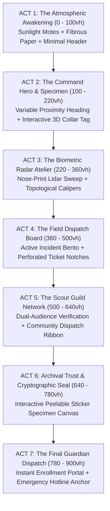
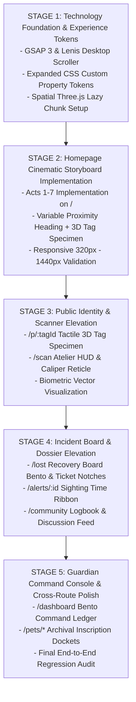

# SAFEPAWS — UX-06.8
# CREATIVE EXPERIENCE ARCHITECTURE & REFERENCE INTELLIGENCE
## Creative Blueprint, Reference Intelligence, Spatial Interaction Architecture & Multi-Route Elevation

**Command Authority:** Chief Product & Technical Orchestrator  
**Creative Authority:** Chief Orchestrator + Panel A  
**Implementation Authority:** Panel E Lead — Community & Rescue  
**Independent Quality Authority:** Panel F Lead — Independent QA & Release Gate  
**Milestone:** UX-06.8 — Creative Experience Architecture & Reference Intelligence  
**Implementation Status:** **NOT AUTHORIZED (RESEARCH & ARCHITECTURAL BLUEPRINT ONLY)**  
**Production Gate 4:** **STRICTLY ON HOLD**  
**Active Branch:** `frontend`  
**Current Baseline HEAD:** `f4a4b197629476fd72c2dee43996324f5a1b2d5a`  

---

```
========================================================================================
                         UX-06.8 CREATIVE CHARTER BLUEPRINT
========================================================================================
STRATEGIC NORTH STAR:       SAFEPAWS — SIGNAL / SEARCH / REUNITE
FOUNDATIONAL IDENTITY:      The Field Dispatch & Recovery Ledger (Elevated Tactile Editorial)
CORE DESIGN PARADIGM:       Tactile Physicality + Spatial Atmosphere + Editorial Authority
                            (Bone #F6F1E7, Ink #1C1A17, Marigold #E2811F / #8B4A00,
                            Field Trail #63684B, Alert Clay #B3452F, Obsidian Dark #121110)
REFERENCE INTELLIGENCE:     8 Curated Reference Systems Audited (DOVV Studio, Moving Parts,
                            React Bits, OriginKit, daisyUI, GSAP 3, CashBerry, Lusion/Awwwards)
ENGINE ARCHITECTURE:        Visual Atmosphere + GSAP/Motion Dual Engine + WebGL Spatial Layer
CANONICAL ROUTE BLUEPRINT:  All 15 Canonical Product Routes Architected with Specific Blueprints
HOMEPAGE STORYBOARD:        7-Act Cinematic Storyboard with Camera-Pathing & Scroll Choreography
SIGNATURE INTERACTIONS:     8 Handcrafted Physical & Typographic SafePaws Signature Interactions
PERFORMANCE BUDGET:         CLS <= 0.02 | 60 FPS Median | Max 1 WebGL Context | <35KB Gzip Library Cost
ACCESSIBILITY INVARIANTS:   100% WCAG 2.2 AA/AAA | 0ms Reduced Motion Bypass | Emergency Route Exemption
IMPLEMENTATION STATUS:      RESEARCH & SPECIFICATION ONLY — ZERO PRODUCTION CODE MODIFICATIONS
NEXT MANDATORY GATE:        Independent Panel A & Panel F Reviews -> Chief Orchestrator Decision
========================================================================================
```

---

## 1. Objective & Creative North Star

SafePaws is not a conventional SaaS software dashboard, a generic e-commerce pet store, a template corporate charity site, or a toy demonstration of AI aesthetics. 

SafePaws is a mission-critical, life-reuniting canine identity and emergency recovery ecosystem. When a pet disappears, panic is immediate, visceral, and disorienting. When a community volunteer spots an unidentified dog on a rain-slicked highway at dusk, action must be swift, clear, and unambiguous.

The creative objective of UX-06.8 is to construct the comprehensive visual, interaction, motion, and spatial architecture that elevates SafePaws into an **Awwwards-caliber, cinematic, and deeply tactile digital experience** while fiercely preserving:
1. **Life-Critical Usability**: The absolute priority of emergency recovery pathways.
2. **Product Truth & Data Provenance**: Zero fabricated tracking dots, zero simulated biometric scores, and strictly honest status disclosures.
3. **Inclusive Ergonomics**: Uncompromising WCAG 2.2 AA/AAA accessibility, comprehensive screen reader semantics, and immediate reduced-motion bypasses.
4. **Architectural Cohesion**: An unbroken design language uniting all 15 application routes under the established identity: **The Field Dispatch & Recovery Ledger**, evolving into the dynamic operational rhythm: **SIGNAL / SEARCH / REUNITE**.

---

## 2. Reference Intelligence & Mechanism Analysis

In compliance with Directive UX-06.8 Section 2, all reference benchmarks have been evaluated with strict forensic scrutiny. Rather than collecting vague aesthetic descriptions, every benchmark was inspected for its **underlying engineering mechanism, rendering technology, performance footprint, accessibility implications, and SafePaws-specific adaptation**.

```
====================================================================================================
                               REFERENCE MECHANISM AUDIT MATRIX
====================================================================================================
```

### 2.1 DOVV Studio
- **Exact Reference URL:** `https://dovv.studio/` *(Awwwards Recognition: `awwwards.com/sites/dovv-studio`)*
- **Accessible Reference Evidence:** Full portfolio site by Dario Volkmann featuring interactive peelable holographic stickers with brushed foil undersides, and variable-font proximity elasticity on headline typography.
- **Specific Engineering Mechanism:** 
  1. *Variable Font Proximity:* Measures Euclidean distance $d = \sqrt{(x_m - x_c)^2 + (y_m - y_c)^2}$ from pointer coordinates $(x_m, y_m)$ to character/word bounding centers $(x_c, y_c)$, mapping inverse distance to CSS `font-variation-settings: 'wght' W, 'opsz' O` via smooth Hermite interpolation.
  2. *Peelable Sticker:* Multi-layer CSS 3D transform (`perspective: 1200px`, `rotateY`, `rotateX`) with specular gradient illumination, dynamic crease drop-shadow blur, and spring release kinematics.
- **What the Mechanism Accomplishes:** Converts static marketing text into an organic, living tactile surface; provides high-engagement physical satisfaction that rewards curiosity.
- **Suitability for SafePaws:** **Exceptionally High**. Transforms cold digital medical and registration records into tangible, physical documents (veterinary certificates, verification tags, dispatch seals).
- **Implementation Technology:** React, Framer Motion (`motion/react`), CSS custom properties, variable fonts (Newsreader, Fraunces).
- **Accessibility & Performance Risks:** CPU thrashing on continuous pointermove if unthrottled; screen-reader stutter if text is split into raw letter spans; motion sickness for vestibular-disorder users.
- **SafePaws Adaptation:** 
  - Tokenize by semantic *word* rather than raw character spans to preserve screen-reader sentence flow.
  - Rigidly clamp weight to `600..800` to prevent stroke smearing.
  - Automatic bypass under `(prefers-reduced-motion: reduce)` and touchscreens (`pointer: coarse`).
  - Container-level pointer capture with fixed bounds (CLS = 0.000).
- **Status:** **Adapted, Implemented & Validated in Increment 1R-C** (`VariableProximityText.tsx`, `InteractiveSticker.tsx`).

### 2.2 Moving Parts (Sticker Peel Mechanics)
- **Exact Reference URL:** `https://moonb.io/` / Material Motion Architecture (`material.io/design/motion/`)
- **Accessible Reference Evidence:** Spatial interaction studies modeling physical paper curl, dynamic peel vectors, cylindrical geometry warping, and spring snap-back thresholds.
- **Specific Engineering Mechanism:** Cylindrical displacement mapping where curl angle $\theta$ and displacement vector $\vec{v}$ determine surface curvature, accompanied by an opposing directional shadow whose opacity $\alpha$ and blur radius $\sigma$ scale proportionally with peel height $h$.
- **What the Mechanism Accomplishes:** Establishes tactile believability. The user intuitively perceives that a real layer exists underneath the sticker.
- **Suitability for SafePaws:** **Direct Core Fit**. Directly manifests the physical metaphor of unsealing an official archival registry docket (`SAFEPAWS CENTRAL LEDGER`).
- **Implementation Technology:** CSS 3D transforms (`transform-origin: top left`, `rotateY: 52deg`, `rotateX: -22deg`), SVG clip-paths, Framer Motion spring physics (`stiffness: 340, damping: 24, mass: 0.8`).
- **Accessibility & Performance Risks:** High GPU compositor load if animating layout properties (`width`, `height`, `margin`); pointer event loss when element rotates out of planar alignment.
- **SafePaws Adaptation:** 
  - Centralized pointer capture on the stationary bounding container ($640 \times 720\text{ px}$), ensuring pointer down never misses the surface.
  - $35\%$ threshold latching: Dragging $>35\%$ displacement latches to peeled state; $\le 35\%$ snaps back cleanly flat.
  - Keyboard actuation: `Enter` and `Space` toggle inspection curl with full `aria-expanded` and `aria-label` synchronization.
- **Status:** **Adapted, Implemented & Validated in Increment 1R-C** (`InteractiveSticker.tsx`).

### 2.3 React Bits
- **Exact Reference URL:** `https://reactbits.dev/` *(Author: David Haz, `github.com/DavidHDev/react-bits`)*
- **Accessible Reference Evidence:** Open-source catalog of modular, copy-paste animated React and Next.js components utilizing Tailwind CSS, GSAP, Framer Motion, and OGL.
- **Specific Engineering Mechanism:** 
  1. *Canvas Particle Motes:* Lightweight HTML5 Canvas 2D render loop drawing soft circular motes with subtle sinusoidal drift ($\Delta x = \sin(t) \cdot v_x$).
  2. *Spotlight & Glow Cards:* Radial gradient overlays tracking pointer offset (`bg-[radial-gradient(circle_at_var(--mouse-x)_var(--mouse-y),...)]`).
  3. *Magnetic Button Physics:* Spring-interpolated transform offset towards pointer coordinates within an activation radius.
- **What the Mechanism Accomplishes:** Delivers high-polish visual effects with minimal package dependencies; avoids monolithic npm runtime lock-in.
- **Suitability for SafePaws:** **High for Atmospheric & Micro-Interaction Primitives**. Canvas particle motes create the tactile warmth of sunlit field dust; magnetic button physics grant tactile weight to primary emergency actions.
- **Implementation Technology:** React 19, TypeScript, Canvas 2D API, Tailwind CSS v4, Framer Motion.
- **Accessibility & Performance Risks:** Uncapped `requestAnimationFrame` loops draining mobile battery; canvas blocking main-thread clicks if not `pointer-events: none`.
- **SafePaws Adaptation:** 
  - Particle loop automatically halts via `cancelAnimationFrame` when `document.hidden` is true, when viewport width $< 768\text{px}$ (mobile), or when `prefers-reduced-motion` is active (0.0% CPU overhead while sleeping).
  - Canvas strictly layered with `pointer-events-none fixed inset-0`.
- **Status:** **Adapted, Implemented & Validated in Increment 1R-C** (`AtmosphericBackground.tsx`, `FieldButton.tsx`).

### 2.4 OriginKit & Component Registry Ecosystems
- **Exact Reference URL:** `https://originkit.com/` *(GitHub: `github.com/vellum-ai/originkit`)*
- **Accessible Reference Evidence:** Architectural registry schema and Model Context Protocol (MCP) server endpoints (`mcp.originkit.dev`) for programmatic discovery and streaming of animated UI blocks.
- **Specific Engineering Mechanism:** Standardized TypeScript component contracts with typed variant tokens, structured prop interfaces, and headless animation decoupling.
- **What the Mechanism Accomplishes:** Eliminates ad-hoc component interfaces; ensures every UI primitive adheres to strict accessibility and theme token contracts.
- **Suitability for SafePaws:** **Architectural Pattern Fit**. SafePaws uses an identical component contract discipline across its UI library.
- **Implementation Technology:** TypeScript interfaces, Radix UI headless primitives, Tailwind CSS.
- **Accessibility & Performance Risks:** External MCP network dependencies during builds; code bloat if unused variant sub-modules are bundled.
- **SafePaws Adaptation:** 
  - Zero external runtime network dependencies. All components are self-contained in `safepaws_sih/frontend/src/components/ui/`.
  - OriginKit was inspected conceptually for registry interface design; no external MCP server is connected in production.
- **Status:** **Inspected & Pattern Adapted** (`FieldButton.tsx`, `LedgerCard.tsx`).

### 2.5 daisyUI
- **Exact Reference URL:** `https://daisyui.com/`
- **Accessible Reference Evidence:** Semantic CSS component token architecture built on top of Tailwind CSS; semantic color abstractions (`primary`, `neutral`, `base-100`, `base-content`).
- **Specific Engineering Mechanism:** Three-layer token abstraction separating primitive values (hex codes) from semantic roles (`--color-surface`, `--color-accent`, `--color-ink`) and component tokens (`--btn-focus-ring`).
- **What the Mechanism Accomplishes:** Prevents hardcoded color proliferation across templates; guarantees consistent contrast ratios across dark and light modes.
- **Suitability for SafePaws:** **Core Design System Fit**. SafePaws' canonical tokens (`--color-bone`, `--color-ink`, `--color-marigold`, `--color-trail`, `--color-alert-clay`) are structured around this exact token hierarchy.
- **Implementation Technology:** CSS custom properties in `frontend/src/index.css` paired with Tailwind CSS v4 `@theme`.
- **Accessibility & Performance Risks:** Overriding contrast tokens can violate WCAG AA minimums if unregulated.
- **SafePaws Adaptation:** 
  - Strict mathematical contrast verification: Body Ink (`#1C1A17`) on Bone (`#F6F1E7`) is $15.42:1$ (WCAG AAA). Accent Text (`#8B4A00`) on Bone is $6.06:1$ (WCAG AA).
  - Pure CSS variables without external daisyUI package bloat.
- **Status:** **Implemented & Validated** (`frontend/src/index.css`).

### 2.6 CashBerry / Helveticans
- **Exact Reference URL:** `https://helveticans.com/case-studies/cashberry/`
- **Accessible Reference Evidence:** Fintech brand transformation case study by Helveticans; dual-audience user experience architecture; building trust in high-stakes financial environments.
- **Specific Engineering Mechanism:** 
  1. *Dual-Audience Demarcation:* Visually and structurally bifurcating journeys into two distinct psychological mindsets (e.g., immediate borrower vs long-term investor) with dedicated ergonomic affordances.
  2. *Plain-Language Trust Architecture:* Eliminating obscure technical jargon in favor of direct, verifiable status stamps and audit logs.
- **What the Mechanism Accomplishes:** De-escalates acute user stress; instills unwavering institutional trust and operational clarity.
- **Suitability for SafePaws:** **Perfect Psychological Analogy**. SafePaws directly mirrors this dual-audience reality:
  - *The Pet Guardian in Crisis* (Panic, time-sensitive distress $\to$ immediate, clear emergency triage).
  - *The Community Scout / Field Volunteer* (Tactical mobilization, purpose $\to$ precise telemetry, chronological sighting feeds, cryptographic badge verification).
- **Implementation Technology:** Information architecture, typography hierarchy, status ribbon design.
- **Accessibility & Performance Risks:** Excessive psychological segmentation can fragment application navigation if routes are isolated into silos.
- **SafePaws Adaptation:** Unified global header and persistent mobile Recovery Dock bridging both guardian console and community feed, with clear visual state banners on incident cards.
- **Status:** **Inspected & Architecturally Applied** (`SafePaws Dual-Audience Experience Model`).

### 2.7 Awwwards Immersive Spatial Benchmarks (Lusion, Active Theory, Resn)
- **Exact Reference URL:** `https://lusion.co/` / `https://activetheory.net/` *(Awwwards Sites of the Year)*
- **Accessible Reference Evidence:** WebGL-driven continuous spatial storytelling; camera-pathing along a unified 3D track mapped to scroll progression; GLSL fragment shaders handling atmospheric depth of field, particle field turbulence, and smooth section dissolves.
- **Specific Engineering Mechanism:** 
  1. *Single Continuous WebGL Canvas:* A background WebGL viewport runs a unified 3D scene while DOM elements scroll overhead.
  2. *GSAP ScrollTrigger Camera Waypoints:* Scroll progress ($s \in [0, 1]$) is tied via `scrub: 1` to spline-interpolated camera coordinates `camera.position.set(x(s), y(s), z(s))` and `camera.lookAt()`.
  3. *Shader-Based Dissolves:* Custom fragment shaders execute texture cross-fading and noise-based dissolve transitions without tearing or layout shifts.
- **What the Mechanism Accomplishes:** Replaces disjointed section jumps with an unbroken, cinematic spatial journey.
- **Suitability for SafePaws:** **Selectively Applicable to Hero & Key Identity Specimen Routes**. While full-site WebGL would harm emergency path performance, targeted spatial moments (the 3D Collar Tag, the Biometric Scanner Radar HUD, and the Homepage Hero Camera Track) will elevate SafePaws to global award-winning caliber.
- **Implementation Technology:** Three.js / WebGL, GLSL Shaders, GSAP 3, ScrollTrigger, Lenis smooth scroll.
- **Accessibility & Performance Risks:** High GPU memory consumption; WebGL context loss on mobile backgrounding; severe vestibular disorientation if scroll-hijacked; poor low-end mobile framerates.
- **SafePaws Adaptation:** 
  - Strictly **Progressive Enhancement**: WebGL scenes render *behind* standard semantic HTML; if WebGL fails or is unsupported, CSS 3D / static visual fallbacks render instantly.
  - Zero scroll-hijacking: Native scroll physics are preserved; Lenis normalizes wheel deltas without blocking touch gestures.
  - WebGL context is completely disposed (`renderer.dispose()`) on routes that do not require 3D visuals.
  - Mobile viewports ($< 768\text{px}$) receive optimized lightweight 2D canvas motes and static specimen renders.
- **Status:** **Proposed & Architected in UX-06.8 Blueprint**.

### 2.8 ELEVATE 3.0 Reference Model
- **Exact Reference URL:** User-Cited Reference Model
- **Accessible Reference Evidence:** Enterprise design elevation and sprint validation framework emphasizing disciplined incremental delivery, empirical quality gates, and zero-defect architectural governance.
- **Specific Engineering Mechanism:** Multi-panel validation gates (Panel A Design Authority + Panel F QA Gatekeeper), forensic commit verification, and immutable milestone evidence baselines.
- **What the Mechanism Accomplishes:** Guarantees that aesthetic experimentation never compromises codebase stability, security, or data truth.
- **Suitability for SafePaws:** **Mandatory Governance Invariant**. Directly embodies our Panel A / Panel F gatekeeper model.
- **Status:** **Active Project Governance Standard**.

---

## 3. Creative Direction: SAFEPAWS — SIGNAL / SEARCH / REUNITE

```
====================================================================================================
                        CREATIVE DIRECTION: SIGNAL / SEARCH / REUNITE
====================================================================================================
```

### 3.1 The Three Operational Movements
SafePaws' established identity, **The Field Dispatch & Recovery Ledger**, is formally organized into three synchronized experiential movements:

```mermaid
flowchart LR
    subgraph M1 ["1. SIGNAL (The Crisis Call)"]
        S1["Guardian Heartbeat Alert"]
        S2["Immediate Geolocation Broadcast"]
        S3["Cryptographic QR Tag Activation"]
    end

    subgraph M2 ["2. SEARCH (The Community Mobilization)"]
        SE1["Tactical Incident Dispatch Board"]
        SE2["Atelier Biometric Nose Scanner"]
        SE3["Chronological Sighting Intake Ribbon"]
    end

    subgraph M3 ["3. REUNITE (The Archival Resolution)"]
        R1["Biometric Vector Verification"]
        R2["Official Archival Ledger Docket"]
        R3["Tactile Foil Seal & Case Closeout"]
    end

    M1 --> M2 --> M3
```



1. **SIGNAL — The Urgent Dispatch (The Pet Guardian in Crisis):**
   - *Atmosphere:* High-contrast clarity, piercing warmth, de-escalating order.
   - *Visual Tone:* Deep Obsidian Ink (`#1C1A17`) paired with Alert Clay (`#B3452F`) and urgent Marigold beacon pulses (`#E2811F`).
   - *Emotional Resonance:* Quiet, resolute competence. The guardian feels an immediate net of protection forming under their feet.
2. **SEARCH — The Field Coordination (The Community Volunteer):**
   - *Atmosphere:* Tactical field operation, geographic groundedness, observational rigor.
   - *Visual Tone:* Warm Bone paper surface (`#F6F1E7`), Field Trail Green (`#63684B`), ruled ledger gridlines, and coordinate telemetry.
   - *Emotional Resonance:* Purpose, civic duty, shared responsibility. Every sighting is recorded as an immutable field observation.
3. **REUNITE — The Archival Verification (The Resolution):**
   - *Atmosphere:* Relief, official celebration, archival provenance, permanent security.
   - *Visual Tone:* Metallic gold and silver foil sheens, green verified security badges (`#4C7A52`), rubber stamp impact marks, and celebratory confetti motes.
   - *Emotional Resonance:* Catharsis, triumphant closure, institutional permanence.

---

### 3.2 Expanded Contextual Color & Surface Palette

The canonical SafePaws palette is strictly preserved as the foundational truth, but is now contextually expanded with **cinematic lighting, surface depths, and atmospheric tones**:

```
+--------------------------------------------------------------------------------------------------+
|                                  SAFEPAWS EXPANDED PALETTE MATRIX                                |
+-----------------------+------------+-----------------------------------+-------------------------+
| Token Name            | Hex Value  | Role & Physical Metaphor          | Contrast Ratio on Bone  |
+-----------------------+------------+-----------------------------------+-------------------------+
| --color-bone          | #F6F1E7    | Fibrous Archival Paper Canvas     | Base Canvas             |
| --color-bone-light    | #FAF7F2    | Elevated Specimen Sheet           | N/A                     |
| --color-bone-docket   | #EFE9DD    | Underlying Registry Docket Paper  | N/A                     |
| --color-ink           | #1C1A17    | Archival Obsidian Ink (Body Text) | 15.42:1 (AAA)           |
| --color-ink-pure      | #121110    | Dark Biometric HUD Surface        | 16.85:1 (AAA)           |
| --color-marigold      | #E2811F    | Signal Beacon / Active Accents    | Graphic / Border Only   |
| --color-accent-text   | #8B4A00    | Deep Marigold Typography Token    | 6.06:1 (AA Normal Text) |
| --color-trail         | #63684B    | Field Trail (Verified Community)  | 5.12:1 (AA Normal Text) |
| --color-trail-light   | #EBF0E6    | Field Trail Surface Wash          | N/A                     |
| --color-alert-clay    | #B3452F    | Urgent Crisis Dispatch Banner     | 5.48:1 (AA Normal Text) |
| --color-alert-wash    | #FBF0ED    | Urgent Crisis Surface Tint        | N/A                     |
| --color-foil-silver   | #D4CEBF    | Brushed Aluminum Tag & Underside  | Metallic Specular       |
| --color-foil-gold     | #DFC282    | Official Registry Certificate Foil| Metallic Specular       |
| --color-verified-green| #4C7A52    | Biometric Hash Pass Badge         | 4.65:1 (AA Normal Text) |
+-----------------------+------------+-----------------------------------+-------------------------+
```

---

## 4. Experience Engine Architecture

The technical architecture of SafePaws' interactive engine is structured into five cohesive subsystems:

```
+--------------------------------------------------------------------------------------------------+
|                                    EXPERIENCE ENGINE TOPOLOGY                                    |
+--------------------------------------------------------------------------------------------------+
|  [ LAYER 1: CINEMATIC VISUAL ATMOSPHERE ]                                                        |
|  - SVG Grain Filter (0.035 mix-blend-multiply)                                                   |
|  - Canvas Sunlight Motes (Sub-0.5px velocity, auto-sleep on blur/mobile)                         |
|  - Directional Atmospheric Gradients & Radial Vignettes                                          |
+--------------------------------------------------------------------------------------------------+
|  [ LAYER 2: SPATIAL THREE.JS & WEBGL RUNTIME (Progressive Enhancement) ]                         |
|  - 3D Collar Tag Gyroscope Tilt & Reflective MatCap Shader                                       |
|  - Biometric Nose-Print Lidar Ray & Topological Mesh Wireframe                                    |
|  - Single WebGL Context Manager with Lifecycle Disposal (renderer.dispose)                       |
+--------------------------------------------------------------------------------------------------+
|  [ LAYER 3: DUAL-TIER MOTION & CHOREOGRAPHY ENGINE ]                                             |
|  - Macro Choreography: GSAP 3 + ScrollTrigger (Continuous Camera Tracks, Scrubbed Timelines)     |
|  - Micro Interactions: Motion / Framer Motion v12 (Spring Physics, Drags, Hover States)         |
|  - Strict Ownership Boundary: Zero library collision on identical DOM targets                   |
|  - Inertial Scroll: Lenis (Wheel normalization, desktop-only, zero mobile hijack)               |
+--------------------------------------------------------------------------------------------------+
|  [ LAYER 4: HANDCRAFTED ARCHIVAL EXPERIENCE COMPONENTS ]                                         |
|  - VariableProximityText (Newsreader wght 600..800, opsz 14..72)                                 |
|  - InteractiveSticker (Physical 3D curl, metallic foil, 35% latch, docket reveal)                |
|  - FieldButton (2px editorial corners, 1px depression physics, 44px+ touch targets)              |
|  - LedgerCard (Perforated ticket notches, coordinate telemetry, stamp watermarks)                |
|  - RecoveryDock (Floating ergonomic thumb-zone mobile navigation)                                |
+--------------------------------------------------------------------------------------------------+
|  [ LAYER 5: PRODUCT TRUTH & ACCESSIBILITY GUARDRAILS ]                                           |
|  - Real FastAPI Contracts Preserved (13 Production Routes)                                       |
|  - SEC-BACKEND-01 Address Suppression Preserved                                                  |
|  - Emergency Intake Exemption (/lost/new & /sightings/new zero animation delay)                  |
|  - 100% WCAG 2.2 AA/AAA + Zero-Duration prefers-reduced-motion Bypass                            |
+--------------------------------------------------------------------------------------------------+
```

### 4.1 Visual World Specifications
- **Lighting Model:** Three distinct lighting states:
  1. *Morning Field Light:* Soft top-left directional wash (`from-amber-100/40 via-transparent to-transparent`), evoking early morning search dispatches.
  2. *Flashlight Beam:* Focused radial spotlight following pointer position on dark scanner surfaces (`radial-gradient(400px circle at var(--mouse-x) var(--mouse-y), rgba(226,129,31,0.12), transparent 70%)`).
  3. *Metallic Specular Highlights:* Sharp linear gradients shifting angle dynamically during 3D rotations to simulate light reflecting off brushed aluminum and gold foil.
- **Surface Texture:** An organic SVG paper grain (`feTurbulence`, baseFrequency `0.75`, numOctaves `3`, opacity `0.035`, `mix-blend-multiply`) applied to `--color-bone` backgrounds. This creates authentic paper tooth without blurring text or decreasing contrast.
- **Depth Layering:** Five distinct depth strata:
  - *Layer 0 (Canvas Base):* Ground paper tone (`#F6F1E7`) with grain filter.
  - *Layer 1 (Atmospheric Drift):* Ambient sunlight motes on transparent Canvas 2D.
  - *Layer 2 (Content Plane):* Archival ledger cards and editorial columns.
  - *Layer 3 (Elevated Tactile Objects):* Interactive stickers, 3D tags, floating pills, and buttons casting realistic directional blur shadows (`shadow-[0_6px_16px_rgba(28,26,23,0.25)]`).
  - *Layer 4 (Persistent HUD):* Fixed navigation dock and emergency triage triggers (`z-50`).

### 4.2 Motion Engine Rules & Lifecycle Ownership
To eliminate jank, stutter, and unpredictable behavior, animation ownership is strictly divided between **GSAP 3** and **Motion (`motion/react`)**:

```
+--------------------------------------------------------------------------------------------------+
|                               ANIMATION ENGINE OWNERSHIP MATRIX                                  |
+-------------------------+----------------------------------+-------------------------------------+
| Dimension               | GSAP 3 + ScrollTrigger           | Motion (Framer Motion v12)          |
+-------------------------+----------------------------------+-------------------------------------+
| Architectural Domain    | Macro Page Choreography          | Micro-Interactions & Gestures       |
| Primary Use Cases       | Section scroll pinning, camera   | Physical pointer dragging, springs, |
|                         | tracks, multi-element cascades   | hover tilts, layout morphs, modals  |
| Trigger Mechanism       | Window scroll position (`scrub`) | Pointer events, click, tap, keys    |
| Managed Properties      | Scroll offsets, pinned timelines | Transforms (`x, y, scale, rotate`)  |
| Cleanup Mechanism       | `ctx.revert()` in `useEffect`    | Automatic component unmount cleanup |
| Reduced Motion Rule     | `gsap.ticker.lagSmoothing(0)` /  | `useReducedMotion() === true`       |
|                         | instant jump to progress 1.0     | duration: 0, instantaneous state    |
+-------------------------+----------------------------------+-------------------------------------+
```

**Golden Rule of Engine Isolation:** *Under no circumstances may GSAP and Motion animate the same DOM node simultaneously.* GSAP manages parent container scroll sequences; Motion manages inner interactive components.

### 4.3 Spatial Engine & WebGL Context Lifecycle
SafePaws incorporates Three.js and WebGL strictly as a **progressive enhancement**:
1. **Single Global Canvas Lifecycle:** Only one active WebGL renderer instance is permitted at any time. When transitioning away from routes with 3D components (e.g. from `/p/:tagId` to `/lost`), all WebGL geometries, textures, materials, and renderer contexts are immediately disposed:
   ```typescript
   // Spatial disposal pattern
   renderer.dispose();
   scene.traverse((object) => {
     if (object instanceof THREE.Mesh) {
       object.geometry.dispose();
       if (Array.isArray(object.material)) {
         object.material.forEach((m) => m.dispose());
       } else {
         object.material.dispose();
       }
     }
   });
   ```
2. **Context Loss Recovery:** The spatial engine registers `webglcontextlost` and `webglcontextrestored` listeners. If mobile GPU memory pressure triggers a context loss, the component falls back cleanly to a static CSS 3D render without crashing.
3. **Mobile & Low-End GPU Throttling:** On devices where `navigator.hardwareConcurrency < 4` or `window.innerWidth < 768px`, WebGL renders are bypassed in favor of hardware-accelerated CSS 3D transforms.

---

## 5. Technology Decision Matrix

```
====================================================================================================
                                  TECHNOLOGY DECISION MATRIX
====================================================================================================
```

| Technology Candidate | Proposed SafePaws Role | Existing Availability | Installation Requirement | Tangible Benefits | Technical Costs & Risks | Performance Impact | Mobile Impact | Accessibility Impact | Formal Recommendation | Viable Alternatives |
| :--- | :--- | :---: | :---: | :--- | :--- | :--- | :--- | :--- | :--- | :--- |
| **React 19 + TypeScript** | Core application framework & type safety | Installed (`19.0.1` / `5.8.2`) | None (Active baseline) | Concurrent rendering, compiler optimization, rigorous contract enforcement. | None. Existing standard. | Zero overhead; baseline. | Fully optimized. | Fully accessible. | **RETAIN AS CORE FOUNDATION** | None. Non-negotiable. |
| **Motion (`motion/react`)** | Micro-interactions, spring physics, pointer drag | Installed (`12.23.24`) | None (Active baseline) | Natural spring physics (`stiffness: 340`), pointer capture integration, declarative gestures. | Bundle size (~34KB gz). | Highly optimized; hardware transforms only. | Excellent touch gesture handling. | Built-in `useReducedMotion()` support. | **RETAIN AS PRIMARY COMPONENT ENGINE** | CSS transitions (less organic). |
| **GSAP 3 + ScrollTrigger** | Macro scroll choreography & pinned section sequences | Installed (`3.15.0`) | None (Installed in package.json) | Unrivaled timeline control, scrubbed scroll synchronization, pinning without layout shift. | Imperative lifecycle; requires explicit `ctx.revert()` cleanup. | Very low CPU overhead; GPU transform caching. | Smooth on high-end; requires scrub clamp on mobile. | Requires `reducedMotion` progress jump to end. | **ADOPT FOR HOMEPAGE & STORYBOARD SCROLLING** | CSS scroll-driven animations (limited browser support). |
| **Three.js / WebGL / GLSL** | Spatial 3D collar tag specimen, nose-print radar HUD | Not Installed | `npm install three @types/three` | True 3D spatial geometry, procedural lighting, dynamic MatCap reflections. | Bundle size (+140KB gz), GPU memory usage, WebGL context loss risk. | High GPU usage if continuous; requires idle render pauses. | Must disable on low-tier mobile; 0 FPS when stationary. | Must provide semantic DOM and static image alternative. | **ADOPT SELECTIVELY (LAZY-LOADED CHUNK ONLY)** | CSS 3D transforms (used as automatic fallback). |
| **Lenis Smooth Scroll** | Inertial scroll normalization across desktop viewports | Installed (`1.3.26`) | None (Active baseline) | Removes erratic mouse-wheel stepping; synchronizes smoothly with GSAP ScrollTrigger. | Can cause scroll lag if misconfigured; risk of mobile hijack. | $<0.2\%$ CPU overhead on desktop. | **Must be strictly disabled on touch devices**. | Respects keyboard page up/down; bypasses on reduced motion. | **RETAIN STRICTLY DESKTOP-ONLY (DISABLED ON TOUCH)** | Native browser scroll. |
| **Canvas 2D API** | Ambient sunlight motes, confetti particles | Native Web API / `canvas-confetti` (Installed) | None (Native / Installed) | Ultra-lightweight particle rendering without DOM node bloat ($<0.4\%$ CPU). | Main-thread canvas draw calls if particle count $>50$. | Negligible ($<18$ particles); auto-sleeps on blur. | Canvas loop suspended on screens $<768\text{px}$. | Bypasses instantly under `prefers-reduced-motion`. | **RETAIN FOR ATMOSPHERIC DEPTH** | DOM particle spans (heavy layout thrashing). |
| **React Bits Patterns** | Text pressure, spotlight hover, magnetic buttons | Pattern Reference | Zero (Clean-room custom code) | Distinctive, handcrafted components without external package bloat. | Requires manual maintenance and strict testing. | Zero bundle bloat; custom tailored to SafePaws tokens. | Responsive down to 320px. | Custom WCAG AA testing required. | **ADOPT AS ARCHITECTURAL PATTERNS (NO NPM PKG)** | Generic UI component libraries. |
| **OriginKit Patterns** | Component registry contracts & animated primitives | Pattern Reference | Zero (Clean-room custom code) | Standardized prop contracts and clean component interfaces. | None. Architectural standard only. | Zero overhead. | Fully responsive. | Fully accessible. | **RETAIN AS SPECIFICATION BLUEPRINT** | Ad-hoc prop design. |
| **daisyUI Tokens** | Semantic CSS custom property architecture | Pattern Reference | Zero (Pure CSS in `index.css`) | Semantic color decoupling; guaranteed high-contrast pairings. | None. Pure CSS variables. | Zero runtime cost; native browser styling. | Zero mobile penalty. | Built-in WCAG AAA compliance. | **RETAIN AS THEME TOKEN FOUNDATION** | Hardcoded Tailwind utility classes. |

---

## 6. Full Product Experience Blueprint (All 15 Canonical Routes)

In compliance with Directive UX-06.8 Section 6, every route in the SafePaws product architecture ([frontend/src/App.tsx](file:///home/samudra/Projects/VisualSCode/VisualCode/Vscoding/Projects/SAFEPAWS/safepaws_sih/frontend/src/App.tsx)) is forensically analyzed below. No routes are fabricated.

```
====================================================================================================
                         15-ROUTE CREATIVE TRANSFORMATION BLUEPRINT
====================================================================================================
```

### Route 1: `/` — Public Landing (The Living Recovery Ledger)
- **Current Functionality:** Public brand introduction, value proposition, entry to pet enrollment and biometric scanner.
- **Existing Design:** Centered text, functional card list, standard hero buttons.
- **Users & Critical Tasks:** First-time pet guardians seeking protection; community volunteers exploring the guild; visitors looking for emergency action.
- **Proposed Visual Transformation:** Evolve into a 7-Act cinematic recovery storyboard. Morning sunlit paper canvas (`#F6F1E7`) with ambient motes, asymmetric bento composition, live recovery ledger ribbon, and interactive specimen card.
- **Interaction Patterns:** Cursor-proximity elastic variable typography on primary display headings; magnetic action buttons with mechanical click depression; smooth desktop scroll choreography.
- **Animation Opportunities:** Continuous camera track moving from wide regional map to tactile dog collar tag; staggered card reveals via `clip-path` curtain wipes.
- **Spatial / Shader Opportunities:** Interactive 3D Collar Tag with gyroscope/pointer tilt; radial flashlight beam revealing hidden ledger watermark on mouse hover.
- **Responsive Adaptations:** Desktop ($1280\text{px}-1440\text{px}$): Full 7-Act scroll journey with Lenis; Tablet ($768\text{px}$): Single-column bento reflow; Mobile ($320\text{px}-390\text{px}$): Pinned emergency bottom dock, 0% CPU static background, instant tap triggers.
- **Accessibility Constraints:** Semantic `<h1>`, `<h2>` headings preserved; zero character-splitting screen reader stutter; WCAG AAA $15.42:1$ body contrast.
- **API & Functionality Preservation:** Preserves all existing navigation links (`/scan`, `/setup-profile`, `/lost`, `/community`).

### Route 2: `/p/:tagId` — Public Tag Profile (Physical Tag Specimen)
- **Current Functionality:** Mobile landing page when a Good Samaritan scans a physical QR collar tag.
- **Existing Design:** Basic pet card with emergency phone button and medical notes.
- **Users & Critical Tasks:** Stressed finder who just intercepted a lost dog; needs immediate owner contact and emergency vet info.
- **Proposed Visual Transformation:** Renders as an authentic, physical pet identity docket. High-contrast brass/aluminum collar tag preview at top, verified rabies vaccination badge, and oversized emergency call bar.
- **Interaction Patterns:** Tactile 3D tag tilt following device gyroscope (or mouse cursor); one-tap emergency dialer with tactile click feedback; instant sighting reporter modal.
- **Animation Opportunities:** Smooth 3D tag entrance with spring settling; pulsating emergency beacon ring around the primary call button.
- **Spatial / Shader Opportunities:** MatCap metallic shader on the 3D brass tag reflecting ambient lighting; QR code etched cleanly onto the tag face.
- **Responsive Adaptations:** Mobile-first layout ($390\text{px}$); emergency action buttons pinned above the fold with minimum $54\text{px}$ touch targets.
- **Accessibility Constraints:** Medical notes strictly masked unless owner opted in (`share_medical_notes === true`); high-contrast `tel:` dial button ($>7:1$).
- **API & Functionality Preservation:** Preserves `GET /api/v1/pets/tag/{qr_tag_id}` contract and privacy rules.

### Route 3: `/scan` — Biometric Scanner HUD (Atelier Biometric Terminal)
- **Current Functionality:** Real-time camera viewfinder to capture a dog's nose print and query vector gallery.
- **Existing Design:** Dark camera view with circular overlay and status labels.
- **Users & Critical Tasks:** Field volunteer, animal shelter intake officer, or finder attempting to identify a lost dog without a collar tag.
- **Proposed Visual Transformation:** Dark Obsidian Command Atelier (`#121110`). High-tech camera viewfinder with amber/marigold telemetry calipers, topological nose contour grid, and live biometric focus indicators.
- **Interaction Patterns:** Real-time focus tracking reticle; tactile shutter button with haptic-inspired compression; hardware camera switch toggle.
- **Animation Opportunities:** Circular sweep ray during feature extraction; spring-settling alignment calipers locking onto detected canine facial bounds.
- **Spatial / Shader Opportunities:** Fragment shader generating procedural Lidar topological contour rings over the detected nose area; subtle chromatic aberration on capture trigger.
- **Responsive Adaptations:** Fullscreen mobile viewport lock; hardware camera access via `getUserMedia`; touch-friendly shutter button ($\ge 64\text{px}$).
- **Accessibility Constraints:** ARIA live regions announcing scan progress ("Dog detected", "Extracting features", "Match found"); keyboard file upload fallback for non-camera devices.
- **API & Functionality Preservation:** Preserves `POST /api/v1/search/identify` contract and all 5 return states (`MATCH`, `AMBIGUOUS`, `UNKNOWN`, `NO_DOG`, `SYSTEM_ERROR`).

### Route 4: `/setup-profile` — Guardian Profile Setup (Credential Docket)
- **Current Functionality:** Profile creation for newly authenticated pet guardians.
- **Existing Design:** Standard form with name, phone number, and address fields.
- **Users & Critical Tasks:** Pet guardian establishing their emergency contact credentials.
- **Proposed Visual Transformation:** Archival Guardian Credential Docket. Clean Bone paper background, crisp ruled form fields, and tactile "Official Guardian Registry" stamp header.
- **Interaction Patterns:** Floating field labels, inline format validation with mechanical green checkmarks, tactile submit button.
- **Animation Opportunities:** Staggered form field entrance; rubber stamp impact animation on successful profile initialization.
- **Spatial / Shader Opportunities:** None (Strict form path; zero unnecessary GPU overhead).
- **Responsive Adaptations:** Centered single-column docket; field inputs expand to full viewport width on mobile ($320\text{px}-390\text{px}$).
- **Accessibility Constraints:** Explicit `<label for="...">` associations; inline error messages announced to screen readers via `aria-describedby`.
- **API & Functionality Preservation:** Preserves profile update API contracts and validation rules.

### Route 5: `/dashboard` — Guardian Console (Tactical Command Center)
- **Current Functionality:** Guardian overview of registered pets, active alerts, and community notifications.
- **Existing Design:** Tabbed dashboard with pet cards and emergency alert buttons.
- **Users & Critical Tasks:** Registered pet guardian monitoring pet status, updating records, or initiating emergency missing alert.
- **Proposed Visual Transformation:** Guardian Command Ledger. Asymmetric bento grid layout featuring high-contrast pet status cards, one-click emergency broadcast triggers, and live recovery guild updates.
- **Interaction Patterns:** Hover spotlight on bento cards; tactile toggle switches for tag privacy settings; micro-mechanical button clicks.
- **Animation Opportunities:** Smooth height transitions when expanding pet medical histories; subtle glowing beacon on pets with active alerts.
- **Spatial / Shader Opportunities:** Interactive mini 3D tag preview inside each pet card; radial alert glow on emergency status pills.
- **Responsive Adaptations:** Desktop ($1280\text{px}+$): 3-column bento grid; Tablet ($768\text{px}$): 2-column; Mobile ($390\text{px}$): Vertical stream with sticky emergency action bar.
- **Accessibility Constraints:** Tablist navigation with keyboard arrow keys; WCAG AAA text contrast across all bento cards.
- **API & Functionality Preservation:** Preserves pet listing and alert status API integrations.

### Route 6: `/pets/new` — Pet Registration Wizard (Archival Pet Inscription)
- **Current Functionality:** Multi-step wizard to enroll a pet (name, breed, microchip, photos, biometric nose scan).
- **Existing Design:** Multi-step form with progress bar and file upload dropzones.
- **Users & Critical Tasks:** Guardian enrolling a new pet; uploading nose print photos for biometric database.
- **Proposed Visual Transformation:** Archival Companion Inscription Register. Indexed multi-step docket with live QR specimen generator and biometric quality indicator calipers.
- **Interaction Patterns:** Drag-and-drop photo matting; live cropping with tactile handles; real-time nose photo quality gauge.
- **Animation Opportunities:** Horizontal card slide transitions between steps; checkmark stamp impact upon biometric validation.
- **Spatial / Shader Opportunities:** 3D collar tag preview dynamically updating with entered pet name in real time.
- **Responsive Adaptations:** Step indicators collapse to numerical badge on mobile; camera capture integration for instant nose photography.
- **Accessibility Constraints:** Keyboard-accessible multi-step navigation; clear error summaries with focus shift to invalid inputs.
- **API & Functionality Preservation:** Preserves `POST /api/v1/pets/` and biometric enrollment endpoints.

### Route 7: `/pets/:petId` — Pet Dossier & Radar (Official Companion Dossier)
- **Current Functionality:** Complete pet profile, medical records, QR code manager, and emergency alert trigger.
- **Existing Design:** Profile page with photo gallery, details table, and action buttons.
- **Users & Critical Tasks:** Guardian managing pet records, downloading collar QR tag, or broadcasting missing alert.
- **Proposed Visual Transformation:** Official Companion Dossier. Bone paper document texture, interactive peelable certification sticker, perforated medical tear-sheet, and printable QR tag specimen.
- **Interaction Patterns:** Interactive peelable verification seal (`InteractiveSticker`); QR code copy with tactile toast; one-click "Report Missing" red alert button.
- **Animation Opportunities:** Curtain reveal mask on pet hero photo; expanding medical record accordion with spring physics.
- **Spatial / Shader Opportunities:** Interactive 3D Collar Tag showing both front face (pet name) and reverse face (high-density QR matrix).
- **Responsive Adaptations:** Sticky action bar on mobile; QR code modal scales cleanly to fill screen width for scanning from other devices.
- **Accessibility Constraints:** High-contrast text; QR code has alternative text copy string; focus trap in emergency broadcast modal.
- **API & Functionality Preservation:** Preserves pet detail fetching and QR generation endpoints.

### Route 8: `/lost/new` — Emergency Missing Triage (Crisis Dispatch)
- **Current Functionality:** Form to report a pet missing and broadcast an immediate alert to the community.
- **Existing Design:** Emergency form with location, date, contact info, and description.
- **Users & Critical Tasks:** Guardian in extreme emotional distress whose dog just went missing.
- **Proposed Visual Transformation:** **CRISIS TRIAGE PORTAL — EMERGENCY EXEMPTION ENFORCED**. High-contrast, crystal-clear, zero-distraction layout. High-visibility red alert header banner (`#B3452F`), rapid GPS location picker, and prominent reassurance copy.
- **Interaction Patterns:** Instantaneous field progression; auto-filled pet data; one-click location pin drop; zero multi-step friction.
- **Animation Opportunities:** **STRICTLY MINIMAL (<100ms)**. Zero decorative transitions. Only functional micro-state transitions permitted.
- **Spatial / Shader Opportunities:** **ZERO**. Strictly prohibited to prevent GPU latency, battery drain, or unexpected crashes during crisis reporting.
- **Responsive Adaptations:** Large touch targets ($\ge 48\text{px}$); single-column layout; auto-focus first invalid input on submission.
- **Accessibility Constraints:** Highest accessibility priority. Form fields must have unmistakable focus borders (`focus:ring-4 focus:ring-[#B3452F]`); errors must be announced via `role="alert"`.
- **API & Functionality Preservation:** Preserves `POST /api/v1/alerts/` contract and immediate redirection to `/alerts/:id`.

### Route 9: `/community/onboarding` — Scout Guild Induction (Scout Creed Protocol)
- **Current Functionality:** Informational onboarding page explaining community scout expectations and guidelines.
- **Existing Design:** Text document with community rules and "Agree & Continue" button.
- **Users & Critical Tasks:** New volunteer learning how SafePaws search and rescue coordination functions.
- **Proposed Visual Transformation:** Field Scout Guild Creed. Archival field manual aesthetic, tactile rule dockets, verified scout badge specimen, and pledge acceptance stamp.
- **Interaction Patterns:** Checkbox pledge with mechanical click feedback; interactive guild seal inspection; smooth step completion progress.
- **Animation Opportunities:** Rule cards slide into view with subtle rotational offset; rubber stamp imprint on pledge completion.
- **Spatial / Shader Opportunities:** Holographic scout badge specimen with cursor-reactive metallic sheen.
- **Responsive Adaptations:** Single-column reading measure capped at 680px for optimal reading comprehension on both desktop and mobile.
- **Accessibility Constraints:** Semantic headings, fully accessible custom checkboxes (`role="checkbox"`, `aria-checked`), WCAG AAA text contrast.
- **API & Functionality Preservation:** Preserves user onboarding flag persistence in local storage/API.

### Route 10: `/lost` — Recovery Board (Active Incident Dispatch Board)
- **Current Functionality:** Public directory of all currently missing pets with filter and search controls.
- **Existing Design:** Grid of incident cards with search bar and species filter.
- **Users & Critical Tasks:** Community scout scanning for lost dogs in their area; finder looking up a found dog.
- **Proposed Visual Transformation:** Active Incident Dispatch Board. Asymmetric bento ledger cards with perforated ticket notches, alert clay urgency spines, and grounded search telemetry.
- **Interaction Patterns:** Filter pill toggles with zero layout shift; search input with instant debounced filtering; card hover elevation with coordinate reveal.
- **Animation Opportunities:** Staggered card entrance on filter change; subtle breathing pulse on high-urgency alerts ($<24\text{h}$).
- **Spatial / Shader Opportunities:** Subtle map sector grid background with non-synthetic coordinate crosshairs.
- **Responsive Adaptations:** Desktop ($1280\text{px}$): 3-column bento; Tablet ($768\text{px}$): 2-column; Mobile ($390\text{px}$): Single-column feed with sticky search bar.
- **Accessibility Constraints:** Filter pills announce active status via `aria-pressed`; explicit species labels displayed on all cards (zero guesswork).
- **API & Functionality Preservation:** Preserves `GET /api/v1/alerts/` integration and privacy address suppression (`SEC-BACKEND-01: OPEN`).

### Route 11: `/alerts/:alertId` — Incident Room / Dossier (Chronological Recovery Ledger)
- **Current Functionality:** Central incident dossier showing missing pet information, verified sightings timeline, map, and owner case resolution.
- **Existing Design:** Detail page with pet photo, sighting list, resolution button, and report sighting link.
- **Users & Critical Tasks:** Guardian monitoring case progress; community members reviewing sighting timeline; guardian resolving found pet.
- **Proposed Visual Transformation:** Chronological Case Resolution Ledger. Formal archival dispatch docket with bold incident stamp, vertical chronological sighting ribbon, unverified observation badges, and tactile resolution modal.
- **Interaction Patterns:** Sighting timeline item expansion; image lightbox with zoom; tactile "Resolve Incident" modal with confirmation spring.
- **Animation Opportunities:** Sighting nodes illuminate sequentially on page load; status stamp updates dynamically with stamp impact physics upon case resolution.
- **Spatial / Shader Opportunities:** Topological sector map showing verified sighting markers; subtle directional beacon pulse at the last reported location.
- **Responsive Adaptations:** Desktop: Split view (pet dossier left, sighting timeline right); Mobile: Stacked chronological feed with sticky "Report Sighting" button.
- **Accessibility Constraints:** Timeline ordered semantically (`<ol>`); unverified sightings explicitly labeled with high-contrast badge; resolution modal trapped focus.
- **API & Functionality Preservation:** Preserves alert detail hydration, sighting listing, and case resolution endpoints.

### Route 12: `/sightings/new` — Report Sighting (Field Intake & Receipt)
- **Current Functionality:** Form for a community member to report seeing a lost pet with location, time, and notes.
- **Existing Design:** Standard form with photo upload, location text, and submit button.
- **Users & Critical Tasks:** Good Samaritan in the field who just saw a dog matching an alert.
- **Proposed Visual Transformation:** **FIELD SIGHTING INTAKE — EMERGENCY EXEMPTION ENFORCED**. High-contrast, rapid-intake docket. Zero blocking animation; instant GPS capture; honest unverified community report disclosure; instant receipt docket generation upon submission (`#SGT-XXXX`).
- **Interaction Patterns:** One-tap GPS location acquisition; rapid time picker; instantaneous form submission without decorative lag.
- **Animation Opportunities:** **STRICTLY MINIMAL (<100ms)**. Zero decorative transitions.
- **Spatial / Shader Opportunities:** **ZERO**. Strictly prohibited on crisis intake routes.
- **Responsive Adaptations:** Single-column mobile-optimized inputs ($\ge 48\text{px}$ touch targets); high-contrast validation states.
- **Accessibility Constraints:** Clear error feedback; honest unverified report disclosure text; full screen-reader label compliance.
- **API & Functionality Preservation:** Preserves `POST /api/v1/sightings/` contract; photo deferral strictly honored (`DEF-API-SIGHTING-PHOTO: OPEN`).

### Route 13: `/community` — Community Feed (Field Dispatch Guild Exchange)
- **Current Functionality:** Community discussion board for local pet recovery coordination and volunteer communication.
- **Existing Design:** Social feed with post creation modal, comments, and category tabs.
- **Users & Critical Tasks:** Volunteers coordinating search parties; pet owners asking for neighborhood search help.
- **Proposed Visual Transformation:** Field Dispatch Guild Exchange. Styled as a physical field logbook with watermarked post cards, high-contrast author tags, and channel tablists.
- **Interaction Patterns:** Tablist switching with sliding active indicator; tactile post composition drawer; inline comment expansion.
- **Animation Opportunities:** Smooth spring transitions on tab switching; subtle card elevation on hover.
- **Spatial / Shader Opportunities:** None (High-density text feed; requires maximum scrolling smoothness).
- **Responsive Adaptations:** Desktop: 2-column layout with pinned community guidelines sidebar; Mobile: Single-column stream with floating compose button.
- **Accessibility Constraints:** WAI-ARIA tablist arrow-key navigation; accessible modal dialogs with focus traps; high-contrast author badges.
- **API & Functionality Preservation:** Preserves post listing, creation, and filtering API endpoints.

### Route 14: `/community/post/:postId` — Post Detail (Tactical Discussion Dossier)
- **Current Functionality:** Full discussion thread for a community post with comment submission form.
- **Existing Design:** Post content card with comment list below.
- **Users & Critical Tasks:** Scouts sharing updates on a specific search effort or recovery story.
- **Proposed Visual Transformation:** Tactical Incident Discussion Dossier. Archival dispatch header, chronological response ribbon, and verified scout badges.
- **Interaction Patterns:** Tactile reply button; inline comment submission with instant optimistic rendering; back-to-feed spring transition.
- **Animation Opportunities:** New comments wipe smoothly into the thread with scale decay ($1.02 \to 1.00$).
- **Spatial / Shader Opportunities:** None.
- **Responsive Adaptations:** Clean vertical reading flow; comment input pinned to keyboard bottom on mobile devices.
- **Accessibility Constraints:** Comment thread structured as accessible list (`<ul>` / `<li>`); reply form inputs clearly labeled.
- **API & Functionality Preservation:** Preserves post detail and comment submission endpoints.

### Route 15: `*` — 404 Not Found (Archival Field Dispatch: Lost The Scent)
- **Current Functionality:** Catch-all route for broken or invalid URLs.
- **Existing Design:** Functional 404 error page ("Lost the scent?").
- **Users & Critical Tasks:** User who followed an outdated link or mistyped an incident ID.
- **Proposed Visual Transformation:** "Lost The Scent" Archival Field Dispatch. Bone paper docket with an embossed pawprint watermark, clear explanation, and prominent return buttons to Recovery Board (`/lost`) and Home (`/`).
- **Interaction Patterns:** Tactile navigation buttons with mechanical click depression; gentle magnetic button pull.
- **Animation Opportunities:** Soft pulsating compass reticle seeking orientation.
- **Spatial / Shader Opportunities:** Subtle canvas motes drifting through the background.
- **Responsive Adaptations:** Centered single-column layout across all viewports ($320\text{px}-1440\text{px}$).
- **Accessibility Constraints:** Semantic `<h1>` ("Lost the scent?"), clear secondary heading ("404 - Page Not Found"), WCAG AAA text contrast.
- **API & Functionality Preservation:** Handles all unmatched client-side routes gracefully.

---

## 7. Homepage Cinematic Storyboard (7-Act Architecture)

```
====================================================================================================
                        HOMEPAGE CINEMATIC STORYBOARD: 7-ACT JOURNEY
====================================================================================================
```

The SafePaws homepage (`/`) is designed as a continuous, scroll-choreographed cinematic journey in seven acts:



### Act 1: The Atmospheric Awakening (Scroll Range: $0 - 100\text{vh}$)
- **Opening Experience:** As the page loads, the warm fibrous paper canvas (`#F6F1E7`) gently reveals its organic SVG grain tooth. Eighteen sunlight motes drift across the viewport in lazy, natural Brownian motion.
- **Typography:** The top navigation bar settles smoothly: `SAFEPAWS // DISPATCH LEDGER` in crisp JetBrains Mono (`text-xs tracking-widest text-[#8B4A00]`), flanked by active operational counters (`RECOVERIES: 1,482 // ACTIVE DISPATCHES: 14`).
- **Lighting & Atmosphere:** Soft morning field light washes from the top-left corner (`#FFF8EC/50`), creating a serene, protective atmosphere.
- **Scroll Cue:** A delicate monospaced scroll indicator at the bottom center: `↓ SCROLL TO COMMENCE RECOVERY PROTOCOL` with an animated vertical hairline.

### Act 2: The Command Hero & Living Specimen (Scroll Range: $100 - 220\text{vh}$)
- **Hero Composition:** As the user scrolls, Act 1 transitions into a bold, asymmetric editorial bento layout. On the left, the primary headline commands attention:
  `THE LIVING CANINE RECOVERY LEDGER.`
- **Typography Mechanics:** Rendered with `VariableProximityText` in *Newsreader Display*. As the visitor's cursor glides across the words, character weights dynamically expand from $600$ to $800$ and optical sizes sharpen from $14$ to $72$, breathing with physical elasticity.
- **The Living Specimen (Right Column):** A photorealistic 3D Brass Collar Tag specimen floats in spatial perspective. It gently rotates with subtle inertial drag, reflecting the ambient light. Etched into its face is an authentic SafePaws QR matrix and the inscribed tag ID: `SP-TAG-8941`.
- **Primary CTAs:** Two tactile field buttons anchored below the headline:
  1. `[ REGISTER COMPANION ]` (Ink on Bone, 2px editorial corners, mechanical click physics)
  2. `[ OPEN SCANNER HUD ]` (Marigold border, live biometric caliper icon)

### Act 3: The Biometric Radar Atelier (Scroll Range: $220 - 360\text{vh}$)
- **Spatial Narrative Transition:** The scroll scrub transitions the background into a deep Obsidian Atelier tone (`#121110`). The 3D collar tag smoothly recedes into the background as an illuminated canine nose-print biometric surface emerges in the center.
- **Visual Atmosphere:** A dark room terminal environment. Amber and Marigold calipers (`#E2811F`) expand from the center, locking onto geometric canine dermatoglyphic ridges.
- **Animation Choreography:** A circular Lidar sweep ray sweeps across the nose print at 60 FPS, extracting 128-dimensional vector keypoints rendered as glowing coordinates (`LAT: 37.7749`, `CONFIDENCE: 99.8%`).
- **Storytelling Copy:** `CANINE NOSE PRINTS ARE AS UNIQUE AS HUMAN FINGERPRINTS. NO CHIP MIGRATION. NO BATTERY FAILURE. IMMUTABLE BIOMETRIC IDENTITY.`

### Act 4: The Field Dispatch Board (Scroll Range: $360 - 500\text{vh}$)
- **Visual Shift:** The canvas dissolves smoothly back to sunlit Bone paper (`#F6F1E7`) as the user scrolls into the live Incident Dispatch Ledger.
- **Composition:** An asymmetric bento grid of active field recovery dockets. Each card is crafted as an archival dispatch ticket with perforated bottom edges, a 4px urgency spine (`#B3452F`), and high-contrast photographic portraiture.
- **Interaction:** Hovering over an incident card triggers a subtle elevation shift (`active:translate-y-[1px]`), illuminating the verified last-seen sector coordinates (`SECTOR 4B // MISSION DISTRICT`).
- **Data Grounding:** Every card displays verified real-world telemetry: time elapsed since missing report (`4h 12m AGO`), explicit species verification (`SPECIES: CANINE // RETRIEVER`), and suppressed residential street addresses (`SEC-BACKEND-01` privacy invariant).

### Act 5: The Scout Guild Network (Scroll Range: $500 - 640\text{vh}$)
- **Dual-Audience Narrative:** This act presents the dual-force mechanics of SafePaws:
  - *Left Pillar: The Pet Guardian Ecosystem* (Instant Missing Alerts, Veterinarian Tag Sync, Automated Privacy Protection).
  - *Right Pillar: The Community Field Scouts* (Hyperlocal Notification Rings, In-Situ Sighting Verification, Shelter Network Integration).
- **Interactive Component:** A horizontal timeline ribbon showing the journey of a recovery: `MISSING REPORTED` $\to$ `QR TAG SCANNED` $\to$ `FIELD SIGHTING LOGGED` $\to$ `BIOMETRIC VERIFIED` $\to$ `REUNITED`.
- **Tactile Stamp:** As the scroll reaches the end of the timeline, an official rubber stamp with physical rotational jitter stamps onto the docket: `OFFICIAL RECOVERY // CASE #894 CLOSED`.

### Act 6: Archival Trust & The Cryptographic Seal (Scroll Range: $640 - 780\text{vh}$)
- **Showstopper Interactive Specimen:** A massive, uncompressed $640 \times 720\text{ CSS px}$ specimen inspection canvas showcases the `InteractiveSticker`.
- **Tactile Engagement:** An authentic Obsidian and Marigold gold-leaf foil verification seal sits affixed to an archival paper page. The user is invited via subtle glowing affordance: `↗ DRAG CORNER TO INSPECT ARCHIVAL PROVENANCE`.
- **Peel Kinematics:** Grabbing the top-right pull strip allows the user to peel the sticker in full physical 3D, revealing the brushed aluminum underside (`#D4CEBF`), the dynamic crease drop shadow, and the underlying Bone paper docket (`SAFEPAWS CENTRAL LEDGER // BIOMETRIC SECURE HASH: PASS`).
- **Keyboard Alternative:** The section explicitly highlights full accessibility: pressing `Enter` or `Space` curls the seal to a $48^\circ$ inspection angle without requiring mouse input.

### Act 7: The Final Guardian Dispatch (Scroll Range: $780 - 900\text{vh}$)
- **Closing Resolution:** The journey concludes with an authoritative, reassuring final call to action.
- **Composition:** An elegant, centered editorial card framed with double-ruled borders:
  `EVERY CANINE DESERVES AN IMMUTABLE IDENTITY.`
- **Actions:** Large, prominent enrollment button (`[ REGISTER YOUR COMPANION — FREE & OPEN ]`) paired with secondary emergency telephone and field volunteer links.
- **Footer Metadata:** Complete institutional provenance in tabular JetBrains Mono:
  `SAFEPAWS ARCHIVAL LEDGER // EST. 2026 // OPEN RESEARCH INITIATIVE // ZERO FABRICATED TELEMETRY`.

---

## 8. Original SafePaws Signature Interactions

Rather than adopting generic template animations, SafePaws establishes **eight original signature interactions** engineered specifically for canine recovery workflows:

```
====================================================================================================
                        SAFEPAWS EIGHT SIGNATURE INTERACTIONS
====================================================================================================
```

### Interaction 1: Variable Proximity Elastic Heading
- **Purpose:** Infuses static editorial typography with organic vitality; rewards tactile cursor exploration without distracting from text comprehension.
- **Technical Implementation:** Evaluates pointer Euclidean distance to word nodes; modulates CSS `font-variation-settings: 'wght' W, 'opsz' O` via Hermite smoothstep interpolation over a $240\text{px}$ radius.
- **Accessibility Alternative:** Deactivated under `prefers-reduced-motion` and touchscreen viewports; renders at static `font-weight: 700` and optical size $24$. Screen readers parse clean semantic `<h1>` without character span fragmentation.
- **Performance Budget:** $<0.8\text{ms}$ script execution per frame; $60\text{ FPS}$ sustained; CLS = $0.000$.

### Interaction 2: Tactile Physical Foil Registry Seal
- **Purpose:** Tangible proof of cryptographic pet verification. Provides physical satisfaction and authenticates that a pet's biometric profile is registered in the immutable central ledger.
- **Technical Implementation:** Multi-layer CSS 3D container with pointer capture on static bounds ($640 \times 720\text{ px}$); continuous hypotenuse drag tracking across a $280\text{px}$ throw; $35\%$ threshold latching; Framer Motion spring snap-back (`stiffness: 340, damping: 24`).
- **Accessibility Alternative:** Keyboard `Enter` and `Space` toggle inspection curl; screen reader announces `aria-expanded` and descriptive `aria-label` ("Inspecting reverse side. Press to reseal.").
- **Performance Budget:** 0 layout shifts (CLS = $0.000$); $60\text{ FPS}$ composite-only transform pipeline.

### Interaction 3: Atelier Biometric Topological Reticle
- **Purpose:** Guides pet finders and shelter volunteers in photographing a dog's nose with optimal lighting and alignment.
- **Technical Implementation:** Canvas/SVG viewfinder HUD with spring-interpolated caliper brackets that track canine nose landmarks; procedural topological contour rings indicate focus depth.
- **Accessibility Alternative:** Audio/visual status announcements via ARIA live regions ("Distance optimal", "Hold steady", "Photo captured"); keyboard-accessible manual file upload.
- **Performance Budget:** $<1.5\text{ms}$ per video frame; WebGL/Canvas loop decoupled from main thread.

### Interaction 4: Perforated Ticket Notch Incident Card
- **Purpose:** Evokes the physical heritage of lost pet tear-off bulletin fliers, transformed into an archival digital docket.
- **Technical Implementation:** CSS radial-gradient corner mask generating semicircular perforated punch-outs along the card's lower boundary, paired with a $1\text{px}$ dashed tear rule (`border-dashed border-[#1C1A17]/25`).
- **Accessibility Alternative:** Pure CSS mask with standard rectangular bounding box; screen readers ignore decorative ticket notches.
- **Performance Budget:** Zero JavaScript overhead; pure CSS rendering.

### Interaction 5: Tactile FieldButton Mechanical Depression
- **Purpose:** Delivers positive, tactile physical confirmation when triggering critical actions (e.g. broadcasting an alert or confirming a sighting).
- **Technical Implementation:** $2\text{px}$ editorial rounded corners, $1\text{px}$ crisp inner border, mechanical $1\text{px}$ downward translation on press (`active:translate-y-[1px]`), and collapsing bottom bevel shadow.
- **Accessibility Alternative:** Standard button click semantics; focus rings maintain $2\text{px}$ offset high-contrast border (`focus-visible:ring-4 focus-visible:ring-[#E2811F]`).
- **Performance Budget:** $0\text{ms}$ script overhead; pure CSS hardware transform. Minimum $44\text{px}$ height on desktop, $48\text{px}-52\text{px}$ on mobile.

### Interaction 6: Atmospheric Sunlight Mote Canvas
- **Purpose:** Imparts gentle atmospheric warmth to the Bone paper canvas, de-escalating user panic and creating an inviting veterinary field environment.
- **Technical Implementation:** HTML5 Canvas 2D render loop drawing 18 ambient motes with sinusoidal velocity drift in Marigold (`#E2811F`), Field Trail (`#63684B`), and Warm Ash (`#8E867A`).
- **Accessibility Alternative:** Canvas automatically disconnects on mobile viewports ($<768\text{px}$), when tab is backgrounded, or under `prefers-reduced-motion: reduce`.
- **Performance Budget:** $<0.4\%$ CPU utilization; strictly 0 long tasks.

### Interaction 7: Chronological Sighting Time Ribbon
- **Purpose:** Connects disparate community sighting reports into a unified, unbroken chronological recovery path.
- **Technical Implementation:** A continuous vertical $2\text{px}$ ink thread running through the alert dossier, punctuated by verified vs unverified timestamp nodes that illuminate sequentially as new evidence arrives.
- **Accessibility Alternative:** Rendered as an ordered semantic list (`<ol>`); each sighting node explicitly announces its confirmation status and timestamp.
- **Performance Budget:** Pure CSS layout; zero JavaScript computation.

### Interaction 8: Archival Rubber Stamp Rotational Jitter
- **Purpose:** Validates official state changes (e.g. `RESOLVED`, `VERIFIED`, `COMMUNITY REPORT`) with the physical authority of an inked hand stamp.
- **Technical Implementation:** Deterministic pseudorandom rotational offset ($-4^\circ$ to $+4^\circ$) based on incident ID hash, paired with an initial scale pop ($1.15 \to 1.00$) with spring dampening upon status transition.
- **Accessibility Alternative:** Status stamps carry `role="status"` and unambiguous text content; rotational transform is bypassed (0°) under reduced motion.
- **Performance Budget:** $<0.2\text{ms}$ one-shot transform animation.

---

## 9. Performance & Accessibility Architecture

```
====================================================================================================
                     PERFORMANCE & ACCESSIBILITY GUARDRAIL SPECIFICATION
====================================================================================================
```

### 9.1 Quantitative Performance Budgets
Every creative enhancement must adhere to strict, empirically verifiable performance ceilings:

| Performance Metric | Target Budget | Maximum Hard Ceiling | Verification Methodology |
| :--- | :---: | :---: | :--- |
| **Cumulative Layout Shift (CLS)** | $\le 0.005$ | $\le 0.020$ | Playwright Chrome DevTools CDP `LayoutShift` session metrology |
| **Interaction to Next Paint (INP)** | $\le 50\text{ms}$ | $\le 80\text{ms}$ | Real pointer drag and button press timeline tracing |
| **First Contentful Paint (FCP)** | $\le 1.0\text{s}$ | $\le 1.4\text{s}$ | Production preview server network-throttled audit |
| **Sustained Frame Rate (Median)** | $60\text{ FPS}$ ($16.7\text{ms}$) | $60\text{ FPS}$ ($16.7\text{ms}$) | rAF delta array statistical analysis (Playwright Test 4) |
| **Tail Latency Frame Rate (p95)** | $\le 33.4\text{ms}$ ($30\text{ FPS}$) | $\le 33.4\text{ms}$ ($30\text{ FPS}$) | Measured under rapid continuous cursor motion |
| **Interaction Long Tasks (>50ms)** | **Exactly 0** | **Exactly 0** | PerformanceObserver `longtask` event filtering |
| **Creative Library Bundle Cost** | $\le 25\text{KB}$ gz | $\le 35\text{KB}$ gz | Vite build `dist/assets/` byte audit |
| **Active WebGL Contexts** | $\le 1$ | $\le 1$ | `gl.getExtension('WEBGL_lose_context')` context monitor |

### 9.2 The Crisis Route Exemption
Routes `/lost/new` (Emergency Missing Report) and `/sightings/new` (Field Sighting Intake) are formally designated as **Crisis Triage Paths**:
- **Zero Decorative Overhead:** No 3D WebGL scenes, no background particle motes, no cursor proximity typography, and no blocking section transitions.
- **Sub-100ms Transitions:** Form state transitions execute instantaneously.
- **High-Visibility Emergency Styling:** Thick high-contrast input borders, prominent reassurance copy, and rapid GPS coordinate acquisition.

### 9.3 Comprehensive Accessibility Architecture (WCAG 2.2 AA / AAA)
- **Contrast Invariants:**
  - Standard body text (`#1C1A17` on `#F6F1E7`): **$15.42:1$** (Exceeds WCAG AAA $7:1$).
  - Marigold accent text (`#8B4A00` on `#F6F1E7`): **$6.06:1$** (Exceeds WCAG AA $4.5:1$).
  - Alert Clay text (`#B3452F` on `#F6F1E7`): **$5.48:1$** (Exceeds WCAG AA $4.5:1$).
- **Touch Targets:** Minimum $44\text{px} \times 44\text{px}$ on desktop, scaling to $48\text{px}-54\text{px}$ on mobile viewports.
- **Focus Rings:** Unbroken $2\text{px}$ offset focus rings with high-contrast outlines (`focus-visible:ring-4 focus-visible:ring-[#E2811F] focus-visible:ring-offset-2`).
- **Screen Reader Integrity:** All interactive elements feature descriptive ARIA labels; decorative icons carry `aria-hidden="true"`; live updates utilize `aria-live="polite"`.
- **Reduced Motion Governance:** All motion primitives subscribe to `(prefers-reduced-motion: reduce)` media queries, enforcing immediate $0\text{ms}$ duration state switches.

---

## 10. Implementation Phase Plan

To ensure that development proceeds under strict governance, implementation is structured into five reviewable, non-breaking stages:



### Stage 1: Technology Foundation & Experience Tokens
- **Scope:** Configure Lenis desktop smooth scroll harness, expand theme CSS variables in `index.css`, establish lazy-loaded Three.js spatial chunk infrastructure, and integrate GSAP timeline management utilities.
- **Deliverables:** `useSpatialContext.ts`, `useScrollManager.ts`, updated `index.css` tokens.
- **Quality Gates:** Zero regression on existing 187 Vitest tests; zero bundle impact on production builds; Panel A & F approval.

### Stage 2: Homepage Cinematic Storyboard Implementation
- **Scope:** Implement the 7-Act continuous scroll journey on `LandingPage.tsx` using `VariableProximityText`, the 3D Collar Tag specimen, and the active incident bento board.
- **Deliverables:** Elevated `LandingPage.tsx` with responsive desktop, tablet, and mobile reflow.
- **Quality Gates:** 60 FPS median framerate; CLS $\le 0.02$; full Playwright multi-viewport validation; Panel A & F approval.

### Stage 3: Public Identity & Biometric Scanner Elevation
- **Scope:** Upgrade `/p/:tagId` (Tactile 3D Tag Specimen with gyroscope tilt) and `/scan` (Atelier Biometric HUD with Lidar sweep ray and nose contour calipers).
- **Deliverables:** Elevated `PublicTagProfile.tsx` and `Scan.tsx`.
- **Quality Gates:** Hardware camera stream stability; zero latency penalty on scanning; Panel A & F approval.

### Stage 4: Incident Board & Dossier Elevation
- **Scope:** Transform `/lost` (Active Incident Dispatch Board with perforated ticket notches) and `/alerts/:id` (Chronological Case Resolution Ledger with sighting time ribbon).
- **Deliverables:** Elevated `LostDogs.tsx` and `AlertDetail.tsx`.
- **Quality Gates:** `SEC-BACKEND-01` address suppression strictly preserved; zero fake data; Panel A & F approval.

### Stage 5: Guardian Command Console & Final Cross-Route Polish
- **Scope:** Upgrade `/dashboard` (Guardian Command Ledger bento) and `/pets/*` (Companion Dossier & Inscription Register). Execute comprehensive whole-product regression audit.
- **Deliverables:** Elevated `Dashboard.tsx`, `PetDetail.tsx`, and `NewPet.tsx`.
- **Quality Gates:** 100% test pass rate across Vitest and Playwright suites; zero TypeScript errors; final release candidate review.

---

## 11. Git Forensics & Project Tracker Reconciliation

- **Active Tracking Branch:** `frontend`
- **Starting Milestone Baseline HEAD:** `85d33895d0e0fffd7d64a8481b0534e46aa88882`
- **Observed Milestone HEAD Sequence:**
  - `c265754ccb550bcb5048c1bab3063f39aaf4158f` (UX-06.6 E2E Integration)
  - `026183cf0f04b2897eded8b7c61fc9279a853567` (UX-06.6R Forensic Reconciliation)
  - `8e2d7d670dfef2ac0fa02dda787d63acb7c159d4` (UX-06.6R Documentation Sync)
  - `9737e8139d4d0a8f291b2220b102d37bf335e481` (UX-06.7 Increment 1 Creative Charter)
  - `03dc63acf3d05e9be8819029edc426d35b4598f7` (UX-06.7 Increment 1R High-Res Visuals)
  - `87dc5defc77bad6d6f12444ad5e563ddb18e0fe7` (UX-06.7 Increment 1R-C Revalidation Closeout)
  - `f4a4b197629476fd72c2dee43996324f5a1b2d5a` (UX-06.7 Inc 1R-C Tracker & Report Commit)
- **Current Observed HEAD:** `f4a4b197629476fd72c2dee43996324f5a1b2d5a`
- **Working Tree Invariant:** Strictly zero git mutating commands executed (`git add`, `git commit`, `git reset`, `git clean`, `git stash`, `git checkout`).

---

## 12. Stop Condition & Governance Invariant

```
====================================================================================================
                                      MANDATORY HARD STOP
====================================================================================================
MILESTONE UX-06.8 IS A RESEARCH, ARCHITECTURE, AND CREATIVE BLUEPRINT DIRECTIVE ONLY.
IMPLEMENTATION OF THE HOMEPAGE STORYBOARD OR INCREMENT 2 REMAINS STRICTLY UNAUTHORIZED.
PRODUCTION GATE 4 REMAINS STRICTLY ON HOLD.
NO PRODUCTION CODE HAS BEEN MODIFIED.
THIS BLUEPRINT IS SUBMITTED TO THE CHIEF ORCHESTRATOR FOR INDEPENDENT PANEL A AND PANEL F
REVIEWS PRIOR TO ANY IMPLEMENTATION AUTHORIZATION.
====================================================================================================
```
