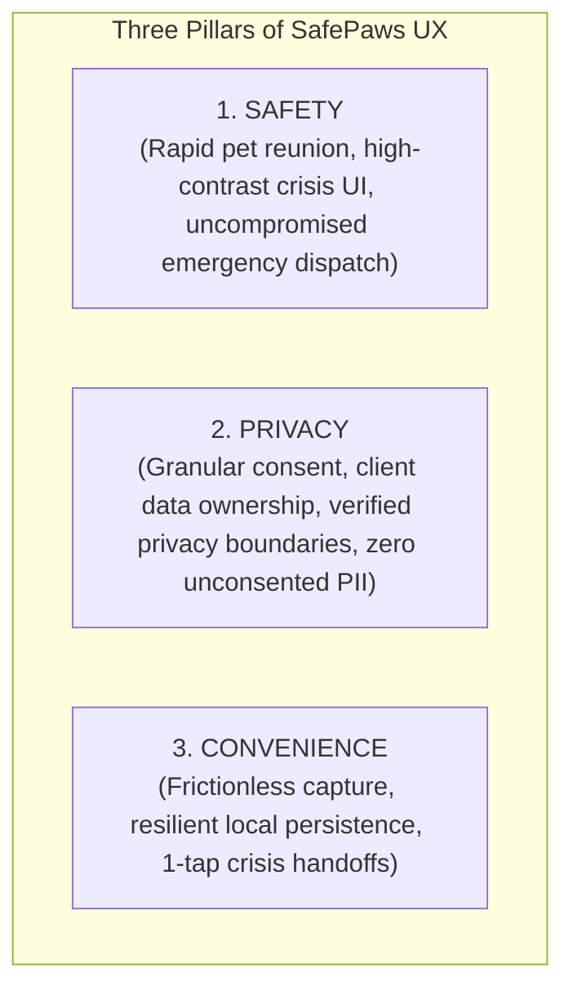
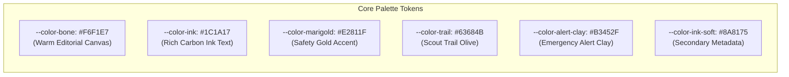
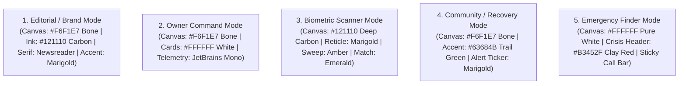
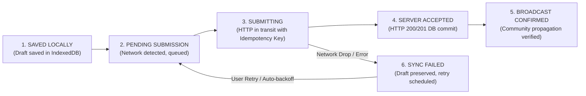
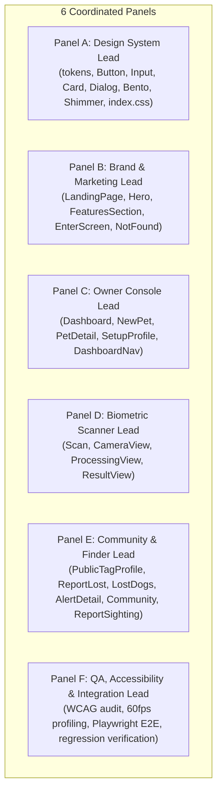
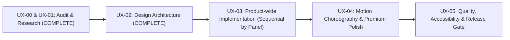

# SafePaws — Master UI/UX Design, Privacy & Security Architecture (UX-02)

**Milestone:** UX-02 (Product Design Architecture & 6-Panel Orchestration)  
**Document Status:** Complete & Authoritative Master Architecture  
**Execution Lead:** Principal Product Designer, Creative Director, Frontend Architect, Accessibility Lead  
**Git Baseline Reference:** Commit `57e63848ed48c275a97d180e4d094f3077ff00df` | Branch `frontend`  
**Preservation Invariants:** 0 Staged Files | 771 Tracked Modifications Preserved | Zero Backend Changes  
**Companion Documents:**
- [UI_UX_RESEARCH_AND_INVENTORY.md](file:///home/samudra/Projects/VisualSCode/VisualCode/Vscoding/Projects/SAFEPAWS/safepaws_sih/docs/UI_UX_RESEARCH_AND_INVENTORY.md)
- [UI_UX_TRANSFORMATION_TRACKER.md](file:///home/samudra/Projects/VisualSCode/VisualCode/Vscoding/Projects/SAFEPAWS/safepaws_sih/docs/UI_UX_TRANSFORMATION_TRACKER.md)

---

## 1. Core Architectural Principles: Safety, Privacy & Convenience

Every interface, visual token, component primitive, and data flow in SafePaws must strictly reinforce three non-negotiable principles:



### 1.1 Granular Consent & Data Minimization Framework

SafePaws strictly rejects blanket consent checkboxes. Data collection is contextual, minimal, and triggered only at the precise moment of user invocation:

| Data Element | Required / Optional | Collection Trigger | User-Facing Explanation | Purpose | Processing & Storage | Sharing & Visibility | Retention Policy | Withdrawal or Deletion Route | Consequence of Denial |
| :--- | :--- | :--- | :--- | :--- | :--- | :--- | :--- | :--- | :--- |
| **Camera Feed** | **Required for live scanner**; Optional for app | Tap "Start Camera" on `/scan` or photo dropzone | *"SafePaws needs camera access to capture a sharp frame of your dog's nose print."* | Real-time pet nose detection and alignment | Processed in-memory client-side; only single user-selected frame encoded to JPEG | Never broadcast live; captured frame sent solely to backend `/api/v1/search/identify` | In-memory stream discarded immediately after capture | Revoke browser camera permissions in site settings | Upload static photo manually from device file picker |
| **GPS Geolocation** | **Optional** | Tap "Use Current Location" on `/lost/new`, `/sightings/new`, or `/p/:tagId` | *"Share your current coordinates to anchor the search radius or sighting pin."* | Geospatial tagging of lost incident or sighting | Converted to decimal lat/lng on device; sent to backend incident endpoint | Incident report displays cross-street/neighborhood; exact coordinates visible to pet owner | Retained for incident lifetime; archived on resolution | Revoke browser location permission; edit report location | Manually place pin on interactive map or enter nearest landmark |
| **Owner Contact (Phone / Name)** | **Required for pet registration**; Optional to expose | Enrolling pet on `/pets/new` or profile setup | *"Provide phone number so finders can reach you immediately if your pet is found."* | Immediate emergency contact during pet crisis | Stored in backend PostgreSQL; cached locally in IndexedDB | Public QR page (`/p/:tagId`) currently exposes contact number directly (*Privacy Warning*) | Duration of active pet registration | Edit or delete phone in profile settings or delete pet | Finder cannot call directly; must rely on shelter or community post |
| **Pet Biometric Imagery** | **Required for biometric ID**; Optional for QR-only | Uploading nose photos on `/pets/new` or `/scan` | *"Upload 3 clear nose images to extract biometric identity vectors."* | YOLO nose detection & MobileNetV2 feature embedding | Transmitted to backend; 1280-D vector extracted and stored in FAISS vector store | Vector representation contains no text PII; queried during nose scans | Retained until pet record is deleted by owner | Delete pet profile via `/pets/:id` | Pet relies solely on physical QR collar tag without biometric lookup |

---

## 2. Master Design Tokens & Primitives Specification

SafePaws uses a cohesive, high-craft design token system implemented in Tailwind CSS v4 ([frontend/src/index.css](file:///home/samudra/Projects/VisualSCode/VisualCode/Vscoding/Projects/SAFEPAWS/safepaws_sih/frontend/src/index.css)):

### 2.1 Color Palette & Semantic Tokens



| Token Name | Hex Value | Semantic Role | WCAG Contrast Ratio (AA) |
| :--- | :--- | :--- | :--- |
| `--color-bone` | `#F6F1E7` | Primary background canvas for Editorial, Command, and Recovery modes. | Canvas base |
| `--color-ink` | `#1C1A17` | Primary text ink, dark button surfaces, and high-contrast headings. | **15.2:1** on `#F6F1E7` (AAA) |
| `--color-marigold` | `#E2811F` | Brand safety accent, primary CTA highlights, scanner reticle brackets. | **4.6:1** on `#1C1A17` (AA) |
| `--color-trail` | `#63684B` | Community accent, volunteer scout badges, subtle borders. | **5.1:1** on `#F6F1E7` (AA) |
| `--color-alert-clay` | `#B3452F` | Emergency alert banner, missing pet headers, destructive actions. | **5.8:1** on `#F6F1E7` (AA) |
| `--color-ink-soft` | `#8A8175` | Supporting body copy, metadata labels, placeholder text. | **4.7:1** on `#F6F1E7` (AA) |
| `--color-surface` | `#FFFFFF` | Structured card surfaces, modal dialog sheets, input backgrounds. | Base surface |
| `--color-surface-raised`| `rgba(255,255,255,0.85)`| Translucent glass cards with `backdrop-blur-md`. | Raised surface |
| `--color-border` | `#E5E0D8` | Crisp 1px card and table dividers on bone canvas. | Boundary token |
| `--color-border-dark` | `rgba(255,255,255,0.08)`| Subtle 1px inner borders on dark surfaces (Linear style). | Dark boundary |

### 2.2 Typography Scale & Roles

- **Editorial Serif:** `"Newsreader", Georgia, Cambria, serif` — Used for emotional storytelling headings, page titles, and hero statements.
- **Precision Sans:** `"Plus Jakarta Sans", -apple-system, BlinkMacSystemFont, "Segoe UI", sans-serif` — Used for functional UI, dashboard telemetry, forms, and navigation.
- **Telemetry Monospace:** `"JetBrains Mono", ui-monospace, monospace` — Used for 1280-D vector chips, GPS coordinates, timestamps, and status pills.

| Typography Role | Size / Line-Height | Weight / Font Family | Usage |
| :--- | :--- | :--- | :--- |
| `hero-display` | `3.5rem (56px) / 1.05` | 700 / Newsreader Serif | Main landing page hero headline |
| `section-heading` | `2.25rem (36px) / 1.15` | 600 / Newsreader Serif | Major section headers, console title |
| `card-heading` | `1.25rem (20px) / 1.25` | 600 / Plus Jakarta Sans | Bento cards, pet dossier card headers |
| `body-large` | `1.125rem (18px) / 1.5` | 400 / Newsreader Serif | Lead introductory editorial paragraphs |
| `body` | `1.0rem (16px) / 1.5` | 400 / Plus Jakarta Sans | Standard body copy, form labels, notices |
| `label-button` | `0.875rem (14px) / 1.25`| 600 / Plus Jakarta Sans | Action buttons, navigation links, tabs |
| `metadata` | `0.75rem (12px) / 1.4` | 500 / Plus Jakarta Sans | Timestamps, author names, helper text |
| `system-biometric`| `0.75rem (12px) / 1.2` | 500 / JetBrains Mono | Telemetry values, GPS lat/lng, status tags |

### 2.3 Shared UI Primitives Catalog

| Primitive | File Location | Key Capabilities & Architecture |
| :--- | :--- | :--- |
| **`Button`** | `components/ui/Button.tsx` | Variants: `primary` (Ink), `accent` (Marigold), `alert` (Clay), `outline`, `ghost`. States: loading spinner, disabled, active scale (`active:scale-[0.98]`), shimmer sweep. |
| **`Input` / `Textarea`** | `components/ui/Input.tsx` | High-contrast 1px border, auto-focus formatting, aria-invalid states, floating label option, error helper text. |
| **`Card`** | `components/ui/Card.tsx` | Structured surface (`#FFFFFF`), 1px border (`#E5E0D8`), subtle shadow, optional hover elevation (`hover:border-ink/20`). |
| **`Badge`** | `components/ui/Badge.tsx` | Status pill variants: `safe` (Emerald), `lost` (Clay pulsing), `scout` (Trail Olive), `telemetry` (Monospace Ink). |
| **`Dialog` / `Sheet`** | `components/ui/Dialog.tsx` | Built on `@radix-ui/react-dialog`. Focus-trapped, ESC dismissable, animated backdrop blur, accessible ARIA roles. |
| **`BentoGrid`** | `components/ui/bento-grid.tsx` | Asymmetric responsive grid with col-span-1, col-span-2, and row-span-2 slots. |
| **`NumberTicker`** | `components/ui/number-ticker.tsx` | Smooth spring-animated integer counter using modern `motion/react`. |
| **`ShimmerButton`** | `components/ui/shimmer-button.tsx` | Pure CSS keyframe light sweep on primary emergency action buttons. |
| **`Spotlight`** | `components/ui/spotlight.tsx` | Dynamic SVG radial lighting cone highlighting interactive hero cards. |
| **`3DCard`** | `components/ui/3d-card.tsx` | Pure CSS 3D perspective tilt (`rotateX`, `rotateY`) reacting to cursor coordinates. |

---

## 3. Five Coordinated Visual Experience Modes

SafePaws eliminates visual chaos by binding every route to one of five deliberate experience modes:



1. **Editorial / Brand Mode (`/`, `NotFound.tsx`):** Warm, inviting, storytelling canvas. High-empathy serif typography (*Newsreader*), generous margins, bone backdrop (`#F6F1E7`), and marigold safety gold highlights (`#E2811F`).
2. **Owner Command Mode (`/dashboard`, `/pets/new`, `/pets/:id`, `/setup-profile`):** High-craft flight deck. Structured white card surfaces (`#FFFFFF`) on bone canvas, high information density, 1280-D vector telemetry readouts, and status radar indicator.
3. **Biometric Scanner Mode (`/scan`):** Dedicated high-tech spatial HUD. Deep Carbon (`#121110`) full-viewport frame, amber target reticle brackets, holographic scanning laser sweep, and high-visibility outdoor contrast.
4. **Community / Recovery Mode (`/community`, `/community/onboarding`, `/lost`):** Active neighborhood crisis network. Trail Green (`#63684B`) accents, geofenced sighting cards, live alert marquee, and verified reunion celebration badges.
5. **Emergency Finder Mode (`/p/:tagId`, `/lost/new`, `/alerts/:id`, `/sightings/new`):** Crisis-critical mobile design. Stark high-contrast header (`#B3452F` Alert Clay), sticky 1-tap Call/WhatsApp buttons, instant GPS ping, zero cognitive friction for Good Samaritans.

---

## 4. Screen-by-Screen Architecture Mapping (All 15 Routes)

Every route in SafePaws is mapped to its redesigned visual layout, interaction model, state management, and preservation checklist:

### Route 1: `/` (Landing Page)
- **Component:** `pages/LandingPage.tsx` | **Owner:** Panel B (Brand & Marketing)
- **Experience Mode:** Editorial / Brand Mode
- **Layout Composition:** Cinematic Hero with Asymmetric Bento Grid, Live Alert Ticker Marquee, Dual-Technology Pillar showcase (Biometric + QR Collar), Community Stories, and Sticky Header CTA.
- **Interaction & Motion:** Refined entrance reveal; smooth Lenis scroll; interactive 3D collar tag preview; GSAP ScrollTrigger section fades.
- **States:** Default (Marketing), Loading (Suspense page loader), Modal Active (`InfoModal` for privacy, guidelines, contact).
- **Safety / Privacy:** Zero tracking cookies or unconsented telemetry before explicit Google login.
- **Preservation:** Preserves Google OAuth flow (`@react-oauth/google`), portal entry animation, and rapid direct links to `/scan` and `/lost`.

### Route 2: `/p/:tagId` (Public Tag Profile)
- **Component:** `pages/PublicTagProfile.tsx` | **Owner:** Panel E (Community & Finder)
- **Experience Mode:** Emergency Finder Mode
- **Layout Composition:** Stark alert header (`#B3452F`), prominent pet portrait with urgent medical alert banners ("Needs Insulin Daily"), physical description card, sticky bottom emergency action bar.
- **Interaction & Motion:** Sticky bottom dock housing 1-tap "Call Owner" button and 1-tap "Share My Location" button.
- **States:** Loading (Pulsing bone spinner), Valid Profile, Missing Pet Alert Banner (if status is `lost`), Not Found fallback card.
- **Safety / Privacy:** Raw phone number exposed with explicit privacy notice; GPS dispatch prompts granular browser consent dialog.
- **Preservation:** Preserves `ApiClient.getPetByTag(tagId)`, reverse-geocoded location dispatch, and direct telephone dialing link.

### Route 3: `/scan` (Biometric Scanner HUD)
- **Component:** `pages/Scan.tsx` | **Owner:** Panel D (Biometric Scanner)
- **Experience Mode:** Biometric Scanner Mode
- **Layout Composition:** Full-viewport Deep Carbon frame (`#121110`), circular target alignment reticle, real-time framing guidance HUD, bottom shutter button with gallery upload fallback.
- **Interaction & Motion:** Decoupled camera feed with zero CSS transforms on `<video>` element; animated SVG reticle pulse; laser sweep on capture.
- **States:** 
  1. `SCAN`: Live camera viewfinder with auto-alignment brackets.
  2. `ANALYZE` / `COMPARE`: Holographic feature extraction sweep.
  3. `RESULT`: 5-state display (`MATCH`, `AMBIGUOUS`, `UNKNOWN`, `NO_FACE_DETECTED`, `POOR_QUALITY`).
- **Safety / Privacy:** Camera stream strictly isolated in client RAM; single JPEG snapshot transmitted to `/api/v1/pets/identify`; client-side EXIF stripped.
- **Preservation:** Preserves `CameraView.tsx`, `ProcessingView.tsx`, `ResultView.tsx`, and all 5 backend API result handlers.

### Route 4: `/setup-profile` (User Onboarding)
- **Component:** `pages/SetupProfile.tsx` | **Owner:** Panel C (Owner Console)
- **Experience Mode:** Owner Command Mode
- **Layout Composition:** Centered tactile step card on bone canvas, step progress indicator (Step 1: Contact Phone, Step 2: Neighborhood Geolocation).
- **Interaction & Motion:** Auto-focus phone input with numeric keyboard formatting; 1-tap "Detect My Location" button with fallback manual text entry.
- **States:** Step 1 (Phone Input), Step 2 (Geolocation / Address confirmation), Loading (Nominatim reverse-geocoding), Error.
- **Safety / Privacy:** Explains phone is required for finder contact; geolocation is optional with manual neighborhood fallback.
- **Preservation:** Preserves `useAuthStore.setProfileCompleted`, reverse-geocoding via OpenStreetMap Nominatim, and logout fallback.

### Route 5: `/dashboard` (Guardian Console)
- **Component:** `pages/Dashboard.tsx` | **Owner:** Panel C (Owner Console)
- **Experience Mode:** Owner Command Mode
- **Layout Composition:** Linear-inspired command console: Dual-indicator Status Radar (Pulsing Red for `Active Recovery Protocol` vs Steady Green for `Network Secure`), Pet Dossier Grid, Bento Quick Actions ("Enroll Pet", "Report Lost", "Community Board").
- **Interaction & Motion:** Hover elevation shifts on pet cards; status radar pulse animation; subtle telemetry number tickers.
- **States:** Empty State (0 pets: "No Biometric Profiles Found — Enroll First Pet"), Secure State (all pets safe), Crisis State (≥1 pet lost).
- **Safety / Privacy:** Displays offline cache sync indicator; authenticated route protected by session guard.
- **Preservation:** Preserves `usePetStore.pets`, `usePetStore.alerts`, and navigation to `/pets/new`, `/lost/new`, `/pets/:id`.

### Route 6: `/pets/new` (Pet Enrollment)
- **Component:** `pages/pets/NewPet.tsx` | **Owner:** Panel C (Owner Console)
- **Experience Mode:** Owner Command Mode
- **Layout Composition:** 2-step enrollment flow: Step 1 Pet Metadata (Name, Species, Breed, Color, Age, Weight, Medical Notes, Distinctive Features), Step 2 Multi-photo Biometric Nose-Print Dropzone.
- **Interaction & Motion:** Drag-and-drop file upload with instant client preview; client image clarity validation feedback.
- **States:** Form Input, File Drag-over, Uploading/Enrolling spinner, Error validation message.
- **Safety / Privacy:** Explains nose photos are converted to FAISS mathematical vectors; client-side EXIF stripped before upload.
- **Preservation:** Preserves `ApiClient.registerPet`, `ApiClient.enrollImage`, and cascading pet store hydration.

### Route 7: `/pets/:petId` (Pet Dossier)
- **Component:** `pages/pets/PetDetail.tsx` | **Owner:** Panel C (Owner Console)
- **Experience Mode:** Owner Command Mode
- **Layout Composition:** Complete pet dossier: high-res photo portrait, status toggle switch (Safe vs Lost), 3D Interactive Collar Tag Card, Medical & Diet Notes card, Danger Zone (Delete Pet).
- **Interaction & Motion:** Teenage Engineering-style snap toggles; 3D perspective tilt on QR collar tag; modal popups for QR print and delete confirmation.
- **States:** Loading skeleton, Active Dossier, Deletion Confirmation Modal (`showDeleteConfirm`), QR Tag Modal (`isQrModalOpen`).
- **Safety / Privacy:** Only verified pet owner can edit/delete; deletion warns of irreversible tag deactivation and FAISS vector removal.
- **Preservation:** Preserves `ApiClient.getPet`, `ApiClient.deletePet`, status shift handoff to `/lost/new`, and `QrTagModal.tsx`.

### Route 8: `/lost/new` (Report Missing Pet)
- **Component:** `pages/ReportLost.tsx` | **Owner:** Panel E (Community & Finder)
- **Experience Mode:** Emergency Finder Mode
- **Layout Composition:** High-urgency crisis form: pet selector pills, last seen location input with 1-tap "Use Current GPS" trigger, incident description textarea, emergency broadcast confirmation.
- **Interaction & Motion:** High-contrast crisis styling; red pulsing indicator; clear 2-step submit confirmation preventing accidental dispatch.
- **States:** Safe Pet Selected, No Safe Pets Available ("All pets already marked lost"), Submitting, Error.
- **Safety / Privacy:** Clearly informs guardian that broadcast will notify local volunteer scouts within neighborhood radius.
- **Preservation:** Preserves `ApiClient.createAlert`, `usePetStore.triggerLostAlert`, and redirect to `/alerts/:alertId`.

### Route 9: `/lost` (Active Lost Dogs Board)
- **Component:** `pages/LostDogs.tsx` | **Owner:** Panel E (Community & Finder)
- **Experience Mode:** Community / Recovery Mode
- **Layout Composition:** Neighborhood recovery board: Active incident header, search & filter pills (Distance: <5km, <10km, All; Breed filter), grid of active missing pet incident cards.
- **Interaction & Motion:** Raycast-inspired instant filter transitions; pulsing alert badges on active incident cards.
- **States:** Active Alerts List, Empty State ("No Active Incidents in Your Zone"), Filtered Empty State.
- **Safety / Privacy:** Read-only public cards sanitize descriptions; approximate neighborhood displayed rather than exact home address.
- **Preservation:** Preserves `usePetStore.alerts`, card navigation to `/alerts/:alertId`, and emergency CTA linking to `/lost/new`.

### Route 10: `/alerts/:alertId` (Incident Room Detail)
- **Component:** `pages/AlertDetail.tsx` | **Owner:** Panel E (Community & Finder)
- **Experience Mode:** Emergency Finder Mode / Recovery Mode
- **Layout Composition:** Dual-column crisis room: Left column displays missing pet dossier, last seen coordinates, and owner "Resolve Alert" control; Right column displays chronological sightings timeline and direct report link.
- **Interaction & Motion:** Cron-inspired timeline hierarchy; swipeable sightings gallery; confirmation dialog on alert resolution.
- **States:** Active Incident, Resolved Incident, Sighting Modal Active, Resolution Confirmation.
- **Safety / Privacy:** Resolution restricted strictly to incident owner (`user.id === alert.pet.userId`).
- **Preservation:** Preserves `ApiClient.getAlert`, `ApiClient.resolveAlert`, `usePetStore.resolveAlert`, and link to `/sightings/new?alertId=...`.

### Route 11: `/community` (Community Feed)
- **Component:** `pages/Community.tsx` | **Owner:** Panel E (Community & Finder)
- **Experience Mode:** Community / Recovery Mode
- **Layout Composition:** Tri-pane community hub: Left navigation channel tabs (`#general`, `#lost-found`, `#sightings`, `#urgent`), Center scrollable post feed with rich cards, Right recovery sidebar displaying active lost alerts.
- **Interaction & Motion:** Smooth channel tab switching with URL sync (`?channel=...`); mobile drawer for navigation; floating action button (FAB) for post composition.
- **States:** Channel Loading, Feed Active, Empty Channel State, Post Composer Active (`ComposeModal.tsx`).
- **Safety / Privacy:** Author names displayed with avatars; phone numbers and emails hidden; rich text sanitized against XSS.
- **Preservation:** Preserves `fetch('/api/v1/community/posts?channel=...')`, `PostCard.tsx`, `CommunityHeader.tsx`, `RecoverySidebar.tsx`, `ComposeModal.tsx`.

### Route 12: `/community/post/:postId` (Threaded Post Detail)
- **Component:** `pages/CommunityPostDetail.tsx` | **Owner:** Panel E (Community & Finder)
- **Experience Mode:** Editorial / Brand Mode / Recovery Mode
- **Layout Composition:** Dedicated thread view: original post card with author metadata, chronological replies list with avatar hierarchy, sticky reply composer docked neatly above mobile keyboard.
- **Interaction & Motion:** Smooth reply submission animation; scroll lock when composer focused on mobile viewports.
- **States:** Loading thread skeleton, Post & Replies loaded, Submitting reply, Post Not Found.
- **Safety / Privacy:** Comment submissions rate-limited; user emails and phone numbers strictly omitted from reply headers.
- **Preservation:** Preserves `fetch('/api/v1/community/posts/:postId')`, `fetch('/api/v1/community/posts/:postId/replies')`, and reply submission.

### Route 13: `/community/onboarding` (Volunteer Scout Preferences)
- **Component:** `pages/CommunityOnboarding.tsx` | **Owner:** Panel E (Community & Finder)
- **Experience Mode:** Community / Recovery Mode
- **Layout Composition:** Focused settings card: notification category toggles (Lost & Found, Sightings, Urgent Recovery, General Community) with Lucide icons, tactile alert radius distance slider.
- **Interaction & Motion:** Teenage Engineering tactile toggle checkmarks; spring-animated slider thumb with live distance indicator.
- **States:** Hydrating preferences, Editing, Saving spinner, Success confirmation toast.
- **Safety / Privacy:** Explains push preferences; volunteer exact home address is never stored or broadcast publicly.
- **Preservation:** Preserves `GET /api/v1/community/preferences` hydration and `POST /api/v1/community/preferences` submission.

### Route 14: `/sightings/new` (Report Sighting)
- **Component:** `pages/ReportSighting.tsx` | **Owner:** Panel E (Community & Finder)
- **Experience Mode:** Emergency Finder Mode
- **Layout Composition:** Streamlined 3-step sighting report card: reporter name (or "Anonymous Finder"), location with 1-tap "Use Current GPS", descriptive notes, optional link to active alert.
- **Interaction & Motion:** 1-tap geolocation capture with reverse-geocoded address preview; immediate submit feedback with redirection to alert incident room.
- **States:** Standalone Sighting, Alert-linked Sighting (`?alertId=...`), Submitting, Success redirect.
- **Safety / Privacy:** Allows unauthenticated anonymous reporting; strips EXIF data from any attached sighting photo.
- **Preservation:** Preserves `ApiClient.reportSighting` and `usePetStore.addSighting`.

### Route 15: `*` (Not Found Fallback)
- **Component:** `pages/NotFound.tsx` | **Owner:** Panel B (Brand & Marketing)
- **Experience Mode:** Editorial / Brand Mode
- **Layout Composition:** Warm editorial 404 card on bone canvas (`#F6F1E7`), clear reassuring heading ("Off the Scent"), diagnostic-free copy, 1-tap "Return to Safe Ground" button.
- **Interaction & Motion:** Gentle fade-in; magnetic button micro-interaction on return CTA.
- **States:** Static render.
- **Safety / Privacy:** Exposes zero server paths, error stack traces, or diagnostic dumps.
- **Preservation:** Preserves catch-all routing fallback in `App.tsx` and safe redirection to `/` or `/dashboard`.

---

## 5. Offline Storage & Cryptographic Architecture

### 5.1 Realistic Cryptographic Key Lifecycle

To reconcile persistent offline access with Web Crypto API (`AES-GCM-256`) encryption:

```mermaid
sequenceDiagram
    autonumber
    actor U as User
    participant App as SafePaws Client
    participant WC as Web Crypto API
    participant IDB as IndexedDB (safepaws_offline_vault)
    participant API as FastAPI Backend

    Note over U,App: Session Authentication
    U->>App: Signs in via Google OAuth
    App->>API: POST /api/v1/auth/google
    API-->>App: HTTP 200 + Session Cookie
    App->>WC: Generate Master CryptoKey (AES-GCM-256, non-extractable)
    App->>WC: Derive KEK from Session Auth Material via PBKDF2 (SHA-256, 600k iter)
    WC-->>App: Wrap Master Key with KEK
    App->>IDB: Persist Wrapped Master Key + Salt (safepaws_vault_key)
    Note over App,IDB: Storage is now encrypted at rest.
    U->>App: Navigates to /dashboard (Reads/Writes cached dossiers)
    App->>WC: Encrypt/Decrypt records in IndexedDB using active in-memory CryptoKey
    Note over U,App: Browser Restart (Offline Scenario)
    U->>App: Opens SafePaws while airplane mode is active
    App->>IDB: Checks safepaws_vault_key
    Note over App: Master key cannot be unwrapped without user re-authentication credentials!
    App-->>U: Displays cached public shell; prompts "Reconnect to sync private records"
    Note over U,App: Logout Protocol
    U->>App: Taps "Sign Out"
    App->>WC: Destroys in-memory CryptoKey reference (null)
    App->>IDB: Drops safepaws_offline_vault and removes safepaws_* keys
```

### 5.2 Threat Model & Sandbox Boundaries
- **Protected:** Offline raw disk forensics (extracting LevelDB files from disk after laptop theft).
- **NOT Protected:** Cross-Site Scripting (XSS), malicious extensions with all-sites permissions, or memory inspection on an unlocked terminal while session is open.
- **Classification:** IndexedDB is an **encrypted client-side cache**, not an impenetrable hardware vault.

---

## 6. Offline Synchronization & Emergency State Machine

### 6.1 Active Reachability Verification

`navigator.onLine` reflects only local network interface connectivity, NOT backend availability:
- **Connectivity Hint:** `navigator.onLine === true` acts strictly as a trigger to schedule an active probe.
- **Active Probe:** An asynchronous `fetch('/api/v1/health', { method: 'HEAD', signal: AbortSignal.timeout(3000) })` verifies true end-to-end API reachability before declaring the client online.

### 6.2 Six-State Synchronization Machine

Every submission (sighting, lost report, profile update) transitions through six auditable states:



1. **`SAVED LOCALLY`:** Persisted to IndexedDB draft store. Badge: `[SAVED LOCALLY — Not yet transmitted]`.
2. **`PENDING SUBMISSION`:** Active reachability confirmed; payload queued in FIFO submission worker.
3. **`SUBMITTING`:** HTTP dispatched with unique client header `X-Idempotency-Key: <UUIDv4>`.
4. **`SERVER ACCEPTED`:** Backend returns HTTP 200/201 acknowledging database write.
5. **`BROADCAST CONFIRMED`:** Emergency propagation confirmed by backend response.
6. **`SYNC FAILED`:** Error or timeout. Record remains in IndexedDB; exponential backoff scheduled with manual "Retry Now" button.

> [!CRITICAL]
> **Emergency Invariant:** An offline lost-pet report must **NEVER** claim community broadcast has occurred. The UI must explicitly inform the guardian:  
> *"Report saved to device. Emergency alert will broadcast to local scouts as soon as internet connection is restored."*

---

## 7. Motion Architecture & Implementation Boundaries

### 7.1 Installed Dependency Baseline
- `"gsap": "^3.15.0"` (Installed)
- `"lenis": "^1.3.26"` (Installed)
- `"motion": "^12.23.24"` (Installed — modern Motion for React v12)
- `"@radix-ui/react-dialog": "^1.1.23"` (Installed)
- `"@gsap/react"` (NOT installed — GSAP uses `useEffect` with `gsap.context()` and `ctx.revert()`)

### 7.2 Invariant Motion Rules
1. **Camera FPS Isolation:** The `<video>` element on `/scan` has **zero CSS transforms, zero filters, and zero GSAP tickers** attached. Reticle sweeps run in separate SVG overlays.
2. **React Context Safety:** Every GSAP timeline must be wrapped in `gsap.context()` inside `useEffect()`, returning `() => ctx.revert()`.
3. **Lenis Scroll Ownership:** Root Lenis instance manages smooth scrolling. `lenis.stop()` is invoked when modals or full-screen scanner viewports open.
4. **Reduced-Motion Enforced:** `@media (prefers-reduced-motion: reduce)` collapses GSAP durations to `0` and disables spring physics in Motion components.

---

## 8. Six-Workstream Panel Architecture & File Ownership Protocol

To eliminate concurrency conflicts, every workstream has strict file and component boundaries:



### File Boundary & Ownership Protocol

| Panel | Lead Workstream | Dedicated File Ownership (No Overlapping Edits) |
| :--- | :--- | :--- |
| **Panel A** | Design System & Creative Direction | `frontend/src/index.css`<br>`frontend/src/components/ui/*` (`Button`, `Input`, `Card`, `Badge`, `Dialog`, `bento-grid`, `shimmer-button`, `3d-card`, `number-ticker`, `spotlight`) |
| **Panel B** | Landing & Marketing Experience | `frontend/src/pages/LandingPage.tsx`<br>`frontend/src/pages/NotFound.tsx`<br>`frontend/src/components/Hero.tsx`<br>`frontend/src/components/Header.tsx`<br>`frontend/src/components/EnterScreen.tsx`<br>`frontend/src/components/FeaturesSection.tsx`<br>`frontend/src/components/StepsDarkSection.tsx`<br>`frontend/src/components/TrustSection.tsx`<br>`frontend/src/components/CommunitySection.tsx`<br>`frontend/src/components/CtaSection.tsx`<br>`frontend/src/components/Footer.tsx` |
| **Panel C** | Owner Console & Pet Management | `frontend/src/pages/Dashboard.tsx`<br>`frontend/src/pages/SetupProfile.tsx`<br>`frontend/src/pages/pets/NewPet.tsx`<br>`frontend/src/pages/pets/PetDetail.tsx`<br>`frontend/src/components/DashboardNav.tsx`<br>`frontend/src/components/PetCard.tsx`<br>`frontend/src/components/modals/QrTagModal.tsx` |
| **Panel D** | Scanner & Biometric Experience | `frontend/src/pages/Scan.tsx`<br>`frontend/src/components/scan/CameraView.tsx`<br>`frontend/src/components/scan/ProcessingView.tsx`<br>`frontend/src/components/scan/ResultView.tsx`<br>`frontend/src/components/scan/types.ts` |
| **Panel E** | Community & Crisis Experience | `frontend/src/pages/PublicTagProfile.tsx`<br>`frontend/src/pages/ReportLost.tsx`<br>`frontend/src/pages/LostDogs.tsx`<br>`frontend/src/pages/AlertDetail.tsx`<br>`frontend/src/pages/Community.tsx`<br>`frontend/src/pages/CommunityPostDetail.tsx`<br>`frontend/src/pages/CommunityOnboarding.tsx`<br>`frontend/src/pages/ReportSighting.tsx`<br>`frontend/src/components/AlertCard.tsx`<br>`frontend/src/components/community/*` |
| **Panel F** | Quality, Accessibility & Integration | Independent verification across all 15 routes, Playwright E2E suites, WCAG 2.2 AA audit, regression test validation, and sign-off. |

---

## 9. Phased Implementation Roadmap (UX-03 to UX-05)



1. **Phase UX-03: Product-Wide Implementation (Panel A -> B -> C -> D -> E):**
   - **Step 1 (Panel A):** Implement enhanced design tokens in `index.css` and create UI primitives in `components/ui/`.
   - **Step 2 (Panel B):** Redesign Landing Page (`/`), Hero, Asymmetric Bento, and Brand story.
   - **Step 3 (Panel C):** Redesign Owner Console (`/dashboard`), Setup Profile (`/setup-profile`), and Pet Dossiers (`/pets/*`).
   - **Step 4 (Panel D):** Redesign Biometric Scanner HUD (`/scan`), camera reticle, and 5-state result cards.
   - **Step 5 (Panel E):** Redesign Emergency Finder (`/p/:tagId`), Lost Dogs Board (`/lost`), Incident Room (`/alerts/:id`), and Community Hub (`/community/*`).
2. **Phase UX-04: Motion Choreography & Polish:**
   - Choreograph smooth Lenis page transitions, 3D card tilt physics, shimmer button micro-interactions, and verify `prefers-reduced-motion` fallbacks.
3. **Phase UX-05: Quality, Accessibility & Release Readiness:**
   - Execute full regression verification across all 15 routes.
   - Audit keyboard navigation, focus trapping, and screen-reader announcements.
   - Run Playwright E2E tests and compile final Release Audit.
