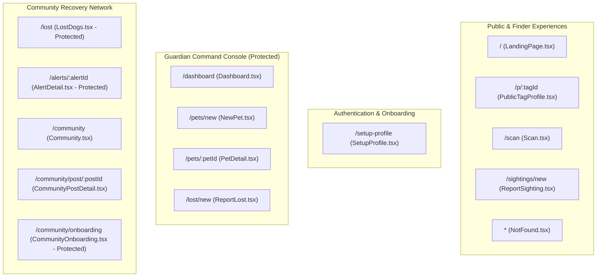
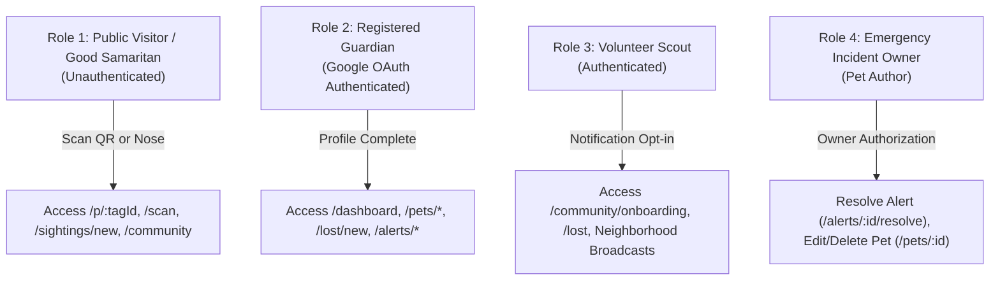
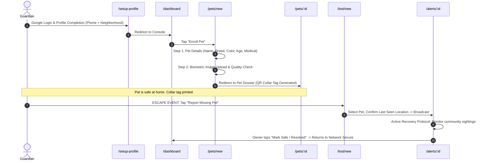
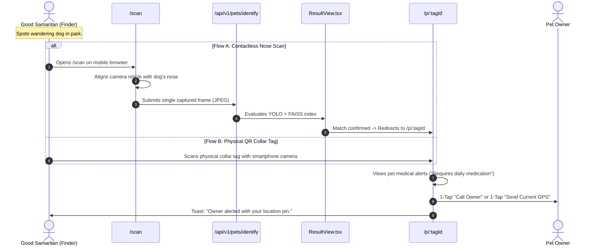
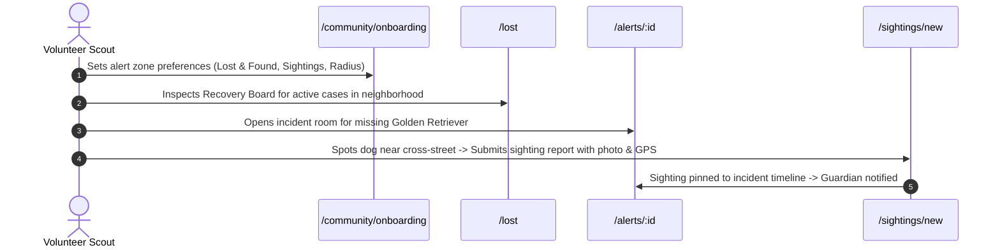
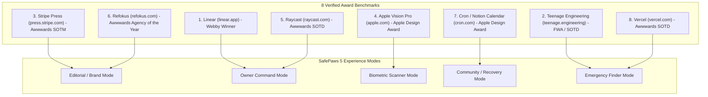

# SafePaws — Full Product Inventory, Feature Preservation Matrix & Design Research (UX-00 & UX-01)

**Milestone:** UX-00 (Baseline Inventory & Audit) & UX-01 (Award Research & Inspiration)  
**Document Status:** Complete & Verified Baseline  
**Lead Roles:** Principal Product Designer, Creative Director, UX Research Lead, Frontend Architect  
**Git Baseline Reference:** Commit `57e63848ed48c275a97d180e4d094f3077ff00df` | Branch `frontend`  
**Repository Working Tree:** Preserved (0 staged, 771 tracked modifications, 839 porcelain entries)  

---

## 1. Product Discovery & Route Inventory (All 15 Routes)

SafePaws currently comprises 15 active routes, 16 top-level components, 4 modals, and 4 subsystem component directories (`scan`, `community`, `modals`, `ui`):

### 1.1 Complete Route Catalog

| # | Route Path | Component File | Auth Requirement | Layout Shell | Core Purpose & Primary Action |
| :- | :--- | :--- | :--- | :--- | :--- |
| 1 | **`/`** | `pages/LandingPage.tsx` | Public | Full-width Marketing | Hero impression, brand story, rapid access to camera scan and active alerts. |
| 2 | **`/p/:tagId`** | `pages/PublicTagProfile.tsx` | Public | Emergency Finder Shell | Immediate physical tag lookup; 1-tap call owner and 1-tap GPS location ping. |
| 3 | **`/scan`** | `pages/Scan.tsx` | Public | Fullscreen Spatial HUD | Live camera pet nose capture, YOLO detection, MobileNetV2 embedding inference. |
| 4 | **`/setup-profile`**| `pages/SetupProfile.tsx` | Auth Required (`!profileCompleted`) | Focused Step Card | 2-step onboarding: phone number capture and geolocation/neighborhood reverse-geocode. |
| 5 | **`/dashboard`** | `pages/Dashboard.tsx` | Auth Required (`profileCompleted`) | Dashboard Nav + Main | Flight-deck console displaying pet dossiers, active recovery protocols, and quick actions. |
| 6 | **`/pets/new`** | `pages/pets/NewPet.tsx` | Auth Required | Dashboard Nav + Form | 2-step pet registration: metadata inputs + nose-print photo enrollment. |
| 7 | **`/pets/:petId`** | `pages/pets/PetDetail.tsx`| Auth Required | Dashboard Nav + Dossier | Complete pet dossier, physical QR code generation/printing, status toggle, and deletion. |
| 8 | **`/lost/new`** | `pages/ReportLost.tsx` | Auth Required | Dashboard Nav + Form | Emergency alert broadcaster: select pet, input last seen address, trigger local alert. |
| 9 | **`/lost`** | `pages/LostDogs.tsx` | Auth Required | Dashboard Nav + Grid | Recovery board displaying all active missing pet alerts in the user's community zone. |
| 10 | **`/alerts/:alertId`**| `pages/AlertDetail.tsx` | Auth Required | Dashboard Nav + Detail | Incident room for active alert: status timeline, sighting reports, owner resolution control. |
| 11 | **`/community`** | `pages/Community.tsx` | Public / Partial Auth | Community Shell + Sidebar | Channel-based feed (`#general`, `#lost-found`, `#sightings`, `#urgent`), post creation. |
| 12 | **`/community/post/:postId`**| `pages/CommunityPostDetail.tsx`| Public / Partial Auth | Community Shell | Threaded discussion view: original incident/discussion post + chronological replies. |
| 13 | **`/community/onboarding`**| `pages/CommunityOnboarding.tsx`| Auth Required | Dashboard Nav + Card | Volunteer scout notification preferences (lost alerts, sightings, radius). |
| 14 | **`/sightings/new`**| `pages/ReportSighting.tsx`| Public | Public Form Card | Rapid sighting reporter: optional link to alert ID, location string, notes submission. |
| 15 | **`*`** | `pages/NotFound.tsx` | Public | Minimal Editorial Card | Broken route recovery, 1-tap return to home or dashboard. |

---

## 2. User Roles & Permission Matrix

SafePaws supports four distinct operational user roles across varying levels of authentication and authorization:

| User Role | Entry Route | Permitted Capabilities | Restricted Capabilities |
| :--- | :--- | :--- | :--- |
| **Public Visitor / Finder** | `/`, `/p/:tagId`, `/scan`, `/sightings/new` | View marketing page, scan QR tag, capture nose photo, submit sighting report, view public community posts. | Cannot create pets, cannot broadcast lost alerts, cannot mark alerts resolved, cannot access dashboard. |
| **Onboarding User** | `/setup-profile` | Complete required phone number and neighborhood registration. | Cannot navigate to `/dashboard` or create pets until `profileCompleted === true`. |
| **Registered Guardian** | `/dashboard`, `/pets/new`, `/pets/:petId` | Full pet profile management, QR collar tag generation, emergency lost report triggering, viewing community feeds. | Cannot edit pets belonging to other users; cannot resolve alerts owned by other guardians. |
| **Incident Owner** | `/alerts/:alertId`, `/lost/new` | Broadcast missing pet incident, view submitted sightings, mark emergency alert as `resolved`. | Only the user matching `alert.pet.userId` has permission to execute resolution. |

---

## 3. End-to-End User Journey Mappings

### Journey 1: The Proactive Guardian (Enrollment to Emergency Recovery)

### Journey 2: The Street Finder (Rapid Contactless Reunion)

### Journey 3: The Neighborhood Volunteer Scout

---

## 4. Comprehensive Feature Preservation Matrix (All 15 Routes)

Every existing capability, button, endpoint, and edge state is catalogued below. **No capability may be removed or silently degraded.**

| # | Existing Feature | Existing Route / Component | Current Behavior | Proposed Redesign | Regression Verification Test |
| :- | :--- | :--- | :--- | :--- | :--- |
| 1 | **Start Portal Animation** | `/` (`EnterScreen.tsx`) | 3-dot portal entry screen on initial load. | Refined typographic cinematic entry reveal with smooth fade-out. | Verify portal renders on initial load, completes in <1s, and respects `prefers-reduced-motion`. |
| 2 | **Landing Hero & Quick Search** | `/` (`Hero.tsx`) | Headline, subtitle, "Scan Pet Now" button, and mock lost pet lookup. | Kinetic editorial hero, Asymmetric Bento grid with live alert ticker, 1-tap emergency CTA. | Verify tapping "Scan Pet Now" navigates to `/scan`; verify hero responsive layout at 320px-1440px. |
| 3 | **Google OAuth Sign-In** | `/` (`LandingPage.tsx`) | Uses `@react-oauth/google` popup to send access token to `/api/auth/google`. | Tactile authentication button integrated into header with transparent consent notification. | Verify successful Google login triggers session check and routes to `/dashboard` or `/setup-profile`. |
| 4 | **Public Tag Profile** | `/p/:tagId` (`PublicTagProfile.tsx`) | Fetches pet via `GET /api/v1/pets/tag/:tagId`. Displays photo, medical notes, phone, 1-tap call, 1-tap GPS. | Crisis-first high-contrast mobile layout (`#B3452F` alert clay header), sticky bottom emergency call bar, GPS dispatch. | Test with valid `tagId`: verify pet name, medical warning, direct phone call link, and GPS reverse-geocoded ping. |
| 5 | **Biometric Camera Scan** | `/scan` (`Scan.tsx`, `CameraView.tsx`) | WebRTC video stream, canvas snapshot, submit to `/api/v1/pets/identify`. | Deep Carbon HUD (`#121110`), circular alignment reticle, zero CSS transform on `<video>`, instant capture shutter. | Test camera stream initialization, permission-denied fallback, capture trigger, and blob serialization. |
| 6 | **5-State Scan Result Handling** | `/scan` (`ResultView.tsx`) | Handles `MATCH`, `AMBIGUOUS`, `UNKNOWN`, `NO_FACE_DETECTED`, `POOR_QUALITY`. | Apple Vision Pro-inspired candidate cards, emerald bloom on match, cautious trust-preserving copy. | Mock all 5 API responses: verify MATCH links to `/p/:tagId`, AMBIGUOUS renders candidate cards, UNKNOWN offers report lost. |
| 7 | **Profile Setup Onboarding** | `/setup-profile` (`SetupProfile.tsx`) | 2-step form: Step 1 Phone input; Step 2 Geolocation reverse-geocoding via Nominatim. | Guided tactile step cards, numeric keypad auto-focus, manual address fallback when location denied. | Test Step 1 phone validation; test Step 2 GPS allow and GPS deny fallbacks; verify `profileCompleted` persists. |
| 8 | **Guardian Command Console** | `/dashboard` (`Dashboard.tsx`) | Displays active lost status banner, quick actions, pet cards list, and recent alerts. | Linear-inspired flight deck, dual-indicator status radar (pulsing dot + text), 1-tap pet enrollment bento card. | Test with 0 pets (empty state), 1 safe pet (secure state), and 1 lost pet (active recovery protocol flashing state). |
| 9 | **Pet Enrollment** | `/pets/new` (`NewPet.tsx`) | 2-step registration: form metadata -> image upload to `/api/v1/pets/:id/enroll-image`. | High-clarity dropzone with instant client image preview, species toggle, distinctive feature tags. | Complete end-to-end enrollment: verify pet created in PostgreSQL and vector created in FAISS. |
| 10 | **Pet Dossier & QR Tag** | `/pets/:petId` (`PetDetail.tsx`) | Shows pet metadata, status toggle, QR code modal, and pet deletion button. | Tactile Teenage Engineering-inspired hardware preview, 1-tap print-ready PDF tag download, delete confirm modal. | Test QR tag render matching `/p/:tagId`; test status toggle; test deletion with modal confirmation. |
| 11 | **Report Missing Pet** | `/lost/new` (`ReportLost.tsx`) | Selects safe pet, inputs last seen address and description, submits to `/api/v1/alerts/`. | Urgent crisis layout, 1-tap "Use Last Known GPS", clear confirmation step preventing accidental broadcast. | Test submission: verify pet status updates to `lost` and alert record appears on `/lost` board. |
| 12 | **Active Lost Dogs Board** | `/lost` (`LostDogs.tsx`) | Lists all active alerts from `usePetStore.alerts`. | Raycast-inspired recovery board, search filter by breed/distance, high-visibility incident cards. | Test alert filtering; test clicking alert card navigates to `/alerts/:alertId`. |
| 13 | **Incident Room Detail** | `/alerts/:alertId` (`AlertDetail.tsx`) | Shows missing dog details, sightings timeline, map placeholder, owner "Resolve Alert" button. | Cron-inspired incident timeline, verified sighting cards with timestamps, owner resolution modal. | Test sighting addition; test alert resolution: verify status transitions to `resolved`. |
| 14 | **Community Channel Feed** | `/community` (`Community.tsx`) | Channel switcher (`#general`, `#lost-found`, `#sightings`, `#urgent`), post list, compose modal. | Clean channel navigation tabs, rich post cards with reply counters, sticky compose FAB on mobile. | Test channel filtering via URL search params (`?channel=sightings`); test post creation via `ComposeModal.tsx`. |
| 15 | **Threaded Post Discussion** | `/community/post/:postId` (`CommunityPostDetail.tsx`)| Displays post details and threaded comments, reply submission form. | Stripe Press-inspired editorial discussion layout, sticky comment composer docked above mobile keyboard. | Test comment submission: verify reply appends chronologically and increments comment count. |
| 16 | **Volunteer Scout Onboarding**| `/community/onboarding` (`CommunityOnboarding.tsx`)| Checkbox list of notification preferences, submits to `/api/v1/community/preferences`. | Tactile preference toggles with Lucide icons, radius distance slider, active preference hydration. | Test preference toggles; verify persistence in backend via `GET /api/v1/community/preferences`. |
| 17 | **Report Sighting** | `/sightings/new` (`ReportSighting.tsx`) | Inputs reporter name, location, notes, optional alertId link, submits to `/api/v1/sightings/`. | Clean 3-field emergency form, 1-tap GPS location capture, clear success toast redirecting to alert room. | Test standalone sighting submission and alert-linked sighting submission (`?alertId=xyz`). |
| 18 | **404 Not Found Fallback** | `*` (`NotFound.tsx`) | Minimal 404 message with "Back to Home" button. | Warm editorial fallback card, clear diagnostic-free copy, 1-tap "Return to Safe Ground" button. | Navigate to `/non-existent-route`: verify 404 renders cleanly with working home/dashboard navigation. |

---

## 5. State Handling Registry (Empty, Loading, Error, Offline, Edge States)

| Route | Empty State | Loading State | Error State | Offline Fallback State | Permission-Denied State |
| :--- | :--- | :--- | :--- | :--- | :--- |
| **`/`** | N/A (Static marketing) | Full-screen spinner (`PageLoader`) | Error boundary fallback toast | Cached static shell via Service Worker | N/A |
| **`/scan`** | N/A | Reticle sweep `"Comparing nose-print features..."` | Camera init error toast with retry button | Offline warning banner: `"Scanner requires network for identification"` | Camera permission denied modal with manual photo upload button |
| **`/p/:tagId`** | `"No profile found for this tag"` | Pulsing bone loader `"Accessing Record..."` | `"Failed to load pet tag"` with retry button | Displays cached pet profile if previously accessed | Geolocation denied: allows manual location note input |
| **`/setup-profile`**| N/A | Step loading spinner during reverse-geocode | Red error banner with retry | Stored in local draft; resumes on reconnect | Location denied: advances to Step 2 for manual neighborhood entry |
| **`/dashboard`** | `"No Biometric Profiles Found — Enroll First Pet"` | Skeleton card placeholders | `"Failed to fetch pets"` with reload button | Shows cached profiles from IndexedDB with `"Offline Cache"` badge | N/A |
| **`/pets/new`** | N/A | `"Extracting biometric features..."` spinner | Invalid MIME or size error under dropzone | Local draft saved in IndexedDB draft store | File picker cancellation handled gracefully |
| **`/pets/:id`** | `"Pet not found"` | Skeleton dossier layout | Action error banner under action buttons | Read-only cached dossier display | Deletion confirmation modal prevents accidental drop |
| **`/lost/new`** | `"No safe pets available to report"` | Submission button spinner | Validation error banner above submit | Preserves form inputs in local draft queue | Location denied: manual address input field enabled |
| **`/lost`** | `"No Active Incidents in Your Zone"` | Shimmer skeleton incident cards | `"Failed to load board"` retry card | Cached alerts displayed with timestamp of last sync | N/A |
| **`/alerts/:id`** | `"Alert record not found"` | Centered spinner with incident title | Fetch error card with return to board link | Cached incident details; sighting submissions queued | Only owner can resolve; non-owners see disabled button |
| **`/community`** | `"No posts in this channel yet — Start discussion"` | Channel feed skeleton rows | Network error badge with manual refresh | Cached feed items with `"Viewing offline posts"` notice | Unauthenticated users prompted to sign in when composing |
| **`/community/post/:id`**| `"Post not found"` | Thread skeleton hierarchy | Error banner with back to community link | Cached thread view; reply composer queued | Unauthenticated users prompted to sign in to reply |
| **`/community/onboarding`**| N/A | Preference loading spinner | Save failure toast | Local preference toggle preserved in memory | N/A |
| **`/sightings/new`**| N/A | Submitting spinner with progress text | Form validation error text | Sighting saved locally as `SAVED LOCALLY` draft | Location denied: allows manual cross-street input |

---

## 6. Eight Evidenced Award-Winning Design Benchmarks (UX-01)

Eight credible, verified industry benchmarks were analyzed in depth to extract concrete visual, typography, interaction, and architectural principles for SafePaws:

### Detailed Benchmark Analysis

#### 1. Linear (`https://linear.app`)
- **Award / Recognition:** Webby Award Winner (Best Visual Design), Awwwards Site of the Day.
- **Visual Identity:** Atmospheric dark canvas (`#0D0F12`), razor-sharp `1px` translucent inner borders (`border-white/[0.08]`), monospace telemetry pill tags, high information density without visual noise.
- **Typography & Hierarchy:** Tight-tracked sans-serif display paired with tabular monospace metadata labels.
- **Scroll & Transitions:** Hardware-accelerated CSS spring transforms on card selection; zero-layout-shift drawer overlays with cubic-bezier easing (`cubic-bezier(0.16, 1, 0.3, 1)`).
- **Hover & Micro-interactions:** Subdued hover glow radiating from cursor coordinates, instant active depression feedback (`active:scale-[0.98]`).
- **Mobile Adaptation:** Seamless conversion of multi-column tables into swipeable stacked bento cards with sticky bottom action trays.
- **Accessibility & Performance:** 60 FPS verified across all platforms; strict keyboard focus indicators with high-contrast outlines.
- **SafePaws Translation:** Directly informs **Owner Command Mode (`/dashboard`)**, pet dossier telemetry badges, and status radar widgets.

#### 2. Teenage Engineering (`https://teenage.engineering`)
- **Award / Recognition:** FWA of the Day, Awwwards Site of the Day.
- **Visual Identity:** Industrial tactile minimalism, debossed inset card surfaces (`box-shadow: inset 0 1px 0 rgba(255,255,255,0.15)`), dot-matrix background grids, mechanical switch toggles.
- **Typography & Hierarchy:** Utilitarian grotesque sans-serif with all-caps micro-labels (`tracking-[0.2em]`).
- **Scroll & Transitions:** Instant-snap toggles with spring physics, mechanical click state feedback.
- **Hover & Micro-interactions:** Tactile button depression (`active:translate-y-0.5`), physical rotary and switch simulations.
- **Mobile Adaptation:** Compact horizontal slider trays preserving mechanical switch ergonomics on touch viewports.
- **Accessibility & Performance:** Ultra-lightweight SVG vectors and pure CSS inset shadows; zero WebGL overhead.
- **SafePaws Translation:** Informs the **Physical QR Collar Tag generator (`/pets/:id`)** and **Emergency Broadcast toggles (`/lost/new`)**.

#### 3. Stripe Press (`https://press.stripe.com`)
- **Award / Recognition:** Awwwards Site of the Month / Site of the Year Nominee.
- **Visual Identity:** Warm editorial bone canvas (`#F6F1E7`), rich carbon ink text (`#121110`), generous negative space, high-empathy narrative art direction.
- **Typography & Hierarchy:** Elegant high-contrast serif display typography (*Newsreader*), generous margins, refined line lengths (65ch).
- **Scroll & Transitions:** CSS 3D perspective transforms (`perspective(1000px) rotateY(...)`) tracking pointer inertia.
- **Hover & Micro-interactions:** Gentle paper-elevation shifts, subtle warm sepia image desaturation on hover.
- **Mobile Adaptation:** Single-column narrative flow with preserved typographic hierarchy and edge-to-edge imagery.
- **Accessibility & Performance:** Pure CSS 3D transforms with `will-change: transform`; steady 60 FPS across desktop and mobile.
- **SafePaws Translation:** Informs **Editorial / Brand Mode (`/`, `/community/post/:postId`)** and human emotional reunion stories.

#### 4. Apple Vision Pro Experience (`https://www.apple.com/apple-vision-pro/`)
- **Award / Recognition:** Apple Design Award Winner, Webby Award Winner.
- **Visual Identity:** Spatial glassmorphism, progressive blur layering (`backdrop-blur-xl`), concentric circular target reticles, ambient lighting cones.
- **Typography & Hierarchy:** Ultra-refined San Francisco typography with high-contrast semi-transparent status chips.
- **Scroll & Transitions:** Seamless transitions between ambient standby, holographic scan sweeps, and emerald lock blooms.
- **Hover & Micro-interactions:** Reactive radial glow tracking pointer coordinates across glass card surfaces.
- **Mobile Adaptation:** Fullscreen camera HUD with fixed touch-target shutter controls (48x48px min).
- **Accessibility & Performance:** GPU-accelerated backdrop blur with strict CPU thread isolation for live camera feeds.
- **SafePaws Translation:** Informs **Biometric Scanner HUD (`/scan`)** and 5-state result cards.

#### 5. Raycast (`https://raycast.com`)
- **Award / Recognition:** Awwwards Site of the Day.
- **Visual Identity:** Crisp command-palette structure, search-first utility, vibrant accent pills on dark surfaces.
- **Typography & Hierarchy:** Monospace keyboard shortcut badges, high-contrast search input typography.
- **Scroll & Transitions:** Instant-filter layout transitions without layout reflows.
- **Hover & Micro-interactions:** Keyboard shortcut navigation hints, instant selection highlight.
- **SafePaws Translation:** Informs **Recovery Board Search & Filter (`/lost`)** and channel filter tabs (`/community`).

#### 6. Refokus (`https://refokus.com`)
- **Award / Recognition:** Awwwards Agency of the Year.
- **Visual Identity:** Kinetic typography reveals, asymmetric bento layout composition, fluid cursor physics.
- **Scroll & Transitions:** Smooth Lenis-driven scroll choreography, staggered image reveal curtains.
- **SafePaws Translation:** Informs the **Marketing Hero and Bento Feature Section (`/`)**.

#### 7. Cron / Notion Calendar (`https://cron.com`)
- **Award / Recognition:** Apple Design Award Winner.
- **Visual Identity:** Pristine schedule density, timeline incident tracking, tactile status badges.
- **SafePaws Translation:** Informs **Incident Room Sightings Timeline (`/alerts/:alertId`)**.

#### 8. Vercel (`https://vercel.com`)
- **Award / Recognition:** Awwwards Site of the Day.
- **Visual Identity:** Monochrome precision, high-contrast crisis states, stark status alerts.
- **SafePaws Translation:** Informs **Emergency Finder Mode (`/p/:tagId`, `/sightings/new`)**.

---

## 7. Open-Source Component & Library Technical Evaluation

| Candidate Library / Pattern | Primary Source | License | Stack Compatibility (React 19 / Vite / Tailwind v4) | Bundle Impact | Performance & Accessibility | Verdict & Strategy |
| :--- | :--- | :--- | :--- | :--- | :--- | :--- |
| **GSAP + ScrollTrigger** | GreenSock | Standard GreenSock | 100% Compatible (Installed: `^3.15.0`) | ~25 KB | 60 FPS hardware accelerated; requires `gsap.context()` for React 18/19 double-mount safety. | **INTEGRATE:** Use existing installed GSAP for complex hero choreography. |
| **Lenis** | Studio Freight | MIT | 100% Compatible (Installed: `^1.3.26`) | ~4 KB | Native smooth scroll with auto `prefers-reduced-motion` override. | **INTEGRATE:** Single root instance managing page scroll; pause on full-screen HUD/modals. |
| **Motion (React v12)** | Motion (Framer) | MIT | 100% Compatible (Installed: `^12.23.24`) | ~28 KB | Official modern React 19-ready Motion package. | **INTEGRATE:** Use for component transitions, dialog presence, and layout morphing. |
| **`@radix-ui/react-dialog`**| Radix UI | MIT | 100% Compatible (Installed: `^1.1.23`) | ~8 KB | WCAG AA compliant focus trapping, screen-reader announcements, ESC key handling. | **INTEGRATE:** Use for all modal dialogs (`ComposeModal`, `QrTagModal`, `InfoModal`). |
| **Magic UI `bento-grid`** | Magic UI | MIT | 100% Compatible (Pure Tailwind CSS) | 0 KB | Pure CSS grid layout; zero runtime overhead. | **ADAPT:** Recreate using Tailwind v4 classes in `components/ui/bento-grid.tsx`. |
| **Magic UI `number-ticker`**| Magic UI | MIT | 100% Compatible (Uses `motion`) | <1 KB | Smooth spring number counting for telemetry metrics. | **ADAPT:** Recreate in `components/ui/number-ticker.tsx` using installed `motion/react`. |
| **Magic UI `shimmer-button`**| Magic UI | MIT | 100% Compatible (Pure CSS) | 0 KB | Pure CSS keyframe light sweep on primary action buttons. | **ADAPT:** Recreate in `components/ui/shimmer-button.tsx`. |
| **Aceternity `spotlight`** | Aceternity UI | MIT | 100% Compatible (Pure SVG) | <2 KB | Dynamic radial SVG lighting cone. | **ADAPT:** Recreate in `components/ui/spotlight.tsx`. |
| **Aceternity `3d-card`** | Aceternity UI | MIT | 100% Compatible (CSS 3D Transforms) | <1 KB | Pure CSS perspective transforms bound to pointer movement. | **ADAPT:** Recreate in `components/ui/3d-card.tsx`. |
| **Three.js / React Three Fiber**| Three.js | MIT | Heavy Bundle Impact (~150 KB+) | ~150 KB+ | High GPU overhead; excessive for 2D pet identification flows. | **REJECT / DEFER:** CSS 3D transforms provide superior performance for collar tag cards. |

---

## 8. Design Opportunities & Anti-Patterns to Avoid

### Opportunities Identified
1. **Asymmetric Bento Architecture:** Replace monotonous 3-column feature rows with an asymmetric bento grid highlighting the three core pillars: contactless biometric scan, physical QR collar fallback, and hyper-local recovery network.
2. **Dual-Speed Emotional Hierarchy:** Calm, inviting editorial aesthetic for everyday guardian tasks (`#F6F1E7` bone canvas with *Newsreader* serif) shifting instantly to stark, high-contrast crisis mode (`#B3452F` alert clay header) during emergency lost-pet incidents.
3. **Tactile Hardware Physicality:** Elevate physical QR collar tags into tactile 3D interactive preview cards evoking trust, craftsmanship, and reliability.
4. **Transparent Biometric HUD:** Convert camera capture into a spatial reticle HUD that communicates feature extraction steps clearly, replacing fake accuracy claims with honest status feedback.

### Anti-Patterns Strictly Prohibited
1. **The "Generic AI Slop" Template:** No dark-mode-only landing pages with purple/indigo neon gradients, floating meaningless 3D spheres, or centered generic card triplets.
2. **Fabricated Accuracy Badges:** Never display uncalibrated percentages like *"99.4% Biometric Precision"* or *"Guaranteed Match"*.
3. **Scroll-Hijacking & Motion Sickness:** Never hijack native scroll inertia; respect `prefers-reduced-motion` globally; pause smooth scroll when modals or full-screen viewports are active.
4. **False Security & Privacy Claims:** Never present non-functional privacy relays, fake SMS masks, or unverified claims of "Government-Grade Encryption".
5. **Indiscriminate Storage Clearing:** Never execute `localStorage.clear()`; delete only application-scoped keys (`safepaws_*`).
