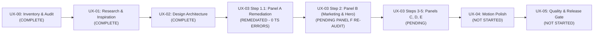
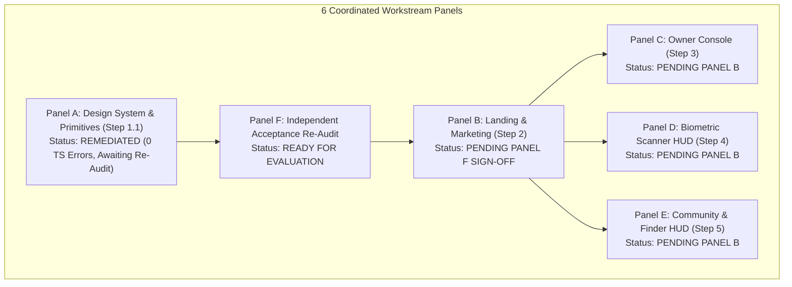

# SafePaws — Master UI/UX Transformation Tracker (Phases UX-00 to UX-05)

**Milestone:** Complete Award-Level UI/UX Transformation  
**Baseline Git Commit:** `57e63848ed48c275a97d180e4d094f3077ff00df`  
**Baseline Branch:** `frontend`  
**Execution Lead:** Principal Product Architect & Multi-Agent Orchestrator  
**Master Design Architecture:** [docs/UI_UX_DESIGN_ARCHITECTURE.md](file:///home/samudra/Projects/VisualSCode/VisualCode/Vscoding/Projects/SAFEPAWS/safepaws_sih/docs/UI_UX_DESIGN_ARCHITECTURE.md)  
**Research & Inventory Reference:** [docs/UI_UX_RESEARCH_AND_INVENTORY.md](file:///home/samudra/Projects/VisualSCode/VisualCode/Vscoding/Projects/SAFEPAWS/safepaws_sih/docs/UI_UX_RESEARCH_AND_INVENTORY.md)  
**Panel A Remediated Specification:** [docs/DESIGN_SYSTEM_PANEL_A.md](file:///home/samudra/Projects/VisualSCode/VisualCode/Vscoding/Projects/SAFEPAWS/safepaws_sih/docs/DESIGN_SYSTEM_PANEL_A.md)  
**Current Program State:** UX-00, UX-01, UX-02, and UX-03 Step 1.1 (Panel A Remediated) **COMPLETE & READY FOR PANEL F RE-AUDIT**  
**Last Updated:** November 21, 2026  

---

## 1. Verified Repository State & Preservation Baseline

```
[GIT PRESERVATION STATUS]
Committed HEAD:          57e63848ed48c275a97d180e4d094f3077ff00df (Verified)
Active Branch:           frontend (Verified)
Remote Tracking:         origin/frontend (0 behind, 0 ahead) (Verified)
Staging Index:           0 files staged (Empty / Clean: git diff --cached is empty)
Existing Tracked Diffs:  771 files (Preserved working-tree modifications from Phase 1C & 2.0)
Historical Status:       839 porcelain entries
In-Repo UI/UX Docs:      docs/UI_UX_TRANSFORMATION_TRACKER.md, docs/UI_UX_DESIGN_ARCHITECTURE.md,
                         docs/UI_UX_RESEARCH_AND_INVENTORY.md, docs/DESIGN_SYSTEM_PANEL_A.md,
                         docs/PROJECT_ARCHITECTURE.md, docs/DEVELOPMENT_SETUP.md
```

> [!IMPORTANT]
> **Working Tree Policy:** The working tree is **NOT clean**. It contains 771 tracked modifications (568 line-ending modifications and 115 semantic modifications) and historical untracked assets from Phase 1C and Phase 2.0. These changes represent essential project functionality and are strictly preserved. The staging index remains empty.

---

## 2. Master Transformation Phases & Milestone Tracker



| Phase Code | Milestone Title | Lead Workstream | Key Deliverables & Evidence | Status |
| :--- | :--- | :--- | :--- | :--- |
| **UX-00** | **Product Inventory & Baseline Audit** | Principal UX Architect | 15-route catalog, role permissions, user journeys, empty/loading/error states, feature-preservation matrix. Delivered in `docs/UI_UX_RESEARCH_AND_INVENTORY.md`. | **COMPLETE** |
| **UX-01** | **External Research & Inspiration** | Creative Director | 8 verified award benchmarks (Linear, Teenage Engineering, Stripe Press, Vision Pro, Raycast, Refokus, Cron, Vercel), open-source feasibility analysis. Delivered in `docs/UI_UX_RESEARCH_AND_INVENTORY.md`. | **COMPLETE** |
| **UX-02** | **Product Design Architecture** | Frontend Systems Architect | 5 visual experience modes, Tailwind v4 design tokens, UI primitives catalog, offline Web Crypto key lifecycle, 6-state sync machine, 6-panel ownership protocol. Delivered in `docs/UI_UX_DESIGN_ARCHITECTURE.md`. | **COMPLETE** |
| **UX-03 (Step 1.1)** | **Panel A: Remediation & Closure** | Design System Lead | Button accent contrast (6.11:1), Soft Ink token (#6E665C, 5.02:1), NumberTicker sr-only separation, 3DCard reduced-motion check, Spotlight unique `useId()`, FormField context auto-linkage, Input `wrapperClassName`. Verified via `npm run lint`. Delivered in `docs/DESIGN_SYSTEM_PANEL_A.md`. | **COMPLETE (AWAITING RE-AUDIT)** |
| **UX-03 (Step 2)** | **Panel B: Marketing & Landing Experience** | Brand & Marketing Lead | Editorial Hero, Asymmetric Bento grid, live alert marquee, brand storytelling. Targets: `LandingPage.tsx`, `Hero.tsx`, `FeaturesSection.tsx`, etc. | **PENDING PANEL F RE-AUDIT** |
| **UX-03 (Step 3)** | **Panel C: Owner Console & Pet Management** | Owner Console Lead | Linear-inspired console, status radar, pet registration, 3D collar tag preview. Targets: `Dashboard.tsx`, `NewPet.tsx`, `PetDetail.tsx`, `SetupProfile.tsx`. | **PENDING PANEL B** |
| **UX-03 (Step 4)** | **Panel D: Biometric Scanner HUD** | Biometric Scanner Lead | Spatial reticle HUD, camera isolation, 5-state result cards. Targets: `Scan.tsx`, `CameraView.tsx`, `ProcessingView.tsx`, `ResultView.tsx`. | **PENDING PANEL B** |
| **UX-03 (Step 5)** | **Panel E: Community & Finder HUD** | Community & Finder Lead | High-contrast finder view (`/p/:tagId`), recovery board (`/lost`), incident room (`/alerts/:id`), community feed (`/community/*`). | **PENDING PANEL B** |
| **UX-04** | **Motion Choreography & Polish** | Motion Designer | GSAP context timelines, smooth Lenis integration, 3D card physics, reduced-motion overrides, 60fps frame-rate protection. | **NOT STARTED** |
| **UX-05** | **Quality, Accessibility & Release Gate** | Panel F (Independent QA) | Independent WCAG 2.2 AA audit, Playwright E2E verification across all 15 routes, regression validation, release sign-off. | **NOT STARTED** |

---

## 3. Six-Panel Workstream Ownership & Execution Status



| Panel Code | Lead Workstream | Assigned Scope & Files | Dependencies | Status |
| :--- | :--- | :--- | :--- | :--- |
| **Panel A** | **Design System Lead** | `frontend/src/index.css`<br>`frontend/src/components/ui/*` (`Button`, `Input`, `Textarea`, `Select`, `Card`, `Badge`, `Dialog`, `FormField`, `EmptyState`, `LoadingState`, `bento-grid`, `shimmer-button`, `3d-card`, `number-ticker`, `spotlight`, `index.ts`) | None | **REMEDIATED (AWAITING RE-AUDIT)** |
| **Panel F** | **Independent QA Lead** | Verification of Panel A remediations (contrast, screen reader, reduced motion, FormField context), cross-route Playwright E2E suites, WCAG 2.2 AA audit. | Panel A | **READY FOR EVALUATION** |
| **Panel B** | **Marketing & Brand Lead** | `frontend/src/pages/LandingPage.tsx`<br>`frontend/src/pages/NotFound.tsx`<br>`frontend/src/components/Hero.tsx`<br>`frontend/src/components/FeaturesSection.tsx`<br>`frontend/src/components/TrustSection.tsx`<br>`frontend/src/components/CommunitySection.tsx`<br>`frontend/src/components/CtaSection.tsx`<br>`frontend/src/components/Footer.tsx` | Panel F Sign-Off | **PENDING PANEL F SIGN-OFF** |
| **Panel C** | **Owner Console Lead** | `frontend/src/pages/Dashboard.tsx`<br>`frontend/src/pages/SetupProfile.tsx`<br>`frontend/src/pages/pets/NewPet.tsx`<br>`frontend/src/pages/pets/PetDetail.tsx`<br>`frontend/src/components/DashboardNav.tsx`<br>`frontend/src/components/PetCard.tsx` | Panel B | **PENDING PANEL B** |
| **Panel D** | **Biometric Scanner Lead** | `frontend/src/pages/Scan.tsx`<br>`frontend/src/components/scan/CameraView.tsx`<br>`frontend/src/components/scan/ProcessingView.tsx`<br>`frontend/src/components/scan/ResultView.tsx` | Panel B | **PENDING PANEL B** |
| **Panel E** | **Community & Finder Lead** | `frontend/src/pages/PublicTagProfile.tsx`<br>`frontend/src/pages/ReportLost.tsx`<br>`frontend/src/pages/LostDogs.tsx`<br>`frontend/src/pages/AlertDetail.tsx`<br>`frontend/src/pages/Community.tsx`<br>`frontend/src/pages/CommunityPostDetail.tsx`<br>`frontend/src/pages/CommunityOnboarding.tsx`<br>`frontend/src/pages/ReportSighting.tsx` | Panel B | **PENDING PANEL B** |
