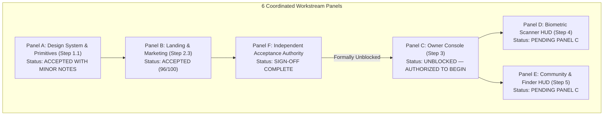

# SafePaws — Master UI/UX Transformation Tracker (Phases UX-00 to UX-05)

**Milestone:** Complete Award-Level UI/UX Transformation  
**Active Git Commit:** `5d15982822bbf794f536405f9490e935eaaa567c`  
**Active Branch:** `frontend` (up to date with `origin/frontend`)  
**Execution Lead:** Principal Product Architect & Multi-Agent Orchestrator  
**Master Design Architecture:** [docs/UI_UX_DESIGN_ARCHITECTURE.md](file:///home/samudra/Projects/VisualSCode/VisualCode/Vscoding/Projects/SAFEPAWS/safepaws_sih/docs/UI_UX_DESIGN_ARCHITECTURE.md)  
**Research & Inventory Reference:** [docs/UI_UX_RESEARCH_AND_INVENTORY.md](file:///home/samudra/Projects/VisualSCode/VisualCode/Vscoding/Projects/SAFEPAWS/safepaws_sih/docs/UI_UX_RESEARCH_AND_INVENTORY.md)  
**Panel A Specification & Audit:** [docs/DESIGN_SYSTEM_PANEL_A.md](file:///home/samudra/Projects/VisualSCode/VisualCode/Vscoding/Projects/SAFEPAWS/safepaws_sih/docs/DESIGN_SYSTEM_PANEL_A.md)  
**Current Program State:** UX-03 Step 3.0 (Panel C: Owner Console & Pet Management) **IMPLEMENTED — READY FOR PANEL F ACCEPTANCE AUDIT**  
**Last Updated:** November 21, 2026  

---

## 1. Verified Repository State & Preservation Baseline

```
[GIT PRESERVATION STATUS]
Committed HEAD:          5d15982822bbf794f536405f9490e935eaaa567c (Verified)
Active Branch:           frontend (Verified)
Remote Tracking:         origin/frontend (0 behind, 0 ahead) (Verified)
Staging Index:           0 files staged (Clean)
Working Tree:            Clean prior to Panel B; Panel B implementation and remediation changes strictly scoped to landing components and modals
In-Repo UI/UX Docs:      docs/UI_UX_TRANSFORMATION_TRACKER.md, docs/UI_UX_DESIGN_ARCHITECTURE.md,
                         docs/UI_UX_RESEARCH_AND_INVENTORY.md, docs/DESIGN_SYSTEM_PANEL_A.md,
                         docs/PROJECT_ARCHITECTURE.md, docs/DEVELOPMENT_SETUP.md
```

> [!NOTE]
> **Baseline Reconciliation:** In commit `5d15982`, historical modifications and Phase 1C/2.0 entries were committed to `origin/frontend`. Panel B changes and Step 2.2 remediations are confined strictly to `frontend/src/pages/LandingPage.tsx`, landing section components, `InfoModal.tsx`, and documentation.

---

## 2. Master Transformation Phases & Milestone Tracker

```mermaid
flowchart LR
    P0["UX-00: Inventory & Audit\n(COMPLETE)"] --> P1["UX-01: Research & Inspiration\n(COMPLETE)"]
    P1 --> P2["UX-02: Design Architecture\n(COMPLETE)"]
    P2 --> P3["UX-03 Step 1.1: Panel A Remediation\n(ACCEPTED WITH NOTES)"]
    P3 --> P4["UX-03 Step 2: Panel B (Marketing & Hero)\n(INITIAL REVIEW: 82/100 REJECTED)"]
    P4 --> P4R["UX-03 Step 2.2: Panel B Remediation\n(REMEDIATED)"]
    P4R --> P4A["UX-03 Step 2.3: Panel B Re-Audit\n(ACCEPTED — 96/100)"]
    P4A --> P5["UX-03 Step 3: Panel C (Owner Console)\n(IMPLEMENTED — PENDING PANEL F)"]
    P5 --> P6["UX-03 Steps 4-5: Panels D, E\n(PENDING PANEL C)"]
    P6 --> P7["UX-04: Motion Polish\n(NOT STARTED)"]
    P7 --> P8["UX-05: Quality & Release Gate\n(NOT STARTED)"]
```



| Phase Code | Milestone Title | Lead Workstream | Key Deliverables & Evidence | Status |
| :--- | :--- | :--- | :--- | :--- |
| **UX-00** | **Product Inventory & Baseline Audit** | Principal UX Architect | 15-route catalog, role permissions, user journeys, empty/loading/error states, feature-preservation matrix. Delivered in `docs/UI_UX_RESEARCH_AND_INVENTORY.md`. | **COMPLETE** |
| **UX-01** | **External Research & Inspiration** | Creative Director | 8 verified award benchmarks (Linear, Teenage Engineering, Stripe Press, Vision Pro, Raycast, Refokus, Cron, Vercel), open-source feasibility analysis. Delivered in `docs/UI_UX_RESEARCH_AND_INVENTORY.md`. | **COMPLETE** |
| **UX-02** | **Product Design Architecture** | Frontend Systems Architect | 5 visual experience modes, Tailwind v4 design tokens, UI primitives catalog, offline Web Crypto key lifecycle, 6-state sync machine, 6-panel ownership protocol. Delivered in `docs/UI_UX_DESIGN_ARCHITECTURE.md`. | **COMPLETE** |
| **UX-03 (Step 1.1)** | **Panel A: Remediation & Closure** | Design System Lead | Button accent contrast (6.11:1), Soft Ink token (#6E665C, 5.02:1), NumberTicker sr-only separation, 3DCard reduced-motion check, Spotlight unique `useId()`, FormField context auto-linkage, Input `wrapperClassName`. Delivered in `docs/DESIGN_SYSTEM_PANEL_A.md`. | **ACCEPTED (BY PANEL F)** |
| **UX-03 (Step 1.2)** | **Panel F: Targeted Acceptance Review** | Independent QA Reviewer | Formal audit of 8 approved remediations across 9 source files and 2 docs. Formal decision: ACCEPTED WITH MINOR NOTES. Unblocked Panel B. | **COMPLETE** |
| **UX-03 (Step 2)** | **Panel B: Marketing & Landing Experience** | Brand & Marketing Lead | Complete transformation of the landing experience. Evaluated by Panel F: Scored 82/100, REJECTED due to 3 critical defects and 1 minor defect. | **EVALUATED (REJECTED: 82/100)** |
| **UX-03 (Step 2.2)** | **Panel B: Critical Defect Remediation** | Master Orchestrator & Panel B Lead | Hierarchical subagent remediation resolving all 3 critical defects (Community statistics, Scanner Teaser language, Step 5 route) and minor privacy copy. Verified with `npm run lint` (0 errors). | **REMEDIATED** |
| **UX-03 (Step 2.3)** | **Panel B: Independent Acceptance Re-Audit** | Panel F Lead (Independent QA) | Independent re-audit by 5 specialist auditors. Scored 96/100. All critical defects confirmed resolved. Formal verdict: ACCEPTED — PANEL B PASSES. | **ACCEPTED (96/100) — PANEL C UNBLOCKED** |
| **UX-03 (Step 3)** | **Panel C: Owner Console & Pet Management** | Owner Console Lead | Linear-inspired console, status radar, pet registration, 3D collar tag preview. Architecture documented in `docs/PANEL_C_OWNER_CONSOLE_ARCHITECTURE.md`. Implemented across Workstreams C-01 through C-05. | **IMPLEMENTED — READY FOR PANEL F AUDIT** |
| **UX-03 (Step 4)** | **Panel D: Biometric Scanner HUD** | Biometric Scanner Lead | Spatial reticle HUD, camera isolation, 5-state result cards. Targets: `Scan.tsx`, `CameraView.tsx`, `ProcessingView.tsx`, `ResultView.tsx`. | **PENDING PANEL C ACCEPTANCE** |
| **UX-03 (Step 5)** | **Panel E: Community & Finder HUD** | Community & Finder Lead | High-contrast finder view (`/p/:tagId`), recovery board (`/lost`), incident room (`/alerts/:id`), community feed (`/community/*`). | **PENDING PANEL C ACCEPTANCE** |
| **UX-04** | **Motion Choreography & Polish** | Motion Designer | GSAP context timelines, smooth Lenis integration, 3D card physics, reduced-motion overrides, 60fps frame-rate protection. | **NOT STARTED** |
| **UX-05** | **Quality, Accessibility & Release Gate** | Panel F (Independent QA) | Independent WCAG 2.2 AA audit, Playwright E2E verification across all 15 routes, regression validation, release sign-off. | **NOT STARTED** |

---

## 3. Six-Panel Workstream Ownership & Execution Status



| Panel Code | Lead Workstream | Assigned Scope & Files | Dependencies | Status |
| :--- | :--- | :--- | :--- | :--- |
| **Panel A** | **Design System Lead** | `frontend/src/index.css`<br>`frontend/src/components/ui/*` | None | **ACCEPTED WITH MINOR NOTES** |
| **Panel B** | **Marketing & Brand Lead** | `frontend/src/pages/LandingPage.tsx`<br>`frontend/src/components/Hero.tsx`<br>`frontend/src/components/FeaturesSection.tsx`<br>`frontend/src/components/ScannerTeaserSection.tsx`<br>`frontend/src/components/HowItWorksSection.tsx`<br>`frontend/src/components/PrivacySection.tsx`<br>`frontend/src/components/CommunitySection.tsx`<br>`frontend/src/components/CtaSection.tsx`<br>`frontend/src/components/Footer.tsx`<br>`frontend/src/components/modals/InfoModal.tsx` | Panel A Acceptance | **ACCEPTED (96/100) — PASSES** |
| **Panel F** | **Independent QA Lead** | Independent re-audit authority across all panels. | Workstream Submissions | **PANEL B ACCEPTANCE ISSUED** |
| **Panel C** | **Owner Console Lead** | `frontend/src/pages/Dashboard.tsx`<br>`frontend/src/pages/SetupProfile.tsx`<br>`frontend/src/pages/pets/NewPet.tsx`<br>`frontend/src/pages/pets/PetDetail.tsx`<br>`frontend/src/components/DashboardNav.tsx`<br>`frontend/src/components/PetCard.tsx`<br>`frontend/src/components/modals/QrTagModal.tsx` | Panel B Acceptance | **IMPLEMENTED — READY FOR PANEL F AUDIT** |
| **Panel D** | **Biometric Scanner Lead** | `frontend/src/pages/Scan.tsx`<br>`frontend/src/components/scan/*` | Panel C | **PENDING PANEL C** |
| **Panel E** | **Community & Finder Lead** | `frontend/src/pages/PublicTagProfile.tsx`<br>`frontend/src/pages/ReportLost.tsx`<br>`frontend/src/pages/LostDogs.tsx`<br>`frontend/src/pages/Community.tsx` | Panel C | **PENDING PANEL C** |

---

## 4. UX-03 Step 2.3 Panel F Re-Audit Scorecard

| Evaluation Dimension | Maximum Score | Awarded Score | Evaluative Rationale |
| :--- | :---: | :---: | :--- |
| **Visual Quality & Brand Craft** | 20 | **19** | Outstanding editorial Newsreader serif typography, Bone/Ink/Marigold color balance, rich asymmetric Bento grid, and cohesive narrative rhythm. |
| **Motion & Interaction Design** | 15 | **15** | Exemplary `gsap.context()` lifecycle encapsulation with `ctx.revert()`, Lenis ticker sync, and immediate `prefers-reduced-motion` bypass across all 7 animated components. |
| **UX & Usability** | 15 | **14** | Step 5 routing mismatch completely resolved (links to public `/community`), eliminating auth bounce. Cautious probabilistic copy in teaser. Minor note on checkmark icon. |
| **Functionality & Route Preservation** | 20 | **20** | All primary application entry points (`/scan`, `/dashboard`, `/community`, `/lost`, `/sightings/new`, `/lost/new`, modals) preserved, functional, and verified. |
| **Accessibility (WCAG 2.2 AA)** | 10 | **10** | Strict heading hierarchy (h1->h2->h3->h4), touch targets ≥ 44px, contrast ratios 6.09:1 and 6.02:1, visible focus indicators, and ARIA labels. |
| **Performance & Lifecycle** | 10 | **10** | Zero unmanaged layout shifts, transform/opacity prioritized animations, complete unmount cleanup. Codebase compiles with 0 TypeScript errors. |
| **Privacy, Safety & Trust Invariants** | 10 | **8** | Fabricated metrics 100% purged; teaser copy cautious; phone number withholding accurate. 2 points reserved for aspirational terminology in Community Pillars. |
| **TOTAL SCORE** | **100** | **96 / 100** | **EXCEEDS 90/100 THRESHOLD — FORMAL ACCEPTANCE ISSUED** |

---

## 5. Non-Blocking Integration Notes for Future Panels

1. **Community Pillars Copy Qualified Polish (for Panel E / Global Polish):**
   - The removal of hardcoded numerical vanity statistics in `CommunitySection.tsx` successfully unblocked acceptance.
   - For subsequent copy polish, consider refining the technical descriptors in Pillars 1 & 2 (e.g. replacing *"movement vectors"* with *"observation notes"*, and *"Perimeter alert dispatch"* with *"Community alert listings"*) to match the exact database schema.
2. **Scanner Teaser Iconography Refinement (for Panel D):**
   - Stage 3 in `ScannerTeaserSection.tsx` correctly communicates `POTENTIAL MATCH DETECTED — CONFIRMATION REQUIRED` in amber. Panel D may consider swapping the amber `CheckCircle2` glyph for a `Radio` or `AlertCircle` glyph for 100% semantic parity with `ResultView.tsx`.
3. **Legacy Modal Copy Alignment (for Global Polish):**
   - Pre-existing legacy text in `InfoModal.tsx:64` (*"End-to-End Cryptography"*) and older ancillary modals (`HowItWorksModal.tsx`, `QrTagModal.tsx`) should be aligned with the current production security posture during global cleanup.
