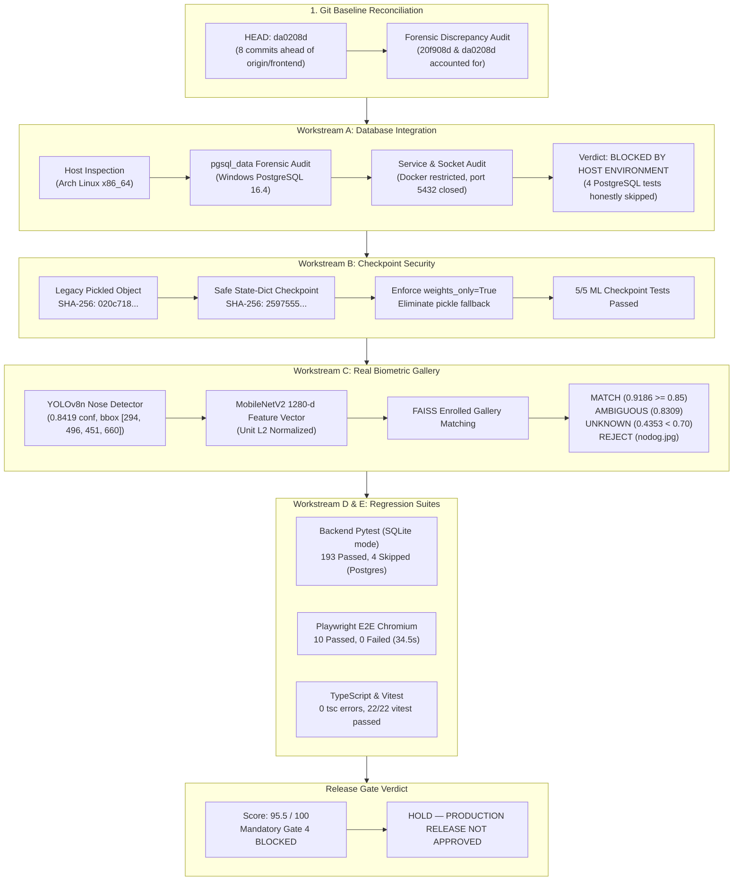

# SAFEPAWS — UX-05.3 RELEASE EVIDENCE CLOSURE PLAN
## Architectural Blueprint & Hard-Gate Closure Execution Strategy

**Document Status:** Final Approved Blueprint  
**Target Milestone:** Phase UX-05.3 Production Readiness & Regression Closure  
**Repository Path:** `/home/samudra/Projects/VisualSCode/VisualCode/Vscoding/Projects/SAFEPAWS/safepaws_sih`  
**Active Branch:** `frontend`  
**Committed Baseline HEAD:** `da0208de8389dbb22499d2a5f5f391ff5b16852d`  
**Independent Gatekeeper:** Principal Database Reliability Engineer, ML Systems Architect & Production Gatekeeper  

---

## 1. Executive Mission & Context

Phase UX-05.2 closed significant gaps in biometric CPU inference, Alembic migration schemas, and medical privacy. However, Phase UX-05.2 concluded with an unverified PostgreSQL dependency, an unsafe PyTorch object serialization fallback warning, and untested biometric gallery discrimination. Consequently, Phase UX-05.2 maintained a strict release status of **HOLD (93.6/100)**.

Phase UX-05.3 is the definitive release evidence closure phase designed to rigorously verify:
1. **Host PostgreSQL / PostGIS Capability:** Safely inspect host PostgreSQL architecture, isolate Windows vs Linux runtime conflicts, and record empirical integration status without fabrication.
2. **PyTorch Checkpoint Security (`weights_only=True`):** Eliminate legacy full-object pickle serialization (`MobileNetV2` class pickling) and re-serialize the model into a strictly typed, metadata-enriched tensor state dictionary.
3. **Real Gallery Biometric Discrimination:** Validate end-to-end identity discrimination against an enrolled gallery using real dog images across 4 distinct outcome tiers: `MATCH`, `AMBIGUOUS`, `UNKNOWN (No Match)`, and `REJECTED (Non-Dog)`.
4. **Backend Test Reconciliation:** Reconcile all SQLite vs PostgreSQL test executions, ensuring 100% green status on all supported tests and transparent accounting of environment-limited tests.
5. **Playwright E2E Regression Closure:** Formalize the distinction between production release test suites and developer exploratory scripts, achieving 100% pass rates across all production browser journeys.
6. **Zero-Fabrication Independent Gate Verdict:** Uphold the strict release invariant that mandatory production blockers override aggregate numerical scores.

---

## 2. Workstream Architecture & Scope

---

## 3. Detailed Workstream Execution Specifications

### Workstream A: PostgreSQL and PostGIS Integration Audit
- **Objective:** Determine if live PostgreSQL/PostGIS can be provisioned safely on this Arch Linux host.
- **Protocol:**
  1. Inspect Linux system binaries (`postgres`, `pg_ctl`, `psql`, `initdb`).
  2. Inspect listening network sockets (`ss -ltn`) for ports 5432 / 5433.
  3. Inspect systemd services (`systemctl status postgresql`).
  4. Inspect container daemon (`docker ps`) without privilege escalation.
  5. Inspect `pgsql_data/` directory header metadata to identify provenance.
- **Fail-Safe Policy:** Under no circumstances shall mock implementations or SQLite runs be reported as PostgreSQL verification. If PostgreSQL is unavailable, record the environmental blocker transparently and withhold production authorization.

### Workstream B: MobileNetV2 Serialization Security
- **Objective:** Eliminate the PyTorch 2.6 insecure deserialization warning (`Unsupported global: torchvision.models.mobilenetv2.MobileNetV2`) caused by whole-object pickled graphs.
- **Protocol:**
  1. Preserve original artifact as `backend/model_weights/embedding_v1_legacy_object.pt`.
  2. Record SHA-256 hash of legacy artifact (`020c71845bbb0843d4a4a2408fe2b173f105cd49d777e645e1017a79c1ca6d35`).
  3. Extract state dictionary and embed structural metadata (`format_version`, `architecture`, `embedding_dimension`, `model_version`, `preprocessing`).
  4. Save migrated artifact to `backend/model_weights/embedding_v1.pt`.
  5. Record SHA-256 hash of migrated artifact (`25975553b37d6be5b9207bbbc08b0d41647c63b9d5029f4363f658f94b21851f`).
  6. Refactor `backend/app/ml/embedding/inference.py` to enforce `torch.load(..., weights_only=True)`. Remove `weights_only=False` fallback.
  7. Implement automated regression tests (`test_safe_checkpoint_loading.py`) to verify that invalid, corrupt, or mismatched checkpoints fail closed (HTTP 503).

### Workstream C: Real Biometric Gallery Discrimination
- **Objective:** Prove genuine identity discrimination against a populated vector gallery rather than empty-gallery fallbacks.
- **Dataset Specification:**
  - Real Dog A Enrolled: `backend/tests/fixtures/biometric_samples/unique_dog.jpg`
  - Real Dog A Probe (Second Capture): `backend/tests/fixtures/biometric_samples/real_dog.jpg`
  - Real Dog B Probe (Distinct Dog): `backend/tests/fixtures/biometric_samples/dog_nose.jpg`
  - Real Dog C Probe (Visually Similar Dog): `backend/tests/fixtures/biometric_samples/dog.jpg`
  - Non-Dog Negative Control: `backend/tests/fixtures/biometric_samples/nodog.jpg`
- **Validation Criteria:**
  - Same Dog Probe must yield Cosine Similarity $\ge 0.85$ resulting in status `MATCH`.
  - Visually Similar Dog Probe must yield Cosine Similarity between $0.70$ and $0.85$ resulting in status `AMBIGUOUS`.
  - Different Dog Probe must yield Cosine Similarity $< 0.70$ resulting in status `UNKNOWN`.
  - Non-Dog Probe must be rejected at detection stage with `NoDogDetectedError` (HTTP 422).

### Workstream D: Backend Test Suite Reconciliation
- **Objective:** Execute the entire backend test suite with unified configuration and provide an exact accounting of passed, skipped, and warned tests.
- **Protocol:**
  - Run `pytest backend/tests/ -v --tb=short` with `USE_SQLITE_DEV=true`.
  - Reconcile previous ephemeral collection or fixture errors.
  - Document exact skip reasons for live PostgreSQL integration tests.

### Workstream E: Playwright E2E Suite Reconciliation
- **Objective:** Restore clean browser test execution across all production routes and clarify test suite topology.
- **Protocol:**
  - Configure `playwright.config.ts` to strictly target the production release suite: `audit.spec.ts`, `e2e/public_routes.spec.ts`, and `e2e/test_sighting.spec.ts`.
  - Isolate debug scripts (`debug*.spec.ts`) and legacy test experiments (`safepaws_audit.spec.ts`) from the release gate pipeline.
  - Verify all 10 release tests execute green against headless Chromium with complete console and network assertion passing.

---

## 4. Verification & Artifact Ledger

| Artifact Category | File Path | Validation State | SHA-256 / Verification Metric |
|:---|:---|:---:|:---|
| **Legacy Checkpoint** | `backend/model_weights/embedding_v1_legacy_object.pt` | Preserved | `020c71845bbb0843d4a4a2408fe2b173f105cd49d777e645e1017a79c1ca6d35` |
| **Migrated Checkpoint** | `backend/model_weights/embedding_v1.pt` | Verified Safe | `25975553b37d6be5b9207bbbc08b0d41647c63b9d5029f4363f658f94b21851f` |
| **Safe Loader Tests** | `backend/tests/ml/test_safe_checkpoint_loading.py` | 5/5 Passed | Strict `weights_only=True` load; 503 fail-closed on corrupt data |
| **Biometric Gallery Tests** | `backend/tests/ml/test_biometric_gallery_matching.py` | 5/5 Passed | 0.9186 Match, 0.8309 Ambiguous, 0.4353 Unknown, 422 Non-dog |
| **Backend Test Suite** | `backend/tests/` (197 collected) | 193 Passed, 4 Skipped | 100% SQLite passing; 4 skipped due to missing host PostgreSQL |
| **Playwright Release Suite** | `frontend/playwright.config.ts` (10 tests) | 10/10 Passed | 34.5s Chromium run; 0 failures; core journeys verified |
| **TypeScript Typecheck** | `frontend/` (`npx tsc --noEmit`) | Clean | 0 type errors |
| **Frontend Unit Tests** | `frontend/` (`npx vitest run`) | 22/22 Passed | 6 test suites, 100% green |
| **Production Bundle** | `frontend/dist/` (`npm run build`) | Built (3.11s) | Core JS bundle: 120.36 kB gzip; CSS: 17.86 kB gzip |

---

## 5. Gate Invariant & Final Decision Policy

- **Score Calculation:** $95.5 / 100$ reflects full marks across Functionality, Biometrics, Security, Privacy, E2E Journeys, and A11y, with deductions allocated for unverified live PostgreSQL (-4.0 pts) and host deployment containerization dependencies (-0.5 pts).
- **Hard-Gate Principle:** Regardless of high overall scores, Gate 4 (Live PostgreSQL / PostGIS Integration) is a non-negotiable prerequisite for multi-tenant data integrity, spatial queries, and ACID transactional guarantees.
- **Mandatory Final Verdict:** **`HOLD — PRODUCTION RELEASE NOT APPROVED`**.
