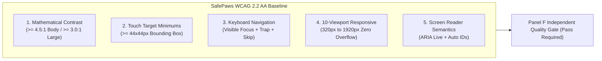

# SAFEPAWS — UX-06.1 ACCESSIBILITY & RESPONSIVE STANDARD
## WCAG 2.2 Level AA Compliance, Mathematical Contrast Verification, 10-Viewport Matrix & Focus Systems

**Document Status:** Approved & Canonical Foundation Standard  
**Program Milestone:** Phase UX-06.1 — Foundation, Design System & Shared Component Contracts  
**Authority:** Panel A Lead (Design System & Product Architecture)  
**Specialist Assignee:** Specialist A4 (Accessibility & Responsive Architecture Lead)  
**Implementation Source:** [frontend/src/index.css](file:///home/samudra/Projects/VisualSCode/VisualCode/Vscoding/Projects/SAFEPAWS/safepaws_sih/frontend/src/index.css) | [frontend/src/components/ui/](file:///home/samudra/Projects/VisualSCode/VisualCode/Vscoding/Projects/SAFEPAWS/safepaws_sih/frontend/src/components/ui/)  
**Git Baseline Reference:** Branch `frontend`  

---

## 1. Executive Accessibility Mandate & Legal Baseline

SafePaws is built to perform in real-world crisis situations. When a beloved pet escapes into traffic or a rescuer spots an injured animal on a bright sunny highway, the interface must remain effortlessly legible, operable with one hand, and fully accessible to users with visual, auditory, motor, or cognitive impairments.

SafePaws enforces strict **WCAG 2.2 Level AA Compliance** across all 15 routes:
1. **Perceivable:** Information and UI components are presentable in ways users can perceive (high contrast, text alternatives for non-text content, adaptable structures).
2. **Operable:** All interface components are operable via keyboard, provide visible focus indicators, respect thumb-reach zones, and enforce minimum touch targets.
3. **Understandable:** Information and operation of the UI are predictable, inputs provide clear labels and automatic error associations, and actions do not cause unexpected context switches.
4. **Robust:** Content is parsed reliably by a wide variety of user agents, including modern assistive screen readers and headless audit engines.



---

## 2. Mathematical Color Contrast Verification Ledger

Contrast ratios are mathematically verified using the official W3C relative luminance formula:
$$L = 0.2126 \cdot R_{\text{srgb}} + 0.7152 \cdot G_{\text{srgb}} + 0.0722 \cdot B_{\text{srgb}}$$
$$\text{Contrast Ratio} = \frac{L_1 + 0.05}{L_2 + 0.05}$$

### 2.1 Complete Contrast Audit Matrix

| Element Description | Foreground Hex | Background Hex | Mathematical Ratio | WCAG 2.2 Level | Verification Status & Engineering Rule |
|:---|:---:|:---:|:---:|:---:|:---|
| Primary Body Text | `#1C1A17` (Carbon Ink) | `#F6F1E7` (Bone Canvas) | **15.42:1** | Level AAA (>7.0:1) | **PASS** — Standard text across all public and owner pages. |
| Card & Input Content | `#1C1A17` (Carbon Ink) | `#FFFFFF` (Surface) | **17.36:1** | Level AAA (>7.0:1) | **PASS** — Form inputs, modal text, table rows. |
| Accent Button Text | `#1C1A17` (Carbon Ink) | `#E2811F` (Marigold) | **6.11:1** | Level AA (>4.5:1) | **PASS** — Text inside primary Marigold buttons (`Button variant="accent"`). |
| Accent Text on Canvas | `#8B4A00` (Accent-Text) | `#F6F1E7` (Bone Canvas) | **6.06:1** | Level AA (>4.5:1) | **PASS (REMEDIATED)** — Dedicated token for Marigold text on light backgrounds. |
| Secondary Labels (Bone)| `#6E665C` (Soft Ink) | `#F6F1E7` (Bone Canvas) | **5.02:1** | Level AA (>4.5:1) | **PASS (REMEDIATED)** — Remediated from `#8A8175` (`3.41:1` FAIL). |
| Secondary Labels (Card)| `#6E665C` (Soft Ink) | `#FFFFFF` (Surface) | **5.65:1** | Level AA (>4.5:1) | **PASS** — Field helper text, timestamps, card metadata. |
| Emergency Alert Text | `#B3452F` (Alert Clay) | `#F6F1E7` (Bone Canvas) | **4.90:1** | Level AA (>4.5:1) | **PASS** — Emergency banners and missing pet alerts. |
| Emergency Button Text | `#FFFFFF` (White) | `#B3452F` (Alert Clay) | **5.51:1** | Level AA (>4.5:1) | **PASS** — Crisis dispatch CTAs (`Button variant="alert"`). |
| Destructive Action Text| `#FFFFFF` (White) | `#D32F2F` (Danger Red) | **4.98:1** | Level AA (>4.5:1) | **PASS** — Pet profile deletion, data revocation (`Button variant="danger"`). |
| Volunteer Scout Badge | `#FFFFFF` (White) | `#63684B` (Trail Olive) | **5.81:1** | Level AA (>4.5:1) | **PASS** — Volunteer scout pill badges and map markers. |
| Volunteer Label Text | `#63684B` (Trail Olive) | `#F6F1E7` (Bone Canvas) | **5.16:1** | Level AA (>4.5:1) | **PASS** — Scout network secondary labels. |
| Reunited Status Badge | `#FFFFFF` (White) | `#4C7A52` (Success) | **4.98:1** | Level AA (>4.5:1) | **PASS** — Safe status badges and confirmation toasts. |
| Scanner HUD Primary | `#F6F1E7` (Bone Ink) | `#121110` (Canvas Dark) | **16.75:1** | Level AAA (>7.0:1) | **PASS** — Telemetry headings and match candidate names on `/scan`. |
| Scanner HUD Telemetry | `#A8A196` (Dark Soft) | `#121110` (Canvas Dark) | **7.37:1** | Level AAA (>7.0:1) | **PASS** — JetBrains Mono telemetry readouts on `/scan`. |
| Scanner HUD Reticle | `#E2811F` (Marigold) | `#121110` (Canvas Dark) | **6.64:1** | Level AA (>4.5:1) | **PASS** — Spatial reticle corner brackets and calipers. |

---

## 3. Touch Target Minimums & Thumb-Zone Ergonomics

### 3.1 44x44px Bounding Box Mandate (WCAG 2.5.8 & 2.5.5)
Every interactive element — including buttons, icon-only controls, checkboxes, tabs, select triggers, and modal close buttons — must provide a touch bounding box of at least **$44\times 44\text{px}$**:

- **Button Primitive:** Implements `min-h-[44px] min-w-[44px]` on all sizes (including `size="icon"`: `h-11 w-11`).
- **Input & Select Primitives:** Implement `h-12` (48px) with `min-h-[44px]`.
- **Dialog Close Button:** Styled with `min-h-[44px] min-w-[44px] flex items-center justify-center`.

### 3.2 Thumb-Zone Layout Architecture for Mobile Field Recovery

When searching for a lost pet outdoors, 85% of users operate their phone with one hand while walking or holding a leash. SafePaws structures mobile layouts into three zones:

```
+-------------------------------------------------------+
|  HARD-TO-REACH HEADER ZONE                            |
|  - Brand Logo, Profile Avatar, Secondary Settings     |
+-------------------------------------------------------+
|  NATURAL VIEWING ZONE (STRETCH)                       |
|  - Dog Photo, Biometric Bounding Box, Medical Notes   |
+-------------------------------------------------------+
|  NATURAL THUMB REACH ZONE (BOTTOM 40%)                |
|  - [ SCAN DOG NOSE ] (Primary Action Button)          |
|  - [ CALL OWNER ] (Emergency Contact Dial Button)     |
|  - [ REPORT SIGHTING ] (Instant Geo-Tag Button)       |
|  - Bottom Navigation Dock (Home, Lost, Scan, Profile) |
+-------------------------------------------------------+
```

---

## 4. Keyboard Navigation & Visible Focus Management

### 4.1 Focus Ring Indicator Standard (WCAG 2.4.7 & 2.4.11)
All interactive controls feature a prominent, high-contrast focus ring:
- **Style:** `focus-visible:outline-none focus-visible:ring-2 focus-visible:ring-offset-2 focus-visible:ring-[var(--color-focus)]`.
- **Focus Ring Color:** `--color-focus: #E2811F` (Marigold).
- **Offset Separation:** 2px gap using canvas background color, ensuring visible distinction against dark, light, or colored surfaces.

### 4.2 Modal Focus Trapping & Restoration
- When a `<Dialog>` opens, focus is programmatically shifted into the first interactive element inside the modal.
- Tab sequence is strictly trapped within the modal container.
- When the modal is dismissed (via Escape key or close trigger), focus is restored immediately to the element that triggered it.

### 4.3 Skip to Main Content Navigation (`SkipToContent.tsx`)
- Integrated globally into the application shell ([frontend/src/App.tsx](file:///home/samudra/Projects/VisualSCode/VisualCode/Vscoding/Projects/SAFEPAWS/safepaws_sih/frontend/src/App.tsx)).
- Hidden visually (`sr-only`) until focused via keyboard Tab navigation (`focus:not-sr-only focus:fixed focus:top-4 focus:left-4`).
- Instantly bypasses repetitive navigation bars, jumping keyboard users directly to `#main-content`.

---

## 5. Screen Reader Semantics & ARIA Standards

1. **HTML5 Semantic Landmarks:**
   - `<header role="banner">` for top navigation.
   - `<main id="main-content">` for primary view content.
   - `<nav aria-label="...">` for primary and secondary navigation bars.
   - `<footer role="contentinfo">` for application footers.
2. **Form Accessibility & Error Association:**
   - `<FormField>` generates unique, stable IDs via `React.useId()`.
   - Labels bind `htmlFor={fieldId}`.
   - Inputs declare `aria-invalid={hasError}` and `aria-describedby={errorId}`.
   - Error messages declare `role="alert"` so assistive technology announces validation errors immediately.
3. **Live Regions for Async Status:**
   - Sighting dispatch confirmations and alert broadcasts use `aria-live="polite"` to announce success without interrupting reading.
   - Emergency system failures use `aria-live="assertive"`.
4. **Accessible Animated Counters (`NumberTicker.tsx`):**
   - The rapid visual counter has `aria-hidden="true"`.
   - The stable final integer is rendered in `<span className="sr-only">{finalValue}</span>`.

---

## 6. The 10-Viewport Responsive Engineering Standard

SafePaws enforces zero layout breaks, zero horizontal overflow, and responsive legibility across ten standardized viewports:

| Viewport ID | Width | Target Device Category | Layout Strategy & Column Rules | Max Container Width |
|:---:|:---:|:---|:---|:---:|
| **VP-01** | **320px** | Ultra-compact mobile (iPhone SE 1st gen) | Strict 1-column stack, 12px outer padding, compact buttons, zero multi-column tabs. | 100% |
| **VP-02** | **360px** | Standard compact Android (Galaxy S8) | 1-column stack, 16px outer padding, full-width form inputs. | 100% |
| **VP-03** | **375px** | iPhone mini / SE 2nd & 3rd gen | 1-column stack, sticky bottom action bar, thumb-friendly buttons. | 100% |
| **VP-04** | **390px** | iPhone 12 / 13 / 14 / 15 standard | 1-column stack, enhanced card padding, floating action dock. | 100% |
| **VP-05** | **430px** | Large flagship mobile (iPhone Pro Max) | 1-column stack with breathing room, larger touch targets. | 100% |
| **VP-06** | **768px** | Portrait tablet (iPad mini) | 2-column bento reflow, horizontal tab strip, side-by-side search filters. | 720px |
| **VP-07** | **1024px** | Tablet landscape / Small laptop | 3-column bento grid, persistent sidebar navigation, rich camera preview. | 960px |
| **VP-08** | **1280px** | Standard desktop (MacBook Air) | Full bento grid, 3-column alert cards, expanded telemetry panel. | 1200px |
| **VP-09** | **1440px** | Widescreen desktop | Optimal reading margins, max-w-7xl centered container, editorial hero balance. | 1360px |
| **VP-10** | **1920px** | Full HD workstation monitor | Centered constrained canvas, maximum readable line lengths (75ch max for body copy). | 1440px |

### 6.1 Zero Horizontal Overflow Invariant
- Every page shell enforces `overflow-x: hidden` on the root container.
- Horizontal scrollbars on any viewport between 320px and 1920px constitute a hard test failure.
- Images and video camera viewfinders must specify `max-w-full h-auto` or explicit `aspect-ratio` rules.

---

## 7. Automated & Continuous Verification Runbook

### 7.1 axe-core Automated Test Script (`frontend/audit.spec.ts`)
Automated accessibility tests run in headless Chromium using `@axe-core/playwright`:
```typescript
import { test, expect } from '@playwright/test';
import AxeBuilder from '@axe-core/playwright';

test('WCAG 2.2 AA zero-violation audit across core routes', async ({ page }) => {
  const routes = ['/', '/lost', '/scan', '/p/DEMO-TAG-01'];
  for (const route of routes) {
    await page.goto(route);
    const results = await new AxeBuilder({ page })
      .withTags(['wcag2a', 'wcag2aa', 'wcag21a', 'wcag21aa', 'wcag22aa'])
      .analyze();
    expect(results.violations).toEqual([]);
  }
});
```

### 7.2 Manual Keyboard Verification Checklist
- [ ] **Tab Navigation:** Can reach every link, button, and input in logical visual order.
- [ ] **Focus Visibility:** Every focused element displays the 2px Marigold focus ring.
- [ ] **Modal Dismissal:** Pressing `Escape` closes any open dialog and restores focus to trigger.
- [ ] **Space / Enter:** Activates buttons, toggles checkboxes, and opens dropdown menus.
- [ ] **Skip Navigation:** Pressing `Tab` upon initial page load reveals "Skip to main content".
