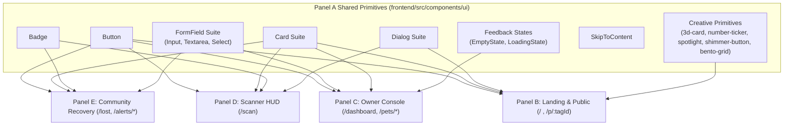

# SAFEPAWS — UX-06.1 COMPONENT CONTRACTS
## Shared UI Primitives, Component Interfaces, ARIA Semantics & Downstream Consumption Matrix

**Document Status:** Approved & Canonical Foundation Standard  
**Program Milestone:** Phase UX-06.1 — Foundation, Design System & Shared Component Contracts  
**Authority:** Panel A Lead (Design System & Product Architecture)  
**Specialist Assignees:** Specialist A1 (Product Experience Architect) & Specialist A3 (Frontend Foundation Engineer)  
**Implementation Source:** [frontend/src/components/ui/](file:///home/samudra/Projects/VisualSCode/VisualCode/Vscoding/Projects/SAFEPAWS/safepaws_sih/frontend/src/components/ui/)  
**Git Baseline Reference:** Branch `frontend`  

---

## 1. Architectural Philosophy & Component Invariants

All SafePaws UI primitives adhere to five foundational engineering invariants:

1. **Headless Accessibility via Radix UI:** Complex behavioral primitives (Dialogs, Portals, Focus Traps) use battle-tested Radix UI primitives with zero styling baggage, decorated via Tailwind CSS v4.
2. **Explicit ForwardRef & Prop Forwarding:** Every primitive wraps its root node with `React.forwardRef<T, P>`, forwarding DOM references and native attributes (`className`, `style`, `aria-*`, `data-*`).
3. **Automatic Contextual ID Linkage:** Form controls generate collision-free unique IDs using `React.useId()`, linking `<label htmlFor>`, `<input id aria-describedby>`, and `<p role="alert">` automatically without manual ID prop plumbing.
4. **Touch Target Guarantee:** Every interactive control enforces a minimum bounding box of **$44\times 44\text{px}$** (`min-h-[44px] min-w-[44px]`), meeting WCAG 2.2 Target Size (Minimum) Criterion 2.5.8.
5. **Reduced-Motion Safety:** Visual animations, 3D perspective shifts, and spring tickers automatically degrade to static, non-vestibular presentations when `prefers-reduced-motion` is detected.



---

## 2. Interactive Primitives Catalog & Contracts

### 2.1 `Button`
- **File:** `frontend/src/components/ui/Button.tsx`
- **Role:** Primary interactive trigger for navigation, form submission, and dialog toggles.

```typescript
export interface ButtonProps extends React.ButtonHTMLAttributes<HTMLButtonElement> {
  variant?: 'primary' | 'secondary' | 'accent' | 'outline' | 'ghost' | 'danger' | 'alert' | 'scanner';
  size?: 'default' | 'sm' | 'lg' | 'icon';
  fullWidth?: boolean;
  isLoading?: boolean;
  leftIcon?: React.ReactNode;
  rightIcon?: React.ReactNode;
}
```

#### Variants & Contrast Specifications:
- `primary`: Carbon Ink (`#1C1A17`) background with Bone (`#F6F1E7`) text. Contrast: **15.42:1 (AAA)**.
- `accent`: Marigold (`#E2811F`) background with Carbon Ink (`#1C1A17`) text. Contrast: **6.11:1 (AA Pass)**.
- `secondary`: White (`#FFFFFF`) surface with 1px Border (`#E5E0D8`) and Carbon Ink text.
- `outline`: 2px Carbon Ink border with transparent background, fills on hover.
- `ghost`: Transparent surface with hover highlight.
- `alert`: Crisis Clay (`#B3452F`) with pure white text. Contrast: **5.51:1 (AA Pass)**.
- `danger`: Destructive Red (`#D32F2F`) with pure white text. Contrast: **4.98:1 (AA Pass)**.
- `scanner`: Translucent dark glass (`#252320`) with 1px border and Marigold glow on hover.

#### Accessibility & Behavioral Features:
- Sets `aria-busy="true"` and `disabled` when `isLoading={true}`, replacing content with a spinning `Loader2` indicator and accessible loading text.
- Minimum bounding box: `min-h-[44px] min-w-[44px]`.
- Active tactile feedback: `active:scale-[0.98] motion-reduce:active:scale-100`.
- Focus ring: `focus-visible:ring-2 focus-visible:ring-offset-2 focus-visible:ring-[var(--color-focus)]`.

---

### 2.2 `Badge`
- **File:** `frontend/src/components/ui/Badge.tsx`
- **Role:** Categorical labeling, identity status, emergency broadcasting state, and telemetry tags.

```typescript
export interface BadgeProps extends React.HTMLAttributes<HTMLDivElement> {
  variant?: 'default' | 'accent' | 'success' | 'danger' | 'alert' | 'scout' | 'telemetry' | 'outline' | 'neutral';
  pulse?: boolean;
}
```

#### Semantic Roles:
- `default`: General metadata (Carbon Ink on Bone).
- `accent`: Marigold highlight with dark text (**6.11:1 AA**).
- `success`: Reunited status, biometric enrollment verified (**4.98:1 AA**).
- `danger`: Critical error, system offline (**4.98:1 AA**).
- `alert`: Active missing pet broadcast (**5.51:1 AA**).
- `scout`: Volunteer neighborhood scout indicator (Trail Olive, **5.81:1 AA**).
- `telemetry`: Monospace tabular chip for FAISS distance, bounding box coordinates, and sensor values (`font-mono`).
- `pulse`: When `true`, prepends an animated radar ping dot (`animate-ping`) for live incidents.

---

### 2.3 `Card` Suite
- **File:** `frontend/src/components/ui/Card.tsx`
- **Exports:** `Card`, `CardHeader`, `CardTitle`, `CardDescription`, `CardContent`, `CardFooter`
- **Role:** Structural surface for content grouping, bento-grid cells, and incident summaries.

```typescript
export interface CardProps extends React.HTMLAttributes<HTMLDivElement> {
  variant?: 'default' | 'interactive' | 'crisis' | 'dark' | 'glass';
}
```

#### Variant Roles:
- `default`: Standard clean white card with `--shadow-card` and subtle border.
- `interactive`: Cursor pointer, hover lift (`hover:shadow-[var(--shadow-card-hover)]`), border darkening.
- `crisis`: 2px Alert Clay border (`#B3452F`) for active lost dog alerts.
- `dark`: Deep Carbon surface (`#1C1A17`) with translucent border for scanner mode.
- `glass`: Translucent blurred surface (`rgba(255,255,255,0.85)` + `backdrop-blur-md`).

---

### 2.4 `Dialog` & Modal Architecture
- **File:** `frontend/src/components/ui/Dialog.tsx`
- **Exports:** `Dialog`, `DialogTrigger`, `DialogContent`, `DialogTitle`, `DialogDescription`, `DialogClose`, `DialogOverlay`, `DialogPortal`
- **Role:** Accessible modal layer for pet registration, QR tag details, image zooms, and crisis dispatches.

```typescript
export interface DialogContentProps extends React.ComponentPropsWithoutRef<typeof DialogPrimitive.Content> {
  size?: 'sm' | 'md' | 'lg' | 'xl' | 'full';
  showCloseButton?: boolean;
}
```

#### Behavioral Invariants:
1. **Focus Trap:** Radix UI automatically restricts keyboard tab sequence within modal boundaries.
2. **Focus Restoration:** Upon modal close (via Escape key, close button, or overlay click), focus returns directly to the triggering element.
3. **Screen Reader Announcement:** `DialogTitle` (`aria-labelledby`) and `DialogDescription` (`aria-describedby`) are linked to the modal container.
4. **Close Target:** Includes standard close button with `min-h-[44px] min-w-[44px]` touch target and `aria-label="Close dialog"`.

---

### 2.5 Form Controls & `FormField` Suite
- **Files:** `FormField.tsx`, `Input.tsx`, `Textarea.tsx`, `Select.tsx`
- **Role:** High-accessibility, error-resilient form inputs for pet profile setup, lost reporting, and sighting notes.

```typescript
// Context Provider Schema
export interface FormFieldContextValue {
  id: string;             // Deterministic field ID, e.g. "field-r0"
  hasError: boolean;      // Error boolean flag
  errorId: string;        // E.g. "field-r0-error"
  descriptionId: string;  // E.g. "field-r0-description"
}
```

#### Control Contracts:
- `<FormField hasError={boolean}>`: Creates context provider via `React.useId()`.
- `<FormLabel required={boolean}>`: Auto-consumes `htmlFor={id}`, appends accessible required asterisk.
- `<FormHelperText>`: Auto-consumes `id={descriptionId}`, styled with Soft Ink (`#6E665C`).
- `<FormError>`: Auto-consumes `id={errorId}`, renders `role="alert"` for screen reader interruption.
- `<Input>`, `<Textarea>`, `<Select>`:
  - Automatically bind `id={id}`, `aria-invalid={hasError}`, and `aria-describedby={hasError ? errorId : descriptionId}`.
  - Enforce `min-h-[44px]` touch target height.
  - Accept `wrapperClassName` for external layout positioning without overriding internal control styling.

---

### 2.6 Data Feedback & Fallback Primitives

#### `EmptyState` (`frontend/src/components/ui/EmptyState.tsx`)
```typescript
interface EmptyStateProps extends React.HTMLAttributes<HTMLDivElement> {
  title: string;
  description?: string;
  action?: React.ReactNode;
  icon?: React.ReactNode;
}
```
- Tactile dashed border (`border-2 border-dashed border-[var(--color-border)]`) on warm Bone canvas.
- Clear typographic hierarchy for zero-record states (e.g., no registered pets, no active sightings).

#### `LoadingState` (`frontend/src/components/ui/LoadingState.tsx`)
```typescript
interface LoadingStateProps extends React.HTMLAttributes<HTMLDivElement> {
  text?: string;
}
```
- Animated Marigold accent spinner ring (`border-[var(--color-accent)] border-t-transparent animate-spin`).
- Accessible loading description text.

#### `SkipToContent` (`frontend/src/components/ui/SkipToContent.tsx`)
```typescript
interface SkipToContentProps extends React.AnchorHTMLAttributes<HTMLAnchorElement> {
  targetId?: string; // Default: "main-content"
  label?: string;    // Default: "Skip to main content"
}
```
- Visually hidden until keyboard focus (`sr-only focus:not-sr-only focus:fixed focus:top-4 focus:left-4`).
- Provides instantaneous keyboard navigation bypass over extensive navigation headers.

---

## 3. Creative & Interactive Primitives

| Component Name | Source File | Creative Pattern | Accessibility Remediation Applied |
|:---|:---|:---|:---|
| **`NumberTicker`** | `number-ticker.tsx` | Spring-driven animated counter for community rescue stats. | Rapid intermediate numbers hidden via `aria-hidden="true"`; static final number provided in `<span className="sr-only">`. Renders immediately under reduced-motion. |
| **`3DCard`** | `3d-card.tsx` | Cursor-reactive perspective tilt for collar tags & pet cards. | Explicitly checks `(prefers-reduced-motion: reduce)`. Resets transform to `rotateY(0deg) rotateX(0deg)` when active. Bypassed on touch devices. |
| **`Spotlight`** | `spotlight.tsx` | SVG radial gradient beam for dramatic section backdrops. | Generates collision-free filter IDs via `React.useId()` (`spotlight-filter-:r0:`), preventing cross-instance SVG distortion. |
| **`BentoGrid`** | `bento-grid.tsx` | Asymmetric card container for dashboard features. | Pure CSS grid with responsive 1-to-3 column reflow; zero JavaScript layout overhead. |
| **`ShimmerButton`**| `shimmer-button.tsx` | Shimmering light sweep CTA for high-conversion actions. | Shimmer animation respects reduced-motion; maintains WCAG AA contrast throughout entire sweep cycle. |

---

## 4. Downstream Panel Consumption Matrix

| Panel & Domain Scope | Assigned Lead | Primary Primitives Consumed | Required Contract Invariants |
|:---|:---:|:---|:---|
| **Panel B** (Landing Page & Finder Narrative) | B Lead | `Button`, `Dialog`, `Card`, `3d-card`, `spotlight`, `number-ticker`, `shimmer-button`, `SkipToContent` | Must use `--color-accent-text` for text links; Lenis smooth scroll active only on desktop. |
| **Panel C** (Owner Console & Pet Management) | C Lead | `FormField`, `Input`, `Select`, `Textarea`, `Button`, `Badge`, `Card`, `EmptyState` | Must wrap all form fields in `FormField`; medical notes toggle must provide optimistic feedback. |
| **Panel D** (Biometric Scanner & Identity HUD) | D Lead | `Button` (scanner variant), `Card` (dark variant), `Badge` (telemetry variant), `Dialog` | Reticle HUD must operate against `--color-canvas-dark`; confidence readouts must use JetBrains Mono. |
| **Panel E** (Community Board & Recovery Room) | E Lead | `Card` (crisis variant), `AlertCard`, `Badge` (alert, scout), `FormField`, `Button` | Urgent sighting buttons must have $\ge 44\times 44\text{px}$ touch targets; recovery filter chips must use `Badge`. |
| **Panel F** (Independent Quality Authority) | F Lead | All Primitives | Audits touch targets, focus rings, axe-core violations, and TypeScript contracts across 10 viewports. |
