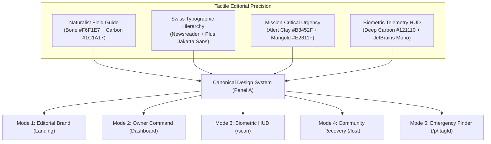

# SAFEPAWS — UX-06.1 DESIGN SYSTEM SPECIFICATION
## Master Visual Identity, Color Token Mathematics, Typographic Hierarchy & Spatial Foundation

**Document Status:** Approved & Canonical Foundation Standard  
**Program Milestone:** Phase UX-06.1 — Foundation, Design System & Shared Component Contracts  
**Authority:** Panel A Lead (Design System & Product Architecture)  
**Specialist Assignee:** Specialist A2 (Visual Design & Brand Systems Director)  
**Implementation Source:** [frontend/src/index.css](file:///home/samudra/Projects/VisualSCode/VisualCode/Vscoding/Projects/SAFEPAWS/safepaws_sih/frontend/src/index.css) | [frontend/src/components/ui/](file:///home/samudra/Projects/VisualSCode/VisualCode/Vscoding/Projects/SAFEPAWS/safepaws_sih/frontend/src/components/ui/)  
**Git Baseline Reference:** Branch `frontend`  

---

## 1. Executive Architectural Mandate & Brand Philosophy

SafePaws is a mission-critical, human-centered pet identity, rescue, community discovery, and safe reunification ecosystem. When a guardian loses an animal or a good Samaritan discovers a stray dog on a roadside, interface aesthetics directly govern psychological calmness, situational clarity, and speed of action.

SafePaws rejects generic SaaS conventions, clinical dashboard blues, and gratuitous micro-interaction noise. The visual architecture is anchored in **Tactile Editorial Precision** — an intentional synthesis of:
1. **Warm Botanical & Tactile Naturalism:** Earthy Bone canvas, Carbon Ink typography, Trail Olive accents, and Alert Clay signals inspired by classical naturalist field guides and physical archival cards.
2. **Modern Swiss Editorial Typography:** High-contrast serif headlines paired with ultra-legible modern grotesques and tabular monospace telemetry.
3. **Linear-Grade Spatial Precision:** 0.5px subtle borders, crisp corner radii, tactile keypress depression, and non-blocking responsive layouts.



---

## 2. The Five Operating Experience Modes

SafePaws establishes five coordinated operating modes that share the same semantic foundation while adapting surface brightness, contrast density, and information speed to user context:

| Mode ID | Experience Mode | Target Routes | Visual Atmosphere & Surface Treatment | Primary User Psychology |
|:---:|:---|:---|:---|:---|
| **M1** | **Editorial Brand & Narrative** | `/`, Brand storytelling, FAQs | Warm Bone canvas (`#F6F1E7`), large Newsreader headlines, generous negative space, gentle scroll pacing. | Contemplative, receptive, building trust and community belonging. |
| **M2** | **Owner Command Console** | `/dashboard`, `/setup-profile`, `/pets/*` | High-density white cards on Bone canvas, structured bento grid, linear task lists, clear progress indicators. | Focused, organized, managing pet records and privacy boundaries. |
| **M3** | **Biometric Scanner HUD** | `/scan` (Camera HUD & Telemetry) | Deep Carbon canvas (`#121110`), translucent dark glass panels (`#1C1A17`), Marigold reticle brackets, JetBrains Mono readouts. | Operational, scientific, real-time focus under outdoor lighting. |
| **M4** | **Community Recovery & Alerts** | `/lost`, `/alerts/:alertId`, `/community/*` | Tactile incident cards, Alert Clay accents, geographic badges, rapid proximity filter chips. | Alert, cooperative, scanning sightings and verifying lost dogs. |
| **M5** | **Emergency Finder Tag Scan** | `/p/:tagId`, `/sightings/new` | Full-width photo framing, high-contrast one-tap emergency call triggers, masked veterinary privacy toggles. | High urgency, single-action clarity, zero cognitive friction. |

---

## 3. Canonical Design Tokens & Color Architecture

All tokens are defined as CSS Custom Properties in `frontend/src/index.css` inside the Tailwind CSS v4 `@theme` block, making them globally available both as native CSS variables (`var(--color-*)`) and Tailwind utility classes (`bg-accent`, `text-accent-text`, `border-border`).

### 3.1 Base Palette Tokens

```css
@theme {
  /* BASE COLOR TOKENS */
  --color-ink: #1C1A17;
  --color-bone: #F6F1E7;
  --color-marigold: #E2811F;
  --color-trail: #63684B;
  --color-alert-clay: #B3452F;
  --color-ink-soft: #6E665C;

  /* ACCESSIBLE FOREGROUND TEXT TOKENS */
  --color-accent-text: #8B4A00;
  --color-accent-text-hover: #733D00;

  /* DARK & HUD SURFACES (Biometric Scanner Mode) */
  --color-canvas-dark: #121110;
  --color-surface-dark: #1C1A17;
  --color-surface-dark-raised: #252320;
  --color-border-dark: rgba(255, 255, 255, 0.08);
  --color-border-dark-hover: rgba(255, 255, 255, 0.16);
  --color-ink-dark: #F6F1E7;
  --color-ink-dark-soft: #A8A196;

  /* SEMANTIC FUNCTIONAL TOKENS */
  --color-background: var(--color-bone);
  --color-background-crisis: var(--color-ink);
  --color-surface: #FFFFFF;
  --color-surface-raised: rgba(255, 255, 255, 0.85);
  --color-border: #E5E0D8;
  --color-accent: var(--color-marigold);
  --color-accent-hover: #C9721B;
  --color-accent-active: #B06317;
  --color-alert: var(--color-alert-clay);
  --color-success: #4C7A52;
  --color-danger: #D32F2F;
  --color-focus: var(--color-marigold);
}
```

### 3.2 Mathematical Contrast Verification Ledger (WCAG 2.2 Standard)

Contrast ratios are mathematically derived using the official W3C relative luminance equation:
$$L = 0.2126 \cdot R + 0.7152 \cdot G + 0.0722 \cdot B$$
$$\text{Contrast Ratio} = \frac{L_1 + 0.05}{L_2 + 0.05}$$

| Foreground Token | Background Surface | Contrast Ratio | WCAG 2.2 Standard | Compliance Status & Usage Guidance |
|:---|:---|:---:|:---:|:---|
| **Carbon Ink** (`#1C1A17`) | **Bone Canvas** (`#F6F1E7`) | **15.42:1** | AAA (>7.0:1) | **PASS** — Standard primary body text, headlines, and key borders. |
| **Carbon Ink** (`#1C1A17`) | **White Surface** (`#FFFFFF`) | **17.36:1** | AAA (>7.0:1) | **PASS** — Form input text, modal card contents, data table cells. |
| **Carbon Ink** (`#1C1A17`) | **Marigold Fill** (`#E2811F`) | **6.11:1** | AA (>4.5:1) | **PASS** — Used exclusively inside primary accent buttons (`variant="accent"`). |
| **Accent-Text** (`#8B4A00`) | **Bone Canvas** (`#F6F1E7`) | **6.06:1** | AA (>4.5:1) | **PASS (REMEDIATED)** — Canonical token for Marigold text links, tags, and small labels on Bone. |
| **Soft Ink** (`#6E665C`) | **Bone Canvas** (`#F6F1E7`) | **5.02:1** | AA (>4.5:1) | **PASS (REMEDIATED)** — Darkened from `#8A8175` (`3.41:1` FAIL) to guarantee WCAG AA compliance. |
| **Soft Ink** (`#6E665C`) | **White Surface** (`#FFFFFF`) | **5.65:1** | AA (>4.5:1) | **PASS** — Secondary field labels, helper descriptions, and card timestamps. |
| **Alert Clay** (`#B3452F`) | **Bone Canvas** (`#F6F1E7`) | **4.90:1** | AA (>4.5:1) | **PASS** — Emergency banners, missing pet labels, destructive alerts. |
| **White** (`#FFFFFF`) | **Alert Clay** (`#B3452F`) | **5.51:1** | AA (>4.5:1) | **PASS** — Text on crisis alert buttons, broadcast chips, and emergency badges. |
| **Trail Olive** (`#63684B`) | **Bone Canvas** (`#F6F1E7`) | **5.16:1** | AA (>4.5:1) | **PASS** — Volunteer scout badges, neighborhood group labels, calm tags. |
| **White** (`#FFFFFF`) | **Trail Olive** (`#63684B`) | **5.81:1** | AA (>4.5:1) | **PASS** — Filled volunteer pill badges and map boundary indicators. |
| **White** (`#FFFFFF`) | **Danger Red** (`#D32F2F`) | **4.98:1** | AA (>4.5:1) | **PASS** — Destructive account deletion, unenrollment, and hard error chips. |
| **White** (`#FFFFFF`) | **Success Green** (`#4C7A52`) | **4.98:1** | AA (>4.5:1) | **PASS** — Reunited badges, verified biometric enrollment indicators. |
| **Bone** (`#F6F1E7`) | **Canvas Dark** (`#121110`) | **16.75:1** | AAA (>7.0:1) | **PASS** — Scanner HUD primary readouts, biometric candidate match names. |
| **Ink Dark Soft** (`#A8A196`) | **Canvas Dark** (`#121110`) | **7.37:1** | AAA (>7.0:1) | **PASS** — Camera telemetry labels, vector dimension markers, sensor states. |
| **Marigold** (`#E2811F`) | **Canvas Dark** (`#121110`) | **6.64:1** | AA (>4.5:1) | **PASS** — Spatial reticle corner brackets and target alignment calipers. |

> [!IMPORTANT]
> **The Marigold Text Rule:** Raw Marigold (`#E2811F`) yields only `2.3:1` contrast against Bone (`#F6F1E7`). Never use `--color-marigold` directly for small text on light backgrounds. All accent text on light surfaces must strictly reference `--color-accent-text: #8B4A00` (`6.06:1` WCAG AA pass).

---

## 4. Canonical Tri-Font Typography System

SafePaws uses three purposefully chosen typefaces to establish immediate authority, effortless readability, and technical precision:

```
[ NEWSREADER (Serif Display) ]
Editorial warm serif for brand hero headlines, pet memorial names, and commemorative profile titles.
Weights: 600 (SemiBold), 700 (Bold)

[ PLUS JAKARTA SANS (Modern Grotesque Sans) ]
Humanist geometric sans for operational clarity, form inputs, buttons, navigation, and body copy.
Weights: 400 (Regular), 500 (Medium), 600 (SemiBold), 700 (Bold)

[ JETBRAINS MONO (Tabular Monospace) ]
High-precision monospace for biometric confidence scores, 1280-d coordinates, QR tag IDs, and hashes.
Weights: 500 (Medium)
```

### 4.1 Typographic Scale & Role Mapping

| Token Name | Font Family | Size (rem / px) | Line Height | Weight | Canonical Usage Context |
|:---|:---|:---:|:---:|:---:|:---|
| `--text-hero-display` | Newsreader | `3.5rem` (56px) | `1.05` | 700 | Landing page hero statements, commemorative profile banners. |
| `--text-section-heading` | Newsreader | `2.25rem` (36px) | `1.15` | 600 | Section titles, modal dialog headers, incident room banners. |
| `--text-card-heading` | Plus Jakarta Sans | `1.25rem` (20px) | `1.25` | 600 | Bento grid cards, pet dossier titles, empty state headings. |
| `--text-body-large` | Plus Jakarta Sans | `1.125rem` (18px) | `1.5` | 400 | Article lead paragraphs, crisis dispatch guidance instructions. |
| `--text-body` | Plus Jakarta Sans | `1.0rem` (16px) | `1.5` | 400 | Standard interface copy, descriptions, input values. |
| `--text-label-button` | Plus Jakarta Sans | `0.875rem` (14px) | `1.25` | 600 | Interactive buttons, navigation items, tab labels. |
| `--text-metadata` | Plus Jakarta Sans | `0.75rem` (12px) | `1.4` | 500 | Form helper text, timestamps, proximity distance chips. |
| `--text-system-biometric` | JetBrains Mono | `0.75rem` (12px) | `1.2` | 500 | Biometric HUD confidence scores, FAISS distance, QR serials. |
| `--text-error-failure` | Plus Jakarta Sans | `0.875rem` (14px) | `1.4` | 500 | Form validation alerts, camera quality warnings (`role="alert"`). |

---

## 5. Spatial Scale, Radius & Elevation Architecture

### 5.1 Radius Scale
SafePaws enforces gentle, organic curvatures that soften the operational interface without appearing toy-like:

| Radius Token | Value | Target UI Elements |
|:---|:---:|:---|
| `--radius-8` | `8px` | Subtle filter tags, badge pills, form checkbox inputs. |
| `--radius-12` | `12px` | Form inputs, select dropdowns, textarea fields, skip-to-content pill. |
| `--radius-16` | `16px` | Interactive buttons, small cards, tooltips, toast notifications. |
| `--radius-24` | `24px` | Standard content cards, bento grid items, large CTA action buttons. |
| `--radius-28` | `28px` | Modal dialog sheets, incident room cards, bottom navigation dock. |
| `--radius-9999` | `9999px` | Circular avatar frames, status pills, floating action buttons. |
| `--radius-scan-frame` | `24px` | Real-time spatial reticle HUD camera viewfinder mask. |

### 5.2 Elevation & Shadow Hierarchy

```css
--shadow-card: 0 1px 3px rgba(28, 26, 23, 0.04), 0 1px 2px rgba(28, 26, 23, 0.02);
--shadow-card-hover: 0 10px 25px -5px rgba(28, 26, 23, 0.08), 0 8px 10px -6px rgba(28, 26, 23, 0.04);
--shadow-card-inset: inset 0 1px 0 rgba(255, 255, 255, 0.15);
--shadow-dialog: 0 25px 50px -12px rgba(0, 0, 0, 0.25);
--shadow-glow-marigold: 0 0 24px rgba(226, 129, 31, 0.25);
--shadow-glow-emerald: 0 0 24px rgba(76, 122, 82, 0.35);
```

### 5.3 Bento Grid Layout Architecture
Inspired by Details.so and Linear, card-based layouts in SafePaws follow a structured bento grid system:
- **Card Separations:** High-precision 1px borders using `--color-border: #E5E0D8` on light canvas, and `--color-border-dark: rgba(255, 255, 255, 0.08)` on dark canvas.
- **Background Fill:** Pure white (`#FFFFFF`) with subtle inset highlight for tactile depth.
- **Asymmetric Hierarchy:** Essential operational stats (e.g. Lost Status, Microchip verification) span 2 columns; secondary metadata spans 1 column.

---

## 6. Iconography & Visual Asset Delivery Standards

1. **Icon Library:** Lucide React is the official icon standard.
   - **Stroke Width:** `2px` for standard UI (`16px`, `20px`); `1.75px` for large headers (`24px`).
   - **Color Semantics:** Icons inherit text color via `text-current` or use explicit semantic tokens (`text-[var(--color-ink-soft)]`, `text-[var(--color-alert-clay)]`).
   - **A11y:** Decorative icons must carry `aria-hidden="true"`. Standalone icon buttons must include `<span className="sr-only">Label</span>` or `aria-label`.
2. **Photography Framing:**
   - **Pet Hero:** `16:9` ratio, object-cover, centered on animal eyes/muzzle.
   - **Collar QR Tag:** `1:1` square macro framing with high contrast.
   - **Recovery Alert Cards:** `4:3` ratio with subtle dark gradient vignette at the top for status badge legibility.
   - **Lazy Loading:** All offscreen pet images must include `loading="lazy"` and `decoding="async"` to conserve mobile field bandwidth.
