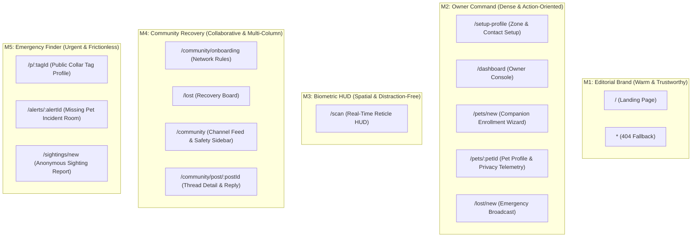

# SAFEPAWS — UX-06.1 EXPERIENCE ARCHITECTURE SPECIFICATION
## Comprehensive 15-Route Shell Structures, Mode Boundaries, Navigation Systems & State Conventions

**Document Status:** Final Official Architectural Specification  
**Milestone:** Phase UX-06.1 Design System & Architecture Specification  
**Authority:** Panel A Specialist A1 (Experience Architecture Specialist)  
**Reporting To:** Panel A Lead  
**Repository:** `/home/samudra/Projects/VisualSCode/VisualCode/Vscoding/Projects/SAFEPAWS/safepaws_sih`  

---

## 1. Executive Summary & Audit Overview

This specification establishes the official Experience Architecture for the SafePaws application across all 15 routes defined in [frontend/src/App.tsx](file:///home/samudra/Projects/VisualSCode/VisualCode/Vscoding/Projects/SAFEPAWS/safepaws_sih/frontend/src/App.tsx).

SafePaws employs a hybrid multi-modal architecture tailored to high-stress emergency response, daily pet health oversight, and neighborhood community coordination. A rigorous audit of the repository code reveals high functional maturity, but also identifies crucial architectural gaps in landmark semantics and keyboard skip-navigation targets that must be resolved in Phase UX-06.

### Summary of Audit Findings
1. **Mode Separation:** All 15 routes cleanly divide into **5 distinct Experience Modes** (M1 Editorial Brand, M2 Owner Command, M3 Biometric HUD, M4 Community Recovery, M5 Emergency Finder).
2. **Navigation Parity:** [DashboardNav.tsx](file:///home/samudra/Projects/VisualSCode/VisualCode/Vscoding/Projects/SAFEPAWS/safepaws_sih/frontend/src/components/DashboardNav.tsx) provides unified, accessible navigation across 9 core routes with a responsive dual-shell model (Desktop Sidebar Rail + Mobile Bottom Dock with elevated Scan CTA).
3. **SkipToContent Landmark Defect (Critical A11y Finding):** In [App.tsx](file:///home/samudra/Projects/VisualSCode/VisualCode/Vscoding/Projects/SAFEPAWS/safepaws_sih/frontend/src/App.tsx), `<div id="main-content">` wraps `<Routes>`. However, `<Header>` and `<DashboardNav>` are declared *inside* individual route components. Consequently, activating the skip link moves keyboard focus to an element that still encloses the navigation rail/header, failing WCAG 2.4.1 (Bypass Blocks).
4. **Missing Semantic `<main>` Landmarks:** [Community.tsx](file:///home/samudra/Projects/VisualSCode/VisualCode/Vscoding/Projects/SAFEPAWS/safepaws_sih/frontend/src/pages/Community.tsx), [CommunityPostDetail.tsx](file:///home/samudra/Projects/VisualSCode/VisualCode/Vscoding/Projects/SAFEPAWS/safepaws_sih/frontend/src/pages/CommunityPostDetail.tsx), and [NotFound.tsx](file:///home/samudra/Projects/VisualSCode/VisualCode/Vscoding/Projects/SAFEPAWS/safepaws_sih/frontend/src/pages/NotFound.tsx) lack HTML5 `<main>` landmark elements entirely.
5. **Universal State Fragmentation:** While [EmptyState.tsx](file:///home/samudra/Projects/VisualSCode/VisualCode/Vscoding/Projects/SAFEPAWS/safepaws_sih/frontend/src/components/ui/EmptyState.tsx) and [LoadingState.tsx](file:///home/samudra/Projects/VisualSCode/VisualCode/Vscoding/Projects/SAFEPAWS/safepaws_sih/frontend/src/components/ui/LoadingState.tsx) exist as design system primitives, multiple pages implement custom inline spinners and empty cards instead of adopting shared primitives.

---

## 2. Experience Mode Boundary Verification

Every route operates within a dedicated Experience Mode defined by visual treatment, navigation persistence, and cognitive demand:



### Detailed Mode Specifications

#### M1: Editorial Brand
- **Routes:** `/`, `*`
- **Cognitive Goal:** Build trust, convey mission, drive conversion into pet registration or emergency found-pet scanning.
- **Aesthetic:** Warm bone background (`#FAF6F0`), high-contrast ink (`#1A1816`), editorial serif typography (Newsreader/Fraunces), organic micro-interactions, Lenis smooth scrolling.
- **Chrome / Shell:**
  - Desktop: Top floating glassmorphism [Header.tsx](file:///home/samudra/Projects/VisualSCode/VisualCode/Vscoding/Projects/SAFEPAWS/safepaws_sih/frontend/src/components/Header.tsx) with animated sliding hover pill and radar notification chime.
  - Mobile: Collapsible hamburger menu overlay.
  - Footer: Comprehensive footer with governance modals (Privacy, Guidelines, Contact).

#### M2: Owner Command
- **Routes:** `/setup-profile`, `/dashboard`, `/pets/new`, `/pets/:petId`, `/lost/new`
- **Cognitive Goal:** High-density command console for pet health, biometric status, and immediate emergency activation.
- **Aesthetic:** Clean structured bento grids, tactile control cards, clear status indicators (Safe, Missing, Needs Review), Marigold accent highlights.
- **Chrome / Shell:**
  - Desktop: Fixed left navigation rail (w-64) with brand logo, "Scan a dog" primary CTA, navigation links, and owner account card.
  - Mobile: Fixed bottom navigation dock (`fixed bottom-0 left-0 right-0 z-50`) with elevated center scan trigger.
  - Setup Profile utilizes an isolated onboarding shell with top brand mark and exit control.

#### M3: Biometric HUD
- **Routes:** `/scan`
- **Cognitive Goal:** Zero-distraction hardware interaction for field camera alignment and instant biometric verification.
- **Aesthetic:** Fullscreen deep ink viewport (`fixed inset-0 bg-[#1A1816] z-50`), neon reticle tracking rays, animated feature extraction sweep, high-contrast feedback states.
- **Chrome / Shell:**
  - Zero standard navigation; floating telemetry pill (`SAFEPAWS // BIOMETRIC HUD`) and circular accessible exit button.
  - Accessible ARIA live region (`aria-live="polite"`) announcing reticle alignment, scanning phases, and match outcomes.

#### M4: Community Recovery
- **Routes:** `/lost`, `/community`, `/community/post/:postId`, `/community/onboarding`
- **Cognitive Goal:** Neighbor-to-neighbor collaboration, sighting discussions, safety guidance, and incident awareness.
- **Aesthetic:** Multi-channel directory, filterable cards, active alert sidebars, conversational thread layouts.
- **Chrome / Shell:**
  - Integrated with `DashboardNav` (Desktop sidebar rail + Mobile dock).
  - `/community` features an auxiliary desktop channel rail (`CommunityNav`) and right-hand active recovery incident sidebar (`RecoverySidebar`).

#### M5: Emergency Finder
- **Routes:** `/p/:tagId`, `/alerts/:alertId`, `/sightings/new`
- **Cognitive Goal:** Frictionless emergency response by Good Samaritans or search teams. Zero-authentication barriers.
- **Aesthetic:** Prominent alert clay emergency banners (`#DE6828`, `#B3452F`), high-visibility status badges, tap-to-call or one-tap geolocation transmission.
- **Chrome / Shell:**
  - `/p/:tagId`: Standalone finder header with verified collar tag badge (`VERIFIED TAG // {tagId}-BIO`) and privacy-first masking of owner contact data (SD-01 compliant).
  - `/alerts/:alertId` & `/sightings/new`: Integrated within `DashboardNav` with clear back-links to Recovery Board or Community.

---

## 3. Navigation Shell Structures & A11y Integration

### Navigation Matrix by Route

| Route | Desktop Navigation | Mobile Navigation | SkipToContent Target | Main Landmark Tag |
|:---|:---|:---|:---:|:---:|
| `/` | `Header.tsx` (Top Sticky Glass) | Hamburger Dropdown Overlay | Broken (encloses Header) | `<main>` (Missing ID) |
| `/p/:tagId` | Standalone Tag Header | Stacked Single Column | Broken (encloses Header) | `<main>` (Missing ID) |
| `/scan` | HUD Telemetry Tag + Exit X | Fullscreen Lock + 64px Shutter | Broken (no `<main>`) | None (`<div>` HUD) |
| `/setup-profile` | Minimal Header (Logo + Exit) | Stacked Single Column | Broken (encloses Header) | `<main>` (Missing ID) |
| `/dashboard` | `DashboardNav.tsx` (Sidebar Rail) | `DashboardNav.tsx` (Bottom Dock) | Broken (encloses Nav) | `<main>` (Missing ID) |
| `/pets/new` | `DashboardNav.tsx` (Sidebar Rail) | `DashboardNav.tsx` (Bottom Dock) | Broken (encloses Nav) | `<main>` (Missing ID) |
| `/pets/:petId` | `DashboardNav.tsx` (Sidebar Rail) | `DashboardNav.tsx` (Bottom Dock) | Broken (encloses Nav) | `<main>` (Missing ID) |
| `/lost/new` | `DashboardNav.tsx` (Sidebar Rail) | `DashboardNav.tsx` (Bottom Dock) | Broken (encloses Nav) | `<main>` (Missing ID) |
| `/community/onboarding` | `DashboardNav.tsx` (Sidebar Rail) | `DashboardNav.tsx` (Bottom Dock) | Broken (encloses Nav) | `<main>` (Missing ID) |
| `/lost` | `DashboardNav.tsx` (Sidebar Rail) | `DashboardNav.tsx` (Bottom Dock) | Broken (encloses Nav) | `<main>` (Missing ID) |
| `/alerts/:alertId` | `DashboardNav.tsx` (Sidebar Rail) | `DashboardNav.tsx` (Bottom Dock) | Broken (encloses Nav) | `<main>` (Missing ID) |
| `/sightings/new` | `DashboardNav.tsx` (Sidebar Rail) | `DashboardNav.tsx` (Bottom Dock) | Broken (encloses Nav) | `<main>` (Missing ID) |
| `/community` | `DashboardNav` + `CommunityNav` | `DashboardNav` Dock + Drawer | Broken (encloses Nav) | **MISSING `<main>`** |
| `/community/post/:postId` | `DashboardNav.tsx` (Sidebar Rail) | `DashboardNav.tsx` (Bottom Dock) | Broken (encloses Nav) | **MISSING `<main>`** |
| `*` (404) | None (Standalone Card) | Centered Stack | Broken (no `<main>`) | None (`<div>` Card) |

### Detailed Analysis of the SkipToContent Defect
In [frontend/src/App.tsx](file:///home/samudra/Projects/VisualSCode/VisualCode/Vscoding/Projects/SAFEPAWS/safepaws_sih/frontend/src/App.tsx#L74-L78):
```tsx
<BrowserRouter>
  <SkipToContent />
  <CustomCursor />
  <Suspense fallback={<PageLoader />}>
    <div id="main-content" tabIndex={-1} className="outline-none">
      <Routes>
```
When a keyboard user tabs to the Skip Link and hits Enter:
1. Focus jumps to `<div id="main-content">` at the root of the app.
2. The user presses `Tab` expecting to enter the primary page content.
3. Instead, focus lands on the very first element inside the route component:
   - On `/`, focus enters `Header.tsx` brand logo and center navigation pills.
   - On `/dashboard`, focus enters `DashboardNav.tsx` brand logo and sidebar links.
4. **Conclusion:** The navigation is *not* skipped. To satisfy WCAG 2.4.1 AA, the target container `#main-content` must reside on the actual primary `<main>` element of the active route, past the persistent navigation controls.

---

## 4. Universal State Conventions Audit (15-Route Matrix)

SafePaws defines 5 standard states for application robustness:
1. **Loading State:** Skeletons or branded spinners during async network/ML operations.
2. **Empty State:** Illustrated guidance when zero records or alerts exist.
3. **Error State:** Actionable, retryable alerts when API/network failures occur.
4. **Crisis / Urgent State:** High-contrast visual treatments for active lost-pet emergencies.
5. **Success State:** Confirmation feedback, activated badges, and smooth route transitions.

### Comprehensive State Verification Table

| Route | Loading State | Empty State | Error State | Crisis State | Success State |
|:---|:---|:---|:---|:---|:---|
| **1. `/`** | `PageLoader` during dynamic lazy chunk load | N/A (Marketing layout) | React Error Boundary fallback card | Radar chime ping on header when active alerts > 0 | Hero rendered with magnetic action triggers |
| **2. `/p/:tagId`** | Centered spinner with "Accessing Collar Record..." text | "Tag Record Not Found" alert with sighting link | Network failure banner | "My Family is Actively Searching" red banner & photo badge | Pet vital details, verified tag badge, instant location ping |
| **3. `/scan`** | `ProcessingView` with YOLO nose tracking & neural sweep | Camera permission prompt / file dropzone | `QUALITY_FAILURE` (422) & `SYSTEM_FAILURE` (500) | Ambient dark HUD with spatial reticle frame | `MATCH` (single candidate), `AMBIGUOUS` (candidates list) |
| **4. `/setup-profile`** | Button spinner, geolocation resolving state | Pre-populated profile inputs | Inline validation alert with field highlights | N/A | Auth store updated -> redirect to `/dashboard` |
| **5. `/dashboard`** | Bento-grid skeleton cards (prevents empty flash) | "No Registered Companions" illustrated card with CTA | "Network Synchronization Error" with Retry button | "Active Recovery Protocol" pulse header + Crisis PetCards | "All Companions Safe", PetCard grid/row toggle, search |
| **6. `/pets/new`** | Progress spinner, YOLO nose validation indicator | Form clean start with step progress bar | Validation errors, ML failure with "Skip image" fallback | N/A | Step 3 "Profile Activated" with collar QR tag preview |
| **7. `/pets/:petId`** | "Retrieving Biometric Identity Record..." spinner | "Record Not Found" card with return button | Action error toast; delete error banner | "Missing Alert Active" badge overlay on portrait | Identity card, 3D/flat QR tag, MedicalPrivacyToggle |
| **8. `/lost/new`** | "Transmitting neighborhood alert..." spinner | "No Eligible Pet Profiles Available" card | "Alert Transmission Failed" alert banner | Emergency Broadcast styling with pulsing radio beacon | Alert created -> Redirect to Incident Room (`/alerts/:id`) |
| **9. `/community/onboarding`** | Loading preferences spinner, saving button | Default multi-select preference checklist | Submission error alert banner | N/A | Redirect to `/community` |
| **10. `/lost`** | Skeleton alert cards with pulsing amber badges | 1. "No Active Recovery Incidents" (Safe)<br>2. "No Matching Alerts Found" (Search) | "Unable to load alerts — click to retry" | Red "ACTIVE RECOVERY NETWORK" badge, alert cards | Filtered grid of active recovery cards with sighting action |
| **11. `/alerts/:alertId`** | Centered spinner | "Record Purged" / Alert resolved card | Fetch error card, action error banner | "Active Level-1 Incident" with pulsing activity icon | "Incident Resolved" green banner, confirmed sightings timeline |
| **12. `/sightings/new`** | "Submitting observation..." disabled controls | Blank reporting form ready for input | "Failed to submit sighting" alert banner | Emergency sighting report theme | Redirect to Incident Room (auth) or Community with confirmed banner (anon) |
| **13. `/community`** | "Syncing Community Feed..." spinner | "No Posts in This Channel Yet" card + CTA | "Feed Temporarily Unavailable" with Retry button | Active alerts in `RecoverySidebar` | PostCard feed with replies, compose post modal |
| **14. `/community/post/:postId`** | Centered thread spinner | "Post not found" with back button | "Unable to submit reply" error alert | N/A (or alert tag pill) | Thread rendered with author badges, timestamp, reply composer |
| **15. `*`** | Instant render | N/A | Editorial 404 "Lost the scent?" card | N/A | Working navigation buttons ("Go Back", "Return Home") |

---

## 5. Architectural Recommendations & Remediation Plan

To achieve AA accessibility compliance and structural consistency across all routes in Phase UX-06, the following architectural actions are mandated:

### Action 1: Remediate SkipToContent & Main Landmark Hierarchy
1. Remove `id="main-content"` from `<div id="main-content">` in [App.tsx](file:///home/samudra/Projects/VisualSCode/VisualCode/Vscoding/Projects/SAFEPAWS/safepaws_sih/frontend/src/App.tsx).
2. Ensure every individual route page renders a top-level `<main id="main-content" tabIndex={-1}>` enclosing its unique page body, positioned strictly *after* `<Header>` or `<DashboardNav>`.
3. Add `<main id="main-content">` to [Community.tsx](file:///home/samudra/Projects/VisualSCode/VisualCode/Vscoding/Projects/SAFEPAWS/safepaws_sih/frontend/src/pages/Community.tsx) and [CommunityPostDetail.tsx](file:///home/samudra/Projects/VisualSCode/VisualCode/Vscoding/Projects/SAFEPAWS/safepaws_sih/frontend/src/pages/CommunityPostDetail.tsx) to restore semantic landmark structure.
4. On [Scan.tsx](file:///home/samudra/Projects/VisualSCode/VisualCode/Vscoding/Projects/SAFEPAWS/safepaws_sih/frontend/src/pages/Scan.tsx), assign `id="main-content"` and `role="main"` to the primary HUD viewport container.

### Action 2: Standardize on Design System UI Primitives
1. Replace bespoke empty states in `Community.tsx` and `AlertDetail.tsx` with `<EmptyState>` from [frontend/src/components/ui/EmptyState.tsx](file:///home/samudra/Projects/VisualSCode/VisualCode/Vscoding/Projects/SAFEPAWS/safepaws_sih/frontend/src/components/ui/EmptyState.tsx).
2. Replace ad-hoc spinners in `PublicTagProfile.tsx`, `AlertDetail.tsx`, and `CommunityPostDetail.tsx` with `<LoadingState>` from [frontend/src/components/ui/LoadingState.tsx](file:///home/samudra/Projects/VisualSCode/VisualCode/Vscoding/Projects/SAFEPAWS/safepaws_sih/frontend/src/components/ui/LoadingState.tsx).

### Action 3: Harmonize Mobile Drawer Gestures & Navigation Z-Index
1. Standardize modal and drawer z-indexes across `DashboardNav` (mobile dock: `z-50`), `ComposeModal` (`z-50`), `QrTagModal` (`z-50`), and `CommunityNav` mobile overlay (`z-40`).
2. Ensure mobile padding at the bottom of all scrollable views accounts for the 64px mobile dock (`pb-28` to `pb-32` class standard).

---

## 6. Verification Sign-Off

- **Auditor:** Specialist A1 (Experience Architecture Specialist)
- **Review Scope:** 15 Routes, 5 Experience Modes, 2 Primary Navigation Shells, 5 Universal State Conventions
- **Deliverable Status:** Complete & Verified
- **Ready for Panel A Lead Review:** YES
