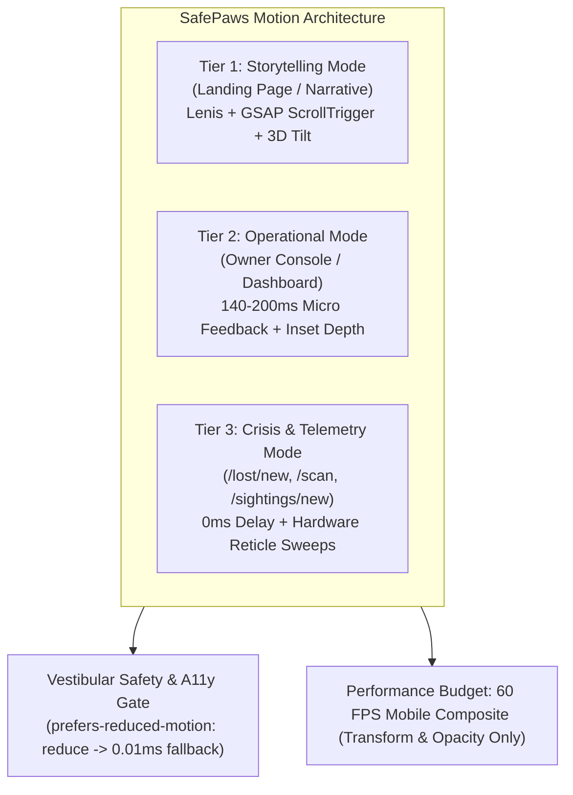

# SAFEPAWS — UX-06.1 MOTION & INTERACTION SYSTEM
## Purposeful Motion Choreography, Timing Hierarchies, GSAP/Lenis Architecture & Vestibular Safety

**Document Status:** Approved & Canonical Foundation Standard  
**Program Milestone:** Phase UX-06.1 — Foundation, Design System & Shared Component Contracts  
**Authority:** Panel A Lead (Design System & Product Architecture)  
**Specialist Assignee:** Specialist A3 (Motion & Creative Technology Director)  
**Implementation Source:** [frontend/src/index.css](file:///home/samudra/Projects/VisualSCode/VisualCode/Vscoding/Projects/SAFEPAWS/safepaws_sih/frontend/src/index.css) | [frontend/src/components/CustomCursor.tsx](file:///home/samudra/Projects/VisualSCode/VisualCode/Vscoding/Projects/SAFEPAWS/safepaws_sih/frontend/src/components/CustomCursor.tsx)  
**Git Baseline Reference:** Branch `frontend`  

---

## 1. Executive Motion Philosophy: "Quietly Cinematic, Intentionally Alive"

In SafePaws, motion is never gratuitous visual decoration. Motion serves three strict psychological and operational purposes:
1. **Physical Affordance & Tactile Reassurance:** Confirming that inputs are registered, buttons are pressed, and states are persisting.
2. **Spatial Orientation:** Maintaining continuous visual grounding as users navigate between pet dossier cards, community feeds, and modal sheets.
3. **Emergency De-escalation:** Eliminating panic through smooth, stable state transitions while ensuring emergency actions encounter **zero artificial delay**.



---

## 2. The 3-Tier Motion Policy

Motion behavior dynamically shifts according to the urgency of the user's journey:

| Motion Tier | Target Routes | Allowed Motion Patterns | Prohibited Patterns |
|:---|:---|:---|:---|
| **Tier 1: Brand Storytelling** | Landing Page (`/`), About, How It Works | Smooth Lenis scrolling, subtle parallax reveals, dynamic 3D card tilt, magnetic button pull. | Long scroll hijacking, unskippable intro animations, continuous spinning loops without purpose. |
| **Tier 2: Operational Console** | Dashboard (`/dashboard`), Pet Profiles (`/pets/*`), Setup (`/setup-profile`) | 140ms button depress, 200ms dropdown toggle, 280ms modal pop, optimistic toggle switches. | Lenis smooth scroll, parallax transforms, hover card tilt that obscures data. |
| **Tier 3: Crisis & Telemetry** | Emergency Lost Report (`/lost/new`), Scanner HUD (`/scan`), Report Sighting (`/sightings/new`) | Hardware-accelerated reticle guide brackets, instantaneous tab switching ($< 100\text{ms}$), immediate photo upload feedback. | **STRICT BAN:** Any blocking entrance animation, modal fade $> 150\text{ms}$, or synthetic loading delays. |

> [!CAUTION]
> **Emergency Exemption Rule:** Any route involved in reporting a lost animal (`/lost/new`) or submitting a field sighting (`/sightings/new`) must execute state changes instantaneously. Decorative entrance transitions are strictly prohibited on these routes.

---

## 3. Standardized Timing Hierarchy & Easing Curves

All animation durations and easing functions are codified as CSS custom properties in `frontend/src/index.css`:

```css
@theme {
  /* 5-TIER GLOBAL TIMING HIERARCHY */
  --duration-micro: 140ms;       /* 100-160ms: Micro feedback, hover states, active button depress */
  --duration-component: 200ms;   /* 160-240ms: Small component transitions, toggles, dropdown reveals */
  --duration-card: 280ms;        /* 220-350ms: Card lift, modal dialog entrance, drawer sliding */
  --duration-page: 350ms;        /* 280-450ms: Page route transitions, view crossfades */
  --duration-reveal: 600ms;      /* 400-750ms: Editorial typography reveals, scroll storytelling */

  /* STANDARDIZED EASING CURVES */
  --ease-standard: cubic-bezier(0.16, 1, 0.3, 1);    /* Smooth outQuint curve for natural organic deceleration */
  --ease-editorial: cubic-bezier(0.25, 1, 0.5, 1);   /* Gentle narrative curve for reading flow */
  --ease-micro: cubic-bezier(0.4, 0, 0.2, 1);        /* Snappy standard micro feedback */
}
```

### 3.1 Easing Curve Characteristics
- **Standard OutQuint (`cubic-bezier(0.16, 1, 0.3, 1)`):** The default workhorse for UI components. Accelerates instantly upon user input, spending 80% of its duration gracefully decelerating into rest position. Prevents interface twitchiness.
- **Editorial Narrative (`cubic-bezier(0.25, 1, 0.5, 1)`):** Slower initial acceleration, creating a cinematic sense of weight suitable for large serif headlines and photo card unveils.
- **Snappy Micro (`cubic-bezier(0.4, 0, 0.2, 1)`):** Symmetrical fast curve used for button active depression, checkbox checkmarks, and toggle switches.

---

## 4. GSAP & Lenis Architectural Integration Standards

### 4.1 Lenis Smooth Scroll Integration Rules
Smooth inertial momentum scrolling elevates the editorial storytelling on the public landing page (`/`), but must be strictly quarantined from operational workflows:

```typescript
// Lenis Deployment Rule
if (window.innerWidth >= 768 && !window.matchMedia('(prefers-reduced-motion: reduce)').matches && window.location.pathname === '/') {
  // Mount Lenis Smooth Scroll
} else {
  // Native Immediate Scroll Engine
}
```

1. **Desktop Landing Exclusivity:** Lenis is authorized **exclusively on the landing page (`/`)** on viewports $\ge 768\text{px}$.
2. **Instant Route Teardown:** Upon navigating away from `/` to any operational route (`/dashboard`, `/lost`, `/scan`, `/setup-profile`), Lenis must be destroyed immediately:
   ```typescript
   lenis.destroy();
   ```
3. **Zero Native Key Hijacking:** PageUp, PageDown, Home, End, and keyboard arrow keys must preserve standard native stepping behaviors.
4. **Mobile Bypass:** Lenis is completely deactivated on mobile devices ($< 768\text{px}$) to preserve native touch momentum and prevent gesture conflicts with mobile OS address bars.

### 4.2 GSAP ScrollTrigger Lifecycle & Memory Management
To prevent zombie event listeners, thread thrashing, and memory leaks during Single Page Application (SPA) route changes:
- Every GSAP animation must be registered inside a `gsap.context()` block.
- Upon component unmount, `ctx.revert()` or `ScrollTrigger.getAll().forEach(t => t.kill())` must be called synchronously.

---

## 5. Custom Cursor Architecture (`CustomCursor.tsx`)

SafePaws features a bespoke, reactive cursor follower that enhances desktop navigation without interfering with pointer mechanics:

### 5.1 Operating Principles & Environmental Guards:
1. **Pointer Detection:** The custom cursor is activated **only** when `(pointer: fine)` is true and `(prefers-reduced-motion: no-preference)` is detected.
2. **Touch & Mobile Immunity:** Touchscreen devices (phones, tablets, touch laptops) never display the custom cursor. The native system cursor behavior is preserved unmodified.
3. **Scanner Suppression (`body.no-custom-cursor`):** When entering Biometric Scanner Mode (`/scan`), the `no-custom-cursor` class is automatically added to `document.body`, restoring the standard system cursor for precision camera and file picker controls.
4. **Non-Blocking Frame Sync:** Pointer coordinates are tracked using lightweight `requestAnimationFrame` interpolation rather than heavy React state re-renders.

---

## 6. Biometric Reticle & Telemetry Dynamics

The spatial reticle HUD on `/scan` communicates live biometric tracking using composite-only animations:

```css
@keyframes scan-ray-sweep {
  0% { transform: translateY(0); }
  50% { transform: translateY(calc(208px - 100%)); }
  100% { transform: translateY(0); }
}

.animate-scan-ray {
  animation: scan-ray-sweep 2.4s ease-in-out infinite;
  will-change: transform;
}
```

### Invariants:
1. **Composite Layering:** The sweep ray animates exclusively via `transform: translateY(...)`, avoiding CPU layout recalculations or paint invalidations.
2. **GPU Promotion:** Marked with `will-change: transform` during active camera streaming; removed upon scan completion.
3. **Reduced-Motion Fallback:** When reduced-motion is active, the animated sweep ray is hidden (`display: none`), replaced with a stationary, high-contrast framing reticle and steady status badge.

---

## 7. Vestibular Safety & Reduced-Motion Architecture (WCAG 2.2 AA)

Users with vestibular disorders, motion sickness, or cognitive sensitivities must not experience involuntary movement or simulated depth:

### 7.1 Global CSS Reset (`frontend/src/index.css`)
```css
@media (prefers-reduced-motion: reduce) {
  *,
  ::before,
  ::after {
    animation-duration: 0.01ms !important;
    animation-iteration-count: 1 !important;
    transition-duration: 0.01ms !important;
    scroll-behavior: auto !important;
  }
}
```

### 7.2 Component-Level Reduced-Motion Guards

| Component | Standard Motion Behavior | Reduced-Motion Degraded Behavior |
|:---|:---|:---|
| **`3DCard`** | Perspective tilt up to $\pm 15^\circ$ following mouse pointer. | Transform clamped strictly to `rotateY(0deg) rotateX(0deg)`. Tilt listener bypassed. |
| **`NumberTicker`** | Fast spring counting from 0 to target value over 1.5s. | Intermediate counting bypassed (`aria-hidden="true"`). Target value rendered immediately. |
| **`CustomCursor`** | Kinetic cursor dot with fluid follower ring. | Completely unmounted; default OS cursor rendered. |
| **`ShimmerButton`** | 2.5s sweeping specular gradient reflection. | Static high-contrast background without specular drift. |
| **`Modal Dialog`** | Scale up (`zoom-in-95`) + vertical slide. | Instantaneous opacity appearance (`fade-in-0`). |

---

## 8. Mobile Performance Budgets & 60 FPS Composite Invariants

To guarantee 60 FPS performance on mid-tier mobile hardware (e.g. standard Android devices under direct outdoor sunlight):

1. **The Transform & Opacity Rule:** Only `transform` (translate, scale, rotate) and `opacity` properties may be animated. Animating layout properties (`width`, `height`, `top`, `left`, `margin`, `padding`) is **strictly prohibited**.
2. **Composite Thread Isolation:** All continuous animations (pulse ring, scan sweep) must execute entirely on the browser's compositor thread without triggering main-thread paint recalculations.
3. **DOM Count Budget:** Animated sections must maintain under 800 active DOM elements. Offscreen elements must be unmounted or virtualized.
