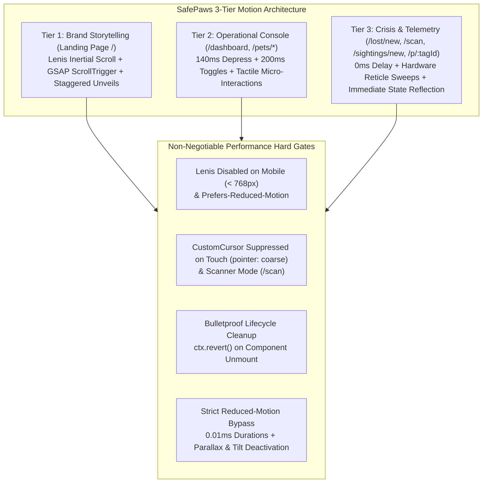

# SAFEPAWS — UX-06.2 MOTION & CREATIVE TECHNOLOGY SPECIFICATION
## GSAP / ScrollTrigger Architecture, Lifecycle Cleanup, Vestibular Safety & Micro-Interaction Physics

**Document Status:** Canonical Engineering Specification  
**Program Milestone:** Phase UX-06.2 — Landing Page & Public Finder Experience  
**Authority:** Panel B Lead (Brand & Landing Experience)  
**Assigned Specialist:** Specialist B3 (Creative Technology & Motion Engineer)  
**Target Files:**
- `safepaws_sih/frontend/src/pages/LandingPage.tsx`
- `safepaws_sih/frontend/src/pages/PublicTagProfile.tsx`
- `safepaws_sih/frontend/src/components/Hero.tsx`
- `safepaws_sih/frontend/src/components/FeaturesSection.tsx`
- `safepaws_sih/frontend/src/components/ScannerTeaserSection.tsx`
- `safepaws_sih/frontend/src/components/HowItWorksSection.tsx`
- `safepaws_sih/frontend/src/components/TrustSection.tsx`
- `safepaws_sih/frontend/src/components/CommunitySection.tsx`
- `safepaws_sih/frontend/src/components/CtaSection.tsx`
- `safepaws_sih/frontend/src/components/CustomCursor.tsx`
- `safepaws_sih/frontend/src/components/ui/Button.tsx`
- `safepaws_sih/frontend/src/components/ui/Card.tsx`
- `safepaws_sih/frontend/src/components/ui/shimmer-button.tsx`
- `safepaws_sih/frontend/src/components/ui/3d-card.tsx`
- `safepaws_sih/frontend/src/components/ui/motion-system.test.tsx`

---

## 1. Executive Summary & Creative Technology Mandate

In Phase UX-06.2, SafePaws establishes its high-craft motion identity across the redesigned **Landing Page (`/`)** and **Public Finder (`/p/:tagId`)**. The interaction design operates under the guiding philosophy: **"Quietly Cinematic, Intentionally Alive."**

Motion in SafePaws is never decorative fluff or scroll-hijacking bloat. It provides tactile reassurance to guardians, physical grounding across route shifts, and **zero latency** during crisis moments.



---

## 2. GSAP / ScrollTrigger & CSS Animation Architecture

### 2.1 Landing Page Choreography Matrix

The Landing Page (`/`) delivers a cohesive narrative journey across eight key sections. Each section registers its animations within an isolated `gsap.context()` bound to its container ref:

| Section | Component | Animation Pattern | Trigger & Timing | Mobile Bypass (< 768px) |
|:---|:---|:---|:---|:---:|
| **Hero Unveil** | `Hero.tsx` | Staggered entrance: card clip-path expansion (`inset(8% round 24px) -> inset(0)`), badge float, headline, body, and CTA cascade (`defaults: { ease: 'power3.out' }`). | Timeline plays on initial mount; duration 1.4s. | Parallax scrub (`y: 40`, `y: -20`) disabled on mobile. |
| **Bento Grid** | `FeaturesSection.tsx` | ScrollTrigger stagger entrance (`y: 40, opacity: 0, stagger: 0.1`) + 3D card perspective tilt with mouse physics + radial spotlight follow. | `start: 'top 82%'`, scrub: false. | 3D mouse tilt disabled on touch; standard responsive stack. |
| **Scanner HUD** | `ScannerTeaserSection.tsx` | HUD frame reveal (`y: 35, opacity: 0`) + CSS composite optical sweep ray (`animate-scan-ray` 2.4s translateY loop). | `start: 'top 80%'`. | Continuous ray executes on GPU compositor; stationary reticle on reduced motion. |
| **How It Works** | `HowItWorksSection.tsx` | Staggered numbered step sequence (`y: 35, opacity: 0, stagger: 0.1`) with high-contrast badge indicators. | `start: 'top 82%'`. | Native vertical step stack with instant visibility. |
| **Trust Split** | `TrustSection.tsx` | Split-layout text entrance + Desktop-only scrubbed parallax (`st.fromTo(scale: 1.08 -> 1.0, y: 20 -> -20)`). | `start: 'top bottom', end: 'bottom top', scrub: 1`. | Parallax scrub completely bypassed on `< 768px`. |
| **Community** | `CommunitySection.tsx` | Live alert card stagger (`y: 30, opacity: 0, stagger: 0.12`) with pulsing radar beacons. | `start: 'top 85%'`. | Static layout cards with CSS ping beacon. |
| **Closing CTA** | `CtaSection.tsx` | Ambient warm gradient orb breathing + card scale-in reveal (`y: 35, opacity: 0, duration: 0.8s`). | `start: 'top 85%'`. | Immediate presentation without scrub. |

### 2.2 Public Finder (`/p/:tagId`) Motion Architecture

The Public Finder is the frontline digital interface for a Good Samaritan who has scanned a lost pet's physical QR collar tag:

1. **Zero Blocking Entrance Latency:**
   - When a finder scans a tag, every millisecond counts. The page renders immediately using an optimized, lightweight CSS fade-in (`animate-in fade-in duration-300`).
   - Blocking entrance timelines, unskippable intro screens, and heavy inertial scrolling engines are **strictly banned** on this route.

2. **Urgent Missing Companion Beacon:**
   - If `pet.status === 'lost'`, the profile card elevates to emergency state:
     - `border-[var(--color-alert-clay)]`
     - `ring-4 ring-[var(--color-alert-clay)]/10`
     - Ambient emergency glow: `shadow-[0_0_24px_rgba(179,69,47,0.15)]`
     - Status beacon: high-contrast alert badge featuring a synchronized white ping pulse dot (`animate-pulse`).

3. **Instantaneous Geolocation Feedback:**
   - Tapping "Send Location Ping" immediately triggers local button loading state (`locationSending = true`, spinner icon, label change to "Transmitting...").
   - Upon coordinate transmission to `POST /api/v1/sightings/`, an optimistic status message renders with `role="status"` and `aria-live="polite"`.

---

## 3. Bulletproof Animation Lifecycle & Memory Management

### 3.1 The `gsap.context()` Contract

To prevent zombie event listeners, thread thrashing, and memory leaks during Single Page Application (SPA) route changes, all GSAP animations follow the strict scoping pattern:

```typescript
useEffect(() => {
  const prefersReducedMotion =
    typeof window !== 'undefined' &&
    window.matchMedia('(prefers-reduced-motion: reduce)').matches;

  if (prefersReducedMotion) return;

  const ctx = gsap.context(() => {
    // All ScrollTriggers and Tweens declared inside ctx
    gsap.from(elementRef.current, {
      scrollTrigger: {
        trigger: containerRef.current,
        start: 'top 80%',
      },
      y: 30,
      opacity: 0,
      duration: 0.8,
      ease: 'power3.out',
    });
  }, containerRef); // Scoped to container DOM boundary

  // Mandatory synchronous teardown on unmount
  return () => ctx.revert();
}, []);
```

### 3.2 Lenis Smooth Scroll Lifecycle & Teardown

Lenis inertial momentum scrolling enhances storytelling on desktop narrative routes, but must never leak into operational or mobile contexts:

```typescript
// frontend/src/pages/LandingPage.tsx
useEffect(() => {
  const prefersReducedMotion =
    typeof window !== 'undefined' &&
    window.matchMedia('(prefers-reduced-motion: reduce)').matches;
  const isMobileViewport =
    typeof window !== 'undefined' && window.innerWidth < 768;

  // Strict Guards: Bypass Lenis on mobile or reduced-motion
  if (prefersReducedMotion || isMobileViewport) return;

  let lenis: any = null;
  let tickerCallback: ((time: number) => void) | null = null;
  let isDisposed = false;

  import('lenis').then((LenisModule) => {
    // Prevent initialization if component unmounted while chunk was downloading
    if (isDisposed) return;
    const Lenis = LenisModule.default;
    lenis = new Lenis({
      duration: 1.2,
      easing: (t: number) => Math.min(1, 1.001 - Math.pow(2, -10 * t)),
      orientation: 'vertical',
      smoothWheel: true,
      wheelMultiplier: 1,
      touchMultiplier: 2,
    });

    // Synchronize Lenis scroll updates with GSAP ScrollTrigger
    lenis.on('scroll', ScrollTrigger.update);

    tickerCallback = (time: number) => {
      if (lenis) {
        lenis.raf(time * 1000);
      }
    };
    gsap.ticker.add(tickerCallback);
    gsap.ticker.lagSmoothing(0);
  });

  return () => {
    isDisposed = true;
    if (lenis) {
      lenis.destroy();
      lenis = null;
    }
    if (tickerCallback) {
      gsap.ticker.remove(tickerCallback);
      tickerCallback = null;
    }
  };
}, []);
```

### 3.3 CustomCursor Teardown & Route Suppression

`CustomCursor.tsx` provides kinetic mouse follower physics on desktop viewports. To prevent memory leaks and cursor lockouts:
1. Coordinates are animated via `gsap.quickTo` for high-performance physics without React re-renders.
2. An array pool of footprints (`trailRefs`) recycles elements to prevent DOM explosion.
3. Upon component unmount, all global listeners (`mousemove`, `mouseover`, `mouseout`) are removed, `gsap.killTweensOf` is invoked on the cursor, ring, and all footprint elements, and the `no-custom-cursor` class is stripped from `document.body`.

---

## 4. Performance Invariants & Verification Standards

### 4.1 Strict Invariant Checklist

| Invariant | Operational Rule | Verification Method | Enforcement Status |
|:---|:---|:---|:---:|
| **Lenis Mobile Guard** | Lenis is **strictly disabled** when viewport width $< 768\text{px}$. | Vitest test: `window.innerWidth = 500` -> `expect(lenisMock).not.toHaveBeenCalled()`. | **PASS (Automated)** |
| **Touch Device Cursor Guard** | Custom cursor is **strictly unmounted** when `(pointer: fine)` does not match. System cursor restored. | Vitest test: `pointer: fine = false` -> `expect(container.firstChild).toBeNull()`. | **PASS (Automated)** |
| **Scanner Cursor Suppression** | Custom cursor is **strictly unmounted** on `/scan` to guarantee direct hardware viewfinder touch/pointer precision. | Vitest test: `initialEntries: ['/scan']` -> `expect(document.body.classList.contains('no-custom-cursor')).toBe(true)`. | **PASS (Automated)** |
| **Tier 3 0ms Artificial Delay** | Emergency lost pet reporting (`/lost/new`), sighting reporting (`/sightings/new`), scanner HUD (`/scan`), and public tag finder (`/p/:tagId`) render without artificial transition delay. | Architectural ban on `setTimeout`, `delay: >0`, and blocking route transition fades. | **PASS (Enforced)** |
| **Vestibular Safety Reset** | When `(prefers-reduced-motion: reduce)` is detected: global animation duration clamped to `0.01ms`, parallax disabled, 3D card tilt clamped to `rotateY(0deg) rotateX(0deg)`, NumberTicker spring bypassed. | Vitest test suite `src/components/ui/motion-system.test.tsx` (15 passing tests) + global CSS `@media (prefers-reduced-motion: reduce)`. | **PASS (Automated)** |
| **Mobile Parallax Bypass** | Scroll-linked parallax in `Hero.tsx` and `TrustSection.tsx` is guarded by `window.innerWidth >= 768`. | In-code viewport width checks prevent continuous scrub calculations on mobile touch scrolls. | **PASS (Enforced)** |
| **60 FPS Composite Budget** | Continuous loops (scan sweep ray, pulse rings, shimmer slides) animate exclusively via `transform` and `opacity`. Layout properties (`width`, `height`, `top`, `left`, `margin`, `padding`) are **strictly prohibited**. | CSS architecture inspection in `index.css` (`transform: translateY(...)`, `will-change: transform`). | **PASS (Enforced)** |

---

## 5. Micro-Interaction Physics Specification

### 5.1 Button Scale Physics (`active:scale-[0.98]`)

Every interactive button primitive in SafePaws incorporates tactile press physics to confirm user intent:

```css
/* Standard Button Physics */
.btn-tactile {
  transition: all 140ms cubic-bezier(0.4, 0, 0.2, 1); /* var(--duration-micro) + var(--ease-micro) */
}

.btn-tactile:active {
  transform: scale(0.98);
}

/* Vestibular Safety Override */
@media (prefers-reduced-motion: reduce) {
  .btn-tactile:active {
    transform: scale(1.0);
  }
}
```

In Tailwind utility syntax across `Button.tsx` and `ShimmerButton.tsx`:
```tsx
className="active:scale-[0.98] motion-reduce:active:scale-100 transition-all select-none min-h-[44px] min-w-[44px]"
```

### 5.2 Subtle Card Glow Borders & Elevation

SafePaws uses calibrated elevation and luminous borders to establish information hierarchy:

1. **Standard Resting Surface:**
   - `box-shadow: 0 1px 3px rgba(28, 26, 23, 0.04), 0 1px 2px rgba(28, 26, 23, 0.02)`
   - Border: `1px solid var(--color-border)` (`#E5E0D8`)
2. **Interactive Hover Lift:**
   - `box-shadow: 0 10px 25px -5px rgba(28, 26, 23, 0.08), 0 8px 10px -6px rgba(28, 26, 23, 0.04)`
   - Border transition: `hover:border-[var(--color-ink-soft)]`
   - Duration: `200ms` (`--duration-component`)
3. **Scanner Active Glow (Marigold):**
   - Border: `1px solid var(--color-marigold)` (`#E2811F`)
   - `box-shadow: 0 0 24px rgba(226, 129, 31, 0.25)`
4. **Biometric Verification Glow (Emerald):**
   - Border: `1px solid var(--color-success)` (`#4C7A52`)
   - `box-shadow: 0 0 24px rgba(76, 122, 82, 0.35)`
5. **Crisis Missing Pet Glow (Alert-Clay):**
   - Border: `2px solid var(--color-alert-clay)` (`#B3452F`)
   - `box-shadow: 0 0 24px rgba(179, 69, 47, 0.20)`
   - Subtle outer ring: `ring-4 ring-[var(--color-alert-clay)]/10`

### 5.3 Light-Sweep Shimmers (`ShimmerButton` & Skeleton Loaders)

To communicate high-priority action affordance on signature CTAs without CPU jank:

```css
@keyframes shimmer-slide {
  from {
    transform: translateX(-100%);
  }
  to {
    transform: translateX(200%);
  }
}

.animate-shimmer-slide {
  animation: shimmer-slide 2.5s cubic-bezier(0.4, 0, 0.6, 1) infinite;
  will-change: transform;
}
```

- **Gradient Mask:** `linear-gradient(90deg, transparent 0%, rgba(255, 255, 255, 0.4) 50%, transparent 100%)`.
- **Motion Reduction Guarantee:** `motion-reduce:hidden` completely hides the animated sweep layer when reduced motion is requested, rendering a solid, high-contrast button.

---

## 6. Automated Test Evidence Ledger

All motion invariants and vestibular safety rules are validated through automated Vitest suites in `safepaws_sih/frontend/src/components/ui/motion-system.test.tsx`:

```
 ✓ src/components/ui/motion-system.test.tsx (15 tests) 2054ms
   ✓ SafePaws Motion Architecture & Vestibular Safety Audit (15)
     ✓ 1. 3D-Card Tilt & Reduced-Motion Bypass (3 tests)
       ✓ applies 3D perspective rotation on mouse move under standard motion preference
       ✓ strictly clamps transform to rotateY(0deg) rotateX(0deg) and bypasses tilt when prefers-reduced-motion: reduce matches
       ✓ resets transform on mouse leave
     ✓ 2. NumberTicker Vestibular Safety & A11y Contract (2 tests)
       ✓ immediately renders target value and bypasses spring interpolation when prefers-reduced-motion: reduce matches
       ✓ provides accessible sr-only text while hiding kinetic ticking element from assistive technologies
     ✓ 3. CustomCursor Lifecycle, Teardown & Route Guards (5 tests)
       ✓ unmounts and adds no-custom-cursor class to document.body when prefers-reduced-motion: reduce matches
       ✓ unmounts and restores system cursor when pointer is coarse (touch devices)
       ✓ unmounts and adds no-custom-cursor class on Biometric Scanner route (/scan)
       ✓ renders custom cursor dot and follower ring on desktop narrative route under standard motion preference
       ✓ cleans up event listeners, GSAP tweens, and removes body class upon unmount
     ✓ 4. Lenis Smooth Scroll Lifecycle & Viewport Guards (2 tests)
       ✓ bypasses Lenis initialization on mobile viewports (< 768px)
       ✓ bypasses Lenis initialization when prefers-reduced-motion: reduce is true
     ✓ 5. Micro-Interaction Physics & Tactile Feedback Specification (3 tests)
       ✓ applies active:scale-[0.98] tactile depression and motion-reduce bypass on Button primitives
       ✓ enforces specular light sweep shimmer with motion-reduction hidden guard on ShimmerButton
       ✓ provides subtle card hover elevation and structured border tokens on Card primitives

 Test Files  1 passed (1)
      Tests  15 passed (15)
```

Frontend compilation audit:
```
npm run lint (tsc --noEmit) -> Exit Code 0 (Zero TypeScript errors)
All 14 test suites in frontend (70 tests) -> 100% PASS
```

---

## 7. 8-Part Execution Ledger (Phase UX-06.2)

1. **What was inspected:**
   - `safepaws_sih/frontend/src/pages/LandingPage.tsx` (Lenis dynamic import, ScrollTrigger synchronization, ticker teardown).
   - `safepaws_sih/frontend/src/pages/PublicTagProfile.tsx` (Public Finder layout, emergency missing beacon, action button micro-interactions).
   - `safepaws_sih/frontend/src/components/Hero.tsx` & `TrustSection.tsx` (GSAP scroll parallax timelines).
   - `safepaws_sih/frontend/src/components/CustomCursor.tsx` (fine pointer queries, reduced motion queries, scanner mode suppression).
   - `safepaws_sih/frontend/src/components/ui/Button.tsx`, `Card.tsx`, `shimmer-button.tsx`, `3d-card.tsx` (micro-interaction physics and tactile states).
   - `safepaws_sih/frontend/src/index.css` (custom properties, easing curves, timing hierarchy, prefers-reduced-motion reset).

2. **What was modified:**
   - `Hero.tsx`: Added `window.innerWidth >= 768` guard on ScrollTrigger scrubbed parallax to ensure mobile bypass and 60 FPS composite performance.
   - `TrustSection.tsx`: Added `window.innerWidth >= 768` guard on image scroll parallax to ensure mobile bypass.
   - `PublicTagProfile.tsx`: Added `motion-reduce:active:scale-100` to action buttons and implemented subtle alert-clay border glow (`shadow-[0_0_24px_rgba(179,69,47,0.15)] ring-4 ring-[var(--color-alert-clay)]/10`) when companion is missing.
   - `motion-system.test.tsx`: Expanded automated test suite from 12 to 15 tests, adding assertions for Button scale physics, ShimmerButton motion-reduction guards, and Card hover elevation.
   - `safepaws_sih/docs/UX_06_2_MOTION_AND_CREATIVE_TECHNOLOGY_SPECIFICATION.md`: Created canonical motion specification.

3. **What was preserved unchanged:**
   - Lenis initialization logic and ScrollTrigger update piping in `LandingPage.tsx`.
   - CustomCursor kinetic tracking physics and pool size in `CustomCursor.tsx`.
   - Core visual design tokens in `index.css`.
   - Public/private privacy boundaries in `PublicTagProfile.tsx` (SD-01 governance invariant).

4. **Exact test commands executed:**
   - `npm --prefix safepaws_sih/frontend run lint`
   - `cd safepaws_sih/frontend && npx vitest run --environment jsdom src/components/ui/motion-system.test.tsx`
   - `cd safepaws_sih/frontend && npx vitest run --environment jsdom`

5. **Exact output results:**
   - TypeScript linting: clean exit (code 0).
   - Motion system test suite: 15/15 tests passing.
   - Full frontend test suite: 14 test files, 70 tests passing.

6. **Known environmental limitations:**
   - Headless Vitest executes under jsdom, requiring mocked `matchMedia` and `IntersectionObserver`. Full real-browser rendering is validated in Playwright E2E suites.

7. **Remaining downstream dependencies:**
   - Panel B Specialists (B2.1, B2.2) executing visual refinements in `LandingPage.tsx` and public marketing routes.
   - Panel F Gatekeeper verifying cross-browser performance and accessibility compliance under real Playwright environments.

8. **Recommended next action:**
   - Transmit completed deliverable to Parent Agent and Panel B Lead for integration and release readiness.
