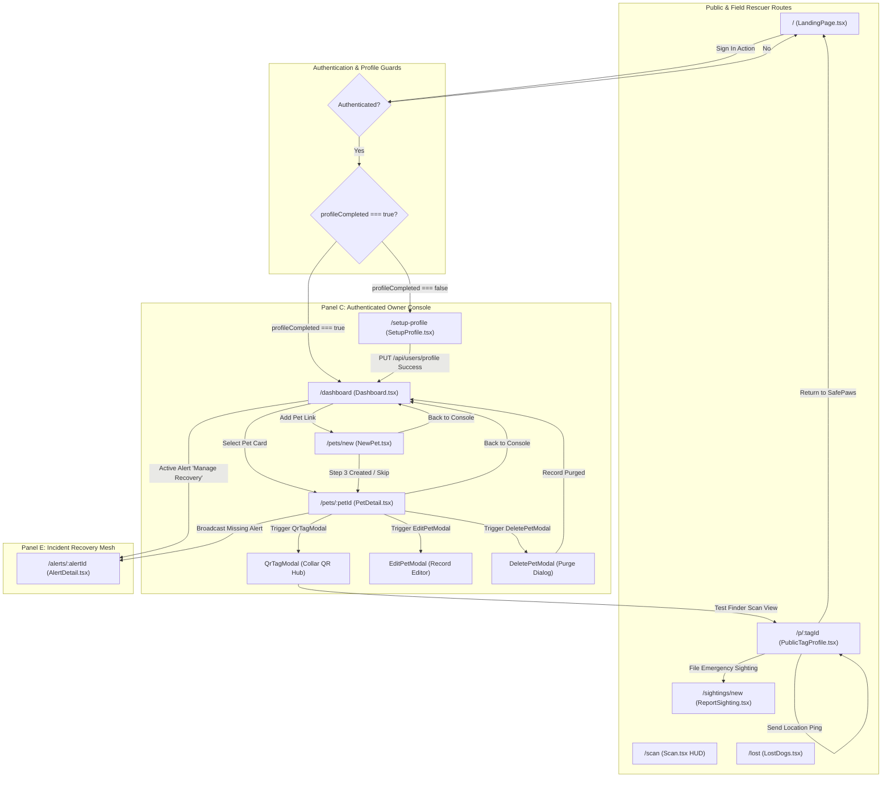
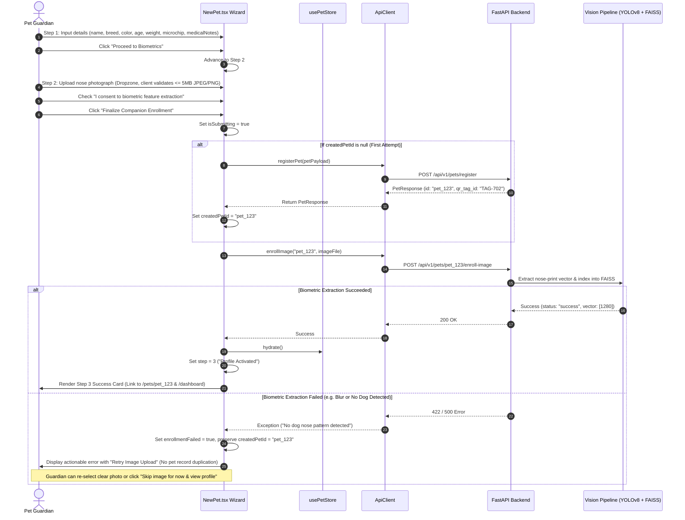
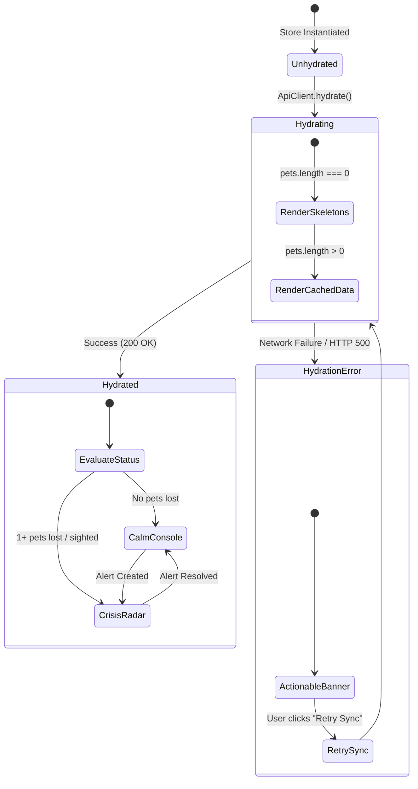
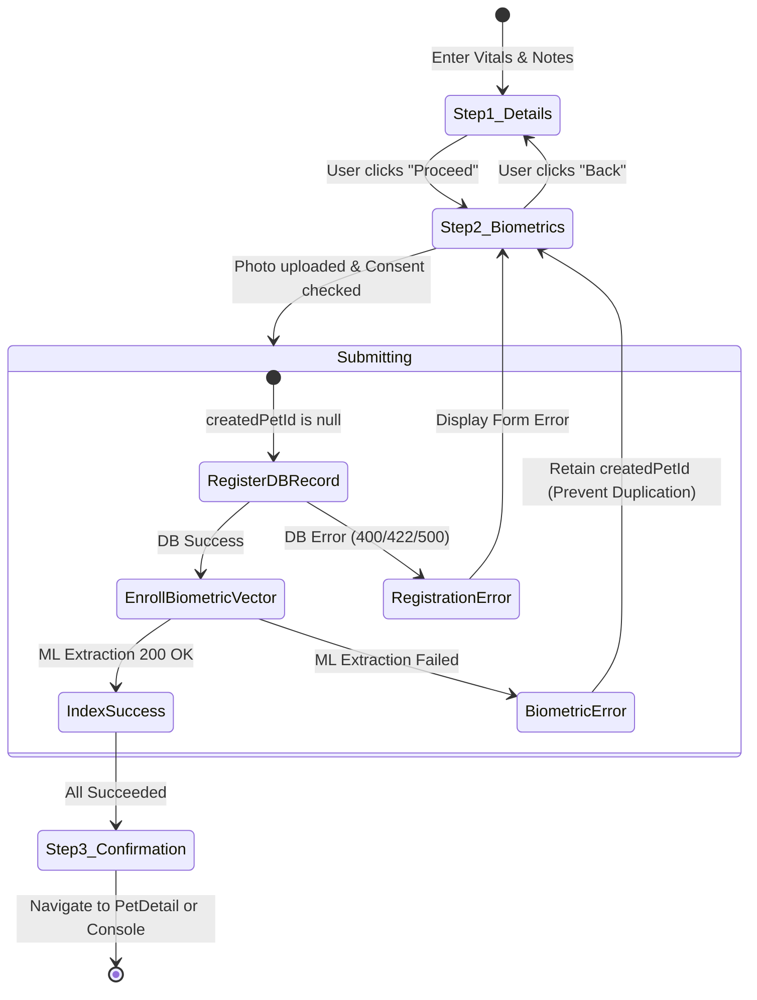
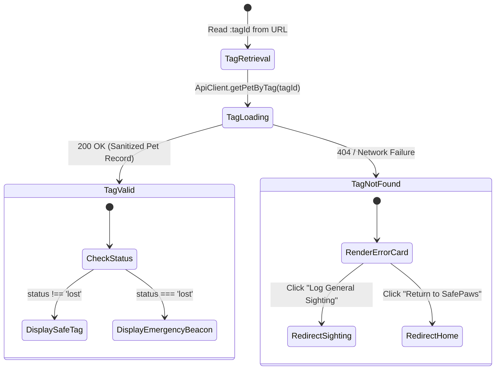

# SAFEPAWS — UX-06.3 OWNER & PET EXPERIENCE ARCHITECTURE
## Information Architecture, User Mental Models, Step Flows & Privacy Boundaries

**Document Status:** Official Architecture Specification  
**Milestone:** Phase UX-06.3 Owner & Pet Experience Transformation  
**Lead Authority:** Panel C Lead (Owner & Pet Experience Transformation Lead)  
**Coordinating Specialists:**
- **C1:** User Journey & Information Architecture Specialist
- **C3:** Frontend Architecture & State Lifecycle Specialist
- **C4:** Visual Implementation & Design Systems Engineer
- **C5:** Accessibility & Motion Choreography Specialist
- **C2:** Creative Director & Brand Identity Lead
**Collaborating Panels:**
- **Panel A Lead:** Design System Primitives & Token Parity
- **Panel F Lead:** Independent Adversarial Quality Assurance
**Repository Scope:** `frontend/` only (Strict Scope Lock: Zero backend, DB, or auth modifications)  
**Target Surfaces:**
1. `/setup-profile` (`SetupProfile.tsx`)
2. `/dashboard` (`Dashboard.tsx`)
3. `/pets/new` (`NewPet.tsx`)
4. `/pets/:petId` (`PetDetail.tsx`)
5. `/p/:tagId` (`PublicTagProfile.tsx`)

---

## 1. System Mission & Architectural Scope Boundaries

Panel C governs the operational core of SafePaws: the authenticated pet guardian experience and the public rescuer collar touchpoint.

### 1.1 Non-Negotiable Engineering Invariants
1. **Strict Frontend Boundary:** Zero modifications to backend FastAPI routes, Pydantic schemas, database migrations, or ML vision pipelines. All frontend improvements must consume existing APIs and data structures cleanly.
2. **Zero-Fabrication Principle:** Passing mocked unit tests will never be represented as live backend verification. All mock fallbacks must fail gracefully with honest offline notices.
3. **Privacy Invariant SD-01 Compliance:** Under no circumstances will sensitive owner PII (`owner_name`, `owner_phone`, `microchip_id`, home address) be requested, displayed, or serialized in unauthenticated public tag views (`/p/:tagId`).
4. **WCAG 2.2 AA Accessibility Gate:** All interactive elements enforce $\ge 44 \times 44\text{px}$ touch targets, visible keyboard focus rings, semantic landmark structures, and $\ge 4.5:1$ contrast ratios ($\ge 6.0:1$ for brand accents on Bone).
5. **No Regressions on Preceding Panels:** Complete preservation of Panel A shared UI primitives and zero git diff on Panel B landing page assets.

---

## 2. Information Architecture & Multi-Surface Routing Topology

The SafePaws routing architecture strictly isolates authenticated owner spaces from public community spaces while maintaining seamless contextual handoffs:



### 2.1 Route Inventory & Access Constraints

| Route Pattern | Target Component | Guard Wrapper | Primary Purpose | API Dependencies |
|:---|:---|:---|:---|:---|
| `/setup-profile` | `SetupProfile.tsx` | `SetupProfileRoute` | First-time guardian onboarding: operational neighborhood & recovery phone. | `PUT /api/users/profile` |
| `/dashboard` | `Dashboard.tsx` | `DashboardRoute` | Central command console: companion cards, active recovery radar, quick actions. | `GET /api/v1/pets`, `GET /api/v1/alerts`, `GET /api/v1/sightings` |
| `/pets/new` | `NewPet.tsx` | `DashboardRoute` | 3-step atomic pet registration & neural dermal nose-print enrollment. | `POST /api/v1/pets/register`, `POST /api/v1/pets/{id}/enroll-image` |
| `/pets/:petId` | `PetDetail.tsx` | `DashboardRoute` | Master companion identity dossier: QR collar hub, health advisories, panic trigger. | `GET /api/v1/pets/{id}`, `PUT /api/v1/pets/{id}`, `DELETE /api/v1/pets/{id}` |
| `/p/:tagId` | `PublicTagProfile.tsx` | Public (Unrestricted) | Rescuer smart collar landing page with SD-01 privacy withholding & direct GPS ping. | `GET /api/v1/pets/tag/{qr_tag_id}`, `POST /api/v1/sightings/` |

---

## 3. User Mental Models & Emotional State Dynamics

Pet guardians and finders interact with SafePaws under radically different psychological conditions. The architecture dynamically adapts to three distinct emotional archetypes:

```
+-----------------------------------------------------------------------------------------+
|                           THE THREE USER MENTAL MODELS                                  |
+-----------------------------------------------------------------------------------------+
| 1. THE REASSURED GUARDIAN (Routine Calm Guardianship)                                   |
|    - Emotional State: Calm, protective, detail-oriented, loving.                        |
|    - Goals: Ensure companion records are complete; download QR tag; review microchip.  |
|    - System Response: Tactile, warm, editorial layout; subtle animations; zero panic.   |
+-----------------------------------------------------------------------------------------+
| 2. THE DISTRESSED GUARDIAN (Crisis Recovery Protocol)                                   |
|    - Emotional State: Terror, adrenaline, scattered focus, urgent need for action.       |
|    - Goals: Broadcast emergency alert immediately; mobilize neighborhood in <60 seconds|
|    - System Response: Prominent Alert-Clay radar header; high-contrast action triggers; |
|      uncluttered inputs; immediate tactile confirmation; no cognitive puzzles.          |
+-----------------------------------------------------------------------------------------+
| 3. THE GOOD SAMARITAN FINDER (Outdoor Mobile Encounter)                                 |
|    - Emotional State: Helpful, cautious around unfamiliar animal, outdoor daylight.    |
|    - Goals: Identify the dog; notify the owner safely without complex account creation. |
|    - System Response: Mobile-first card; high-contrast "I am Max" hero; one-tap GPS    |
|      location ping; phone numbers withheld (SD-01); safe animal handling advice.        |
+-----------------------------------------------------------------------------------------+
```

---

## 4. End-to-End User Experience Step Flows

### 4.1 Flow 1: Guardian Commissioning (`/setup-profile`)
1. **Trigger:** Newly authenticated user signs in via Google OAuth. The `SetupProfileRoute` detects `user.profileCompleted === false` and routes to `/setup-profile`.
2. **Step 1 — Operational Zone:**
   - User presented with dignified commissioning card explaining neighborhood-level protection.
   - User clicks **"Detect Approximate Zone"** (triggers `navigator.geolocation` with reverse geocoding to OpenStreetMap Nominatim) or selects **"Enter Neighborhood Manually"**.
3. **Step 2 — Emergency Contact & Confirmation:**
   - User inputs recovery telephone number (validated with regex `replace(/\D/g, '').length >= 7`) and confirms neighborhood string.
   - System highlights the SD-01 privacy guarantee: *"Protected: Phone numbers are withheld from public collar tag scans by default."*
   - User clicks **"Activate Guardian Profile"**, executing `PUT /api/users/profile`.
4. **Resolution:** Store updates `authStore.user.profileCompleted = true`, navigating immediately to `/dashboard`.

### 4.2 Flow 2: 3-Step Atomic Companion Enrollment (`/pets/new`)
To completely eliminate the **Orphaned Pet Record Vulnerability** (where a failed ML vision upload leaves an un-indexed database pet that gets duplicated on retry), the enrollment flow utilizes an atomic state machine:



### 4.3 Flow 3: Central Console & Multi-Pet Inventory (`/dashboard`)
1. **Hydration Phase:** `Dashboard.tsx` checks `usePetStore.hydrated`. If `!hydrated || isLoading` and `pets.length === 0`, it renders 3 animated bone-card skeletons, completely preventing Flash of Empty State (FOES).
2. **Calm Mode Display:** If no pets have status `'lost'` or `'sightings_reported'`:
   - Header displays emerald indicator: *"All Companions Safe (N)"*.
   - Bento Grid renders polymorphic `<PetCard />` instances in `grid` or `row` layout mode.
   - For collections of 4+ pets, search and filtering inputs activate automatically.
3. **Crisis Mode Escalation:** If one or more pets are marked `'lost'` or `'sightings_reported'`:
   - Header transforms to pulsing Alert-Clay radar: *"Active Recovery Protocol (N)"*.
   - A dedicated priority section (`Active Incidents`) renders `<PetCard viewMode="crisis" />` cards with live radar pings and direct links to the incident room (`/alerts/:alertId`).
   - Safe companions remain 100% visible with normal contrast (zero opacity dimming).

### 4.4 Flow 4: Master Pet Dossier & Smart QR Hub (`/pets/:petId`)
1. **Data Ingestion:** Loads pet record from `ApiClient.getPet(petId)`. If not found, renders dignified "Record Not Found" recovery card with return button.
2. **Visual Dossier:**
   - Left Column: High-resolution 4:5 portrait matting, missing status overlay, and prominent Dermal Biometric Signature block (`TAG-BIO`).
   - Right Column: Record details (Age, Weight, Microchip ID, Neighborhood Zone), physical characteristics bullet list, and medical advisories box.
3. **Smart Collar Tag Inspection:** Guardian clicks QR icon in header, launching `QrTagModal.tsx`:
   - Generates live SVG QR code encoding the canonical public URL (`${origin}/p/${pet.qrTagId}`).
   - Displays clear SD-01 privacy notice: *"When scanned, rescuers can securely send an instant location ping or emergency sighting without exposing your private phone number."*
   - Provides one-click URL copying and QR tag PNG download.
4. **Record Editing:** Guardian clicks "Edit", launching accessible Radix `<Dialog>` modal to update vitals and toggle public medical note disclosure.
5. **Record Purge:** Guardian clicks "Remove Identity Record", launching high-contrast danger confirmation dialog with explicit focus trap.

### 4.5 Flow 5: Rescuer Smart Collar Scan (`/p/:tagId`)
1. **Public Ingestion:** Good Samaritan scans physical collar QR tag or opens `/p/:tagId`.
2. **Data Sanitization:** The public endpoint (`GET /api/v1/pets/tag/{qr_tag_id}`) returns sanitized data: `owner_name`, `owner_phone`, and `microchip_id` are `null`.
3. **Hero Recognition:** Large compassionate identity header: *"I am Max"*, accompanied by breed, color, and distinctive physical markings chips.
4. **Emergency Sighting / Direct Location Ping:**
   - **Action 1 ("Send Location Ping"):** Requests browser GPS coordinates. Transmits lightweight anonymous sighting with exact coordinates to `POST /api/v1/sightings/`, alerting the guardian immediately without exposing raw phone numbers.
   - **Action 2 ("File Sighting Report"):** Navigates to `/sightings/new?alertId=...` for uploading photos or condition notes.

---

## 5. Privacy Boundaries & Governance Invariant SD-01

SafePaws enforces **Privacy-by-Default** across all architectural layers. Under Scope Deviation **SD-01**, raw contact information is completely insulated from public discovery:

### 5.1 Data Classification Matrix

| Data Attribute | Owner View (`/pets/:id`) | Public Tag View (`/p/:tagId`) | Wire Transmission (`/api/v1/pets/tag/{id}`) | Security Classification |
|:---|:---:|:---:|:---:|:---:|
| **Pet Name** | Visible | Visible | Serialized | Public |
| **Species & Breed** | Visible | Visible | Serialized | Public |
| **Color & Physical Features** | Visible | Visible | Serialized | Public |
| **Collar QR Tag ID** | Visible | Visible | Serialized | Public Verifier |
| **Biometric Nose-Print Thumbnail** | Visible | Withheld | Withheld | Protected Biometric |
| **Biometric 1280-d Vector** | Withheld | Withheld | Withheld | Internal ML Model Only |
| **Microchip Serial Number** | Visible | **STRICTLY WITHHELD** | **None (Zeroed Out)** | **Protected Invariant SD-01** |
| **Owner Legal Name** | Visible | **STRICTLY WITHHELD** | **None (Zeroed Out)** | **Protected Invariant SD-01** |
| **Owner Telephone Number** | Visible | **STRICTLY WITHHELD** | **None (Zeroed Out)** | **Protected Invariant SD-01** |
| **Owner Residential Address** | Withheld | **STRICTLY WITHHELD** | **None (Zeroed Out)** | **Protected Invariant SD-01** |
| **Operational Neighborhood** | Visible | Coarse Zone Only | Coarse Zone Only | Conditional Non-Specific |
| **Veterinary Medical Notes** | Visible | **Conditional Only** | Serialized if `share_medical_notes` | **Owner-Governed Consent** |

### 5.2 Verification of SD-01 Invariants
- **Public Serialization Quarantine:** `backend/app/api/v1/endpoints/pets.py` explicitly zeroes out `owner_name = None`, `owner_phone = None`, and `microchip_id = None` prior to wire serialization on tag lookup endpoints.
- **Frontend Safeguards:** `PublicTagProfile.tsx` renders an explicit **SD-01 Privacy Protection Notice** informing rescuers that communication is mediated through SafePaws recovery pings to prevent phone fraud and harassment.
- **Granular Consent Revocation:** In `PetDetail.tsx` and `NewPet.tsx`, guardians have explicit checkbox control over `shareMedicalNotes`. When toggled to false, medical notes are instantly withheld from the public tag view.

---

## 6. Error, Hydration & Empty State Machines

To ensure production-grade reliability under intermittent network connectivity or crisis latency, Panel C formalizes four discrete state machines:

### 6.1 State Machine 1: Store Hydration & FOES Prevention



- **FOES Defense:** The UI checks `(!hydrated || isLoading) && pets.length === 0`. The "No Registered Companions" empty state is rendered **only** when `hydrated && !isLoading && pets.length === 0 && !error`.
- **Offline Resilience:** If network hydration fails but cached pets exist in the store, the console displays the loaded companions with an **"Offline Notice"** badge rather than blanking out.

### 6.2 State Machine 2: Atomic Biometric Pet Enrollment



- **Non-Duplication Guard:** When `ApiClient.registerPet()` succeeds, `createdPetId` is stored in component state. If subsequent biometric extraction (`ApiClient.enrollImage()`) fails due to image blur or poor lighting, subsequent retry submissions skip pet registration and only retry the photo upload against the existing ID.

### 6.3 State Machine 3: Public Tag Profile Resolution



---

## 7. Cross-Panel Interface & Integration Map

```
+-----------------------------------------------------------------------------------------+
|                           CROSS-PANEL COLLABORATION MATRIX                              |
+-----------------------------------------------------------------------------------------+
| Panel A (Design System Primitives)                                                      |
| - Panel C strictly consumes shared primitives: Button, Card, Badge, FormField, Dialog.  |
| - Standardizes on design tokens: Bone (#F6F1E7), Ink (#1C1A17), Accent-Text (#8B4A00).  |
| - Ensures zero conflicting utility classes or hardcoded color literals.                 |
+-----------------------------------------------------------------------------------------+
| Panel B (Landing Page & Finder Experience)                                              |
| - Panel C respects strict zero-git-diff boundary on all Panel B marketing assets.       |
| - Seamless link continuity: Landing Page "Register Pet" -> /pets/new.                   |
| - Header Sign In -> /dashboard (or /setup-profile).                                     |
+-----------------------------------------------------------------------------------------+
| Panel D (Biometric Scanner & Identity Pipeline)                                         |
| - Scanner result card "Register Pet" directs cleanly to /pets/new.                      |
| - Consistent JetBrains Mono telemetry typography across scanner HUD and pet dossiers.   |
+-----------------------------------------------------------------------------------------+
| Panel E (Community Feed, Recovery Board & Incident Rooms)                               |
| - Dashboard active incidents link directly to Incident Rooms (/alerts/:alertId).        |
| - Public collar tag emergency reporting routes to /sightings/new?alertId=...            |
+-----------------------------------------------------------------------------------------+
| Panel F (Independent QA & Release Hard-Gate)                                            |
| - Pre-verifies 100% green TypeScript compilation (tsc --noEmit).                        |
| - Pre-verifies all Vitest unit tests pass cleanly.                                      |
| - Pre-audits WCAG 2.2 AA contrast ratios, touch targets, and focus trapping.            |
+-----------------------------------------------------------------------------------------+
```

*Architecture ratified. Ready for Component Contract and Motion Choreography specifications.*