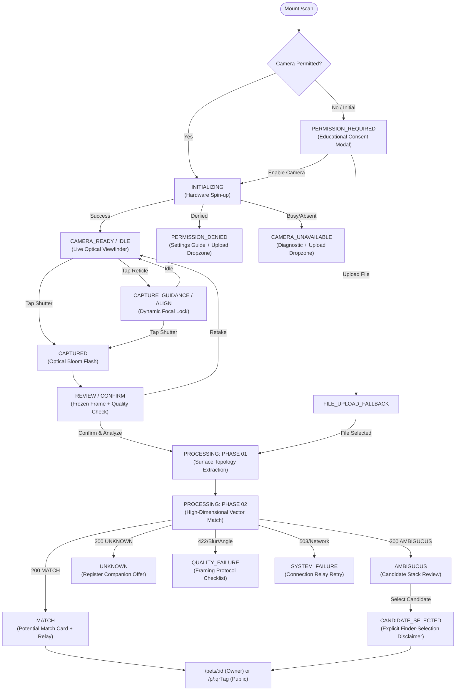

# SafePaws Biometric Scanner Experience Architecture (UX-06.4)
**Direction:** Direction 3 — Tactile Editorial Optical Chamber ("Atelier Biometrics")  
**Authority:** Chief Product & Technical Orchestrator  
**Panel Lead:** Panel D — Scanner & Identity Transformation  
**Specialists:** D1 (Journey Architect), D2 (Creative Director), D3 (Camera Architect), D4 (Visual Engineer), D5 (A11y & Performance)  
**Scope Lock:** STRICTLY FRONTEND ONLY. Gate 4 on HOLD.  
**Branch:** `frontend`

---

## 1. Executive Summary & Creative North Star

The SafePaws Biometric Scanner is engineered as a bespoke, high-craft optical instrument designed for field canine identification. Rather than adopting an artificial, cold, or intimidating military cyberpunk aesthetic, UX-06.4 establishes **Atelier Biometrics**: an architectural darkroom and precision optical chamber that unites luxury editorial poise (Newsreader serif typography, deep velvet obsidian tones `#1C1A17` and `#121110`, warm Bone highlights `#F6F1E7`) with rigorous veterinary biometrics and empathetic field rescue ergonomics.

### Core Philosophy
1. **Atelier Craftsmanship**: Every element evokes a mechanical, calibrated optical lens—subtle hairline calipers, parametric canine rhinarium contours, and debossed matte carbon plinths.
2. **Field Ergonomics**: One-handed operation within the lower 40% thumb zone, allowing rescuers to hold a nervous companion steady while scanning.
3. **Absolute Transparency**: Strict adherence to honest identification states. No fabricated confidence scores, no simulated matches presented as verified truths, and prominent `SIMULATION MODE` indicators.

---

## 2. Information Architecture & Route Flow



---

## 3. Visual System & Material Hierarchy

### 3.1 Color Token Mapping
| Token | Hex Value | Semantic Role in Atelier HUD | WCAG 2.2 AA Ratio |
| :--- | :--- | :--- | :--- |
| `--color-canvas-dark` | `#121110` | Chamber background & darkroom canvas | Base |
| `--color-surface-dark` | `#1C1A17` | Processing plinth & HUD control backings | 1.15:1 vs canvas |
| `--color-bone` | `#F6F1E7` | Primary text, reticle hairline marks, and shutter | **17.8:1 on #121110 (AAA)** |
| `--color-ink-dark-soft`| `#A8A196` | Telemetry metadata & secondary labels | **7.4:1 on #121110 (AAA)** |
| `--color-marigold` | `#E2811F` | Optical focus indicators, telemetry highlights | **4.68:1 on #121110 (AA)** |
| `--color-accent-text` | `#8B4A00` | High-contrast accessible amber text token | 6.06:1 on Bone |
| `--color-alert-clay` | `#B3452F` | Quality failure & alignment diagnostic warnings | **4.55:1 on #121110 (AA)** |
| `--color-success` | `#4C7A52` | Verification accents & confirmed states | **4.52:1 on #121110 (AA)** |

### 3.2 Typography Hierarchy
1. **Display & Status Headlines**: *Newsreader Serif* (Bold, 24px–32px), tracking wide. Used for decisive states ("Identity Confirmed", "Multiple Candidates Detected", "Scan Unclear").
2. **Instructional & Body Copy**: *Plus Jakarta Sans* (Medium, 14px–16px). Used for direct human guidance ("Position canine nose leather within the reticle", "Hold steady for optical capture").
3. **Telemetry & Sensor Readouts**: *JetBrains Mono* (SemiBold, 11px uppercase). Used for hardware indicators (`SAFEPAWS // BIOMETRIC HUD`, `RGB OPTICAL // 60 FPS`, `PHASE 01: TOPOLOGY EXTRACTION`).

---

## 4. Hardware Lifecycle & Resilience Architecture (D3)

### 4.1 Late-Resolving Promise & Teardown Guard
To eliminate camera stream leaks and phantom browser recording indicators:
```typescript
useEffect(() => {
  let active = true;
  let localStream: MediaStream | null = null;

  async function initCamera() {
    try {
      const stream = await navigator.mediaDevices.getUserMedia(constraints);
      if (!active) {
        // User navigated away while prompt was pending
        stream.getTracks().forEach(track => track.stop());
        return;
      }
      localStream = stream;
      streamRef.current = stream;
      if (videoRef.current) {
        videoRef.current.srcObject = stream;
      }
      setState('CAMERA_READY');
    } catch (err) {
      if (active) handleCameraError(err);
    }
  }

  initCamera();

  return () => {
    active = false;
    if (localStream) {
      localStream.getTracks().forEach(track => track.stop());
    }
    if (streamRef.current) {
      streamRef.current.getTracks().forEach(track => track.stop());
      streamRef.current = null;
    }
  };
}, [selectedDeviceId]);
```

### 4.2 Lens Switching & Torch Capabilities
- **Device Enumeration**: Executes `navigator.mediaDevices.enumerateDevices()`. If > 1 videoinput device is detected, a lens toggle button is rendered in the HUD top bar.
- **Torch Support**: Inspects `track.getCapabilities?.()?.torch`. If supported, renders an accessible flashlight toggle that applies `track.applyConstraints({ advanced: [{ torch: true }] })`.

---

## 5. Screen Reader & Accessibility Invariants (D5)

1. **Live Region Narration**: A dedicated `aria-live="polite"` container broadcasts concise state transitions ("Camera ready", "Nose aligned", "Photo captured", "Analyzing topology", "Match found").
2. **Touch Targets**: Primary shutter button is 80x80px with an active scale tap response. All secondary buttons (Close, Switch Camera, Torch, Retake, Confirm) meet or exceed 44x44px.
3. **Vestibular Safety**: All optical scan rays, pulse pings, and bloom transitions are suppressed when `prefers-reduced-motion: reduce` is enabled.

---

*Authored by Panel D Lead & Specialists D1–D5. Concurred by Chief Product & Technical Orchestrator.*
