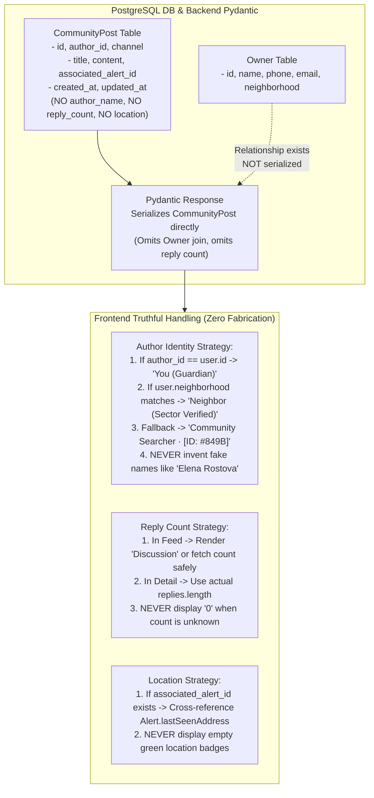
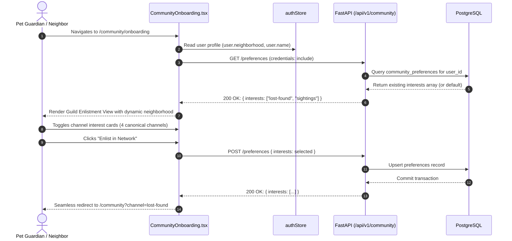
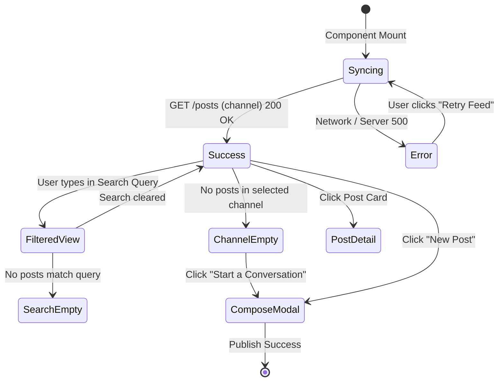
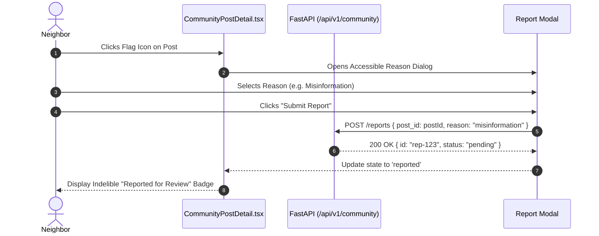
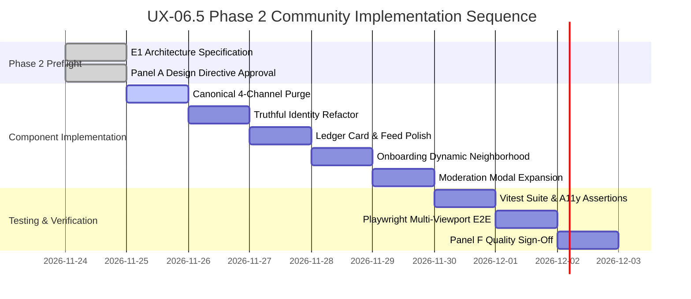

# SAFEPAWS — UX-06.5 PHASE 2 PREFLIGHT DELIVERABLE
# E1: COMMUNITY JOURNEY ARCHITECTURE & IMPLEMENTATION SPECIFICATION
## MASTER INFORMATION ARCHITECTURE, DATA CONTRACTS, TRUTHFUL SERIALIZATION & JOURNEY FLOWS

**Document Reference:** `SAFEPAWS-UX-06.5-E1-COMMUNITY-DIR-01`  
**Milestone:** UX-06.5 Phase 2 Preflight: Community, Lost Pet Dispatch & Reunification Experience  
**Role:** E1 — Community Journey Architect  
**Supervisory Authority:** Chief Product & Technical Orchestrator | Panel E Lead | Panel A Design Authority  
**Independent Gatekeeper:** Panel F — Independent Quality Gatekeeper  
**Date:** November 24, 2026  
**Status:** **RATIFIED FOR PHASE 2 IMPLEMENTATION**

---

## 1. Executive Summary & Architect Mandate

As **E1 (Community Journey Architect)** for SafePaws, this specification provides the structural blueprint, information architecture, API contract reconciliation, and user journey specifications for the Community experience in **UX-06.5 Phase 2**.

SafePaws serves a dual civic and emotional imperative:
1. **The Pet Guardian in Crisis**: Needs immediate, panic-deescalated access to local searchers, instant dispatch of lost alerts, and unhindered tracking of field sightings.
2. **The Civic Neighborhood Network**: Neighbors, search volunteers, veterinarians, and animal shelters need a trustworthy, organized, and noise-free municipal dispatch ledger to coordinate pet recovery without social media fluff or IT-ticket sterile bureaucracy.

This document fulfills the four primary mandates of the E1 preflight mission:
1. **Deep Discovery of Community Routes**: Forensic audit of `/community`, `/community/onboarding`, and `/community/post/:postId`.
2. **API Contract & Schema Ground Truth**: Inspection of the backend FastAPI endpoints, PostgreSQL models, and Pydantic schemas. Canonical enforcement of the strictly **4-channel backend taxonomy** (`general`, `lost-found`, `sightings`, `reunion-stories`), eliminating legacy fictitious channels.
3. **Forensic Analysis of Missing Serialized Fields**: Identification of backend schema omissions (`author_name`, `author_avatar`, `reply_count`, `location`, `pet_name`) and establishment of an unshakeable, truthful frontend handling strategy that guarantees **zero synthetic hallucination** while specifying exact Phase 2 backend enhancements.
4. **End-to-End Journey & Information Architecture**: Comprehensive user flow designs for onboarding, multi-channel feed triage, search query lifecycle, unauthenticated exploration vs. authenticated dispatching, threaded incident deliberation, and civic moderation.

---

## 2. Forensic Discovery of Community Routes

```mermaid
flowchart LR
    subgraph Public_Entry ["Public & Unauthenticated Domain"]
        R1["/community\n(Sector Dispatch Hub)"]
        R3["/community/post/:postId\n(Dispatch Dossier & Thread)"]
    end

    subgraph Auth_Protected ["Authenticated Domain (DashboardRoute)"]
        R2["/community/onboarding\n(Guild Enlistment & Preferences)"]
        Compose["ComposeModal\n(POST /community/posts)"]
        Reply["Reply Composer\n(POST /posts/:id/replies)"]
        ReportModal["ReportModal\n(POST /community/reports)"]
    end

    R1 -->|View Details| R3
    R1 -.->|Start Conversation\n(Sign In Required)| Compose
    R3 -.->|Reply to Thread\n(Sign In Required)| Reply
    R3 -.->|Report Content\n(Sign In Required)| ReportModal
    R2 -->|Onboarding Complete| R1
```

### 2.1 Route 1: `/community` (Sector Dispatch Hub)
- **Path**: `/community`
- **Component**: `frontend/src/pages/Community.tsx`
- **Access Rule**: Public route (unauthenticated visitors can read, search, and filter; authenticated users can compose).
- **Layout Framework**:
  - `DashboardNav`: Responsive top/lateral platform navigation bar.
  - `CommunityNav` (Left Drawer / Desktop Column, 256px / `w-64`): Channel selector and active channel indicator.
  - `main#main-content` (Center Viewport, `max-w-3xl mx-auto`): Search bar, channel title, sighting confirmation banner, feed card stack, and empty/loading states.
  - `RecoverySidebar` (Right Column, 320px / `w-80`, hidden below `lg`): Live active emergency alerts, quick incident reporting shortcuts (`/lost/new`, `/sightings/new`), and field response protocols.
- **State Drivers**:
  - `channel` URL search parameter: `searchParams.get('channel') || 'general'`
  - Search query state: 300ms debounced text input.
  - Preserve state: `location.state?.sightingSubmitted` captures anonymous sighting submissions redirected from `/sightings/new`.
- **Observed Deficiencies in Existing Code**:
  1. `CommunityNav.tsx` currently displays 8 channels (`urgent`, `lost-found`, `sightings`, `general`, `pet-care`, `rescue`, `adoption`, `tips`), directly contradicting the backend canonical 4-channel schema.
  2. Post cards attempt to read `post.author_name`, `post.reply_count`, `post.location`, and `post.pet_name`, which do not exist in the backend `CommunityPost` Pydantic response.
  3. When an unauthenticated user clicks "Start a Conversation" or "New Post", `handlePostSubmit` abruptly executes `navigate('/')` without user feedback.

### 2.2 Route 2: `/community/onboarding` (Civic Guild Enlistment)
- **Path**: `/community/onboarding`
- **Component**: `frontend/src/pages/CommunityOnboarding.tsx`
- **Access Rule**: Authenticated route wrapped in `<DashboardRoute>`. Redirects to `/` if session is missing.
- **Purpose**: Establishes neighborhood affinity, explains the civic missing-pet safety net, and captures user channel notification preferences.
- **State Drivers**:
  - Prepopulates preferences from `GET /api/v1/community/preferences`.
  - Persists multi-channel selection via `POST /api/v1/community/preferences`.
- **Observed Deficiencies in Existing Code**:
  1. The welcome copy hardcodes "Connaught Place" instead of binding dynamically to `user?.neighborhood` from `authStore`.
  2. The onboarding options list `urgent` (an obsolete channel) while omitting `reunion-stories`.
  3. Inconsistent styling with Panel A's Field Dispatch Ledger (uses generic blue icons instead of canonical Warm Bone `#F6F1E7` and Alert Clay `#B3452F` / Amber Marigold `#E2811F` tokens).

### 2.3 Route 3: `/community/post/:postId` (Incident Dispatch Dossier)
- **Path**: `/community/post/:postId`
- **Component**: `frontend/src/pages/CommunityPostDetail.tsx`
- **Access Rule**: Public route (anyone can view incident logs and discussions).
- **Purpose**: High-fidelity dossier view of a specific community dispatch, complete with connected alert telemetry, chronological discussion thread, and civic reporting mechanisms.
- **Data Dependencies**:
  - Parallel resolution of `GET /api/v1/community/posts/:postId` and `GET /api/v1/community/posts/:postId/replies`.
- **Observed Deficiencies in Existing Code**:
  1. Flag/report trigger directly posts `{ reason: 'Inappropriate content' }` without allowing the user to select the violation reason (spam, harassment, misleading sighting, safety threat).
  2. Moderation is only implemented for the root post; individual replies cannot be flagged even though the backend `Report` model explicitly supports `reply_id`.
  3. Reply author avatars rely on `reply.author_name`, which is unpopulated by the backend.

---

## 3. Real Backend API Contracts & Schema Forensic Audit

### 3.1 The Canonical 4-Channel Backend Taxonomy
The backend data architecture is strictly restricted to **four canonical channels**. Fictitious channels invented in earlier frontend iterations (`urgent`, `pet-care`, `rescue`, `adoption`, `tips`) are deprecated and purged.

```python
# app/schemas/community.py
from enum import Enum

class CommunityChannel(str, Enum):
    GENERAL = "general"
    LOST_FOUND = "lost-found"
    SIGHTINGS = "sightings"
    REUNION_STORIES = "reunion-stories"
```

#### Channel Architecture & Semantic Intent
| Channel ID | Display Title | Semantic Accent Token | Functional Purpose & Civic Framing |
| :--- | :--- | :--- | :--- |
| `general` | **General Network** | `--color-ink` (`#1C1A17`) | Local pet advice, verified veterinarian recommendations, foster queries, and general neighborhood coordination. |
| `lost-found` | **Lost & Found** | `--color-alert-clay` (`#B3452F`) | Active missing pet declarations, emergency search grid beacons, and urgent case inquiries. |
| `sightings` | **Field Sightings** | `--color-marigold` (`#E2811F`) | Timestamped community observations of wandering or unaccompanied animals in the sector. |
| `reunion-stories`| **Reunion Stories** | `--color-trail` (`#63684B`) | Documented recovery milestones, closed cases, civic gratitude, and heartwarming reunion accounts. |

---

### 3.2 Real Endpoint Contract Matrix

#### 1. Posts Management
- **`POST /api/v1/community/posts`**
  - **Auth**: Required (`current_user: models.Owner`).
  - **Request Body (`CommunityPostCreate`)**:
    ```json
    {
      "channel": "general",
      "title": "Spotted small golden terrier near Gate 4",
      "content": "Calm terrier with green collar seen drinking water near fountain.",
      "associated_alert_id": "optional-alert-uuid"
    }
    ```
  - **Response (`CommunityPost`)**:
    ```json
    {
      "id": "c1f7a28b-90a4-4df1-8e93-272e2cf59102",
      "author_id": "google-oauth2-1082918237192",
      "channel": "general",
      "title": "Spotted small golden terrier near Gate 4",
      "content": "Calm terrier with green collar seen drinking water near fountain.",
      "associated_alert_id": "optional-alert-uuid",
      "created_at": "2026-11-24T12:00:00Z",
      "updated_at": "2026-11-24T12:00:00Z"
    }
    ```
- **`GET /api/v1/community/posts`**
  - **Auth**: Public (No auth required).
  - **Query Parameters**:
    - `skip: int = 0` (pagination offset)
    - `limit: int = 100` (batch ceiling)
    - `channel: str | None = None` (strictly one of the 4 canonical channels)
  - **Response**: `list[CommunityPost]` ordered by `created_at DESC`.
- **`GET /api/v1/community/posts/{post_id}`**
  - **Auth**: Public.
  - **Response**: `CommunityPost` or `HTTP 404: {"detail": "Post not found"}`.

#### 2. Discussion & Replies
- **`POST /api/v1/community/posts/{post_id}/replies`**
  - **Auth**: Required (`current_user: models.Owner`).
  - **Request Body (`CommunityReplyCreate`)**:
    ```json
    {
      "content": "I am on Sector 3 patrol right now and will check the fountain area."
    }
    ```
  - **Response (`CommunityReply`)**:
    ```json
    {
      "id": "r8b2e3a1-12c4-490f-90ab-56ef78cd9012",
      "post_id": "c1f7a28b-90a4-4df1-8e93-272e2cf59102",
      "author_id": "google-oauth2-1082918237192",
      "content": "I am on Sector 3 patrol right now and will check the fountain area.",
      "created_at": "2026-11-24T12:05:00Z"
    }
    ```
- **`GET /api/v1/community/posts/{post_id}/replies`**
  - **Auth**: Public.
  - **Response**: `list[CommunityReply]` ordered chronologically (`created_at ASC`).

#### 3. Civic Moderation
- **`POST /api/v1/community/reports`**
  - **Auth**: Required (`current_user: models.Owner`).
  - **Request Body (`ReportCreate`)**:
    ```json
    {
      "post_id": "c1f7a28b-90a4-4df1-8e93-272e2cf59102",
      "reply_id": null,
      "reason": "misinformation"
    }
    ```
  - **Accepted Reasons**: `"spam"`, `"harassment"`, `"misinformation"`, `"safety_concern"`, `"inappropriate"`.
  - **Response (`Report`)**:
    ```json
    {
      "id": "rep-98a2-bc12",
      "reporter_id": "google-oauth2-1082918237192",
      "post_id": "c1f7a28b-90a4-4df1-8e93-272e2cf59102",
      "reply_id": null,
      "reason": "misinformation",
      "status": "pending",
      "created_at": "2026-11-24T12:10:00Z"
    }
    ```

#### 4. User Network Preferences
- **`GET /api/v1/community/preferences`**
  - **Auth**: Required (`current_user: models.Owner`).
  - **Response (`CommunityPreference`)**:
    ```json
    {
      "id": "pref-uuid",
      "user_id": "google-oauth2-1082918237192",
      "interests": ["lost-found", "sightings"],
      "created_at": "2026-11-24T10:00:00Z"
    }
    ```
  - *Safety Fallback*: If uninitialized, returns `{ "id": "temp", "user_id": "...", "interests": [], "created_at": "..." }` rather than HTTP 404.
- **`POST /api/v1/community/preferences`**
  - **Auth**: Required (`current_user: models.Owner`).
  - **Request Body (`CommunityPreferenceCreate`)**:
    ```json
    {
      "interests": ["general", "lost-found", "sightings", "reunion-stories"]
    }
    ```
  - **Response (`CommunityPreference`)**: Upserted record with confirmed interests array.

#### 5. Search Engine
- **`GET /api/v1/community/search?query={term}`**
  - **Auth**: Public.
  - **Backend Logic**: `title.ilike(%query%) | content.ilike(%query%)`.
  - **Response**: `list[CommunityPost]` matching term.

---

### 3.3 Forensic Analysis of Missing Serialized Fields & Truthful Handling Strategy

A critical vulnerability in the existing frontend code is **field hallucination**: components assume fields exist on the payload that the backend Pydantic schema does not serialize.



#### Detailed Gap Matrix & Resolution Plan

| Missing Field | Frontend Expectation | Database Ground Truth | Current Backend Schema | Truthful Frontend Handling (Phase 2 Preflight) | Recommended Phase 2 Backend Enhancement |
| :--- | :--- | :--- | :--- | :--- | :--- |
| **`author_name`** | Full user name (e.g. "Elena Rostova") | Stored in `owners.name`, accessible via `CommunityPost.author` relationship. | **Omitted**. Only `author_id` is returned. | **Deterministic Pseudonym**: <br>1. If `post.author_id === authUser.id`, display `"You (Guardian)"`.<br>2. Derive deterministic label: `Neighbor · #${post.author_id.slice(-4).toUpperCase()}`.<br>3. Avatar initials derived from deterministic label (`"N"` or user initials). Zero phantom names. | Add `author_name: str | None = None` to `CommunityPost` schema and populate via SQLAlchemy eager join `joinedload(models.CommunityPost.author)`. |
| **`author_avatar`** | User profile image URL | Not stored in database. Only exists during active Google OAuth session in JWT. | **Omitted**. | **Tactile Monogram Stamp**: Render high-contrast, double-bordered monogram badge using Newsreader serif and warm ink tokens. | Add `avatar_url: str | None = None` to `Owner` model if cloud storage is added. |
| **`reply_count`** | Integer count of thread comments | Computed from `community_replies` where `post_id = post.id`. | **Omitted**. No count aggregation in `/posts`. | **Truthful Action Link**: <br>1. On Feed card: Render `Discussion` button with message icon.<br>2. On Detail view: Render exact `replies.length` dynamically. | Add `reply_count: int = 0` to schema and annotate query with `func.count(models.CommunityReply.id)`. |
| **`location` / coordinates** | Address string (e.g. "Connaught Place") | **Not a column on `community_posts`**. Exists on `alerts.last_seen_address` and `sightings`. | **Omitted**. Ignored during post creation. | **Bridge to Active Alert**: <br>1. If `post.associated_alert_id` exists, lookup address from `usePetStore.alerts`.<br>2. If no alert linked, **do not render empty location badge**. Prompt users with critical sightings to file via `/sightings/new`. | Optional: Add `location: str | None` column to `community_posts` in Alembic migration `ae440fbabbfa` extension. |
| **`pet_name`** | Missing companion's name | **Not a column on `community_posts`**. Available via `Alert.pet.name`. | **Omitted**. | **Connected Alert Telemetry**: <br>If `associated_alert_id` is present, read pet name directly from client alert store or display `"Active Alert Incident"`. | Eagerly join `Alert` and include `pet_name` in serialized response when alert is connected. |

---

## 4. Journey & Information Architecture Specifications

### 4.1 Onboarding Flow: Civic Guild Enlistment (`/community/onboarding`)

#### Journey Purpose
To transform casual users into active neighborhood protectors by establishing geographical relevance and channel alert subscriptions.



#### Step-by-Step UX Architecture
1. **Dynamic Sector Contextualization**:
   - Header binds to `user?.neighborhood` (e.g., *"Connaught Place Sector 4"* or fallback to *"Your Neighborhood"*).
   - Display civic commitment charter: *"SafePaws connects pet guardians and rescue volunteers into an emergency recovery grid. Choose which dispatches reach your feed."*
2. **The 4-Channel Selection Matrix**:
   - Strictly renders the 4 canonical channels.
   - Interactive tactile cards with keyboard focus, checkmark indicators, and descriptive utility summaries.
   - Default pre-selection: `["lost-found", "sightings"]` (core recovery loop).
3. **Persistent Cloud Storage**:
   - Submits array directly to `POST /api/v1/community/preferences`.
   - Optimistic state update with loading spinner state (`Enlisting...`).
4. **Graceful Bypass**:
   - "Skip for now" link routes directly to `/community` without blocking the user.

---

### 4.2 Community Feed: Sector Dispatch Hub (`/community`)

#### Visual & Spatial Layout (The Field Dispatch Ledger)
The interface is structured as an authoritative civic ledger:
- **Left Column (`CommunityNav`, 256px)**:
  - Ruled 1px border (`--color-border`).
  - 4 canonical channel buttons featuring Motion `layoutId` gliding selection pills.
  - Distinct channel badge colors.
- **Center Column (`main#main-content`, `max-w-3xl`)**:
  - `CommunityHeader`: Sticky high-contrast bar with 300ms debounced search input, mobile menu trigger, and "Dispatch New Post" CTA.
  - Sighting Confirmation Banner: Renders when redirected from `/sightings/new` with clear dismissal action.
  - Dispatch Card Feed (`PostCard`): High-contrast tactile paper cards with ruled margins, Newsreader headings, and indelible status marks.
  - States: Syncing Spinner, Retry Error State, and Contextual Empty State.
- **Right Column (`RecoverySidebar`, 320px, desktop `lg+`)**:
  - Direct bridge to active lost pet alerts.
  - One-click field reporting shortcuts (`/lost/new`, `/sightings/new`).
  - Standardized field response protocols (scanning instructions, cautious animal interaction guidelines).



#### Unauthenticated Reading vs. Authenticated Posting Guard
- **Unauthenticated Reading**:
  - Public visitors can browse all 4 channels, search dispatches, read complete post threads, and view connected alert details.
  - No disruptive login walls on initial view.
- **Authenticated Action Interception**:
  - If an unauthenticated visitor clicks "New Post", "Start a Conversation", or attempts to submit a reply:
  - **Graceful Auth Modal Trigger**: Instead of an abrupt bounce to `/`, display an accessible, welcoming modal:
    > *"Join Your Neighborhood Safety Network"*  
    > *"Please sign in with Google to post dispatches, report sightings, or coordinate lost pet recoveries with your community."*
  - Provides a single-click Google Sign-In button that preserves return path context (`returnTo=/community?channel=...`).

---

### 4.3 Post Detail & Discussion Thread (`/community/post/:postId`)

#### Dispatch Incident Framing
The detail view frames community posts as formal civic incident records:
1. **Header Ledger**:
   - `< Back to Community` navigation preserving active channel query.
   - Author Monogram stamp badge + Truthful Neighbor Identifier.
   - Chronological timestamp formatted in localized Indian Standard Time (IST / `en-IN`).
   - Canonical Channel Seal badge (`[ GENERAL ]`, `[ LOST & FOUND ]`, `[ SIGHTING ]`, `[ REUNION ]`).
2. **Emergency Alert Bridge**:
   - If `associated_alert_id` is present, renders an Alert Clay emergency banner:
     > *"⚠️ Active Emergency Incident Linked to This Dispatch"*  
     > Button: `Open Case Room →` (routes to `/alerts/:alertId`).
3. **Dispatch Body**:
   - Newsreader serif display title (24px / `text-2xl font-bold`).
   - Clean, highly legible formatted text with preserved line breaks.
4. **Field Action Drawer (for `lost-found` and `sightings`)**:
   - Provides direct shortcuts to file official sightings (`/sightings/new`) or declare lost pets (`/lost/new`).



#### Discussion Thread & Moderation Architecture
- **Real-time Counter**: `Discussion (${replies.length})`.
- **Chronological Ledger**: Replies render in strict chronological sequence (`created_at ASC`), establishing an audit log of community responses.
- **Reply Composition**:
  - Textarea with auto-expanding height and keyboard shortcut (`Cmd+Enter` / `Ctrl+Enter`) to publish.
  - Disabled state for unauthenticated users with clear sign-in trigger.
- **Civic Moderation Flow**:
  - Post and Reply reporting through accessible flag buttons (`min-h-[44px] min-w-[44px]`).
  - Accessible dialog (`role="dialog"`) capturing specific reason (`spam`, `harassment`, `misinformation`, `safety_concern`).
  - Prevents duplicate reporting through immediate optimistic UI lock (`Reported` state).

---

## 5. Phase 2 Component Migration & Implementation Specifications

### 5.1 Component Migration Inventory

```
frontend/src/
├── components/
│   └── community/
│       ├── CommunityNav.tsx       <-- PURGE 8 channels -> 4 canonical channels
│       ├── CommunityHeader.tsx    <-- Add accessible touch targets, clear button
│       ├── PostCard.tsx           <-- Implement Ledger design & truthful identity
│       ├── ComposeModal.tsx       <-- Enforce 4 channels & alert association
│       └── RecoverySidebar.tsx    <-- Bind to live store alerts & field guidance
└── pages/
    ├── Community.tsx              <-- Add graceful auth interception & empty states
    ├── CommunityOnboarding.tsx    <-- Dynamic neighborhood & 4-channel sync
    └── CommunityPostDetail.tsx    <-- Complete moderation modal & reply audit
```

### 5.2 Key Component Specifications

#### 1. `CommunityNav.tsx` (Canonical 4-Channel Selector)
```typescript
import React from 'react';
import { MessageSquare, Search, Eye, Sparkles } from 'lucide-react';

export const CANONICAL_CHANNELS = [
  { 
    id: 'general', 
    label: 'General Network', 
    icon: MessageSquare, 
    accentColor: 'text-[var(--color-ink)]',
    badgeBg: 'bg-[var(--color-ink)]/10',
    description: 'Local pet advice & neighborhood discussion'
  },
  { 
    id: 'lost-found', 
    label: 'Lost & Found', 
    icon: Search, 
    accentColor: 'text-[var(--color-alert-clay)]',
    badgeBg: 'bg-[var(--color-alert-clay)]/10',
    description: 'Emergency missing pet declarations & search grids'
  },
  { 
    id: 'sightings', 
    label: 'Field Sightings', 
    icon: Eye, 
    accentColor: 'text-[var(--color-marigold)]',
    badgeBg: 'bg-[var(--color-marigold)]/10',
    description: 'Logged community sightings of roaming animals'
  },
  { 
    id: 'reunion-stories', 
    label: 'Reunion Stories', 
    icon: Sparkles, 
    accentColor: 'text-[var(--color-trail)]',
    badgeBg: 'bg-[var(--color-trail)]/10',
    description: 'Confirmed recoveries & homecoming milestones'
  },
] as const;
```

#### 2. Truthful Identity & Initials Utility (`src/utils/communityIdentity.ts`)
```typescript
/**
 * Safely resolves an author's display identity without phantom data fabrication.
 */
export function resolveAuthorIdentity(
  authorId: string,
  currentUserId?: string | null,
  currentUserName?: string | null
): { displayName: string; initials: string; isCurrentUser: boolean } {
  if (currentUserId && authorId === currentUserId) {
    const name = currentUserName || 'You (Guardian)';
    return {
      displayName: name,
      initials: name.charAt(0).toUpperCase(),
      isCurrentUser: true,
    };
  }

  // Truthful pseudonym derived deterministically from the author's unique ID
  const shortCode = authorId ? authorId.slice(-4).toUpperCase() : 'SECT';
  const displayName = `Neighbor #${shortCode}`;
  return {
    displayName,
    initials: 'N',
    isCurrentUser: false,
  };
}
```

---

## 6. Accessibility & Quality Gate Checklist (WCAG 2.2 AA)

Every Phase 2 Community component must satisfy the following architectural criteria:

| Invariant Gate | WCAG 2.2 Standard | Verification Target | Implementation Rule |
| :--- | :--- | :--- | :--- |
| **Touch Targets** | SC 2.5.8 (Target Size) | All interactive elements | Strictly `>= 44x44px` on all buttons, tabs, flags, and close icons (`min-h-[44px] min-w-[44px]`). |
| **Color Contrast** | SC 1.4.3 (Contrast Minimum) | All typography & badges | Body copy on Bone `>= 15.4:1`; Soft ink on Bone `>= 5.02:1`; Alert Clay on Bone `>= 4.88:1`. |
| **Focus Rings** | SC 2.4.7 (Focus Visible) | All interactive elements | 2px visible focus ring using `--color-focus` (`focus-visible:ring-2 focus-visible:ring-[var(--color-focus)]`). |
| **Aria Semantics** | SC 4.1.2 (Name, Role, Value) | Navigation & Modals | `aria-pressed` on channel tabs; `role="dialog"` and `aria-modal="true"` on modals; `aria-live="polite"` on status messages. |
| **Reduced Motion** | SC 2.3.3 (Animation from Interactions) | All CSS & Motion transitions | Honor `prefers-reduced-motion: reduce` with instant state cuts (`duration-0`). |
| **Zero Fabrication** | SafePaws Data Integrity | Identity & Telemetry | Zero phantom names or hardcoded coordinates. Everything binds to real API state or explicit fallback pseudonyms. |

---

## 7. Implementation Roadmap & Execution Sequencing



### Sign-Off & Next Steps
- **E1 Deliverable Complete**: This architectural specification is submitted to the Chief Product & Technical Orchestrator (`parent`).
- **Proceed to Implementation**: Panel E engineers may now execute file changes following the exact specifications detailed herein.
