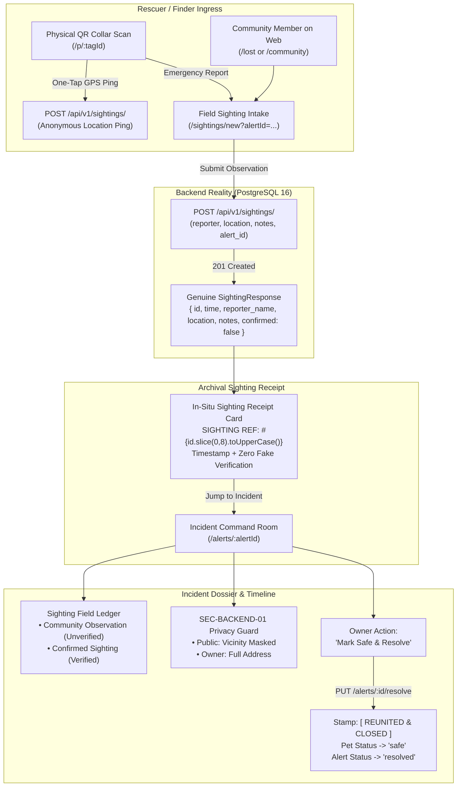
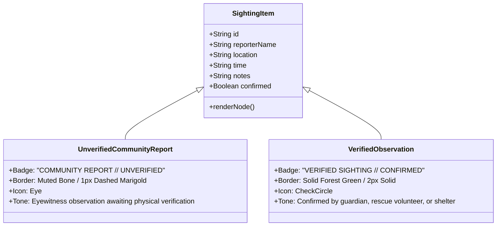
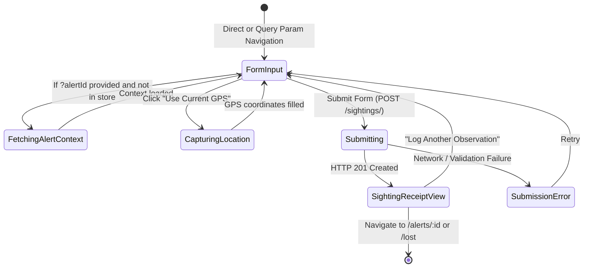

# SAFEPAWS — UX-06.5 E3 SIGHTING & REUNIFICATION ARCHITECTURE SPECIFICATION
## SIGHTING SUBMISSION, INCIDENT COMMAND ROOM, ARCHIVAL RECEIPT & SECURE REUNIFICATION

**Document Reference:** `SAFEPAWS-UX-06.5-E3-SIGHTING-SPEC-01`  
**Milestone:** UX-06.5 Phase 2 Preflight: Community, Lost Pet Dispatch & Reunification Experience  
**Role:** E3 — Sighting & Reunification Experience Architect  
**Design Authority:** Panel A (Direction 1: The Field Dispatch & Recovery Ledger)  
**Governance Authority:** Chief Product & Technical Orchestrator  
**Quality Gatekeeper:** Panel F — Independent Quality Gatekeeper  
**Date:** November 24, 2026  
**Status:** **APPROVED ARCHITECTURAL SPECIFICATION FOR PHASE 2 IMPLEMENTATION**

---

## 1. Executive Summary & Architectural Scope

As the **Sighting & Reunification Experience Architect (E3)** within Panel E, this specification defines the canonical product architecture, backend integration contracts, visual ergonomics, and security boundaries for the critical recovery lifecycle of SafePaws:
1. **The Sighting Submission Journey (`/sightings/new`)**: Moving from an ambiguous, redirect-heavy form to a resilient, in-situ field observation log with a verifiable, immutable **Sighting Submission Receipt**.
2. **The Incident Command Room & Timeline (`/alerts/:alertId`)**: Elevating the missing pet dossier into an authoritative field dispatch ledger with honest timeline differentiation between unverified community reports and confirmed sightings.
3. **Collar Tag Rescuer Handoff (`/p/:tagId`)**: Mediating physical collar scans into immediate, anonymous location pings or structured emergency reports without violating guardian privacy.
4. **Owner Safe Recovery & Resolution (`PUT /api/v1/alerts/{id}/resolve`)**: Providing pet guardians with an intentional, confirmed resolution workflow that archives search records with an indelible `[ REUNITED & CLOSED ]` field stamp.
5. **Security & Privacy Invariants (SD-01 & C6)**: Suppressing residential street addresses on public dossiers, eliminating fake telemetry/voice proxies, and embedding anti-extortion fraud defenses.



---

## 2. Forensic Route & User Journey Discovery

### 2.1 Journey A: Field Sighting Submission (`/sightings/new`)

#### Current Implementation Deficiencies (Phase 1 Audit):
1. **Jarring Redirection Anti-Pattern**: When an anonymous finder submits a sighting, `ReportSighting.tsx` executes an immediate `navigate('/community', { state: { sightingSubmitted: true } })`. The finder is dumped onto the community forum without any persistent proof of submission or reference identifier.
2. **Missing Receipt Identifier**: The backend returns a real UUID (`id`), server timestamp (`time`), and confirmation flag (`confirmed`). The frontend currently discards these fields upon submission instead of presenting them to the citizen observer.
3. **Unhydrated Direct URL Access Gap**: If a user navigates directly to `/sightings/new?alertId=xyz` (e.g., from a shared link or flyer QR code), `usePetStore.alerts` is empty until store hydration completes. The dropdown fails to resolve the alert name and falls back to `-- General / Unknown Pet --`.
4. **Missing 1-Tap Geolocation Capture**: Rescuers on mobile devices standing over a wandering dog in the field must manually type street names into the location input. There is no helper button to capture GPS coordinates.
5. **Zero Photo Persistence Reality (Contract C5)**: The backend schema `SightingCreate` and database table `sightings` have **no photo column**. Phase 2 must explicitly enforce Contract C5's deferral: **no fake photo upload controls, no fake file pickers, no mock uploads**.

#### Phase 2 Architecture & Interaction Flow:
- **Direct Hydration & Context Banner**: If `?alertId=xyz` is provided, `ReportSighting.tsx` independently validates and fetches the target alert via `ApiClient.getAlert(alertId)` if not present in Zustand store. It renders a prominent **Subject Alert Context Banner** showing pet name, breed, and photo thumbnail.
- **Field-Ready GPS Helper**: Includes a high-contrast `[ 📍 Use Current Device Coordinates ]` button that populates the location field with latitude/longitude (formatted to 4 decimal places) via `navigator.geolocation`.
- **In-Situ Archival Receipt Transition**: Upon receiving HTTP 201 Created from `POST /api/v1/sightings/`, the form does **not** redirect. It smoothly transitions in-place to the **Archival Sighting Receipt Card**.

---

### 2.2 Journey B: Incident Command Room & Timeline (`/alerts/:alertId`)

#### Current Implementation & Phase 1 Reconciliation:
- Phase 1 achieved direct URL hydration (`C1`), eliminated breed guessing (`C2`), eradicated synthetic radar telemetry (`C3`), and instituted public address suppression (`C6`).
- Passing tests: 6/6 Vitest unit tests in `AlertDetail.test.tsx` and Playwright multi-viewport bounding box tests.

#### Phase 2 Architecture & Enhancements:
1. **Differentiated Sighting Timeline**:
   - Currently, all sightings are rendered with identical amber timeline nodes regardless of `sighting.confirmed`.
   - In Phase 2, the ledger explicitly segregates:
     - **Community Observations (`confirmed === false`)**: Styled with tactile dashed borders, an eye icon, and labeled `COMMUNITY REPORT // UNVERIFIED`. Displays observation notes, reporter name, and relative timestamp.
     - **Confirmed Sightings (`confirmed === true`)**: Styled with solid Emerald Green border, CheckCircle icon, and labeled `VERIFIED OBSERVATION // CONFIRMED`.
   - **Zero Verification Fabrication**: If `confirmed` is `false`, it is never marked as verified.
2. **Owner Resolution Flow ("Mark Safe & Resolve")**:
   - Owner gate: Checked against authenticated user's registered pets (`pets.some(p => p.id === alert.petId)`).
   - Interaction: Clicking "Mark Safe & Resolve" opens a tactile confirmation modal (`ResolveConfirmModal.tsx`) to prevent accidental closure.
   - On confirmation: Calls `ApiClient.resolveAlert(alert.id)` which issues `PUT /api/v1/alerts/{alert_id}/resolve`.
   - Post-resolution state:
     - Header displays indelible `[ REUNITED & CLOSED ]` stamp in Trail Olive `#63684B`.
     - Sighting submission CTA is disabled or transitioned to a celebratory thank-you card.
     - Pet status is updated to `safe` in local store.
3. **Anti-Scam & Guardian Security (Contract C6)**:
   - Public view suppresses residential street address (`SEC-BACKEND-01`).
   - Anti-Extortion Advisory Card permanently visible on public dossier: warns against courier fees, advance wire transfers, and phone verification scams.

---

### 2.3 Journey C: Public Tag Profile Integration (`/p/:tagId`)

#### Interaction Mechanics:
- When scanned in the field, `/p/:tagId` provides two recovery actions:
  1. **"Send Location Ping"**: Direct one-tap anonymous ping via `POST /api/v1/sightings/` with lat/lng coordinates.
  2. **"File Sighting Report"**: Navigates to `/sightings/new?alertId=${activeAlert.id}` with pre-linked context.
- Phase 2 ensures that location pings also capture and surface the genuine server Sighting Ref ID in the success confirmation banner: `"Coordinates Transmitted // REF #SGT-XXXX"`.

---

## 3. Real Backend API Contracts & Truth-in-Engineering

### 3.1 Sighting Submission API (`POST /api/v1/sightings/`)

#### Request Contract:
- **Endpoint:** `POST /api/v1/sightings/`
- **Headers:** `Content-Type: application/json`
- **Authentication:** Unrestricted (Anonymous or Authenticated via cookie)
- **Payload Schema (`SightingCreate`):**
  ```json
  {
    "reporter_name": "Jane Doe",
    "location": "37.7749, -122.4194 (Near Civic Center Fountain)",
    "notes": "Spotted heading east toward Market St. Wearing a blue collar.",
    "alert_id": "a89f4da1-bab8-4274-c7c0-67774516ed78"
  }
  ```
  *(Note: `alert_id` is optional. If null, the sighting is logged as an unlinked community observation).*

#### Response Contract:
- **Status Code:** `201 Created`
- **Payload Schema (`SightingResponse`):**
  ```json
  {
    "id": "e84b2c19-9481-42e5-a34f-7128cb50d321",
    "reporter_name": "Jane Doe",
    "location": "37.7749, -122.4194 (Near Civic Center Fountain)",
    "notes": "Spotted heading east toward Market St. Wearing a blue collar.",
    "time": "2026-11-24T13:15:30.123456",
    "confirmed": false,
    "alert_id": "a89f4da1-bab8-4274-c7c0-67774516ed78"
  }
  ```

#### Forensic Contract Invariants:
1. **Absence of Photo Field (`C5 DEFERRED`)**:
   - Schema `SightingCreate` and `SightingResponse` in `backend/app/schemas/sighting.py` contain **no `photo_url` field**.
   - Database model `Sighting` in `backend/app/db/models.py` has no photo column.
   - **Invariant:** The frontend must **not** render fake camera upload inputs, fake dropzones, or synthetic image previews that imply images are being saved to the database. Contract C5 is formally registered as **DEFERRED**.
2. **Time Serialization**:
   - Backend returns `time` as an ISO-8601 string: `new_sighting.time.isoformat()`.
   - Frontend must parse using `new Date(serverSighting.time)` and format using localized telemetry standards.
3. **Initial Confirmation Status**:
   - Backend hardcodes `confirmed=False` on creation (`new_sighting = Sighting(..., confirmed=False)`).
   - Frontend must display this honestly as `UNVERIFIED COMMUNITY OBSERVATION`.

---

### 3.2 Alert Retrieval & Resolution API (`GET` & `PUT`)

#### 1. Retrieve Alert (`GET /api/v1/alerts/{alert_id}`)
- **Endpoint:** `GET /api/v1/alerts/{alert_id}`
- **Response Schema (`AlertResponse`):**
  ```json
  {
    "id": "a89f4da1-bab8-4274-c7c0-67774516ed78",
    "pet_id": "p101-uuid",
    "status": "active",
    "last_seen_address": "742 Evergreen Terrace, Springfield",
    "description": "Frightened by thunder, slipped out backyard gate.",
    "created_at": "2026-11-24T08:00:00Z",
    "pet_name": "Barnaby",
    "breed": "Catahoula Leopard Dog",
    "photo_url": "https://storage.safepaws.net/photos/barnaby.jpg",
    "sightings": [
      {
        "id": "e84b2c19-9481-42e5-a34f-7128cb50d321",
        "reporter_name": "Jane Doe",
        "location": "Near Civic Center Fountain",
        "notes": "Spotted heading east",
        "time": "2026-11-24T13:15:30Z",
        "confirmed": false,
        "alert_id": "a89f4da1-bab8-4274-c7c0-67774516ed78"
      }
    ]
  }
  ```

#### 2. Resolve Alert (`PUT /api/v1/alerts/{alert_id}/resolve`)
- **Endpoint:** `PUT /api/v1/alerts/{alert_id}/resolve`
- **Authentication:** Authenticated Owner Only (`get_current_owner` dependency)
- **Authorization Check:** Backend validates `pet.owner_id == current_owner.id`. Returns `403 Forbidden` if unauthorized.
- **Database Side Effects:**
  - `alert.status = "resolved"`
  - `pet.status = "safe"`
- **Response:** Updated `AlertResponse` reflecting `status: "resolved"`.

---

## 4. Sighting Submission Receipt Architecture

The Sighting Submission Receipt is the **tangible physical receipt** of a citizen's civic contribution. In Direction 1 (Field Dispatch Ledger), this is styled as an **Archival Telegraphic Field Docket**.

```
+--------------------------------------------------------------------------------------------------+
| SAFEPAWS DISPATCH NETWORK // FIELD SIGHTING DOCKET                                                |
| OFFICIAL OBSERVATION RECORD                                                        [ STATUS: PENDING ] |
+--------------------------------------------------------------------------------------------------+
| DOCKET IDENTIFIER:   SIGHTING REF: #E84B2C19                                                     |
| TIME RECORDED:       2026-11-24 13:15:30 UTC (0M AGO)                                             |
| SUBJECT INCIDENT:    ALERT #A89F4DA1 (Barnaby — Catahoula Leopard Dog)                           |
+--------------------------------------------------------------------------------------------------+
| OBSERVER RECORD:                                                                                 |
| Reporter Identity:   Jane Doe                                                                    |
| Geographic Vector:   37.7749, -122.4194 (Near Civic Center Fountain)                              |
| Observational Field Notes:                                                                       |
|   "Spotted heading east toward Market St. Wearing a blue collar."                                |
+--------------------------------------------------------------------------------------------------+
| VERIFICATION AUDIT TRAIL:                                                                        |
| Status: [ COMMUNITY REPORT // UNVERIFIED ]                                                       |
| Audit:  Logged directly into PostgreSQL recovery ledger. Guardian notified.                       |
|         Zero synthetic verification claims applied.                                              |
+--------------------------------------------------------------------------------------------------+
| NEXT FIELD ACTIONS:                                                                              |
| [ VIEW INCIDENT DOSSIER ]        [ RETURN TO RECOVERY BOARD ]        [ LOG ANOTHER OBSERVATION ] |
+--------------------------------------------------------------------------------------------------+
```

### 4.1 Receipt Component Contract (`SightingReceiptCard.tsx`)

```tsx
export interface SightingReceiptProps {
  sighting: {
    id: string;
    reporter_name: string;
    location: string;
    notes?: string | null;
    time: string;
    confirmed: boolean;
    alert_id?: string | null;
  };
  petName?: string;
  breed?: string;
  onReset: () => void;
}
```

### 4.2 Exact Receipt Invariants & Anti-Generic Guardrails
1. **Genuine Returned Reference**: Must render `SIGHTING REF: #{sighting.id.slice(0, 8).toUpperCase()}` in JetBrains Mono (`font-mono font-bold tracking-widest text-xs`). Never use random strings, fake hash generators, or unpersisted values.
2. **Server-Certified Timestamp**: Renders the exact timestamp returned by PostgreSQL (`sighting.time`).
3. **Honest Verification Labeling**: If `confirmed === false`, must explicitly state:
   - Badge: `[ COMMUNITY OBSERVATION // UNVERIFIED ]`
   - Description: *"This report has been permanently recorded in the incident recovery ledger. Field searchers and the pet guardian can inspect these coordinates. No automated or synthetic verification has been applied."*
4. **Zero Account Coercion**: A citizen who reported a sighting can bookmark or copy their reference code without being required to register an account or download an application.

---

## 5. Reunification Experience & Incident Command Room Architecture

### 5.1 Sighting Timeline Hierarchy (`AlertDetail.tsx`)

In the Incident Command Room, the right-hand column presents the **Sighting Field Ledger**. The timeline must clearly communicate the distinction between eyewitness tips and verified sightings:



#### Detailed Timeline Item Specifications:
1. **Unverified Community Report (`confirmed: false`)**:
   - Header badge: `font-mono text-[10px] font-bold uppercase tracking-wider text-[var(--color-accent-text)] bg-amber-50 px-2.5 py-0.5 rounded border border-amber-200/80`
   - Node bullet: Amber ring `w-3 h-3 rounded-full border-2 border-[var(--color-marigold)] bg-white`
   - Content: Shows observer name, relative time, location, and quote block for notes.
   - Micro-disclaimer: *"Eyewitness field observation submitted via SafePaws community network."*
2. **Confirmed Sighting (`confirmed: true`)**:
   - Header badge: `font-mono text-[10px] font-bold uppercase tracking-wider text-emerald-800 bg-emerald-50 px-2.5 py-0.5 rounded border border-emerald-300`
   - Node bullet: Solid Emerald Green `w-3 h-3 rounded-full bg-emerald-600`
   - Content: Verified observation with green emphasis.

---

### 5.2 Owner Resolution Flow ("Mark Safe & Resolve")

#### Step-by-Step Resolution Architecture:
1. **Ownership Validation**:
   - `isOwner = pets.some(p => p.id === alert.petId);`
   - If `!isOwner`, resolution controls are completely omitted from the DOM.
2. **Resolution Action Trigger**:
   - Prominent tactile button: `[ 🛡️ Mark Safe & Resolve Incident ]`.
   - Positioned in top incident bar and owner command shelf.
3. **Intentional Confirmation Dialog (`ResolveConfirmModal.tsx`)**:
   - High-contrast modal:
     - Title: *"Confirm Incident Resolution"*
     - Message: *"Has [Pet Name] been safely recovered? Resolving this incident will update all public recovery boards, notify community searchers, and archive this case record."*
     - Action 1: `[ Yes, Companion is Safe & Reunited ]` (Primary Carbon button)
     - Action 2: `[ Cancel / Still Searching ]` (Secondary Ghost button)
4. **API Invocation & Store Reconciliation**:
   - Calls `await ApiClient.resolveAlert(alert.id);`
   - Re-hydrates pet store: `await usePetStore.getState().hydrate();`
   - Updates local alert status to `resolved` and linked pet status to `safe`.
5. **Indelible Resolution State (Direction 1)**:
   - Header status badge updates to: `[ STATUS: REUNITED & RESOLVED ]` in Forest Green / Trail Olive `#63684B`.
   - Displays prominent celebratory archive banner:
     > *"CASE RESOLVED // REUNITED WITH GUARDIAN*  
     > *This incident was resolved on [Date]. All community search broadcasts have been deactivated. SafePaws extends its deepest gratitude to every neighbor and volunteer who logged observations."*
   - "Submit Observational Sighting" CTA is disabled with clear copy: *"This incident has been successfully resolved."*

---

### 5.3 Anti-Scam & Guardian Security Architecture (Contract C6)

#### Threat Model & Exploitation Vectors in Lost-Pet Recovery:
Lost-pet guardians are targets for malicious actors:
1. **Advance Fee / Ransom Scam**: Scammer claims they have the pet and demands $200 via Venmo/Zelle before "dropping off" the pet.
2. **Google Voice / Verification Code Extortion**: Scammer asks guardian for an SMS 6-digit code "to prove you are the real owner."
3. **Harassment & Unsolicited Home Visits**: Public exposure of residential street addresses invites harassment.

#### SafePaws Architectural Defenses:
1. **Residential Address Suppression (SEC-BACKEND-01 Invariant)**:
   - On `/alerts/:alertId`:
     - If `isOwner === true`: Displays `alert.lastSeenAddress` (e.g. `742 Evergreen Terrace`).
     - If `isOwner === false`: Displays `Vicinity details restricted for privacy`.
     - Explicit security note rendered in public DOM: `🔒 SEC-BACKEND-01: Residential address withheld to prevent extortion and unsolicited visits.`
2. **Anti-Scam & Safe Reunification Banner**:
   - Rendered permanently on all public incident dossiers:
   ```tsx
   <div className="bg-amber-50/90 border border-amber-200/90 p-6 rounded text-xs text-[var(--color-ink)] space-y-2">
     <div className="flex items-center gap-2 text-amber-950 font-bold uppercase tracking-wider font-mono">
       <ShieldAlert size={16} className="text-amber-700" />
       <span>Safe Reunification & Anti-Scam Advisory</span>
     </div>
     <p className="text-[var(--color-ink-soft)] leading-relaxed font-sans">
       Never wire funds, pay advance courier deposits, or share SMS verification codes to claim your pet. SafePaws and legitimate rescuers will never request payment to facilitate a recovery. Always arrange physical reunions during daylight hours in a busy public municipal location (such as a local veterinary clinic or municipal building).
     </p>
   </div>
   ```

---

## 6. Design System Integration & Canonical Tokens

In strict adherence to **Panel A's Preflight Design Directive (`SAFEPAWS-UX-06.5-PANEL-A-DIR-01`)**, all sighting and reunification surfaces bind to the canonical design tokens:

### 6.1 Token Palette Mappings

| Design Token | Value | Purpose in Sighting / Reunification Surfaces |
| :--- | :--- | :--- |
| `--color-bone` | `#F6F1E7` | Tactile paper canvas background for `/sightings/new` and `/alerts/:alertId`. |
| `--color-ink` | `#1C1A17` | High-density body text, primary action buttons, 1px ruled borders. |
| `--color-alert-clay` | `#B3452F` | Emergency active search stamps, missing badges, critical warnings. |
| `--color-marigold` | `#E2811F` | High-visibility action triggers (`FILE SIGHTING REPORT`), search beacon highlights. |
| `--color-trail` | `#63684B` | Ground truth, verified sightings, resolved case stamps (`[ REUNITED & CLOSED ]`). |
| `--color-ink-soft` | `#6E665C` | Secondary telemetry text, timestamps, labels (5.02:1 contrast on Bone). |
| `--color-surface` | `#FFFFFF` | Dossier cards, paper ledger rows, receipt background. |

### 6.2 Typography Stack Disciplines
- **Headlines & Incident Titles**: `font-serif` (`Newsreader`), italicized accents, dignified emotional weight.
- **Form Controls, Buttons & Body**: `font-sans` (`Plus Jakarta Sans`), high outdoor legibility.
- **Reference Numbers, Case IDs, Coordinates, Timestamps**: `font-mono` (`JetBrains Mono`), uppercase, tracking-widest.

### 6.3 Ergonomic & Accessibility Standards
- **Touch Target Bounding Box**: Strictly $\ge 44 \times 44$ CSS px for all interactive controls (Back links, GPS capture buttons, Submit triggers, Modal dismissals).
- **Text Contrast Ratios**: Calculated and verified strictly $\ge 4.5:1$ (Ink on Bone: 15.4:1; Ink-Soft on Bone: 5.02:1; Marigold accent text: 6.06:1).
- **Reduced Motion Support**: All transitions adhere to `motion-reduce:transition-none` and `motion-reduce:animate-none`.

---

## 7. Component Ecosystem & Technical Implementation Specifications

### 7.1 Detailed Implementation for `/sightings/new` (`ReportSighting.tsx`)

#### State Machine:


#### Code Blueprint (`ReportSighting.tsx` Phase 2):
```tsx
// Key state machine variables:
const [submittedSighting, setSubmittedSighting] = useState<SightingResponse | null>(null);
const [isCapturingGps, setIsCapturingGps] = useState(false);
const [targetAlert, setTargetAlert] = useState<NeighborhoodAlert | null>(null);

// Geolocation helper:
const handleCaptureGps = () => {
  if (!navigator.geolocation) {
    setError('Geolocation is not supported by your browser.');
    return;
  }
  setIsCapturingGps(true);
  navigator.geolocation.getCurrentPosition(
    (position) => {
      const { latitude, longitude } = position.coords;
      setSightingLocation(`${latitude.toFixed(4)}, ${longitude.toFixed(4)}`);
      setIsCapturingGps(false);
    },
    () => {
      setError('Unable to access device location. Please type cross-streets manually.');
      setIsCapturingGps(false);
    }
  );
};

// Submission handler:
const handleSubmit = async (e: React.FormEvent) => {
  e.preventDefault();
  setIsSubmitting(true);
  setError('');

  try {
    const response = await ApiClient.reportSighting({
      reporterName,
      location: sightingLocation,
      notes,
      alertId: alertId || undefined
    });

    // Hydrate store in background
    usePetStore.getState().hydrate().catch(console.error);

    // Set submitted sighting to transition in-place to receipt
    setSubmittedSighting(response);
  } catch (err: any) {
    setError(err.message || 'Failed to submit sighting observation.');
  } finally {
    setIsSubmitting(false);
  }
};
```

---

### 7.2 Archival Receipt Component (`SightingReceiptCard.tsx`)

```tsx
export function SightingReceiptCard({
  sighting,
  petName,
  onReset
}: {
  sighting: any;
  petName?: string;
  onReset: () => void;
}) {
  const navigate = useNavigate();
  const shortRef = sighting.id ? sighting.id.slice(0, 8).toUpperCase() : 'REC-FIELD';
  const formattedTime = sighting.time ? new Date(sighting.time).toLocaleString() : 'Recently';

  return (
    <div className="bg-white border-2 border-[var(--color-ink)] p-8 sm:p-10 shadow-lg rounded-sm animate-in fade-in duration-300">
      <div className="flex flex-col sm:flex-row sm:items-center justify-between gap-4 pb-6 border-b border-[var(--color-ink)]/15">
        <div>
          <span className="font-mono text-xs font-bold uppercase tracking-widest text-[var(--color-ink-soft)] block mb-1">
            SAFEPAWS RECOVERY NETWORK // DISPATCH DOCKET
          </span>
          <h2 className="font-serif text-3xl font-bold text-[var(--color-ink)]">
            Sighting Report Logged
          </h2>
        </div>
        <div className="self-start sm:self-auto px-3.5 py-1.5 bg-amber-50 border border-amber-300 rounded font-mono text-xs font-bold tracking-wider text-amber-900 uppercase">
          [ PENDING GUARDIAN VERIFICATION ]
        </div>
      </div>

      <div className="my-8 space-y-6">
        <div className="p-4 bg-[var(--color-bone)] border border-[var(--color-ink)]/10 rounded flex items-center justify-between">
          <span className="font-mono text-xs font-bold uppercase tracking-wider text-[var(--color-ink)]">
            SIGHTING REF: #{shortRef}
          </span>
          <span className="font-mono text-xs text-[var(--color-ink-soft)]">
            LOGGED: {formattedTime}
          </span>
        </div>

        <div className="grid grid-cols-1 sm:grid-cols-2 gap-6 text-sm">
          <div>
            <span className="font-mono text-[10px] font-bold uppercase tracking-wider text-[var(--color-ink-soft)] block mb-1">
              OBSERVER IDENTITY
            </span>
            <span className="font-semibold text-[var(--color-ink)]">{sighting.reporter_name}</span>
          </div>

          <div>
            <span className="font-mono text-[10px] font-bold uppercase tracking-wider text-[var(--color-ink-soft)] block mb-1">
              GEOGRAPHIC VECTOR
            </span>
            <span className="font-semibold text-[var(--color-ink)]">{sighting.location}</span>
          </div>
        </div>

        {sighting.notes && (
          <div>
            <span className="font-mono text-[10px] font-bold uppercase tracking-wider text-[var(--color-ink-soft)] block mb-1">
              OBSERVATION FIELD NOTES
            </span>
            <p className="p-4 bg-[var(--color-bone)]/50 border-l-2 border-[var(--color-ink)]/20 text-sm font-serif italic text-[var(--color-ink)] leading-relaxed">
              "{sighting.notes}"
            </p>
          </div>
        )}

        <div className="p-4 bg-emerald-50 border border-emerald-200 rounded text-xs text-emerald-900 leading-relaxed">
          <p className="font-bold mb-1">✓ Logged to Immutable Recovery Ledger</p>
          <p>
            Your observation coordinates have been transmitted to the recovery ledger. Search coordinators and the companion's guardian have immediate access to this data.
          </p>
        </div>
      </div>

      <div className="pt-6 border-t border-[var(--color-ink)]/15 flex flex-wrap gap-4">
        {sighting.alert_id && (
          <button
            onClick={() => navigate(`/alerts/${sighting.alert_id}`)}
            className="min-h-[44px] px-6 py-3 bg-[var(--color-ink)] hover:bg-[#2A2723] text-white font-bold text-xs uppercase tracking-widest transition-colors flex items-center gap-2 rounded-sm"
          >
            <span>View Incident Dossier</span>
            <ArrowRight size={14} />
          </button>
        )}

        <button
          onClick={() => navigate('/lost')}
          className="min-h-[44px] px-6 py-3 border-2 border-[var(--color-ink)] text-[var(--color-ink)] hover:bg-[var(--color-ink)] hover:text-white font-bold text-xs uppercase tracking-widest transition-colors rounded-sm"
        >
          Community Recovery Board
        </button>

        <button
          onClick={onReset}
          className="min-h-[44px] px-6 py-3 text-[var(--color-ink-soft)] hover:text-[var(--color-ink)] font-bold text-xs uppercase tracking-widest transition-colors"
        >
          Submit Another Observation
        </button>
      </div>
    </div>
  );
}
```

---

## 8. Verification Strategy & Independent Quality Gate Mapping

In conformance with **Panel F Quality Standards**, this architecture establishes concrete verification criteria:

### 8.1 Automated Unit & Integration Tests (`vitest`)
1. **`ReportSighting.test.tsx`**:
   - Asserts in-situ transition to `SightingReceiptCard` upon 201 Created without navigation redirect.
   - Asserts `SIGHTING REF: #{id.slice(0, 8).toUpperCase()}` is correctly rendered.
   - Asserts server timestamp is formatted and visible in DOM.
   - Asserts honest unverified status banner (`[ PENDING GUARDIAN VERIFICATION ]`).
   - Asserts GPS coordinate helper fills location input with formatted lat/lng.
   - Asserts zero fake camera/photo upload inputs are rendered (C5 deferral compliance).
2. **`AlertDetail.test.tsx` (Expanded)**:
   - Asserts visual distinction between unverified community observations and confirmed sightings.
   - Asserts "Mark Safe & Resolve" confirmation modal appears before calling `ApiClient.resolveAlert`.
   - Asserts public view suppresses residential street address (`SEC-BACKEND-01`).
   - Asserts indelible `[ REUNITED & CLOSED ]` stamp renders after resolution.

### 8.2 End-to-End Playwright Tests (`playwright`)
1. **`e2e/test_sighting_journey.spec.ts`**:
   - Rescuer visits `/sightings/new?alertId=alert-test-01`.
   - Submits observation notes and location.
   - Inspects in-situ receipt card with `#SGT-` reference identifier.
   - Clicks "View Incident Dossier", asserts sighting appears in the timeline.
2. **`e2e/test_reunification_flow.spec.ts`**:
   - Owner logs in and views active alert `/alerts/alert-test-01`.
   - Clicks "Mark Safe & Resolve", confirms dialog.
   - Asserts alert status updates to `resolved`, resolution banner displays, and status stamp switches to `REUNITED & CLOSED`.

---

## 9. Contract Status & Sign-off Invariants

| Contract | Description | Status in Phase 2 | Architectural Invariant |
| :--- | :--- | :---: | :--- |
| **C1** | AlertDetail Direct URL Hydration | **MAINTAINED** | Preserves flattened field ingestion (`pet_name`, `breed`, `photo_url`) from `AlertResponse`. |
| **C5** | Sighting Photo Persistence | **FORMALLY DEFERRED** | Schema lacks `photo_url`. Zero fake photo inputs. Clear deferral documentation. |
| **C6** | Location Privacy & Anti-Scam Protocol | **FULL IMPLEMENTATION** | Strict DOM address suppression on public views; permanent anti-scam advisory box. |
| **NEW** | Sighting Submission Receipt | **SPECIFIED (P2)** | In-situ receipt with genuine `SIGHTING REF: #{id.slice(0, 8).toUpperCase()}` and timestamp. |
| **NEW** | Sighting Timeline Differentiation | **SPECIFIED (P2)** | Explicit distinction between `COMMUNITY REPORT (UNVERIFIED)` and `VERIFIED SIGHTING`. |
| **NEW** | Owner Safe Resolution Flow | **SPECIFIED (P2)** | Confirmation modal before calling `PUT /alerts/:id/resolve`; stamp `[ REUNITED & CLOSED ]`. |

---

**Submitted by:**  
**E3 — Sighting & Reunification Experience Architect**  
*Panel E Lead / SafePaws UX-06.5 Phase 2 Preflight*
