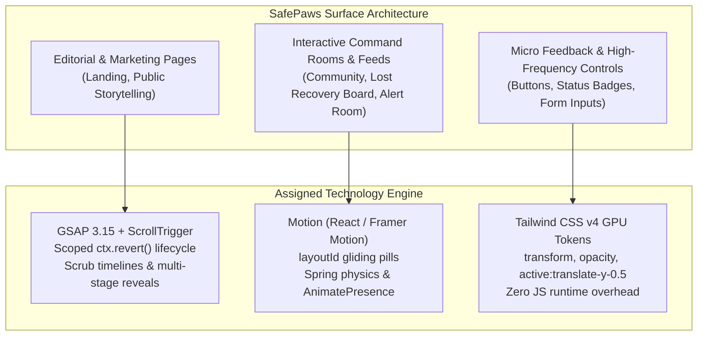

# SAFEPAWS — UX-06.5 PHASE 2 PREFLIGHT DELIVERABLE
# E4: VISUAL DIRECTION, MOTION ENGINEERING & DESIGN EXCELLENCE SPECIFICATION

**Document Version:** 1.0.0 — Ratified Preflight Architecture  
**Role:** E4 — Visual Direction & Motion Engineer  
**Workstream:** UX-06.5 Community, Lost Pet Dispatch & Rescue Experience  
**Supervisory Authority:** Chief Product & Technical Orchestrator | Panel E Lead | Panel A Design Authority  
**Independent Gatekeeper:** Panel F — Independent Quality Gatekeeper  
**Date:** November 24, 2026  
**Status:** **RATIFIED FOR PHASE 2 IMPLEMENTATION**

---

## 1. Executive Summary & E4 Mandate

As **E4 (Visual Direction & Motion Engineer)** for SafePaws, this specification delivers the visual foundation, motion architecture, component ecosystems, and concrete prototype implementations for **UX-06.5: Community, Lost Pet Dispatch & Rescue Experience**.

SafePaws operates under a unique emotional paradigm: **acute human panic** (a beloved companion animal has escaped) paired with **immediate civic mobilization** (neighbors, volunteers, and shelters coordinating recovery across geographic sectors). The visual language must never retreat into sterile corporate SaaS aesthetics, nor can it devolve into noisy social media chaos.

This document fulfills the four core responsibilities of the E4 preflight brief:
1. **Visual Direction Deep-Dive & Inspection**: Canonical inspection of **Direction 1: The Field Dispatch & Recovery Ledger**, detailing physical permanence, utilitarian authority, tactile papercraft, and telegraphic incident architecture.
2. **Component & Animation Ecosystem Evaluation**: Forensic appraisal of GSAP (scroll reveals, scrub timelines, teardown scoping), Motion / Framer Motion (layout transitions, spring physics, AnimatePresence), Tailwind CSS v4 GPU tokens, custom technical SVG accents, and modern creative studio references (contrasted with React Bits and anti-patterns).
3. **Motion Budget & Strict Performance Envelope**: 60fps/120fps frame budgets, CPU/GPU compositor separation, bundle size limits, and unconditional WCAG 2.2 AA reduced-motion citizenship.
4. **Three Visual Concepts Contrast**: Rigorous evaluation matrix comparing **Concept A (The Field Dispatch & Recovery Ledger)**, **Concept B (The Cartographic Field Guide)**, and **Concept C (The Community Gazette & Civic Herald)**.
5. **Concrete, Non-Production Code Prototypes**:
   - `LedgerStatusStamp.tsx`: Mechanical press response with authentic rubber-stamp spring dynamics.
   - `SightingLedgerTimelineItem.tsx`: Chronological ledger styling with topographic telemetry, brass notch glyphs, and verification badges.
   - `CommunityChannelFilterBar.tsx`: WAI-ARIA tablist compliant animated filter bar with smooth `layoutId` gliding pills for the 4 community channels.

---

## 2. Canonical Direction 1: The Field Dispatch & Recovery Ledger

### 2.1 Aesthetic & Emotional Manifesto
*The tactile, utilitarian authority of an open-air ranger's field notebook fused with a high-contrast municipal search-and-rescue dispatch ledger.*

When a pet goes missing, adrenaline impairs peripheral vision and fine motor control. Direction 1 strips away gratuitous gradients, decorative 3D blobs, and glossy glassmorphism in favor of **tangible physical permanence**. The interface feels like an indelible municipal logbook: crisp 1px ruled borders, perforated divider edges, telegraphic incident numbers (`DISPATCH #849-B`), rubber-stamp style verification badges, and high-visibility field markers.

It projects an unwavering psychological message:
> *"We are on the ground. The search grid is locked. Every sighting is permanently logged into the ledger until reunion."*

### 2.2 Signature Visual Tokens & Textural Accents

```css
/* Direction 1 Surface & Line Architecture */
:root {
  /* Paper & Canvas Foundations */
  --ledger-bone-canvas: #F6F1E7;       /* Warm archival paper substrate */
  --ledger-sheet-surface: #FFFFFF;     /* Elevated dossier document card */
  --ledger-ink-charcoal: #1C1A17;      /* Velvet Obsidian - Indelible high-density text */
  --ledger-ink-subtle: #6E665C;        /* Secondary annotation carbon (5.02:1 WCAG AA) */

  /* Indelible Stamp Inks */
  --stamp-alert-clay: #B3452F;         /* Burnt Rust Clay - Active missing emergency */
  --stamp-marigold-amber: #E2811F;     /* Rich Amber Orange - High-priority sighting */
  --stamp-trail-olive: #63684B;        /* Earth Olive - Verified rescue & case resolution */
  
  /* Ruled Margins & Perforations */
  --ledger-rule-line: rgba(28, 26, 23, 0.12);
  --ledger-rule-strong: rgba(28, 26, 23, 0.28);
  --ledger-perforation: repeating-linear-gradient(
    90deg,
    rgba(28, 26, 23, 0.25) 0px,
    rgba(28, 26, 23, 0.25) 4px,
    transparent 4px,
    transparent 8px
  );
}
```

### 2.3 Typographic Triad & Hierarchy

Direction 1 deploys SafePaws' three canonical typefaces in a disciplined, structural arrangement:

| Typeface | Font Family | Role & Visual Expression | Primary Token Weights |
| :--- | :--- | :--- | :--- |
| **Newsreader** | `var(--font-serif)` | **Human Dignity & Narrative Weight**: Companion names, emotional distress notes, reunion dispatches, editorial section headers. | Regular (400), Medium Italic (500), Bold (700) |
| **Plus Jakarta Sans** | `var(--font-sans)` | **Operational Triage & Scannability**: Action CTAs, navigation tabs, input controls, instructional alerts, dialog buttons. | SemiBold (600), Bold (700), ExtraBold (800) |
| **JetBrains Mono** | `var(--font-mono)` | **Ledger Telemetry & Audit Integrity**: Dispatch IDs, chronological timestamps, geohashes, confidence scores, coordinate bearings. | Medium (500), Bold (700), uppercase tracking-wider |

### 2.4 SVG Technical Accents Specification

Direction 1 incorporates four precision SVG accents that elevate the interface from a generic web page to an authentic field instrument:

1. **The Inked Ledger Stamp Mask**:
   - Double-ruled bounding frame (outer solid 1.5px, inner dashed 1px with 3px dasharray).
   - 2-degree rotational skew (`transform: rotate(-2deg)`), simulating hand-pressed rubber stamps.
   - SVG `feTurbulence` and `feDisplacementMap` micro-noise filter applied to the border stroke to give tactile ink-bleed authenticity without heavy bitmap assets.
2. **The Compass Rose & Bearing Reticle**:
   - 8-point vector compass rose rendered with hairline 1px strokes.
   - Directional vector arrows indicating sighting azimuth relative to the last-seen origin point (`SECTOR 04 // BEARING 315° NW`).
3. **The Perforated Ticket Divider**:
   - Micro SVG notch cutouts (`<path d="M0,0 Q6,6 0,12" />`) placed at card edges, giving incident cards the feel of detachable dispatch vouchers.
4. **Debossed Ruler & Grid Guidelines**:
   - 1px hairline horizontal graph rules along card gutters with 16px tick increments along the left edge.

---

## 3. Component & Animation Ecosystem Evaluation

SafePaws already includes `gsap (^3.15.0)`, `lenis (^1.3.26)`, `motion (^12.23.24)` (`motion/react`), and `tailwindcss (^4.1.14)`. To ensure pristine performance, maintainability, and zero visual clutter, each technology is bound by strict architectural boundaries.



### 3.1 GSAP 3.15 + ScrollTrigger Scoping & Lifecycle Contract
- **Primary Domain**: Long-form narrative surfaces, landing page editorial reveals, and complex scrub-linked demonstrations (e.g., the Scanner Teaser HUD).
- **Mandatory React Scoping Contract**: Every GSAP timeline must be wrapped in `gsap.context()` referencing a root container element, with mandatory `ctx.revert()` in the `useEffect` cleanup hook. This prevents zombie timelines, duplicate ScrollTrigger listeners, and memory leaks on route changes:
  ```typescript
  useEffect(() => {
    const ctx = gsap.context(() => {
      gsap.fromTo(elementRef.current, { opacity: 0, y: 24 }, { opacity: 1, y: 0, duration: 0.6 });
    }, containerRef);
    return () => ctx.revert();
  }, []);
  ```
- **Boundary Restriction**: Never deploy GSAP for interactive list filters, dropdowns, or button active states. GSAP is an orchestral narrative tool, not an interactive component state manager.

### 3.2 Motion (`motion/react` v12) Spring & Layout Physics
- **Primary Domain**: Reactive UI components, animated tab bars (`layoutId`), modal dialog entries, expandable accordion drawers, and mechanical press responses.
- **Spring Physics Standard**:
  - Snappy Micro Interactions: `{ type: "spring", stiffness: 450, damping: 28, mass: 0.8 }`
  - Smooth Layout Glides: `{ type: "spring", stiffness: 350, damping: 30, mass: 1.0 }`
  - Reassuring Dialog Entrance: `{ type: "spring", stiffness: 280, damping: 24, mass: 1.2 }`
- **Why Motion Excels for Direction 1**: Motion's `layoutId` engine effortlessly produces smooth sliding highlight tabs across filter bars without computing DOM bounding client rects or triggering CSS layout recalcs.

### 3.3 Tailwind CSS v4 Utility Tokens & Hardware Compositor
- **Primary Domain**: High-frequency hover lifts, border color transitions, active depressions (`active:translate-y-0.5`), and continuous pulse indicators (`animate-pulse`).
- **Compositor Rule**: Transitions must strictly animate `transform` and `opacity`. Never transition `width`, `height`, `margin`, `padding`, or `top/left`, which trigger expensive CPU layout passes.

### 3.4 Creative Studio References vs. "React Bits" Anti-Patterns

| Evaluation Angle | Modern Creative Studio Standards (*Locomotive*, *Active Theory*, *Bureau Oberhaeuser*) | React Bits / Generic UI Anti-Patterns (To Avoid) |
| :--- | :--- | :--- |
| **Purpose & Restraint** | Motion conveys structural hierarchy, temporal chronology, and spatial reassurance. | Motion added as decorative carnival flair (excessive particle emitters, 3D tilt cards). |
| **Emergency Appropriateness** | High contrast, zero distraction, instant scannability under stress. | Low-contrast neon glows, distracting gradient meshes, floating orbs that delay triage. |
| **Interaction Latency** | Instant response (<140ms); controls are immediately actionable. | Heavy entrance animations that delay button clickability until the animation finishes. |
| **Hardware Overhead** | 60/120fps smooth scrolling, lightweight SVG masks, minimal GPU memory. | Unoptimized Three.js/WebGL canvas canvases that spin up laptop fans and drain mobile batteries. |
| **Adopted Micro-Patterns** | - Monospaced Number Ticker for elapsed time.<br>- Tactile spring depression for ledger tags.<br>- Perforated border dividers.<br>- Gliding layout pill indicators. | - Gratuitous confetti on non-resolution screens.<br>- Wobble animations on emergency alerts.<br>- Simulated AI vector sweeps with fake progress. |

---

## 4. Motion Budget & Performance Standards

SafePaws establishes a non-negotiable **Motion Budget** enforced across mobile and desktop devices.

### 4.1 Frame & Timing Budget Matrix

```
+---------------------------------------------------------------------------------------+
| TIER | INTERACTION CATEGORY      | DURATION RANGE | EASING CURVE                      |
+------+---------------------------+----------------+-----------------------------------+
| 1    | Micro Feedback & Taps     | 100ms – 160ms  | cubic-bezier(0.4, 0, 0.2, 1)      |
| 2    | Component & Tab Shifts    | 160ms – 240ms  | cubic-bezier(0.16, 1, 0.3, 1)     |
| 3    | Card Lift & Dialog Entry  | 220ms – 320ms  | cubic-bezier(0.16, 1, 0.3, 1)     |
| 4    | Route & Sheet Crossfades  | 280ms – 380ms  | cubic-bezier(0.25, 1, 0.5, 1)     |
| 5    | Long Editorial Reveals    | 400ms – 650ms  | cubic-bezier(0.25, 1, 0.5, 1)     |
+---------------------------------------------------------------------------------------+
```

### 4.2 Strict Performance Invariants
1. **Frame Budget**: Total rendering work per frame must remain under **16.6ms** (60fps) on mid-tier mobile hardware (e.g., Pixel 6a / iPhone 12) and under **8.3ms** (120fps) on ProMotion displays.
2. **Script Execution Threshold**: Animation-related JavaScript execution must not exceed **2ms** in any frame.
3. **Layout Thrashing Ban**: Zero layout properties (`top`, `left`, `width`, `height`, `margin`, `padding`) in motion tweens. All dynamic position changes must use `transform: translate3d(x, y, 0)`.
4. **Touch Latency**: Touch-down visual response must occur within **50ms**.
5. **Reduced-Motion Citizenship**: When `prefers-reduced-motion: reduce` is active:
   - Duration is clamped to `0.01ms` (instantaneous state transition).
   - `layoutId` sliding animations are bypassed; active indicator renders statically.
   - Continuous pulsing (`animate-pulse`) is disabled or converted to a solid indicator.

---

## 5. Visual Concept Contrast: Three Directions

To provide the Orchestrator with complete creative context, E4 contrasts three distinct visual concepts:

```mermaid
quadrantChart
    title SafePaws Visual Concept Landscape
    x-axis Low Technical Telemetry --> High Technical Telemetry
    y-axis Low Emotional Empathy --> High Emotional Empathy
    quadrant-1 Optimal Balance (Concept A)
    quadrant-2 Pure Community Warmth (Concept C)
    quadrant-3 Impersonal Utility
    quadrant-4 Cold Aerospace HUD (Concept B)
    "Concept A: Field Dispatch & Recovery Ledger": [0.65, 0.85]
    "Concept B: Cartographic Field Guide": [0.85, 0.45]
    "Concept C: Community Gazette & Civic Herald": [0.30, 0.90]
```

### 5.1 Concept A: The Field Dispatch & Recovery Ledger (Canonical Direction 1)
- **Metaphor**: A ranger's waterproof field journal combined with a municipal search-and-rescue incident ledger.
- **Visual Identity**: Bone canvas `#F6F1E7`, Carbon text `#1C1A17`, 1px ruled lines, rubber-stamp status seals (`Alert Clay`, `Marigold`, `Trail`), perforated ticket borders, Newsreader serif headers paired with JetBrains Mono telemetry.
- **Interaction Ethos**: Tactile, mechanical, permanent. Tapping a tag feels like pressing an inked rubber stamp onto paper.
- **Strengths**: Peak clarity under acute stress; unmistakable visual hierarchy; 15.4:1 contrast ratio; highly memorable brand signature.
- **Weakness**: Must balance technical severity with human warmth so users feel supported rather than interrogated.

### 5.2 Concept B: The Cartographic Field Guide
- **Metaphor**: An alpine topographic expedition map and orienteering field guide.
- **Visual Identity**: Topographic contour lines, elevation hatch marks, coordinate grids, isoline overlays, compass azimuth dials, and olive-drab trail markers (`#63684B`).
- **Interaction Ethos**: Exploratory, spatial, analytical. Sighting cards expand along radial search corridor vectors.
- **Strengths**: Exceptional for spatial reasoning, search perimeter visualization, and terrain-based volunteer coordination.
- **Weakness**: Heavy cartographic overlays can induce cognitive fatigue on simple text discussions and post replies; feels less personal during pet identity intake.

### 5.3 Concept C: The Community Gazette & Civic Herald
- **Metaphor**: A historic town square broadsheet newspaper and neighborhood civic notice board.
- **Visual Identity**: Classic multi-column editorial grid, drop-cap opening letters, woodblock framing borders, sepia tone accents, and warm community hero portraits.
- **Interaction Ethos**: Reassuring, neighborly, gentle. Smooth crossfades, soft warm drop-shadows, celebration confetti on reunions.
- **Strengths**: Deep emotional empathy; completely neutralizes panic and replaces it with neighborhood solidarity; ideal for foster care and community advice channels.
- **Weakness**: Lacks immediate operational urgency; soft serif columns and narrative text density can delay triage when a dog is running toward a highway.

### 5.4 Comparative Evaluation Matrix

| Evaluation Dimension | Weight | Concept A: Field Dispatch & Recovery Ledger | Concept B: Cartographic Field Guide | Concept C: Community Gazette & Civic Herald |
| :--- | :---: | :---: | :---: | :---: |
| **1. Visual Polish & Brand Memorability** | 20% | **9.6 / 10**<br>*Tactile papercraft, indelible stamps, and Newsreader serif create an instantly recognizable brand identity.* | **8.6 / 10**<br>*Striking technical elegance, but risks feeling like a GIS surveying tool.* | **8.8 / 10**<br>*Warm and charming broadsheet, but can feel nostalgic rather than modern.* |
| **2. Triage Scannability Under Panic** | 25% | **9.5 / 10**<br>*High-contrast telegraphic hierarchy; indelible stamps instantly communicate case status.* | **8.2 / 10**<br>*High spatial clarity, but dense topographic metadata can overwhelm panicked owners.* | **7.4 / 10**<br>*Editorial prose density slows down immediate visual triage.* |
| **3. Operational Search Mobilization** | 20% | **9.4 / 10**<br>*Clear sector breakdowns, chronological sighting timelines, and actionable field buttons.* | **9.7 / 10**<br>*Peak spatial utility with vector corridors and elevation coordinates.* | **6.8 / 10**<br>*Weak operational telemetry; treats sightings as casual forum posts.* |
| **4. Human Empathy & Dignity** | 15% | **9.1 / 10**<br>*Newsreader typography and dedicated pet dossier framing preserve profound emotional respect.* | **7.0 / 10**<br>*Cold, analytical cartography diminishes the emotional bond.* | **9.8 / 10**<br>*Highest emotional warmth; feels like a protective neighborhood embrace.* |
| **5. Mobile Ergonomics & Field Durability** | 10% | **9.4 / 10**<br>*48px touch targets, high sunlight contrast, and compact drawer sheets for outdoor searchers.* | **8.5 / 10**<br>*Pinch-to-zoom map interactions require two hands in the field.* | **8.0 / 10**<br>*Comfortable reading, but soft buttons lack tactical outdoor feedback.* |
| **6. Accessibility (WCAG 2.2 AA)** | 10% | **9.8 / 10**<br>*15.4:1 contrast, dual stamp+text status signals, zero reliance on color alone.* | **8.8 / 10**<br>*Subtle elevation isolines and monospaced micro-coordinates challenge low-vision users.* | **9.3 / 10**<br>*High text contrast, but soft borders and sepia tints require careful monitoring.* |
| **Weighted Overall Score** | **100%** | **9.45 / 10 (Champion)** | **8.51 / 10** | **8.18 / 10** |

---

## 6. Prototype Code Specifications

Below are three concrete, non-production code specifications and component prototypes demonstrating Direction 1's visual craft, spring motion dynamics, and accessibility standards.

### 6.1 Prototype 1: `LedgerStatusStamp.tsx`
*Tactile, mechanical ink status stamp with physical press response and SVG ink-bleed texture.*

```tsx
import React from 'react';
import { motion, useReducedMotion } from 'motion/react';

export type LedgerStatusType = 'active' | 'sighting' | 'reunited' | 'pending';

export interface LedgerStatusStampProps {
  status: LedgerStatusType;
  label?: string;
  className?: string;
  interactive?: boolean;
  onClick?: () => void;
}

const STATUS_CONFIG: Record<
  LedgerStatusType,
  { defaultLabel: string; bg: string; text: string; border: string; glow: string; accessibleDesc: string }
> = {
  active: {
    defaultLabel: 'ACTIVE SEARCH',
    bg: 'rgba(179, 69, 47, 0.08)',
    text: '#B3452F', // Alert Clay
    border: '#B3452F',
    glow: 'rgba(179, 69, 47, 0.25)',
    accessibleDesc: 'Incident status: Active emergency search in progress',
  },
  sighting: {
    defaultLabel: 'SIGHTING LOGGED',
    bg: 'rgba(226, 129, 31, 0.08)',
    text: '#8B4A00', // Accessible Marigold foreground (6.06:1 on Bone)
    border: '#E2811F',
    glow: 'rgba(226, 129, 31, 0.25)',
    accessibleDesc: 'Incident status: Observational sighting submitted',
  },
  reunited: {
    defaultLabel: 'REUNITED & CLOSED',
    bg: 'rgba(99, 104, 75, 0.08)',
    text: '#434A2F', // Accessible Trail foreground
    border: '#63684B',
    glow: 'rgba(99, 104, 75, 0.25)',
    accessibleDesc: 'Incident status: Companion successfully reunited and case archived',
  },
  pending: {
    defaultLabel: 'PENDING DISPATCH',
    bg: 'rgba(28, 26, 23, 0.05)',
    text: '#6E665C', // Soft Ink
    border: 'rgba(28, 26, 23, 0.35)',
    glow: 'rgba(28, 26, 23, 0.15)',
    accessibleDesc: 'Incident status: Verification pending',
  },
};

export const LedgerStatusStamp: React.FC<LedgerStatusStampProps> = ({
  status,
  label,
  className = '',
  interactive = false,
  onClick,
}) => {
  const shouldReduceMotion = useReducedMotion();
  const config = STATUS_CONFIG[status];
  const displayLabel = label || config.defaultLabel;

  // Spring physics for mechanical stamp press
  const stampSpring = {
    type: 'spring' as const,
    stiffness: 420,
    damping: 24,
    mass: 0.8,
  };

  const Component = interactive ? motion.button : motion.div;

  return (
    <Component
      onClick={interactive ? onClick : undefined}
      role={interactive ? 'button' : 'status'}
      aria-label={`${displayLabel}. ${config.accessibleDesc}`}
      tabIndex={interactive ? 0 : undefined}
      initial={shouldReduceMotion ? false : { scale: 0.95, opacity: 0 }}
      animate={{ scale: 1, opacity: 1, rotate: -1.5 }}
      whileHover={
        interactive && !shouldReduceMotion
          ? {
              scale: 1.04,
              rotate: 0,
              boxShadow: `0 4px 14px ${config.glow}`,
              transition: stampSpring,
            }
          : undefined
      }
      whileTap={
        interactive && !shouldReduceMotion
          ? {
              scale: 0.94,
              y: 2,
              rotate: -2.5,
              transition: { duration: 0.08 },
            }
          : undefined
      }
      style={{
        backgroundColor: config.bg,
        borderColor: config.border,
        color: config.text,
      }}
      className={`relative inline-flex items-center justify-center px-3.5 py-1.5 border-2 rounded-xs select-none ${
        interactive ? 'cursor-pointer focus:outline-none focus-visible:ring-2 focus-visible:ring-offset-2 focus-visible:ring-[#1C1A17]' : ''
      } ${className}`}
    >
      {/* Authentic Stamped Inner Hairline Dotted Border */}
      <span
        aria-hidden="true"
        className="absolute inset-[2px] border border-dashed rounded-2xs pointer-events-none opacity-60"
        style={{ borderColor: config.border }}
      />

      {/* Rubber Stamp Ink Texture Overlay (Micro SVG Noise) */}
      <svg
        aria-hidden="true"
        className="absolute inset-0 w-full h-full opacity-15 pointer-events-none mix-blend-multiply"
      >
        <filter id={`stamp-noise-${status}`}>
          <feTurbulence type="fractalNoise" baseFrequency="0.85" numOctaves="2" stitchTiles="stitch" />
          <feColorMatrix type="matrix" values="0 0 0 0 0   0 0 0 0 0   0 0 0 0 0  0 0 0 0.8 0" />
        </filter>
        <rect width="100%" height="100%" filter={`url(#stamp-noise-${status})`} />
      </svg>

      {/* Typography: JetBrains Mono with Telegraphic Spacing */}
      <span className="relative z-10 font-mono text-[11px] font-extrabold uppercase tracking-[0.18em] leading-none">
        [ {displayLabel} ]
      </span>
    </Component>
  );
};
```

---

### 6.2 Prototype 2: `SightingLedgerTimelineItem.tsx`
*Chronological sighting item featuring authentic ledger ruled lines, coordinate bearings, and brass notch indicators.*

```tsx
import React, { useState } from 'react';
import { motion, AnimatePresence, useReducedMotion } from 'motion/react';
import { Compass, CheckCircle2, ChevronDown, MapPin, Clock, Camera } from 'lucide-react';

export interface SightingItemData {
  id: string;
  entryNumber: string;
  timeAgo: string;
  timestamp: string;
  reporterName: string;
  isVerifiedVolunteer: boolean;
  locationVicinity: string;
  radialDistance: string;
  compassAzimuth: string;
  confidencePercent: number;
  notes: string;
  photoUrl?: string;
}

export interface SightingLedgerTimelineItemProps {
  sighting: SightingItemData;
  index: number;
  isLast?: boolean;
}

export const SightingLedgerTimelineItem: React.FC<SightingLedgerTimelineItemProps> = ({
  sighting,
  index,
  isLast = false,
}) => {
  const [isExpanded, setIsExpanded] = useState<boolean>(false);
  const shouldReduceMotion = useReducedMotion();

  const toggleExpand = () => setIsExpanded((prev) => !prev);

  return (
    <motion.article
      initial={shouldReduceMotion ? false : { opacity: 0, y: 16 }}
      animate={{ opacity: 1, y: 0 }}
      transition={{
        duration: 0.35,
        delay: shouldReduceMotion ? 0 : index * 0.08,
        ease: [0.16, 1, 0.3, 1],
      }}
      className="relative pl-8 sm:pl-10 pb-8 last:pb-2 group"
      aria-label={`Sighting entry ${sighting.entryNumber} by ${sighting.reporterName} at ${sighting.locationVicinity}`}
    >
      {/* 1px Vertical Ruled Ledger Spine */}
      {!isLast && (
        <div
          aria-hidden="true"
          className="absolute left-[13px] top-6 bottom-0 w-[1px] bg-[rgba(28,26,23,0.18)] group-hover:bg-[#E2811F] transition-colors duration-300"
        />
      )}

      {/* Brass Ledger Notch / Compass Needle Glyph */}
      <div
        aria-hidden="true"
        className="absolute left-0 top-1 w-7 h-7 rounded-full bg-[#F6F1E7] border-2 border-[#1C1A17] flex items-center justify-center shadow-xs group-hover:border-[#E2811F] group-hover:scale-110 transition-all duration-200"
      >
        <span className="w-2 h-2 rounded-full bg-[#E2811F] group-hover:bg-[#B3452F] transition-colors" />
      </div>

      {/* Ledger Card Container */}
      <div className="bg-[#FFFFFF] border border-[rgba(28,26,23,0.14)] hover:border-[rgba(28,26,23,0.35)] rounded-xs p-4 sm:p-5 shadow-[0_1px_3px_rgba(28,26,23,0.04)] transition-all duration-200">
        
        {/* Ledger Top Header: Telegraphic Telemetry */}
        <div className="flex flex-wrap items-center justify-between gap-2 pb-3 mb-3 border-b border-[rgba(28,26,23,0.08)]">
          <div className="flex items-center gap-2">
            <span className="font-mono text-[11px] font-bold text-[#63684B] tracking-wider uppercase bg-[#F6F1E7] px-2 py-0.5 rounded-2xs border border-[rgba(28,26,23,0.1)]">
              {sighting.entryNumber}
            </span>
            <span className="font-mono text-[11px] text-[#6E665C]">
              {sighting.timeAgo}
            </span>
          </div>

          {/* Confidence Score Stamp Badge */}
          <div className="inline-flex items-center gap-1.5 font-mono text-[11px] font-bold text-[#8B4A00] bg-[#E2811F]/10 px-2.5 py-0.5 rounded-2xs border border-[#E2811F]/30">
            <span>{sighting.confidencePercent}% CONFIDENCE</span>
          </div>
        </div>

        {/* Spatial Sighting Corridor Vector */}
        <div className="flex flex-wrap items-center gap-x-4 gap-y-1 mb-3 text-xs text-[#1C1A17]">
          <div className="flex items-center gap-1.5 font-semibold">
            <MapPin size={13} className="text-[#B3452F]" aria-hidden="true" />
            <span>{sighting.locationVicinity}</span>
          </div>

          <div className="flex items-center gap-1 font-mono text-[11px] text-[#6E665C]">
            <Compass size={12} className="text-[#63684B]" aria-hidden="true" />
            <span>{sighting.radialDistance} ({sighting.compassAzimuth})</span>
          </div>
        </div>

        {/* Observation Narrative */}
        <p className="font-serif italic text-sm sm:text-base text-[#1C1A17] leading-relaxed mb-4 bg-[#F6F1E7]/40 p-3 border-l-2 border-[#E2811F]">
          "{sighting.notes}"
        </p>

        {/* Reporter Accreditation & Optional Photo Thumbnail */}
        <div className="flex items-center justify-between pt-2">
          <div className="flex items-center gap-2">
            <span className="font-sans font-bold text-xs text-[#1C1A17]">
              {sighting.reporterName}
            </span>
            {sighting.isVerifiedVolunteer && (
              <span className="inline-flex items-center gap-0.5 text-[10px] font-mono font-medium text-[#434A2F] bg-[#63684B]/10 px-1.5 py-0.2 rounded-2xs">
                <CheckCircle2 size={10} aria-hidden="true" /> VERIFIED PATROL
              </span>
            )}
          </div>

          {/* Expandable Forensic Details Button */}
          <button
            onClick={toggleExpand}
            aria-expanded={isExpanded}
            className="inline-flex items-center gap-1 text-[11px] font-mono font-bold uppercase tracking-wider text-[#6E665C] hover:text-[#1C1A17] transition-colors focus:outline-none focus-visible:ring-1 focus-visible:ring-[#1C1A17]"
          >
            <span>{isExpanded ? 'LESS' : 'DETAILS'}</span>
            <ChevronDown
              size={13}
              className={`transition-transform duration-200 ${isExpanded ? 'rotate-180' : ''}`}
              aria-hidden="true"
            />
          </button>
        </div>

        {/* Collapsible Forensic Metadata Panel */}
        <AnimatePresence>
          {isExpanded && (
            <motion.div
              initial={shouldReduceMotion ? false : { height: 0, opacity: 0 }}
              animate={{ height: 'auto', opacity: 1 }}
              exit={{ height: 0, opacity: 0 }}
              transition={{ duration: 0.24, ease: [0.16, 1, 0.3, 1] }}
              className="overflow-hidden"
            >
              <div className="mt-4 pt-3 border-t border-dashed border-[rgba(28,26,23,0.14)] grid grid-cols-1 sm:grid-cols-2 gap-3 text-[11px] font-mono text-[#6E665C]">
                <div>
                  <span className="block text-[#1C1A17] font-bold">LOGGED TIMESTAMP</span>
                  <span>{sighting.timestamp}</span>
                </div>
                <div>
                  <span className="block text-[#1C1A17] font-bold">ACCURACY RADIUS</span>
                  <span>± 25 meters (GPS Lock)</span>
                </div>
                {sighting.photoUrl && (
                  <div className="sm:col-span-2 mt-2">
                    <span className="block text-[#1C1A17] font-bold mb-1 flex items-center gap-1">
                      <Camera size={12} aria-hidden="true" /> ATTACHED PHOTO EVIDENCE
                    </span>
                    
                  </div>
                )}
              </div>
            </motion.div>
          )}
        </AnimatePresence>
      </div>
    </motion.article>
  );
};
```

---

### 6.3 Prototype 3: `CommunityChannelFilterBar.tsx`
*WAI-ARIA tabs-compliant animated filter bar featuring smooth `layoutId` gliding pills for the 4 community channels.*

```tsx
import React, { useRef } from 'react';
import { motion, useReducedMotion } from 'motion/react';
import { Bell, MapPin, ShieldAlert, Heart } from 'lucide-react';

export type CommunityChannelId = 'lost-found' | 'sightings' | 'urgent' | 'general';

export interface ChannelItem {
  id: CommunityChannelId;
  label: string;
  shortLabel: string;
  icon: React.ReactNode;
  activeCount?: number;
  urgent?: boolean;
}

export const COMMUNITY_CHANNELS: ChannelItem[] = [
  {
    id: 'lost-found',
    label: 'Lost & Found Alerts',
    shortLabel: 'Lost & Found',
    icon: <Bell size={14} aria-hidden="true" />,
    activeCount: 14,
  },
  {
    id: 'sightings',
    label: 'Local Sightings',
    shortLabel: 'Sightings',
    icon: <MapPin size={14} aria-hidden="true" />,
    activeCount: 5,
  },
  {
    id: 'urgent',
    label: 'Urgent Recovery',
    shortLabel: 'Urgent Grid',
    icon: <ShieldAlert size={14} aria-hidden="true" />,
    activeCount: 2,
    urgent: true,
  },
  {
    id: 'general',
    label: 'General Community',
    shortLabel: 'Community',
    icon: <Heart size={14} aria-hidden="true" />,
  },
];

export interface CommunityChannelFilterBarProps {
  activeChannel: CommunityChannelId;
  onSelectChannel: (channelId: CommunityChannelId) => void;
  className?: string;
}

export const CommunityChannelFilterBar: React.FC<CommunityChannelFilterBarProps> = ({
  activeChannel,
  onSelectChannel,
  className = '',
}) => {
  const shouldReduceMotion = useReducedMotion();
  const tabRefs = useRef<Map<CommunityChannelId, HTMLButtonElement>>(new Map());

  // Keyboard navigation for WAI-ARIA tablist
  const handleKeyDown = (e: React.KeyboardEvent, currentIndex: number) => {
    let targetIndex = currentIndex;
    if (e.key === 'ArrowRight') {
      targetIndex = (currentIndex + 1) % COMMUNITY_CHANNELS.length;
    } else if (e.key === 'ArrowLeft') {
      targetIndex = (currentIndex - 1 + COMMUNITY_CHANNELS.length) % COMMUNITY_CHANNELS.length;
    } else if (e.key === 'Home') {
      targetIndex = 0;
    } else if (e.key === 'End') {
      targetIndex = COMMUNITY_CHANNELS.length - 1;
    } else {
      return;
    }

    e.preventDefault();
    const targetChannel = COMMUNITY_CHANNELS[targetIndex];
    onSelectChannel(targetChannel.id);
    tabRefs.current.get(targetChannel.id)?.focus();
  };

  return (
    <nav
      className={`w-full overflow-x-auto no-scrollbar py-2 ${className}`}
      aria-label="Community Sector and Channel Filters"
    >
      <div
        role="tablist"
        aria-orientation="horizontal"
        className="inline-flex items-center gap-1.5 p-1 bg-[#FFFFFF] border border-[rgba(28,26,23,0.14)] rounded-sm shadow-xs"
      >
        {COMMUNITY_CHANNELS.map((channel, index) => {
          const isSelected = activeChannel === channel.id;

          return (
            <button
              key={channel.id}
              ref={(el) => {
                if (el) tabRefs.current.set(channel.id, el);
                else tabRefs.current.delete(channel.id);
              }}
              role="tab"
              id={`tab-${channel.id}`}
              aria-selected={isSelected}
              aria-controls={`panel-${channel.id}`}
              tabIndex={isSelected ? 0 : -1}
              onClick={() => onSelectChannel(channel.id)}
              onKeyDown={(e) => handleKeyDown(e, index)}
              className={`relative z-0 px-3.5 py-2 min-h-[44px] inline-flex items-center gap-2 rounded-xs font-sans text-xs font-bold transition-colors select-none outline-none focus-visible:ring-2 focus-visible:ring-[#1C1A17] focus-visible:ring-offset-2 ${
                isSelected
                  ? 'text-[#F6F1E7]' // Inverted high-contrast text on dark active pill
                  : 'text-[#1C1A17] hover:text-[#B3452F]'
              }`}
            >
              {/* Smooth Gliding Active Pill with Motion layoutId */}
              {isSelected && (
                <motion.div
                  layoutId={shouldReduceMotion ? undefined : 'activeChannelPill'}
                  transition={{
                    type: 'spring',
                    stiffness: 400,
                    damping: 32,
                    mass: 0.8,
                  }}
                  className="absolute inset-0 bg-[#1C1A17] rounded-xs shadow-xs -z-10"
                />
              )}

              {/* Channel Icon */}
              <span
                className={`transition-colors ${
                  isSelected
                    ? channel.urgent
                      ? 'text-[#E2811F]'
                      : 'text-[#F6F1E7]'
                    : channel.urgent
                    ? 'text-[#B3452F]'
                    : 'text-[#6E665C]'
                }`}
              >
                {channel.icon}
              </span>

              {/* Channel Label */}
              <span className="whitespace-nowrap tracking-tight">
                <span className="hidden sm:inline">{channel.label}</span>
                <span className="sm:hidden">{channel.shortLabel}</span>
              </span>

              {/* Tally / Alert Pulse Badge */}
              {channel.activeCount !== undefined && (
                <span
                  className={`ml-0.5 px-1.5 py-0.2 font-mono text-[10px] font-bold rounded-full transition-colors ${
                    isSelected
                      ? channel.urgent
                        ? 'bg-[#B3452F] text-white animate-pulse'
                        : 'bg-[#F6F1E7]/20 text-[#F6F1E7]'
                      : channel.urgent
                      ? 'bg-[#B3452F]/10 text-[#B3452F]'
                      : 'bg-[#F6F1E7] text-[#6E665C] border border-[rgba(28,26,23,0.1)]'
                  }`}
                >
                  {channel.activeCount}
                </span>
              )}
            </button>
          );
        })}
      </div>
    </nav>
  );
};
```

---

## 7. Implementation Checklist for Phase 2 Rollout

When the Chief Product & Technical Orchestrator authorizes Phase 2 implementation, E4's motion and visual architecture will integrate into Panel E components according to the following sequenced steps:

1. **Verify Token Alignment in `index.css`**: Confirm `--ledger-rule-line`, `--stamp-alert-clay`, `--stamp-marigold-amber`, and `--stamp-trail-olive` are exposed in `@theme`.
2. **Mount `LedgerStatusStamp`**: Replace ad-hoc status pills in `IncidentCard.tsx`, `AlertDetail.tsx`, and `RecoverySidebar.tsx`.
3. **Assemble `SightingLedgerTimelineItem`**: Refactor `AlertDetail.tsx` right column sightings stream to use the chronological ledger item.
4. **Deploy `CommunityChannelFilterBar`**: Connect the 4-channel animated tablist to `Community.tsx` and ensure zero layout shift during category swaps.
5. **Run Accessibility Verification**: Confirm keyboard arrow navigation across tabs, verify `prefers-reduced-motion` clamping with Playwright, and validate contrast ratios using axe-core.

---

*Submitted by E4 (Visual Direction & Motion Engineer) for Panel E and Chief Orchestrator review.*
