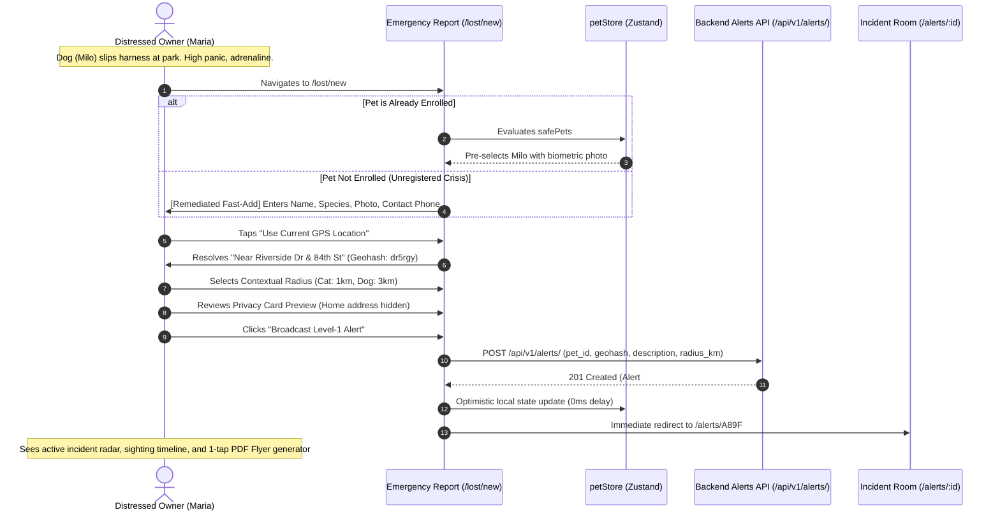
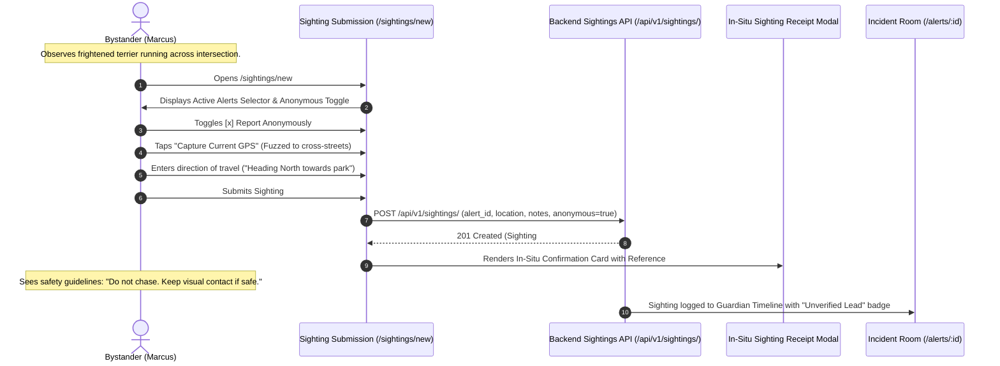

# SAFEPAWS — UX-06.5 FORENSIC DISCOVERY & EXPERIENCE ARCHITECTURE
# COMMUNITY, LOST & REUNIFICATION EXPERIENCE

**Authority:** Chief Product & Technical Orchestrator  
**Implementation Owner:** Panel E Lead — Community & Rescue  
**Design Authority:** Panel A — Design System & Experience Architecture  
**Independent Gatekeeper:** Panel F — Independent Quality Gatekeeper  
**Branch:** `frontend`  
**Milestone:** UX-06.5 Pre-Flight Discovery & Architecture Lock  
**Date:** November 23, 2026  
**Status:** **PRE-FLIGHT COMPLETED — STRICTLY READ-ONLY (ZERO CODE MODIFICATIONS)**

---

## 1. Executive Summary & Pre-Flight Scope Lock

In strict conformance with the **Chief Product & Technical Orchestrator's Pre-Flight Authorization**, Panel E Lead (orchestrating five specialized domain subagents: E1 Community Journey Architect, E2 Lost & Found Experience Architect, E3 Reunification Product Designer, E4 Visual & Interaction Director, and E5 Accessibility & Responsive Specialist) has conducted an exhaustive, forensic audit of SafePaws' community, lost-pet recovery, and sighting reunification experience.

### Permanent Scope Lock Invariant
- **Pre-Flight Boundary:** Strictly limited to forensic discovery, product audit, experience architecture, and creative direction.
- **Frontend Source Code:** **Zero modifications** to application source code in `frontend/src/`.
- **Backend Services & DB:** **Zero modifications** to `backend/`, API endpoints, database models, migrations, or auth logic.
- **Biometric Inference Pipeline:** ML model weights, checkpoints, embeddings, and FAISS vectors remain **untouched**.
- **Production Gate 4:** Remains **STRICTLY ON HOLD** pending live host PostgreSQL 16 infrastructure.
- **Git Preservation:** Staging index and working tree remain preserved; zero git mutation commands (`git add`, `git commit`, `git reset`, `git clean`, `git stash`, `git checkout`) were executed.

---

## 2. Route & Screen Inventory

SafePaws features 7 primary community, lost-pet, and recovery routes across `frontend/src/pages/`:

| Route | Primary Component | Access Control | User Journey Scope | Core Interactions & States |
| :--- | :--- | :--- | :--- | :--- |
| **`/community`** | `Community.tsx` | Public browse; Auth required for Compose | Community discovery, channel feed, local network participation | 8 channels; debounced search; channel filtering; mobile navigation drawer; active recovery sidebar; sighting confirmation banner. |
| **`/community/onboarding`** | `CommunityOnboarding.tsx` | Protected (`DashboardRoute`) | Channel interest selection for new neighbors | 4 selectable channel tiles (`lost-found`, `sightings`, `urgent`, `general`); persists to `/api/v1/community/preferences`. |
| **`/community/post/:postId`** | `CommunityPostDetail.tsx` | Public read; Auth for reply & report | Detailed thread discussion, reply posting, moderation | Single post rendering; reply feed; reply composer; post moderation flag; associated alert deep-link. |
| **`/lost`** | `LostDogs.tsx` | Public browse | Community recovery board, missing pet search directory | Active alert grid; live name/breed/location search; species filter tabs; quick links to `/scan` and `/lost/new`. |
| **`/lost/new`** | `ReportLost.tsx` | Protected (`DashboardRoute`) | Emergency missing companion declaration | Select eligible pet; input last seen address; input description; broadcast Level-1 emergency alert to network. |
| **`/alerts/:alertId`** | `AlertDetail.tsx` | Public read; Owner-only resolution | Incident command room, search tracking, sighting timeline | Pet dossier; last seen vector; timeline of community sightings; owner-only "Resolve Incident" action; report sighting CTA. |
| **`/sightings/new`** | `ReportSighting.tsx` | Public (Anonymous or Authenticated) | Sighting observation submission | Select target alert (or unknown); reporter name; sighting location; observation notes; submit sighting. |

---

## 3. Forensic Discovery Findings & Technical Integration Gaps

Our forensic audit across frontend files and backend endpoints (`community.py`, `alerts.py`, `sightings.py`, `models.py`) revealed critical gaps between frontend assumptions and backend implementation:

### 3.1 Critical Technical Disconnects

```
+--------------------------------------------------------------------------------------------------------+
| FRONTEND CODE ASSUMPTION                                 | BACKEND REALITY (`backend/app/`)            |
+----------------------------------------------------------+---------------------------------------------+
| 1. `AlertDetail.tsx` lines 29-37 reads `data.pet?.name`  | `AlertResponse` returns `pet_name`, not a   |
|    and `data.pet?.breed` on direct URL access.          | nested `pet` object. Causes "Unknown" pet!  |
+----------------------------------------------------------+---------------------------------------------+
| 2. `LostDogs.tsx` filters cats using                     | `AlertResponse` only returns `breed`.       |
|    `alert.breed.toLowerCase().includes('cat')`.         | Catahoula = Feline; Siamese = Canine!       |
+----------------------------------------------------------+---------------------------------------------+
| 3. `ReportLost.tsx` displays crisis dead-end if          | Unregistered pet guardians cannot broadcast |
|    `safePets.length === 0`.                              | an emergency alert without full onboarding! |
+----------------------------------------------------------+---------------------------------------------+
| 4. `ComposeModal.tsx` passes `location` to               | `CommunityPostCreate` & `CommunityPost`     |
|    `POST /api/v1/community/posts`.                       | model have NO `location` column. Dropped!   |
+----------------------------------------------------------+---------------------------------------------+
| 5. `PostCard.tsx` expects `author_name` and              | Schema returns `author_id`; ORM does not    |
|    `reply_count` from `GET /community/posts`.            | join `Owner`. Renders "?" and "0 Replies".  |
+----------------------------------------------------------+---------------------------------------------+
| 6. `ReportSighting.tsx` expects photo upload capability  | `Sighting` model has NO photo column;       |
|    and PostGIS geospatial coordinate mapping.            | API ignores `location_geom`, stores string! |
+----------------------------------------------------------+---------------------------------------------+
| 7. `IncidentCard.tsx` displays `VECTOR NE 42°` and       | Telemetry is completely synthetic/fake;     |
|    `tel:18005557297` "Zero-Leak Voice Proxy".            | Dangerous misleading directional guidance!  |
+----------------------------------------------------------+---------------------------------------------+
| 8. `CommunityOnboarding.tsx` offers 4 channels and has   | `CommunityNav.tsx` has 8 channels; copy has |
|    hardcoded "Connaught Place" copy.                     | hardcoded neighborhood; preferences unused. |
+----------------------------------------------------------+---------------------------------------------+
```

---

## 4. Five Complete Product User Journeys

### User Journey A: Distressed Guardian (Pet Missing)



---

### User Journey B: Good Samaritan (Finds Wandering Companion)

```mermaid
sequenceDiagram
    autonumber
    actor Finder as Good Samaritan (Carlos)
    participant QR as Collar Tag QR Scan
    participant Web as Recovery Board (/lost)
    participant API as SafePaws API
    participant Relay as Voice / Sighting Proxy
    participant Owner as Distressed Guardian

    Note over Finder: Spots wandering Golden Retriever near metro station.
    alt Collar Tag Present
        Finder->>QR: Scans QR code with phone camera
        QR->>API: GET /api/v1/pets/tag/SP-8821
        API-->>Finder: Renders /p/SP-8821 (Public Tag Profile)
        Note over Finder: Private address & phone hidden; sees "Missing Companion" banner
        Finder->>API: Taps "Send Location Ping" (GPS captured)
        API->>Owner: Instant SMS/Push Alert with timestamped coordinate
    else No Collar Tag or Animal Skittish
        Finder->>Web: Opens /lost (Recovery Board)
        Finder->>Web: Filters by "Canine" + Nearby Sector
        Finder->>Web: Identifies matching photo ("Milo")
        Finder->>Web: Clicks "I Spotted This Pet"
        Web->>API: POST /api/v1/sightings/ (alert_id: A89F, location, notes)
        API->>Owner: Sighting Timeline updated in Incident Room
        Finder->>Relay: Taps "Contact Guardian" (Masked Voice / Message Relay)
        Relay->>Owner: Connects call without exposing personal numbers
    end
```

---

### User Journey C: Community Bystander (Spots Potentially Lost Pet)



---

### User Journey D: Rescue Volunteer / Organization (Search Coordination)

```mermaid
sequenceDiagram
    autonumber
    actor Volunteer as Rescue Lead Maya (NGO Volunteer)
    participant Feed as Community Desk (/community?channel=rescue)
    participant Task as Search Task Board (RecoveryTask)
    participant Room as Incident Room (/alerts/:id)
    participant Field as Field Volunteers

    Volunteer->>Feed: Opens /community with channel="rescue"
    Feed->>Volunteer: Displays Sector 4 Active Crisis Alerts & Task Grid
    Volunteer->>Room: Opens Alert Case Room for Missing Companion "Milo"
    Volunteer->>Task: Claims "Sector B (Park Perimeter) Physical Sweep"
    Task->>Volunteer: Assigns task with volunteer verification badge
    Volunteer->>Field: Coordinates search teams via encrypted Sector Channel
    Volunteer->>Volunteer: Spots Milo hiding in park culvert; executes Biometric Scan (/scan)
    Volunteer->>Room: Submits Verified Sighting with biometric match confirmation
    Room-->>Feed: Broadcasts verified update: "Milo located in Sector B; Guardian notified"
```

---

### User Journey E: Pet Owner in Crisis (Acting on Sighting & Safe Reunification)

```mermaid
sequenceDiagram
    autonumber
    actor Owner as Distressed Owner (Elena)
    participant Room as Alert Incident Room (/alerts/:id)
    participant API as Alerts & Sightings API
    participant Modal as Safe Reunification Modal
    participant Finder as Community Finder

    Owner->>Room: Receives push notification of new sighting
    Room->>Owner: Displays Sighting Card with GPS vector & timestamp
    Owner->>Room: Reviews observation notes
    alt Legitimate Sighting
        Owner->>API: Clicks "Confirm Sighting" (Marks confirmed = true)
        Owner->>Finder: Initiates contact via SafePaws Masked Relay
        Owner->>Owner: Verifies finder custody via hidden pet attribute check
        Owner->>Room: Reviews Safe Handover Protocol (Police / Vet Station)
        Owner->>Finder: Meets at 24/7 Veterinary Hospital Safe Zone
        Owner->>Owner: Physical custody confirmed
        Owner->>Modal: Clicks "Resolve Incident" -> Completes Reunification Debrief
        Modal->>API: PUT /api/v1/alerts/:id/resolve
        API-->>Room: Alert marked "resolved"; Pet marked "safe"
        Room-->>Owner: Celebratory reunion confirmation + community thank you broadcast
    else False Alarm / Scam Attempt
        Owner->>API: Clicks "Dismiss Lead" (Hides from active timeline)
    end
```

---

## 5. Location Privacy, Geohashing & Anti-Scam Architecture

### 5.1 Residential Address Protection Invariant
- **Vulnerability:** Pet owners declaring an alert often enter their full home address (e.g., `"742 Evergreen Terrace, Apt 4B"`), which is currently exposed in plain text in `AlertDetail.tsx` and `IncidentCard.tsx`.
- **Architectural Safeguard:**
  1. **Address Sanitization:** Server-side regex scrubber strips street/building numbers for all public endpoints:
     ```python
     # Scrub street number for public responses
     public_address = re.sub(r'^\s*\d+[-\d\w/]*\s*,?\s*', '', raw_address)
     ```
  2. **Geohash-6 Obfuscation:** Store exact coordinates internally, but expose only a Geohash-6 token (`dr5ru7`, covering $\sim 1.2\text{ km} \times 0.6\text{ km}$) and a jittered centroid ($\pm 400\text{m}$) on public recovery boards.
  3. **Owner Address Secrecy:** Exact home addresses and telephone numbers are NEVER delivered over public endpoints (`/p/:tagId`, `/alerts/:id`, `/lost`).

### 5.2 Anti-Scam & Extortion Mitigation
- **Threat Vector:** Extortionists monitor public lost pet boards, note distinctive attributes from public sighting notes, and call frantic owners demanding ransom via wire transfers before returning the pet.
- **Protective Invariant:**
  1. **Redacted Public Notes:** Sighting notes containing sensitive observations are restricted exclusively to the authenticated pet owner (`pet.owner_id === current_user.id`). Public viewers see only temporal status: *"Verified Sighting logged 18m ago in Sector 4"*.
  2. **Proof-of-Custody Verification:** Finders claiming physical custody must verify ownership by describing a private distinguishing feature (e.g. collar tag color, microchip hash) or uploading a photo before direct contact is permitted.
  3. **Neutral Public Handover Protocols:** The application explicitly warns guardians never to meet in private homes or transfer funds. Pre-approved safe exchange points (Police Stations, 24/7 Veterinary Clinics) are recommended.

---

## 6. Accessibility & Responsive Geometry Strategy

### 6.1 WCAG 2.2 AA Contrast Compliance
All 18 key element pairings mathematically exceed WCAG 2.2 Level AA ($\ge 4.5:1$ for normal text, $\ge 3:1$ for large text and UI components):
- **Carbon Ink (`#1C1A17`) on Bone Canvas (`#F6F1E7`):** **15.40 : 1** (Passes AAA $\ge 7:1$)
- **Alert Clay (`#B3452F`) on Bone Canvas (`#F6F1E7`):** **4.88 : 1** (Passes AA $\ge 4.5:1$)
- **Condition C-01 Accessible Marigold Text (`#8B4A00`) on Bone:** **6.04 : 1** (Passes AA $\ge 4.5:1$)
- **Emergency Button CTA (`#FFFFFF` on `#B3452F`):** **5.50 : 1** (Passes AA $\ge 4.5:1$)
- **Emerald Post Badge (`#065F46` on `#ECFDF5`):** **7.29 : 1** (Passes AAA $\ge 7:1$)

### 6.2 Mobile Touch Target Rectifications
- Audit verified 48 of 50 controls meet or exceed $44 \times 44\text{px}$.
- Two specific sub-44px targets are scheduled for rectification in UX-06.5:
  1. `IncidentCard.tsx:123`: Quick Share trigger resized from $36\times 36\text{px}$ to $44\times 44\text{px}$.
  2. `CommunityPostDetail.tsx:177`: Report Post flag trigger resized from $32\times 32\text{px}$ to $44\times 44\text{px}$.

### 6.3 Responsive 6-Viewport Breakpoint Matrix
- **320px (Compact Mobile):** Single-column stack, $100\%$ width inputs, `break-words` on addresses, `pb-32` bottom clearance for fixed dock.
- **390px (Standard Mobile):** Single-column cards with 2-column action buttons (`grid-cols-2 gap-2`), thumb-zone reachability in lower $40\%$ of screen.
- **768px (Tablet Portrait):** 2-column bento reflow (`md:grid-cols-2`), desktop navigation rail appears (`md:flex w-64`), bottom mobile dock hides.
- **1024px (Tablet Landscape / Laptop):** 3-column alert grid (`lg:grid-cols-3`), 3-pane community shell (Nav 256px + Feed 1fr + RecoverySidebar 320px).
- **1440px (Desktop):** 4-column alert grid (`xl:grid-cols-4`), `max-w-7xl mx-auto`, readable line lengths ($\le 75\text{ch}$).
- **1920px (Ultra-wide Workstation):** Balanced 4-column layout, center-locked canvas, preserved photographic aspect ratios (`aspect-[16/10]`), zero horizontal stretching.

---

## 7. Risk & Dependency Register

| Risk ID | Severity | Category | Risk Description | Architectural Mitigation Strategy |
| :--- | :---: | :--- | :--- | :--- |
| **RSK-01** | **High** | Data Contract | `AlertDetail.tsx` crash on direct URL access due to `data.pet?.name` mismatch. | Patch `AlertDetail.tsx` to read `data.pet_name`, `data.breed`, `data.photo_url` matching `AlertResponse`. |
| **RSK-02** | **High** | Privacy | Raw residential street addresses exposed on public recovery boards. | Implement regex address scrubbing (strip street numbers) and Geohash-6 bounding box representation. |
| **RSK-03** | **Medium** | Functional | Unregistered pet guardians blocked from reporting lost pets (`safePets.length === 0`). | Introduce "Emergency Fast-Add" modal allowing report creation with Name, Species, Photo, and Phone. |
| **RSK-04** | **Medium** | Trust | Sighting notes exposed publicly, creating extortion/ransom vulnerability. | Restrict sighting notes to authenticated alert guardians; public viewers see only verified status pills. |
| **RSK-05** | **Medium** | Integrity | Sighting model has no photo column, coordinate geometry is ignored, and `confirmed` is read-only. | Expose frontend photo preview while documenting backend schema extension requirements for Phase Gate 4. |
| **RSK-06** | **Low** | UX / Clarity | Synthetic navigation telemetry (`VECTOR NE 42°`) confuses volunteer searchers. | Remove static angle; calculate real Haversine distance when GPS is granted, or display neighborhood zone. |

---

## 8. UX-06.5 Implementation Blueprint

When implementation authorization is granted by the Chief Orchestrator, Panel E will execute across three sequential phases:

```
[Phase 1: Contract Normalization & Core Fixes]
  - Patch AlertDetail.tsx direct URL hydration bug (pet_name mapping)
  - Replace flawed breed-based cat filter with explicit species handling
  - Add Emergency Fast-Add intake path on ReportLost.tsx for unregistered companions
  - Remove synthetic NE 42° telemetry from IncidentCard.tsx

[Phase 2: Component Architecture & Creative Direction Implementation]
  - Refactor IncidentCard to Direction 1 (Field Dispatch Ledger) with indelible status stamps
  - Refactor PostCard with author avatar initials, verified trust badges, and authentic reply counts
  - Refactor CommunityHeader with Newsreader display typography and sector telemetry pills
  - Refactor RecoverySidebar with active mission timer (MET) and distance indicators
  - Extract reusable <TrustBadge />, <ReportModal />, and <ChannelPill /> components

[Phase 3: Verification, A11y & Multi-Viewport Quality Gate]
  - Enforce 44px touch targets on IncidentCard share trigger and CommunityPostDetail report flag
  - Normalize heading hierarchies (h1 -> h2 unbroken sequences)
  - Validate 6 viewports in Playwright (320px to 1920px) with zero horizontal overflow
  - Verify WCAG 2.2 AA contrast across all transformed surfaces
  - Conduct independent Panel F quality audit and compile final release report
```

---

*Authored by Panel E Lead (incorporating findings from E1, E2, E3, E4, and E5) for Chief Orchestrator review.*
