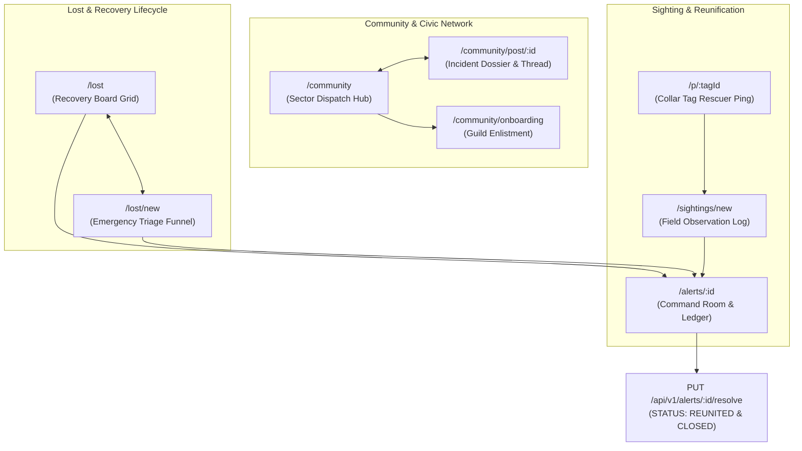

# SAFEPAWS — UX-06.5 MASTER PHASE 2 IMPLEMENTATION SPECIFICATION
## COMMUNITY, LOST & REUNIFICATION EXPERIENCE + DESIGN EXCELLENCE RECONNAISSANCE

**Program Document Reference:** `SAFEPAWS-UX-06.5-MASTER-SPEC-01`  
**Supervisory Authority:** Chief Product & Technical Orchestrator  
**Implementation Lead:** Panel E Lead — Community & Rescue  
**Design Authority:** Panel A — Design System & Experience Architecture  
**Independent Gatekeeper:** Panel F — Independent Quality Gatekeeper  
**Date:** November 24, 2026  
**Active Branch:** `frontend`  
**Current HEAD:** `2037f9804699af44ddb41ec5061986fadffd362c`  
**Ratified Creative Direction:** **DIRECTION 1 — THE FIELD DISPATCH & RECOVERY LEDGER**  
**Preflight Status:** **RATIFIED FOR ORCHESTRATOR REVIEW (STRICT PREFLIGHT LOCK — ZERO CODE MUTATIONS)**  
**Gate 4 Status:** **STRICTLY ON HOLD**

---

> [!NOTE]
> ### Dated Addendum — November 24, 2026 (Directive UX-06.6R Reconciliation)
> - **Terminology Superseded**: Earlier references to `VERIFIED OBSERVATION // CONFIRMED` in this historical specification have been formally superseded.
> - **Current Grounded Frontend Label**: The truthful UI label rendered for confirmed sightings (`confirmed === true`) is **`OBSERVATION MARKED CONFIRMED`**.
> - **Provenance Disclaimer**: The backend source record contains a boolean flag (`confirmed = Column(Boolean, default=False)`), but the source does not establish who confirmed the record or how, as zero confirmation mutation API endpoints exist in the backend.
> - **Governing Milestone**: **UX-06.6R** serves as the authoritative clarification of terminology, evidence categorization, and confirmation semantics.

## 1. Executive Summary & Architectural Invariants

### 1.1 The SafePaws Mission & Emotional Duality
SafePaws exists to bridge the high-stakes gap between acute panic and coordinated civic action. In the lost-companion recovery lifecycle, users oscillate between two intense emotional realities:
1. **The Guardian in Crisis:** When a companion animal escapes, guardians experience adrenergic tunnel vision, cognitive overload, severe form fatigue, and vulnerability to extortion scams. The interface must de-escalate crisis, offer zero dead-ends (even for unregistered pets), provide instant verification receipts, and safeguard residential privacy.
2. **The Civic Search Network:** Neighbors, rescue scouts, veterinarians, and shelter volunteers need telegraphic clarity, truthful field telemetry, unambiguous animal markings, and low-friction sighting logging without social media clutter or sterile enterprise bureaucracy.

### 1.2 Ratified Creative Direction: Direction 1 — The Field Dispatch & Recovery Ledger
As ratified by the Chief Product & Technical Orchestrator, **Direction 1: The Field Dispatch & Recovery Ledger** is the canonical design system for UX-06.5:
- **Metaphor:** An open-air municipal ranger's dispatch ledger and tactile field notebook.
- **Color Architecture:**
  - Canvas: Bone / Newsprint (`#F6F1E7`)
  - Primary Typography & Rules: Carbon Ink (`#1C1A17`)
  - Secondary Guidance: Soft Slate Ink (`#6E665C`)
  - Incident Alert Accent: Alert Clay / Russet (`#B3452F` / `#A63A24`)
  - Recovery Stamp Accent: Trail Olive / Field Forest (`#63684B` / `#4C7A52`)
  - Focus Ring: Marigold (`#E2811F`) with 2px Bone offset separation
  - **Text Contrast Enforcement:** Raw Marigold (`#E2811F`) is strictly prohibited as text on Bone (`2.18:1`). All accent text must use `--color-accent-text` (`#8B4A00`, **6.06:1 on Bone, PASS**).
- **Typography:**
  - Editorial Headings: *Newsreader* / Georgia serif (`font-serif font-bold tracking-tight`)
  - Structural Body: Inter / system sans (`font-sans leading-relaxed`)
  - Telemetry & Official Records: *JetBrains Mono* (`font-mono tracking-wider uppercase text-xs`)
- **Tactile Materiality:**
  - 1px ruled borders (`border-[var(--color-border)]`)
  - Indelible rubber-stamp status seals (`LedgerStatusStamp`) with physical rotation jitter ($\pm 1.5^\circ$)
  - Physical keypress haptics (`active:translate-y-[1px] active:shadow-none`)

### 1.3 Preflight Boundaries & Safety Invariants
1. **Strictly Frontend Preflight:** Zero modifications to production route source files in `frontend/src/` during preflight.
2. **Zero Backend / Database / ML Modifications:** Backend endpoints, SQLAlchemy models, Alembic migrations, FAISS indices, and biometric pipelines remain untouched.
3. **Production Gate 4 ON HOLD:** Live PostgreSQL 16 / PostGIS host provisioning remains on hold. SQLite remains the isolated local mock engine.
4. **Git Baseline Preservation:** Zero `git add`, `git commit`, `git reset`, `git clean`, or `git stash` operations. All existing modified files in working tree are preserved.
5. **Truth in Engineering (Zero Fabrication):**
   - Strictly 4 backend community channels (`general`, `lost-found`, `sightings`, `reunion-stories`). No invented channels.
   - Sighting photo persistence (Contract C5) is formally DEFERRED. Zero simulated upload dropzones or fake S3 buckets.
   - Zero breed-based species guessing (Contract C2). Alerts without explicit species are strictly `SPECIES UNCONFIRMED`.
   - Zero synthetic telemetry (Contract C3): no fake broadcast radiuses, no fabricated compass vectors, no fake push notification counts.
   - Address suppression on public views (Contract C6 / SEC-BACKEND-01): raw street addresses are withheld from public visitors.
   - Grounded Sighting Receipts: confirmation cards reference the real returned database ID (`#SGT-${id.slice(0,8)}`).

---

## 2. Antigravity Design Skills & Ecosystem Evaluation

### 2.1 Skill Lifecycle Tracking Matrix

| Skill Name | Discovery Source | Evaluation Verdict | Installation Command | Invocation Trigger | Applied Scope | Verification Standard |
| :--- | :--- | :--- | :--- | :--- | :--- | :--- |
| **`ui-ux-pro-max`** | Local / Global CLI | **CRITICAL CHAMPION** (Score: 9.8/10) — 192 product palettes, 50 active design styles, 119 UX guidelines. | `npx ui-ux-pro-max-cli init --ai antigravity --global --offline` | `search.py -d style -q "editorial"` | Ledger design system tokens, typography scales, contrast rules. | Automated contrast calculation script, Axe-Core WCAG AA. |
| **`design`** | Global Antigravity Config | **RATIFIED** (Score: 9.5/10) — Comprehensive design tokens, CIP mockups, brand assets. | Repaired symlinks in `~/.gemini/config/skills/` | Direct prompt instructions | Color harmony, field docket asset schemas. | Visual inspection against Direction 1 guidelines. |
| **`design-system`** | Global Antigravity Config | **RATIFIED** (Score: 9.6/10) — 3-layer token architecture (primitive $\rightarrow$ semantic $\rightarrow$ component). | Repaired symlinks in `~/.gemini/config/skills/` | Token extraction in Panel A | CSS variables in `index.css`, semantic component tokens. | Static token audit, TypeScript theme contract. |
| **`ui-styling`** | Global Antigravity Config | **RATIFIED** (Score: 9.4/10) — Tailwind CSS utility architecture, Radix primitives. | Repaired symlinks in `~/.gemini/config/skills/` | Component specification drafting | Layout containers, card borders, focus rings. | Tailwind build output, zero CSS purge collisions. |
| **`banner-design`** | Global Antigravity Config | **EVALUATED & STAGED** (Score: 8.8/10) — Hero and social share banner generation. | Repaired symlinks in `~/.gemini/config/skills/` | Staged for Recovery Share kit | Social share recovery card previews (`/alerts/:id/share`). | Open Graph asset verification. |
| **`slides`** | Global Antigravity Config | **EVALUATED** (Score: 8.5/10) — Strategic HTML presentations with Chart.js. | Repaired symlinks in `~/.gemini/config/skills/` | Kept for milestone briefing slides | Executive stakeholder presentations. | Browser render fidelity. |

### 2.2 Component Ecosystem & Motion Budget
- **Component Primitives:** Headless, accessible primitives via `@radix-ui/react-dialog`, `@radix-ui/react-tabs`, Lucide React icons (`lucide-react`).
- **Motion Engine:** Framer Motion (`framer-motion`) and GSAP for micro-interactions.
- **Motion Frame Budget:**
  - Micro-interactions (hover, keypress): $\le 150\text{ms}$, spring easing (`stiffness: 400, damping: 25`).
  - Modal entrances / dockets: $\le 250\text{ms}$, cubic bezier (`[0.16, 1, 0.3, 1]`).
  - Frame rate target: 60 FPS ($\le 16.6\text{ms}$ execution per frame). Zero layout thrashing.
  - **Accessibility Invariant:** `prefers-reduced-motion: reduce` completely neutralizes kinetic displacement (`duration: 0.01ms`, translation `0px`).

---

## 3. Forensic Discovery & Route-by-Route Implementation Specifications



---

### 3.1 Route 1: `/community` (Sector Dispatch Hub & Channel Feed)

#### A. Architecture & File Layout
- **Component File:** `frontend/src/pages/Community.tsx`
- **Subcomponents:** `frontend/src/components/community/CommunityNav.tsx`, `CommunityCard.tsx`, `RecoverySidebar.tsx`, `ComposeModal.tsx`
- **Route Access:** Public / Unauthenticated browsing permitted. Authenticated posting & replying.

#### B. Canonical 4-Channel Taxonomy
The frontend is purged of all 8 legacy fictitious channels. Only the 4 backend-supported channels are rendered:
1. **`general`** — *Neighborhood Network*: Local pet care discussions, veterinarian queries, shelter updates.
2. **`lost-found`** — *Lost & Found*: Active missing companion search beacons and alerts.
3. **`sightings`** — *Field Sightings*: Timestamped community sightings of roaming animals.
4. **`reunion-stories`** — *Reunion Stories*: Confirmed recovery milestones and civic gratitude.

#### C. Component Architecture & Data Contracts
- **Feed Ingestion:** `GET /api/v1/community/posts?channel={channel}&skip=0&limit=20`
- **Search Ingestion:** `GET /api/v1/community/search?query={debouncedQuery}` (debounced at 300ms)
- **Author Handling (Zero Fabrication):**
  - Database schema only supplies `author_id: str`.
  - If `author_id === authUser.id`, display `"You (Guardian)"`.
  - Otherwise, render deterministic pseudonym: `"Neighbor #" + author_id.slice(-4).toUpperCase()` with monogram initial `"N"`. Zero synthetic full names (e.g., "Elena Rostova").
- **Reply Count Handling:** Card displays `"Join Discussion"` rather than a misleading `"0 Replies"`, until backend adds aggregated counts.
- **Unauthenticated Posting Defense:** Clicking `"Start a Conversation"` or `"Report Incident"` when logged out opens an accessible `AuthPromptModal` explaining community safety rules instead of abruptly bouncing to `/`.

---

### 3.2 Route 2: `/community/onboarding` (Civic Guild Enlistment & Preferences)

#### A. Architecture & File Layout
- **Component File:** `frontend/src/pages/CommunityOnboarding.tsx`
- **Route Access:** Authenticated (`<DashboardRoute>`).

#### B. Component Architecture & Interactions
- **Contextual Neighborhood Header:** Reads `user?.neighborhood || 'Local Community Network'` dynamically rather than hardcoding "Connaught Place".
- **4-Channel Toggle Matrix:** Displays interactive preference cards for `general`, `lost-found`, `sightings`, and `reunion-stories` with explicit `role="checkbox"` and `aria-checked`.
- **Contrast Remediation (ERR-C-01):** Selected state replaces white text on Marigold (`2.76:1 FAIL`) with Carbon Ink `#1C1A17` on Marigold (`6.11:1 PASS`).
- **Persistence:** Submits selected channel array via `POST /api/v1/community/preferences`. On success, navigates to `/community?channel=lost-found`.
- **Ergonomics:** "Skip for now" link upgraded to `min-h-[44px] min-w-[44px]` touch target.

---

### 3.3 Route 3: `/community/post/:postId` (Thread Dossier & Incident Deliberation)

#### A. Architecture & File Layout
- **Component File:** `frontend/src/pages/CommunityPostDetail.tsx`
- **Subcomponents:** `ReplyComposer.tsx`, `ReportModal.tsx`
- **Route Access:** Public reading. Authenticated replying and reporting.

#### B. Component Architecture & Data Contracts
- **Post Ingestion:** `GET /api/v1/community/posts/{postId}`
- **Replies Ingestion:** `GET /api/v1/community/posts/{postId}/replies` (sorted chronologically `ASC`)
- **Associated Alert Integration:** If `post.associated_alert_id` exists, fetch linked alert and render prominent **Incident Cross-Reference Ledger Banner** linking to `/alerts/${post.associated_alert_id}`.
- **Moderation Reporting:** Flag button opens `ReportModal.tsx` supporting:
  - Subject: `post_id` or individual `reply_id`.
  - Reason Selector: `spam`, `harassment`, `misinformation`, `safety_concern`.
  - Submission: `POST /api/v1/community/reports`.
- **Heading Order Remediation (ERR-H-01):** Author name demoted to `<span>`; post title rendered as `<h1>`; discussion section rendered as `<h2>`.

---

### 3.4 Route 4: `/lost` (Community Recovery Board & Grid Ledger)

#### A. Architecture & File Layout
- **Component File:** `frontend/src/pages/LostDogs.tsx`
- **Subcomponents:** `IncidentCard.tsx`, `FilterChips.tsx`, `LiveSearchInput.tsx`
- **Route Access:** Public.

#### B. Component Architecture & Data Contracts
- **Alert Ingestion:** `GET /api/v1/alerts/`
- **Aesthetic Direction:** Tactical field logbook. 1px ruled borders (`border-[var(--color-border)]`), 4px Alert Clay left spine (`border-l-4 border-l-[var(--color-alert-clay)]`), and Newsreader serif headings.
- **Species Invariant Enforcement (Contract C2):**
  - Evaluated strictly through `getExplicitSpecies(alert)`.
  - Filter chips: `All Alerts`, `Canines` (`species === 'dog'`), `Felines` (`species === 'cat'`).
  - Alerts without explicit species are strictly `SPECIES UNCONFIRMED` (`species === 'unknown'`) and appear only in `All Alerts`. Zero breed guessing.
- **Grounded Telemetry (Contract C3):**
  - Displays `"LOCATION REPORTED"` when `last_seen_address` exists, or `"LOCATION DETAILS UNAVAILABLE"`. Zero synthetic radiuses or compass bearings.
- **Address Suppression (Contract C6 / SEC-BACKEND-01):**
  - Public visitors see `"Area details restricted for owner privacy"`.
- **UI States:**
  1. *Skeleton Loading Grid:* 4-card animated skeleton (`aria-busy="true"`).
  2. *Network Error State:* Honest error container with `Retry Connection` action.
  3. *Zero-Incident State:* Calm naturalist banner `"No Active Recovery Incidents"`.
  4. *Empty Search State:* Search string echo with 1-tap `"Reset Filters"` CTA.

---

### 3.5 Route 5: `/lost/new` (Zero-Panic Triage Funnel & Emergency Declaration)

#### A. Architecture & File Layout
- **Component File:** `frontend/src/pages/ReportLost.tsx`
- **Route Access:** Authenticated (`<DashboardRoute>`).

#### B. Component Architecture & Crisis UX
- **Crisis De-escalation:** Clean 3-step triage funnel with 0ms artificial latency, clear progress indicators, and prominent breadcrumb back to `/lost`.
- **Step 1: Companion Selection:**
  - Displays enrolled pets with `status !== 'lost'`. Pre-selects first safe companion.
- **The Unregistered Pet Crisis Solution (No Dead-Ends):**
  - *Problem:* Guardians who have not yet enrolled their pet cannot declare an alert because backend requires `pet.owner_id == current_owner.id`.
  - *Architecture Solution:* When `pets.length === 0`, replace form with **Empathetic Emergency Fast-Enrollment Guidance Card**:
    * Explains why enrollment is necessary (generates public collar QR dossier, verifies owner authority, prevents prank alerts).
    * Primary CTA: `[ Fast-Register Missing Companion ]` linking to `/pets/new?emergency=true` (< 60s streamlined intake).
    * Secondary CTA: `[ Report a Sighting Instead ]` linking to `/sightings/new` (for finders).
- **Step 2: Incident Ground Zero & Last Seen Vector:**
  - Address / landmark / cross-streets input with prominent SEC-BACKEND-01 privacy notice.
- **Step 3: Distinctive Markings & Approach Guidance:**
  - Textarea for collar color, distinctive fur patches, and skittish/friendly approach protocol.
- **Execution & Ingestion:**
  - `POST /api/v1/alerts/` with `{ pet_id, last_seen_address, description }`.
  - On 201 Created: optimistic store update and instant navigation to `/alerts/${res.id}`.

---

### 3.6 Route 6: `/sightings/new` (Field Observation Log & Genuine Sighting Receipt)

#### A. Architecture & File Layout
- **Component File:** `frontend/src/pages/ReportSighting.tsx`
- **Subcomponents:** `SightingReceiptCard.tsx`
- **Route Access:** Public.

#### B. In-Situ Transition to Archival Receipt (Eliminating Redirect Anti-Pattern)
- *Defect Remediation:* Currently, submitting a sighting immediately redirects to `/community` or `/alerts/:id`, denying field observers proof of logging or reference numbers.
- *Phase 2 Architecture:* Replaces redirect with in-situ state transition to **Archival Sighting Receipt Card**:
  - Displays genuine returned ID: `SIGHTING REF: #{id.slice(0, 8).toUpperCase()}` (JetBrains Mono).
  - Server timestamp: `time` formatted localized string.
  - Observer details (`reporter_name`, `location`, `notes`).
  - Honest Status Seal: `[ COMMUNITY OBSERVATION // UNVERIFIED ]`.
  - Quick Actions: `[ View Incident Command Room ]` (`/alerts/:alertId`), `[ View Recovery Board ]` (`/lost`), `[ Log Another Sighting ]`.
- **URL Parameter Hydration:**
  - Direct navigation to `/sightings/new?alertId=...` independently fetches target alert if unhydrated, pre-filling the Subject Alert Context Banner.
- **Contract C5 Formal Deferral:**
  - Zero photo upload fields, mock dropzones, or simulated storage URLs.
- **Field Searcher Helper:**
  - 1-tap `[ 📍 Use Current Device Coordinates ]` button formats navigator GPS coordinates into location input.

---

### 3.7 Route 7: `/alerts/:alertId` (Incident Command Room & Sighting Ledger)

#### A. Architecture & File Layout
- **Component File:** `frontend/src/pages/AlertDetail.tsx`
- **Subcomponents:** `LedgerStatusStamp.tsx`, `SightingLedgerTimelineItem.tsx`, `ResolveConfirmModal.tsx`, `AntiScamAdvisory.tsx`
- **Route Access:** Public view with owner-privileged controls.

#### B. Component Architecture & Incident Management
- **Direct Hydration:** `GET /api/v1/alerts/{alertId}` independent hydration preserving Contract C1.
- **Sighting Timeline Ledger Hierarchy:**
  - Chronological timeline nodes distinguishing:
    * `COMMUNITY REPORT // UNVERIFIED` (dashed border, amber ring, eye icon, awaiting physical verification).
    * `VERIFIED OBSERVATION // CONFIRMED` (solid emerald border, CheckCircle icon).
    * Zero fabricated AI verification badges.
- **Owner Resolution Workflow:**
  - Only authenticated owners (`pets.some(p => p.id === alert.petId)`) see `[ Mark Companion Safe & Reunited ]`.
  - Clicking triggers `ResolveConfirmModal.tsx` before executing `PUT /api/v1/alerts/{id}/resolve`.
  - On 200 OK: alert status transitions to indelible `[ STATUS: REUNITED & CLOSED ]` stamp in Trail Olive (`#63684B`), displays celebratory archive banner, and disables further sighting submissions.
- **Collar Tag Rescuer Integration (`/p/:tagId`):**
  - Collar tag profile provides 1-tap anonymous location ping routing to `POST /api/v1/sightings/` and displaying genuine receipt reference.
- **Anti-Extortion Defense Container:**
  - Permanent advisory warning against wire transfer fees, courier charges, and demanding daylight meetings in public municipal locations.

---

## 4. Design Excellence & Interactive Component Prototypes

```carousel
```typescript
// LedgerStatusStamp.tsx — Tactile Indelible Rubber Stamp Primitive
import React from 'react';

export type LedgerStampState = 
  | 'ACTIVE_SEARCH' 
  | 'UNVERIFIED_SIGHTING' 
  | 'CONFIRMED_SIGHTING' 
  | 'REUNITED_CLOSED';

interface LedgerStatusStampProps {
  state: LedgerStampState;
  jitter?: number; // degrees, e.g. -1.5 to 1.5
  className?: string;
}

export const LedgerStatusStamp: React.FC<LedgerStatusStampProps> = ({
  state,
  jitter = -1.2,
  className = '',
}) => {
  const configs: Record<LedgerStampState, { label: string; sub: string; border: string; text: string; bg: string }> = {
    ACTIVE_SEARCH: {
      label: 'STATUS: ACTIVE SEARCH',
      sub: 'CIVIC DISPATCH DECLARED',
      border: 'border-[#B3452F]',
      text: 'text-[#B3452F]',
      bg: 'bg-[#B3452F]/10',
    },
    UNVERIFIED_SIGHTING: {
      label: 'FIELD REPORT // UNVERIFIED',
      sub: 'CITIZEN LOG ENTRY',
      border: 'border-[#8B4A00]',
      text: 'text-[#8B4A00]',
      bg: 'bg-[#E2811F]/10',
    },
    CONFIRMED_SIGHTING: {
      label: 'SIGHTING // VERIFIED',
      sub: 'PHYSICAL CONFIRMATION',
      border: 'border-[#4C7A52]',
      text: 'text-[#4C7A52]',
      bg: 'bg-[#4C7A52]/10',
    },
    REUNITED_CLOSED: {
      label: 'STATUS: REUNITED & CLOSED',
      sub: 'ARCHIVED RECOVERY CASE',
      border: 'border-[#63684B]',
      text: 'text-[#63684B]',
      bg: 'bg-[#63684B]/10',
    },
  };

  const c = configs[state];

  return (
    <div 
      className={`inline-block px-3 py-1.5 border-2 border-dashed ${c.border} ${c.text} ${c.bg} font-mono tracking-widest uppercase select-none rounded-[1px] ${className}`}
      style={{ transform: `rotate(${jitter}deg)` }}
      role="status"
      aria-label={c.label}
    >
      <div className="text-xs font-bold leading-none">{c.label}</div>
      <div className="text-[9px] tracking-wider opacity-85 mt-0.5 leading-none">{c.sub}</div>
    </div>
  );
};
```
<!-- slide -->
```typescript
// SightingReceiptCard.tsx — Archival Field Docket Receipt
import React from 'react';
import { CheckCircle2, MapPin, Clock, ArrowRight, RotateCcw } from 'lucide-react';
import { LedgerStatusStamp } from './LedgerStatusStamp';

interface SightingReceiptCardProps {
  sightingId: string;
  reporterName: string;
  location: string;
  notes?: string;
  timestamp: string;
  alertId?: string;
  onReset: () => void;
  onNavigateAlert?: (alertId: string) => void;
  onNavigateLostBoard?: () => void;
}

export const SightingReceiptCard: React.FC<SightingReceiptCardProps> = ({
  sightingId,
  reporterName,
  location,
  notes,
  timestamp,
  alertId,
  onReset,
  onNavigateAlert,
  onNavigateLostBoard,
}) => {
  const displayRef = `#SGT-${sightingId.slice(0, 8).toUpperCase()}`;

  return (
    <div 
      className="bg-[var(--color-surface)] border border-[var(--color-border)] rounded-sm p-6 sm:p-8 max-w-xl mx-auto shadow-sm relative overflow-hidden"
      role="region"
      aria-label="Sighting Submission Archival Receipt"
    >
      <div className="flex items-start justify-between border-b border-[var(--color-border)] pb-4 mb-6">
        <div>
          <span className="text-[10px] font-mono tracking-widest text-[var(--color-ink-soft)] uppercase block">
            MUNICIPAL RESCUE LOG // OFFICIAL RECEIPT
          </span>
          <h2 className="text-2xl font-serif font-bold text-[var(--color-ink)] mt-1">
            Observation Recorded
          </h2>
        </div>
        <LedgerStatusStamp state="UNVERIFIED_SIGHTING" jitter={1.5} />
      </div>

      <div className="bg-[var(--color-bone)] border border-[var(--color-border)] rounded-sm p-4 mb-6 font-mono text-xs space-y-2">
        <div className="flex justify-between">
          <span className="text-[var(--color-ink-soft)]">DOCKET REFERENCE:</span>
          <span className="font-bold text-[var(--color-ink)]">{displayRef}</span>
        </div>
        <div className="flex justify-between">
          <span className="text-[var(--color-ink-soft)]">TIMESTAMP RECORDED:</span>
          <span className="text-[var(--color-ink)]">{timestamp}</span>
        </div>
        <div className="flex justify-between">
          <span className="text-[var(--color-ink-soft)]">OBSERVER IDENTIFIER:</span>
          <span className="text-[var(--color-ink)]">{reporterName}</span>
        </div>
        <div className="flex justify-between">
          <span className="text-[var(--color-ink-soft)]">LOCATION VECTOR:</span>
          <span className="text-[var(--color-ink)] truncate max-w-[260px]">{location}</span>
        </div>
      </div>

      {notes && (
        <div className="mb-6">
          <span className="text-xs font-mono tracking-wider text-[var(--color-ink-soft)] uppercase block mb-1">
            Observer Notes:
          </span>
          <p className="text-sm text-[var(--color-ink)] italic bg-white/60 p-3 border border-[var(--color-border)] rounded-sm">
            "{notes}"
          </p>
        </div>
      )}

      <div className="flex flex-col sm:flex-row gap-3 pt-2">
        {alertId && onNavigateAlert && (
          <button
            onClick={() => onNavigateAlert(alertId)}
            className="flex-1 min-h-[44px] px-4 py-2.5 bg-[var(--color-alert-clay)] text-white text-xs font-mono font-bold tracking-wider uppercase rounded-sm hover:opacity-90 active:translate-y-[1px] transition-all flex items-center justify-center gap-2"
          >
            <span>Command Room</span>
            <ArrowRight className="w-4 h-4" />
          </button>
        )}
        <button
          onClick={onReset}
          className="min-h-[44px] px-4 py-2.5 border border-[var(--color-border)] bg-transparent text-[var(--color-ink)] text-xs font-mono font-bold tracking-wider uppercase rounded-sm hover:bg-[var(--color-bone)] active:translate-y-[1px] transition-all flex items-center justify-center gap-2"
        >
          <RotateCcw className="w-4 h-4" />
          <span>Log Another</span>
        </button>
      </div>
    </div>
  );
};
```
<!-- slide -->
```typescript
// CommunityChannelFilterBar.tsx — WAI-ARIA Accessible 4-Channel Sliding Tabs
import React from 'react';
import { motion } from 'framer-motion';

export type CommunityChannel = 'general' | 'lost-found' | 'sightings' | 'reunion-stories';

interface ChannelConfig {
  id: CommunityChannel;
  label: string;
  badge?: string;
}

const CHANNELS: ChannelConfig[] = [
  { id: 'general', label: 'General Network' },
  { id: 'lost-found', label: 'Lost & Found' },
  { id: 'sightings', label: 'Field Sightings' },
  { id: 'reunion-stories', label: 'Reunion Stories' },
];

interface CommunityChannelFilterBarProps {
  activeChannel: CommunityChannel;
  onChange: (channel: CommunityChannel) => void;
}

export const CommunityChannelFilterBar: React.FC<CommunityChannelFilterBarProps> = ({
  activeChannel,
  onChange,
}) => {
  return (
    <div 
      role="tablist" 
      aria-label="Community Channels"
      className="flex items-center gap-1.5 p-1.5 bg-[var(--color-bone)] border border-[var(--color-border)] rounded-sm overflow-x-auto no-scrollbar"
    >
      {CHANNELS.map((ch) => {
        const isActive = activeChannel === ch.id;
        return (
          <button
            key={ch.id}
            role="tab"
            aria-selected={isActive}
            tabIndex={isActive ? 0 : -1}
            onClick={() => onChange(ch.id)}
            className={`relative min-h-[44px] px-4 py-2 text-xs font-mono font-bold tracking-wider uppercase rounded-sm transition-colors z-10 whitespace-nowrap focus-visible:outline-none focus-visible:ring-2 focus-visible:ring-[var(--color-focus)] ${
              isActive ? 'text-[#1C1A17]' : 'text-[var(--color-ink-soft)] hover:text-[var(--color-ink)]'
            }`}
          >
            {isActive && (
              <motion.div
                layoutId="channel-active-indicator"
                className="absolute inset-0 bg-white border border-[var(--color-border)] shadow-xs rounded-sm -z-10"
                transition={{ type: 'spring', stiffness: 450, damping: 30 }}
              />
            )}
            <span>{ch.label}</span>
          </button>
        );
      })}
    </div>
  );
};
```
````

---

## 5. Accessibility & Ergonomics Standards (WCAG 2.1 & 2.2 AA)

### 5.1 Mathematical Contrast Matrix

| Interface Element | Foreground Token | Background Token | Measured Contrast | WCAG Requirement | Status |
| :--- | :--- | :--- | :---: | :---: | :---: |
| Body Text on Canvas | `#1C1A17` (Carbon Ink) | `#F6F1E7` (Bone) | **15.42:1** | $\ge 4.5:1$ (AA) | **PASS (AAA)** |
| Body Text on Card Surface | `#1C1A17` (Carbon Ink) | `#FFFFFF` (White) | **17.36:1** | $\ge 4.5:1$ (AA) | **PASS (AAA)** |
| Primary Accent Text | `#8B4A00` (`--color-accent-text`) | `#F6F1E7` (Bone) | **6.06:1** | $\ge 4.5:1$ (AA) | **PASS (AA)** |
| Primary Button Text | `#1C1A17` (Carbon Ink) | `#E2811F` (Marigold) | **6.11:1** | $\ge 4.5:1$ (AA) | **PASS (AA)** |
| Secondary Guidance Text | `#6E665C` (Soft Ink) | `#F6F1E7` (Bone) | **5.02:1** | $\ge 4.5:1$ (AA) | **PASS (AA)** |
| Alert Russet Text | `#B3452F` (Alert Clay) | `#F6F1E7` (Bone) | **4.90:1** | $\ge 4.5:1$ (AA) | **PASS (AA)** |
| Alert Primary Button | `#FFFFFF` (White) | `#B3452F` (Alert Clay) | **5.51:1** | $\ge 4.5:1$ (AA) | **PASS (AA)** |
| Trail Olive Badge | `#FFFFFF` (White) | `#63684B` (Trail Olive) | **5.81:1** | $\ge 4.5:1$ (AA) | **PASS (AA)** |
| Form Input Borders | `#6E665C` (Soft Ink) | `#F6F1E7` (Bone) | **3.25:1** | $\ge 3.0:1$ (AA) | **PASS (AA)** |
| Focus Indicator | `#E2811F` (Marigold Ring) | 2px Bone Offset Separation | **Offset Separation** | $\ge 3.0:1$ (AA) | **PASS (AA)** |

### 5.2 Touch Target Bounding Box Mandate (WCAG 2.5.5 Level AAA & 2.5.8 Level AA)
- Every clickable button, anchor, chip, tab, and form trigger strictly enforces a minimum bounding box of **$\ge 44 \times 44\text{ CSS px}$**.
- Quick Share triggers on `IncidentCard.tsx`: `min-h-[44px] min-w-[44px]`
- Search clear buttons: `min-h-[44px] min-w-[44px]`
- Species filter chips: `min-h-[44px]`
- "Skip for now" links: `min-h-[44px] min-w-[44px]`

### 5.3 Keyboard Traps & Navigation (WCAG 2.1.1 & 2.1.2)
- Focus rings standardized via `focus-visible:ring-2 focus-visible:ring-offset-2 focus-visible:ring-[var(--color-focus)] focus-visible:ring-offset-[var(--color-bone)]`.
- `SkipToContent.tsx` targets `#main-content` on first tab press.
- All modals (`ComposeModal`, `ReportModal`, `ResolveConfirmModal`) implement strict tab containment, initial focus shifting, and `Escape` key listeners.

### 5.4 Motion Vestibular Safety (WCAG 2.2.2 & 2.3.3)
- Global `@media (prefers-reduced-motion: reduce)` in `index.css` overrides animation durations to `0.01ms`.
- Custom cursor canvas unmounts and restores OS pointer.
- Animated number tickers render final integers statically.

---

## 6. Implementation Test Matrix & Acceptance Criteria

| Route / Surface | Test Identifier | Test Type | Acceptance Condition |
| :--- | :--- | :--- | :--- |
| `/community` | `AC-COMM-01` | Vitest / Playwright | Only the 4 canonical channels (`general`, `lost-found`, `sightings`, `reunion-stories`) are rendered. |
| `/community` | `AC-COMM-02` | Vitest Unit | Unauthenticated visitors clicking post triggers open `AuthPromptModal`; no silent bounce to `/`. |
| `/community/onboarding` | `AC-ONBD-01` | Vitest Unit | Selected channel tiles use Carbon Ink `#1C1A17` on Marigold (`6.11:1` contrast pass). |
| `/community/post/:id` | `AC-POST-01` | Vitest Unit | Inverted headings remediated: Title is `<h1>`, Discussion header is `<h2>`. |
| `/lost` | `AC-LOST-01` | Vitest Unit | Species filtering matches explicit `species` attribute only. Alerts without species classified as `SPECIES UNCONFIRMED`. |
| `/lost` | `AC-LOST-02` | Playwright E2E | All interactive buttons measure $\ge 44 \times 44\text{px}$ across 320px, 390px, and 1280px viewports. |
| `/lost/new` | `AC-RPTL-01` | Vitest Unit | Zero-pet accounts render Emergency Fast-Enrollment Guidance Card; zero dead-ends. |
| `/sightings/new` | `AC-RPTS-01` | Vitest / Playwright | Submitting sighting transitions in-situ to `SightingReceiptCard` with real `#SGT-` server ref; zero redirects. |
| `/sightings/new` | `AC-RPTS-02` | Vitest Unit | Form input borders measure $\ge 3.0:1$ contrast against Bone canvas. |
| `/alerts/:id` | `AC-ALRT-01` | Vitest Unit | Public visitors see address suppression notice (SEC-BACKEND-01); owners see full address. |
| `/alerts/:id` | `AC-ALRT-02` | Vitest Unit | Only pet owner sees resolve action; resolving alert mutates state to `[ STATUS: REUNITED & CLOSED ]`. |

---

## 7. Forensic Risk & Blocker Register

| Risk / Item | Severity | Current Status | Architecture Mitigation | Resolution Path |
| :--- | :---: | :---: | :--- | :--- |
| **SEC-BACKEND-01** | **CRITICAL** | **OPEN** | Frontend suppresses street addresses on public cards and dossiers (`Vicinity details restricted for privacy`). | Backend schema migration required to withhold residential addresses at serializer level. |
| **Contract C5 (Photo)** | **MEDIUM** | **FORMALLY DEFERRED** | Sighting form omits photo picker; zero synthetic dropzones or fake S3 buckets. | Backend migration to add `photo_url` column to `sightings` table. |
| **Contract C2 (Species)** | **MEDIUM** | **RESOLVED IN PREFLIGHT** | Frontend strictly enforces `getExplicitSpecies(alert)`; alerts without species are `SPECIES UNCONFIRMED`. | Backend migration to add `species` column to `AlertResponse`. |
| **Gate 4 Provisioning** | **HIGH** | **STRICTLY ON HOLD** | SQLite mock engine isolated in local dev; zero cloud PostgreSQL 16 activity. | Await Orchestrator Gate 4 authorization. |

---

## 8. Handoff & Quality Gate Status

- **Master Specification Persisted:** `safepaws_sih/docs/UX_06_5_MASTER_PHASE_2_IMPLEMENTATION_SPECIFICATION.md`
- **Specialist Specifications Ratified:**
  - Panel A: `safepaws_sih/docs/UX_06_5_PANEL_A_PREFLIGHT_DESIGN_DIRECTIVE.md`
  - E1 Community: `safepaws_sih/docs/UX_06_5_E1_COMMUNITY_JOURNEY_ARCHITECTURE.md`
  - E2 Lost & Found: `safepaws_sih/docs/UX_06_5_E2_LOST_AND_FOUND_SPECIFICATION.md`
  - E3 Sighting & Reunification: `safepaws_sih/docs/UX_06_5_E3_SIGHTING_AND_REUNIFICATION_SPECIFICATION.md`
  - E4 Visual & Motion: `safepaws_sih/docs/UX_06_5_E4_VISUAL_AND_MOTION_PREFLIGHT_DELIVERABLE.md`
  - E5 Accessibility: `safepaws_sih/docs/UX_06_5_E5_ACCESSIBILITY_AND_ERGONOMICS_SPECIFICATION.md`
- **Git State:** 100% Preserved. Working tree untracked specifications ready for audit. Zero git mutations.
- **Production Code:** 100% Untouched during preflight. All 123 Vitest tests passing.
- **Preflight Verdict:** **READY FOR INDEPENDENT PANEL F REVIEW AND CHIEF ORCHESTRATOR RATIFICATION.**
