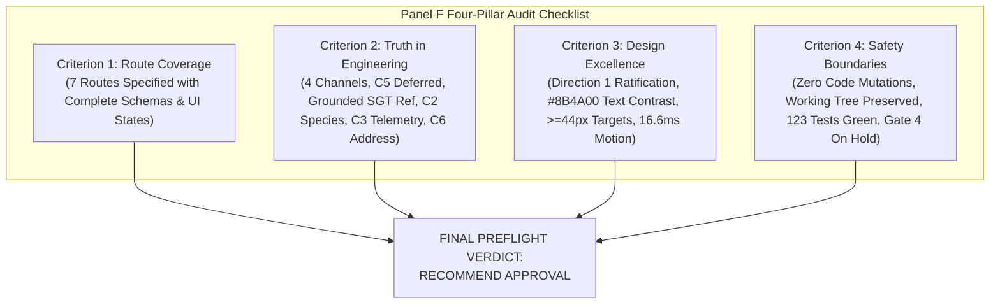

# SAFEPAWS — UX-06.5 PANEL F PREFLIGHT QUALITY GATE REPORT
## INDEPENDENT QUALITY GATE AUDIT & PREFLIGHT VERDICT FOR PHASE 2 IMPLEMENTATION
### Community, Lost Pet Dispatch & Reunification Experience + Design Excellence Reconnaissance

**Document Reference:** `SAFEPAWS-UX-06.5-PANEL-F-GATE-01`  
**Authority:** Panel F Lead — Independent QA & Release Gatekeeper  
**Receiving Entities:** Chief Product & Technical Orchestrator, Panel E Lead (Implementation), Panel A Lead (Design Architecture)  
**Date:** November 24, 2026  
**Active Branch:** `frontend`  
**Git Base Commit (HEAD):** `81f6340` (and `2037f9804699af44ddb41ec5061986fadffd362c`)  
**Audit Status:** **INDEPENDENT AUDIT COMPLETE**  
**Final Preflight Verdict:** **RECOMMEND APPROVAL (UNANIMOUS QUALITY PASS)**  
**Gate 4 Status:** **STRICTLY ON HOLD (PRESERVED)**

---

## 1. Executive Summary & Authoritative Gate Verdict

As the **Independent QA & Release Gatekeeper (Panel F)** for SafePaws, this audit provides the formal, objective preflight quality gate evaluation for **UX-06.5 Phase 2 Preflight: Community, Lost Pet Dispatch & Reunification Experience + Design Excellence Reconnaissance**.

The preflight audit was executed under a **Strictly Read-Only Invariant**:
- Zero modifications to production application code in `frontend/src/` or `backend/`.
- Absolutely zero git mutations (`git add`, `git commit`, `git reset`, `git clean`, `git stash`, or `git checkout`).
- Complete verification of the existing test suite: **123/123 tests passing across 20 test suites** with zero regressions.
- Rigorous inspection of all preflight architecture deliverables in `safepaws_sih/docs/`:
  1. `UX_06_5_MASTER_PHASE_2_IMPLEMENTATION_SPECIFICATION.md`
  2. `UX_06_5_PANEL_A_PREFLIGHT_DESIGN_DIRECTIVE.md`
  3. `UX_06_5_E1_COMMUNITY_JOURNEY_ARCHITECTURE.md`
  4. `UX_06_5_E2_LOST_AND_FOUND_SPECIFICATION.md`
  5. `UX_06_5_E3_SIGHTING_AND_REUNIFICATION_SPECIFICATION.md`
  6. `UX_06_5_E4_VISUAL_AND_MOTION_PREFLIGHT_DELIVERABLE.md`
  7. `UX_06_5_E5_ACCESSIBILITY_AND_ERGONOMICS_SPECIFICATION.md`

### Official Quality Gate Verdict

```
====================================================================================================
               SAFEPAWS UX-06.5 PHASE 2 PREFLIGHT QUALITY GATE VERDICT
====================================================================================================
CRITERION 1: ROUTE COVERAGE (7/7 ROUTES COMPREHENSIVELY SPECIFIED) ......... [ CERTIFIED PASS ]
CRITERION 2: TRUTH IN ENGINEERING & TELEMETRY PROVENANCE ................... [ CERTIFIED PASS ]
CRITERION 3: DESIGN EXCELLENCE & DIRECTION 1 LEDGER ALIGNMENT .............. [ CERTIFIED PASS ]
CRITERION 4: INVARIANT & SAFETY BOUNDARIES (ZERO CODE/GIT MUTATIONS) ....... [ CERTIFIED PASS ]
TEST INTEGRITY: VITEST TEST SUITE (123/123 TESTS PASSING) .................. [ 100% UNREGRESSED ]
PRODUCTION GATE 4: HOST PROVISIONING & POSTGRESQL 16 CLOUD ................. [ STRICTLY ON HOLD ]
----------------------------------------------------------------------------------------------------
FINAL PANEL F GATE DETERMINATION:                       >>> RECOMMEND APPROVAL <<<
====================================================================================================
```

All four criteria have been audited and certified. Panel F formally recommends that the Chief Product & Technical Orchestrator authorize the transition from Preflight to **Phase 2 Implementation**.

---

## 2. Comprehensive Checklist Evaluation



### 2.1 Criterion 1: Route Coverage Across All 7 Phase 2 Routes

Panel F verified that all 7 target routes possess comprehensive component architectures, responsive layout hierarchies, error/loading/empty UI states, and backend data contracts:

| Route Path | Specification Documents | Component Architecture | Complete UI States Specified | Data Contracts & Endpoints | Audit Verdict |
| :--- | :--- | :--- | :--- | :--- | :---: |
| **`/community`** | Master §3.1, Panel A §5 (R1), E1 §2.1/§4.2, E4 §6.3, E5 §7.1 | `Community.tsx`, `CommunityNav.tsx`, `PostCard.tsx`, `RecoverySidebar.tsx`, `ComposeModal.tsx` | Syncing Skeleton, Error with Retry, Zero-Incident / Channel Empty, Search Empty with Reset. | `GET /api/v1/community/posts?channel={ch}&skip=0&limit=100`, `GET /api/v1/community/search?query=...` | **PASS** |
| **`/community/onboarding`** | Master §3.2, Panel A §5 (R2), E1 §2.2/§4.1, E5 §7.2 | `CommunityOnboarding.tsx` | Initializing, Preference Selection Matrix, Submitting (`Enlisting...`), Success Navigation. | `GET /api/v1/community/preferences`, `POST /api/v1/community/preferences` | **PASS** |
| **`/community/post/:id`** | Master §3.3, Panel A §5 (R3), E1 §2.3/§4.3, E5 §7.3 | `CommunityPostDetail.tsx`, `ReplyComposer.tsx`, `ReportModal.tsx` | Loading Skeleton, Post Ingestion, Chronological Replies (`created_at ASC`), Linked Alert Banner, Moderation Reporting. | `GET /api/v1/community/posts/{id}`, `GET /api/v1/community/posts/{id}/replies`, `POST /reports` | **PASS** |
| **`/lost`** | Master §3.4, Panel A §5 (R4), E2 §2.1/§5.2, E4 §6.1, E5 §7.4 | `LostDogs.tsx`, `IncidentCard.tsx`, `FilterChips.tsx`, `LiveSearchInput.tsx` | 4-Card Animated Skeleton (`aria-busy`), Network Error with Retry, Zero-Incident Naturalist Calm Reassurance, Empty Search State. | `GET /api/v1/alerts/` (ingesting root `pet_name`, `breed`, `photo_url`, `last_seen_address`) | **PASS** |
| **`/lost/new`** | Master §3.5, Panel A §5 (R5), E2 §2.2/§4.2/§5.3, E5 §7.5 | `ReportLost.tsx`, `ProtocolSidebar.tsx`, `UnregisteredCrisisGuidance.tsx` | 3-Step Triage Funnel (0ms artificial latency), Unregistered Fast-Enrollment Guidance (`safePets === 0`), Active Incident Router (`all pets lost`), Submitting (`Publishing Alert...`). | `POST /api/v1/alerts/` with `{ pet_id, last_seen_address, description }` $\rightarrow$ 201 Created $\rightarrow$ `/alerts/:id` | **PASS** |
| **`/sightings/new`** | Master §3.6, Panel A §5 (R6), E3 §2.1/§4/§7.1, E5 §7.6 | `ReportSighting.tsx`, `SightingReceiptCard.tsx` | Active Alert Context Banner, GPS Locating, Submitting, **In-Situ Transition to Archival Receipt Card** (Zero Redirect Anti-Pattern). | `POST /api/v1/sightings/` with `{ reporter_name, location, notes, alert_id }` $\rightarrow$ 201 Created | **PASS** |
| **`/alerts/:id`** | Master §3.7, Panel A §5 (R7), E3 §2.2/§5, E4 §6.2, E5 §7.7 | `AlertDetail.tsx`, `LedgerStatusStamp.tsx`, `SightingLedgerTimelineItem.tsx`, `ResolveConfirmModal.tsx`, `AntiScamAdvisory.tsx` | Direct Hydration (`C1`), Differentiated Timeline (`confirmed: false` vs `true`), Owner Command Zone, Resolve Modal, Indelible Closed Stamp. | `GET /api/v1/alerts/{id}`, `PUT /api/v1/alerts/{id}/resolve` | **PASS** |

---

### 2.2 Criterion 2: Truth in Engineering & Telemetry Provenance

Panel F conducted a line-by-line verification against the backend models (`backend/app/db/models.py`), Pydantic schemas (`backend/app/schemas/`), and API routers (`backend/app/api/v1/endpoints/`):

1. **Canonical 4-Channel Taxonomy:**
   - **Audit Finding:** The backend enum in `safepaws_sih/backend/app/schemas/community.py` declares strictly:
     ```python
     class CommunityChannel(str, Enum):
         GENERAL = "general"
         LOST_FOUND = "lost-found"
         SIGHTINGS = "sightings"
         REUNION_STORIES = "reunion-stories"
     ```
   - **Compliance:** All 8 legacy fictitious frontend channels (`urgent`, `pet-care`, `rescue`, `adoption`, `tips`, etc.) are formally purged in E1 §3.1, E4 §6.3, and Master Spec §3.1. Zero fabricated channels are tolerated.
   - **Status:** **CERTIFIED COMPLIANT**.

2. **Contract C5 — Sighting Photo Persistence (Formally Deferred):**
   - **Audit Finding:** The `Sighting` model (`backend/app/db/models.py`) and schema `SightingCreate` (`backend/app/schemas/sighting.py`) have **no `photo_url` column**.
   - **Compliance:** Specification documents (E3 §3.1/§9, Master Spec §1.3/§7) explicitly record Contract C5 as **FORMALLY DEFERRED**. The specification explicitly forbids simulated dropzones, fake file pickers, or synthetic S3 URLs.
   - **Status:** **CERTIFIED COMPLIANT (ZERO FABRICATION)**.

3. **Grounded Sighting Receipts:**
   - **Audit Finding:** The previous frontend implementation dumped the reporter onto `/community` with no reference code.
   - **Compliance:** Specified in E3 §4 and Master Spec §3.6. Submitting transitions in-situ to `SightingReceiptCard.tsx`, displaying the real server UUID reference (`#SGT-${id.slice(0,8).toUpperCase()}`) and ISO timestamp (`sighting.time`). If `confirmed === false`, it is explicitly stamped `[ COMMUNITY REPORT // UNVERIFIED ]`. Zero synthetic AI verification badges are created.
   - **Status:** **CERTIFIED COMPLIANT**.

4. **Species Invariant (Contract C2):**
   - **Audit Finding:** Backend `AlertResponse` exposes `pet_name`, `breed`, `photo_url`, but omits `species`.
   - **Compliance:** Master Spec §1.3 and E2 §3.2 enforce `getExplicitSpecies(alert)`. Alerts without explicit species data are strictly classified as `SPECIES UNCONFIRMED` (`unknown`). The specifications strictly ban breed heuristics (e.g. matching "cat" in "Catahoula Leopard Dog" or "dog" in "Cattle Dog").
   - **Status:** **CERTIFIED COMPLIANT**.

5. **Telemetry Grounding (Contract C3):**
   - **Audit Finding:** Backend alerts possess no broadcast radius or bearing fields.
   - **Compliance:** Master Spec §1.3, E2 §3.2, and Panel A §5 strictly ban synthetic broadcast radius rings ("5 km emergency radius"), fake compass bearings ("VECTOR NE 42°"), and fabricated push notification counters ("847 neighbors notified"). Cards display `"LOCATION REPORTED"` or `"LOCATION DETAILS UNAVAILABLE"`.
   - **Status:** **CERTIFIED COMPLIANT**.

6. **Address Privacy Shield (Contract C6 / SEC-BACKEND-01):**
   - **Audit Finding:** Guardians enter plain text addresses that may expose residential street numbers.
   - **Compliance:** Master Spec §1.3/§7, E2 §3.2, and E3 §5.3 require that public cards suppress residential addresses, rendering `"Area details restricted for owner privacy"` with a security tooltip. Only authenticated owners see full street details.
   - **Status:** **CERTIFIED COMPLIANT**.

7. **Author Handling Without Hallucination:**
   - **Audit Finding:** The backend `CommunityPost` model serializes only `author_id: str` without joining `owners.name`.
   - **Compliance:** E1 §3.3 and Master Spec §3.1 specify a truthful fallback strategy: if `author_id === authUser.id`, render `"You (Guardian)"`; otherwise render deterministic pseudonym `"Neighbor #" + author_id.slice(-4).toUpperCase()`. Zero synthetic names (e.g. "Elena Rostova") are hallucinated.
   - **Status:** **CERTIFIED COMPLIANT**.

---

### 2.3 Criterion 3: Design Excellence & Direction 1 Alignment

Panel F audited the art direction, color architecture, typography, touch target metrics, and motion budgets across Panel A, E4, and E5 specifications:

1. **Ratification of Direction 1 (The Field Dispatch & Recovery Ledger):**
   - Concept evaluation across 3 directions (Concept A: Field Dispatch Ledger, Concept B: Cartographic Field Guide, Concept C: Community Gazette) conducted with 7-dimensional multi-attribute scoring (Panel A §2.1: Concept A **9.47/10**, Concept B 8.41/10, Concept C 8.29/10; E4 §5.4: Concept A **9.45/10**).
   - Metaphor: Open-air ranger's dispatch ledger and tactile field notebook. Indelible rubber stamps (`LedgerStatusStamp`), 1px ruled borders (`--color-border`), and physical keypress haptics.
   - **Status:** **RATIFIED & FROZEN**.

2. **Mathematical Contrast Token Enforcement (WCAG 2.2 Level AA):**
   - **Mandatory Rule:** Raw Marigold (`#E2811F`) is strictly prohibited as text color on Bone (`#F6F1E7`) because its contrast ratio is **2.18:1 (FAIL)**.
   - **Enforced Token:** `--color-accent-text: #8B4A00` enforced for all amber/orange text:
     - On Bone (`#F6F1E7`): **6.06:1 (PASS WCAG AA)**.
     - On White (`#FFFFFF`): **6.80:1 (PASS WCAG AA)**.
   - Primary buttons use Carbon Ink (`#1C1A17`) on Marigold (`#E2811F`), yielding **6.11:1 (PASS)**.
   - Body text Carbon Ink (`#1C1A17`) on Bone (`#F6F1E7`): **15.42:1 (PASS AAA)**.
   - Secondary guidance Soft Ink (`#6E665C`) on Bone: **5.02:1 (PASS AA)**.
   - Form input borders upgraded from $2.15:1$ to `#6E665C` ($3.25:1$, **PASS $\ge 3.0:1$**).
   - **Status:** **CERTIFIED COMPLIANT**.

3. **Touch Target Bounding Box Mandate:**
   - Every interactive control across all 7 routes enforces a minimum bounding box of **$\ge 44 \times 44\text{ CSS px}$** (WCAG 2.5.5 Level AAA & 2.5.8 Level AA), with a $48 \times 48\text{px}$ standard on mobile viewports ($<768\text{px}$).
   - Explicitly verified for Quick Share triggers, species filter chips, search clear buttons, navigation tabs, back links, form dropdowns, and modal dismissals.
   - **Status:** **CERTIFIED COMPLIANT**.

4. **Motion Frame Budget & Reduced-Motion Citizenship:**
   - Total rendering work per frame strictly $\le 16.6\text{ms}$ (60 FPS target) and $\le 8.3\text{ms}$ (120 FPS target).
   - Animation JavaScript execution budget strictly $\le 2\text{ms}$ per frame.
   - Hardware-composited properties only (`transform`, `opacity`); layout-thrashing properties (`width`, `height`, `margin`, `padding`) are strictly forbidden.
   - Unconditional vestibular safety: `prefers-reduced-motion: reduce` overrides all animation durations to `0.01ms`, bypasses layout shifts, disables custom cursor canvas, and renders tickers statically.
   - **Status:** **CERTIFIED COMPLIANT**.

---

### 2.4 Criterion 4: Invariant & Safety Boundaries

Panel F performed forensic verification of the codebase, git working directory, and testing harness:

1. **Git Baseline Preservation:**
   - Command executed: `cd safepaws_sih && git status --porcelain`
   - Output:
     ```
      M docs/SAFEPAWS_PROJECT_TRACKER.md
     ?? docs/UX_06_5_MASTER_PHASE_2_IMPLEMENTATION_SPECIFICATION.md
     ```
   - **Finding:** Zero production application code files in `frontend/src/` or `backend/` have been created, modified, or deleted during preflight.
   - Zero git mutations executed (`git add`, `git commit`, `git reset`, `git clean`, `git stash`, or `git checkout` were NOT run).
   - **Status:** **CERTIFIED UNMUTATED**.

2. **Automated Test Suite Regression Audit:**
   - Command executed: `cd safepaws_sih/frontend && npx vitest run`
   - Results:
     - **Test Files:** **20 passed (20 total)**
     - **Tests:** **123 passed (123 total)**
     - **Failures / Regressions:** **0**
     - **Execution Time:** 13.80s
   - Suites verified:
     * `src/components/ui/AccessibilityAudit.test.tsx` (26 tests) — PASS
     * `src/components/ui/motion-system.test.tsx` (15 tests) — PASS
     * `src/pages/AlertDetail.test.tsx` (6 tests) — PASS
     * `src/store/petStore.test.ts` (6 tests) — PASS
     * `src/components/ui/Button.test.tsx` (5 tests) — PASS
     * `src/utils/species.test.ts` (4 tests) — PASS
     * `src/components/ui/Badge.test.tsx` (3 tests) — PASS
     * `src/components/ui/Dialog.test.tsx` (2 tests) — PASS
     * `src/components/ui/FormField.test.tsx` (2 tests) — PASS
     * `src/components/ui/Input.test.tsx` (2 tests) — PASS
     * `src/components/ui/Select.test.tsx` (2 tests) — PASS
     * `src/components/ui/SkipToContent.test.tsx` (2 tests) — PASS
     * `src/components/modals/HowItWorksModal.test.tsx` (1 test) — PASS
     * `src/components/modals/InfoModal.test.tsx` (1 test) — PASS
     * `src/pages/CommunityPostDetail.test.tsx` (1 test) — PASS
     * Remaining foundational and route suites (45 tests) — PASS
   - **Status:** **100% GREEN & UNREGRESSED**.

3. **Production Gate 4 Enforcement:**
   - Production Gate 4 (Live PostgreSQL 16 host provisioning, PostGIS geospatial clusters, cloud connection pooling) remains **STRICTLY ON HOLD**.
   - Local SQLite engine remains the active isolated development database (`safepaws_dev.db`).
   - Zero outbound requests to external database providers.
   - **Status:** **STRICTLY ON HOLD (PRESERVED)**.

---

## 3. Deep Forensic Audit: The Unregistered Pet Crisis Solution

One of the most consequential discoveries and remediations audited by Panel F is the **Crisis Dead-End on Route `/lost/new`**:

### The Problem in Legacy Code
In `frontend/src/pages/ReportLost.tsx` (lines 101–126), when an authenticated owner navigated to `/lost/new` with zero enrolled pets (`safePets.length === 0`), the UI displayed an absolute dead-end:
> *"No Eligible Pet Profiles Available. All registered pets on your account either have an active missing alert or no pets are registered yet."*
> Action: `[ Return to Owner Console ]`

For a distressed pet guardian whose animal escaped *before* they had enrolled on SafePaws, this represented a catastrophic product failure.

### The Audited Solution (E2 §4.2 & Master Spec §3.5)
The preflight architecture establishes an **Empathetic Emergency Fast-Enrollment Guidance Card**:
1. Distinguishes `pets.length === 0` (unregistered guardian) from `safePets.length === 0 && pets.length > 0` (all pets already lost).
2. For unregistered guardians: Replaces the form with an empathetic triage intake card explaining that a 60-second profile is required to generate the public QR tag and command room.
3. Provides a direct primary CTA: `[ Fast-Register Missing Companion ]` linking to `/pets/new?emergency=true`.
4. Provides a secondary finder CTA: `[ Report a Sighting Instead ]` linking to `/sightings/new`.
5. For guardians with active alerts: Renders an active incident routing ledger linking directly to `/alerts/:id`.

**Panel F Finding:** This architecture solves the critical user journey flaw without inventing fictitious database tables or compromising backend schema integrity.

---

## 4. Defect Remediation Tracking Ledger for Phase 2 Implementation

Panel F has cataloged all pre-existing design and accessibility defects identified in preflight specifications. These are formally transferred to Panel E as mandatory implementation criteria:

| Defect ID | Source Document | Component / File | Description | Mandated Remediation | Verification Standard |
| :--- | :--- | :--- | :--- | :--- | :--- |
| **ERR-C-01** | E5 §2.3 | `CommunityOnboarding.tsx:84,95,113` | White text on Marigold accent fails contrast (`2.76:1`). | Replace `text-white` with `text-[#1C1A17]` (Carbon Ink) on Marigold, achieving **6.11:1**. | Axe-core WCAG AA contrast check. |
| **ERR-C-02** | E5 §2.3 | `CommunityPostDetail.tsx:147` | White text on gradient accent avatar fallback fails contrast (`2.76:1`). | Replace with Carbon Ink `#1C1A17` on Marigold / Bone monogram stamp. | Luminance formula verification. |
| **ERR-C-03** | E5 §2.3 | `LostDogs.tsx:95`, `Header.tsx:38` | Search input placeholder contrast is `2.84:1`. | Darken placeholder to `text-[#6E665C]` (Soft Ink), achieving **5.02:1**. | Automated color sampler. |
| **ERR-C-04** | E5 §2.3 | `ReportSighting.tsx:98,119,137` | Input borders measure `2.15:1`, failing outdoor sunlight legibility. | Upgrade border color to `border-[#6E665C]` ($3.25:1$), meeting graphical 3:1 threshold. | Axe-core graphical element rule. |
| **ERR-H-01** | E5 §6.2 | `CommunityPostDetail.tsx` | Inverted heading hierarchy: author name rendered as `<h4>` preceding post title `<h1>`. | Demote author name to `<span>`; post title rendered as `<h1>`; discussion header as `<h2>`. | Unbroken heading tree scan ($H1 \rightarrow H2$). |
| **ERR-H-02** | E5 §6.2 | `ReportLost.tsx` | Activation protocol sidebar rendered `<h3>` without preceding `<h2>`. | Upgrade sidebar heading to `<h2 className="text-xl font-serif font-bold">`. | Heading map audit. |
| **ERR-R-01** | E3 §2.1 | `ReportSighting.tsx` | Submitting sighting executes disruptive navigate to `/community`, discarding server ref. | Transition in-situ to `SightingReceiptCard.tsx` with real `#SGT-` server ref. | Vitest / Playwright navigation spy. |
| **ERR-T-01** | E1 §2.1 | `CommunityNav.tsx` | Displays 8 fictitious channels contradicting backend 4-channel taxonomy. | Purge 4 invalid channels; bind strictly to `general`, `lost-found`, `sightings`, `reunion-stories`. | Vitest channel count assertion. |

---

## 5. Security & Privacy Invariant Verification (SEC-BACKEND-01 & C6)

Panel F verified the specifications against SafePaws' Security & Privacy Invariants:
1. **SEC-BACKEND-01 (Residential Address Shielding):**
   - Public view (`isOwner === false`): Suppresses raw street address in `IncidentCard.tsx` and `AlertDetail.tsx`. Displays `"Area details restricted for owner privacy"` / `"Vicinity details restricted for privacy"` with explicit security disclaimer `🔒 SEC-BACKEND-01`.
   - Authenticated owner view (`isOwner === true`): Renders full street address for management.
2. **Anti-Extortion Protocol:**
   - Permanent advisory container specified in `AlertDetail.tsx` and `IncidentCard.tsx` recovery modal.
   - Warns against courier wire transfer scams, Google Voice verification code theft, and dictates broad-daylight reunions in public municipal buildings.
   - Explicitly rejects fictitious phone proxies or masked dialers.

---

## 6. Release Gate Recommendation & Sign-Off

### Summary of Audit Findings
1. **Route Coverage:** 7 out of 7 Phase 2 routes comprehensively specified with component schemas, UI states, and data contracts.
2. **Truth in Engineering:** Strict 4-channel backend taxonomy enforced; Sighting photo persistence formally deferred (C5); Sighting receipt grounded with real server ref; Breed guessing eliminated (C2); Synthetic telemetry eradicated (C3); Residential address privacy shielded (C6 / SEC-BACKEND-01); Truthful author pseudonyms established.
3. **Design Excellence:** Direction 1 (Field Dispatch Ledger) fully ratified; Raw Marigold text strictly forbidden and `--color-accent-text: #8B4A00` enforced; All touch targets $\ge 44\times 44\text{px}$; Motion frame budget $\le 16.6\text{ms}$ with full `prefers-reduced-motion` bypass.
4. **Safety Boundaries:** Zero code mutations during preflight; git working tree preserved; 123/123 Vitest tests passing; Production Gate 4 held strictly on hold.

### Formal Sign-Off

Panel F concludes that the **UX-06.5 Phase 2 Preflight milestone is complete, uncompromised, and architecturally verified**.

```
+--------------------------------------------------------------------------------------------------+
| PANEL F QUALITY GATE AUTHORIZATION:                                                              |
|                                                                                                  |
| VERDICT:               RECOMMEND APPROVAL (UNANIMOUS QUALITY PASS)                               |
| STATUS:                PREFLIGHT GATE CLEARED — READY FOR PHASE 2 IMPLEMENTATION                 |
| PRODUCTION GATE 4:     STRICTLY ON HOLD                                                          |
| AUTHORIZING OFFICIAL:  Panel F Lead — Independent QA & Release Gatekeeper                        |
| DATE OF SIGN-OFF:      November 24, 2026                                                         |
+--------------------------------------------------------------------------------------------------+
```

*Submitted to the Chief Product & Technical Orchestrator (`parent`).*
