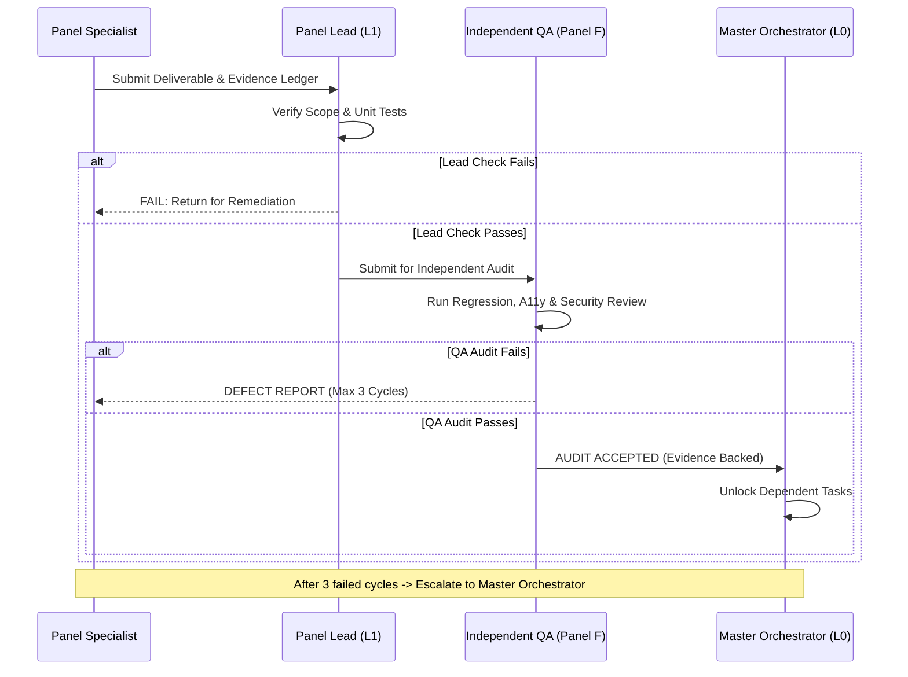

# SAFEPAWS — UX-06 AGENT ORCHESTRATION & OWNERSHIP
## Hierarchical Multi-Agent Architecture, File Ownership Matrix & Governance Protocol

**Document Status:** Final Official Governance Specification  
**Milestone:** Phase UX-06.0 Initial Discovery & Architecture Lock  
**Command Authority:** Master Orchestrator  
**Repository:** `/home/samudra/Projects/VisualSCode/VisualCode/Vscoding/Projects/SAFEPAWS/safepaws_sih`  

---

## 1. Master Multi-Agent Hierarchy

To ensure disciplined execution without merge conflicts, state overwrite, or uncontrolled agent spawning, the UX-06 program enforces a strict 4-level command hierarchy:

```mermaid
flowchart TD
    L0["LEVEL 0: MASTER ORCHESTRATOR\n(Program Architecture, Scope, Dependency & Release Gate Authority)"]

    subgraph Level1 ["LEVEL 1: SIX PANEL LEADS"]
        PA["PANEL A LEAD\nDesign System & Architecture"]
        PB["PANEL B LEAD\nLanding & Public Experience"]
        PC["PANEL C LEAD\nOwner & Pet Ecosystem"]
        PD["PANEL D LEAD\nScanner & Identity Engine"]
        PE["PANEL E LEAD\nCommunity & Reunification"]
        PF["PANEL F LEAD\nIndependent Quality Authority"]
    end

    subgraph Level2_A ["Panel A Specialists"]
        A1["A1 Experience Architect"]
        A2["A2 Visual Design Director"]
        A3["A3 Frontend Foundation Engineer"]
    end

    subgraph Level2_B ["Panel B Specialists"]
        B1["B1 Brand Story Architect"]
        B2["B2 Frontend Experience Engineer"]
        B3["B3 Motion Director"]
    end

    subgraph Level2_C ["Panel C Specialists"]
        C1["C1 Owner Journey Architect"]
        C2["C2 Pet Experience Engineer"]
        C3["C3 Privacy & Consent Specialist"]
    end

    subgraph Level2_D ["Panel D Specialists"]
        D1["D1 ML Systems Architect"]
        D2["D2 Identity Pipeline Engineer"]
        D3["D3 Scanner Experience Engineer"]
    end

    subgraph Level2_E ["Panel E Specialists"]
        E1["E1 Lost Pet Journey Architect"]
        E2["E2 Discovery & Location Engineer"]
        E3["E3 Community Safety Engineer"]
    end

    subgraph Level2_F ["Panel F Specialists (Independent)"]
        F1["F1 Functional QA"]
        F2["F2 Quality Engineering"]
        F3["F3 Security & Privacy Auditor"]
        F4["F4 Independent Release Gatekeeper"]
    end

    L0 --> PA
    L0 --> PB
    L0 --> PC
    L0 --> PD
    L0 --> PE
    L0 --> PF

    PA --> A1 & A2 & A3
    PB --> B1 & B2 & B3
    PC --> C1 & C2 & C3
    PD --> D1 & D2 & D3
    PE --> E1 & E2 & E3
    PF --> F1 & F2 & F3 & F4
```



---

## 2. Panel Ownership & Delegation Mandates

### PANEL A — Design System & Product Architecture
- **Lead Authority:** Frontend Systems Architect & Design Lead
- **Scope:** Product information architecture, shared design tokens, component primitives, layout foundations, responsive breakpoints, typography scales.
- **Specialist Roles:**
  - `A1.1 User Journey Mapper` / `A1.2 Information Architecture Reviewer`
  - `A2.1 Typography & Layout Specialist` / `A2.2 Color & Design Token Specialist`
  - `A3.1 Component Architecture Engineer` / `A3.2 Responsive Foundation Engineer`

### PANEL B — Landing & Public Experience
- **Lead Authority:** Brand & Marketing Experience Lead
- **Scope:** Public landing page (`/`), marketing storytelling, public navigation, initial finder scan hooks, and brand motion choreography.
- **Specialist Roles:**
  - `B1.1 Copy & Content Designer` / `B1.2 Visual Storyboard Designer`
  - `B2.1 Landing Page Engineer` / `B2.2 Public Route Integrator`
  - `B3.1 Scroll Narrative Engineer` / `B3.2 Interaction Engineer`

### PANEL C — Owner & Pet Ecosystem
- **Lead Authority:** Owner Console & Pet Experience Lead
- **Scope:** Authentication flow (`/api/v1/auth/*`), profile setup (`/setup-profile`), owner dashboard (`/dashboard`), pet registration wizard (`/pets/new`), pet detail management (`/pets/:petId`), and medical privacy controls.
- **Specialist Roles:**
  - `C1.1 Registration & Onboarding Specialist` / `C1.2 Dashboard & Navigation Specialist`
  - `C2.1 Pet Profile Engineer` / `C2.2 Pet Data & API Engineer`
  - `C3.1 Sharing & Revocation Engineer` / `C3.2 Data Exposure Test Engineer`

### PANEL D — Scanner & Identity Engine
- **Lead Authority:** ML Systems Architect & Biometric Engineer
- **Scope:** Real-time spatial reticle HUD (`/scan`), camera hardware lifecycle, YOLOv8 nose detection, MobileNetV2 embedding extraction, safe checkpoint deserialization (`weights_only=True`), FAISS gallery search, and 5-state match categorization.
- **Specialist Roles:**
  - `D1.1 Detector & Embedder Validation Engineer` / `D1.2 Model Artifact & Checkpoint Security Engineer`
  - `D2.1 Enrollment & Gallery Engineer` / `D2.2 Similarity & Threshold Validation Engineer`
  - `D3.1 Camera & Capture UX Engineer` / `D3.2 Result State & Feedback Engineer`

### PANEL E — Community & Reunification
- **Lead Authority:** Community & Recovery Experience Lead
- **Scope:** Emergency lost-pet broadcast (`/lost/new`), recovery board (`/lost`), incident room (`/alerts/:alertId`), sighting submission form (`/sightings/new`), and neighborhood community feed (`/community/*`).
- **Specialist Roles:**
  - `E1.1 Missing Pet Report Engineer` / `E1.2 Sighting Report Engineer`
  - `E2.1 Geospatial Experience Engineer` / `E2.2 Search & Discovery Engineer`
  - `E3.1 Reporting & Moderation Engineer` / `E3.2 Abuse & Spam Prevention Engineer`

### PANEL F — Independent Quality Authority
- **Lead Authority:** Independent Release Gatekeeper & Principal QA Architect
- **Independence Mandate:** Panel F operates with zero implementation ownership. It conducts adversarial audits, multi-viewport browser testing, security reviews, and gate verifications.
- **Specialist Roles:**
  - `F1.1 User Journey Test Engineer` / `F1.2 API & Integration Test Engineer`
  - `F2.1 Accessibility & Responsive Auditor` / `F2.2 Performance & Browser Auditor`
  - `F3.1 Authorization & Data Exposure Auditor` / `F3.2 Model & Infrastructure Security Auditor`
  - `F4.1 Evidence Auditor` / `F4.2 Final Acceptance Reviewer`

---

## 3. Strict File Ownership Matrix

To eliminate merge conflicts and concurrent state collisions, **every file in the repository has exactly one primary owner**. Shared configuration files require sequential handoffs approved by the Master Orchestrator:

| File / Directory Path | Primary Panel Owner | Specialist Assignee | Concurrent Edit Policy |
|:---|:---:|:---:|:---|
| `frontend/src/index.css` | **PANEL A** | A2.2 Design Token Specialist | **STRICT LOCK:** Sequential handoff only |
| `frontend/src/components/ui/*` | **PANEL A** | A3.1 Component Engineer | Exclusive to Panel A |
| `frontend/src/App.tsx` | **PANEL A** | A1.2 Info Arch Reviewer | Master Orchestrator integration gate |
| `frontend/src/pages/LandingPage.tsx` | **PANEL B** | B2.1 Landing Page Engineer | Exclusive to Panel B |
| `frontend/src/components/Hero.tsx` | **PANEL B** | B2.1 Landing Page Engineer | Exclusive to Panel B |
| `frontend/src/components/FeaturesSection.tsx`| **PANEL B** | B2.2 Public Integrator | Exclusive to Panel B |
| `frontend/src/pages/Dashboard.tsx` | **PANEL C** | C1.2 Dashboard Specialist | Exclusive to Panel C |
| `frontend/src/pages/SetupProfile.tsx` | **PANEL C** | C1.1 Onboarding Specialist | Exclusive to Panel C |
| `frontend/src/pages/pets/*` | **PANEL C** | C2.1 Pet Profile Engineer | Exclusive to Panel C |
| `frontend/src/store/authStore.ts` | **PANEL C** | C1.1 Onboarding Specialist | Exclusive to Panel C |
| `frontend/src/store/petStore.ts` | **PANEL C** | C2.2 Pet API Engineer | Exclusive to Panel C |
| `frontend/src/pages/Scan.tsx` | **PANEL D** | D3.1 Camera UX Engineer | Exclusive to Panel D |
| `frontend/src/components/scan/*` | **PANEL D** | D3.2 Result State Engineer | Exclusive to Panel D |
| `backend/app/ml/*` | **PANEL D** | D1.1 Detector/Embedder Engineer | Exclusive to Panel D |
| `backend/app/services/biometric_service.py`| **PANEL D**| D2.1 Gallery Engineer | Exclusive to Panel D |
| `backend/model_weights/*` | **PANEL D** | D1.2 Checkpoint Security Engineer| Read-only; strict verification |
| `frontend/src/pages/LostDogs.tsx` | **PANEL E** | E1.1 Missing Pet Engineer | Exclusive to Panel E |
| `frontend/src/pages/ReportLost.tsx` | **PANEL E** | E1.1 Missing Pet Engineer | Exclusive to Panel E |
| `frontend/src/pages/AlertDetail.tsx` | **PANEL E** | E2.1 Geospatial Engineer | Exclusive to Panel E |
| `frontend/src/pages/ReportSighting.tsx` | **PANEL E** | E1.2 Sighting Report Engineer | Exclusive to Panel E |
| `frontend/src/pages/Community*.tsx` | **PANEL E** | E3.1 Moderation Engineer | Exclusive to Panel E |
| `frontend/src/components/community/*`| **PANEL E** | E2.2 Discovery Engineer | Exclusive to Panel E |
| `frontend/audit.spec.ts` | **PANEL F** | F1.1 User Journey Tester | Exclusive to Panel F |
| `frontend/e2e/*` | **PANEL F** | F1.1 User Journey Tester | Exclusive to Panel F |
| `backend/tests/*` | **PANEL F** | F1.2 API Integration Tester | Exclusive to Panel F |
| `docs/reports/*` | **PANEL F** | F4.1 Evidence Auditor | Independent verification reports |

---

## 4. Task Execution Protocol

Every delegated task must be formalized using the standard task contract:

```markdown
### TASK CONTRACT: [Task ID]
- **Parent Task:** [Parent Milestone / Phase ID]
- **Assigned Agent:** [Panel Code & Specialist ID, e.g., D1.2]
- **Objective:** [Clear, single-sentence actionable goal]
- **Inputs:** [Source files, schemas, model weights, or test fixtures]
- **Allowed File Scope:** [Exact list of files allowed to be created or modified]
- **Prohibited Changes:** [Explicit restrictions, e.g., no git commit, no pickle loading]
- **Dependencies:** [Preceding tasks that must be in PASS state]
- **Acceptance Criteria:** [Measurable conditions for task success]
- **Required Evidence:** [Log output, test report, screenshot, or hash]
- **Reviewer:** [Panel Lead or Independent Auditor F4]
```

Every executing agent must return an 8-part execution ledger:
1. What was inspected.
2. What was modified.
3. What was preserved unchanged.
4. Exact test commands executed.
5. Exact output results.
6. Known environmental limitations.
7. Remaining downstream dependencies.
8. Recommended next action.

---

## 5. Pass / Fail Remediation Loop



### Remediation Rules
- **No Self-Certification:** No agent may mark its own work as accepted.
- **Strict Evidence Standard:** A task is not complete until reproducible test output or verified artifacts exist.
- **Escalation Threshold:** After 3 unsuccessful remediation cycles, the Master Orchestrator halts execution, audits root causes, and reassigns or adjusts the specification.
