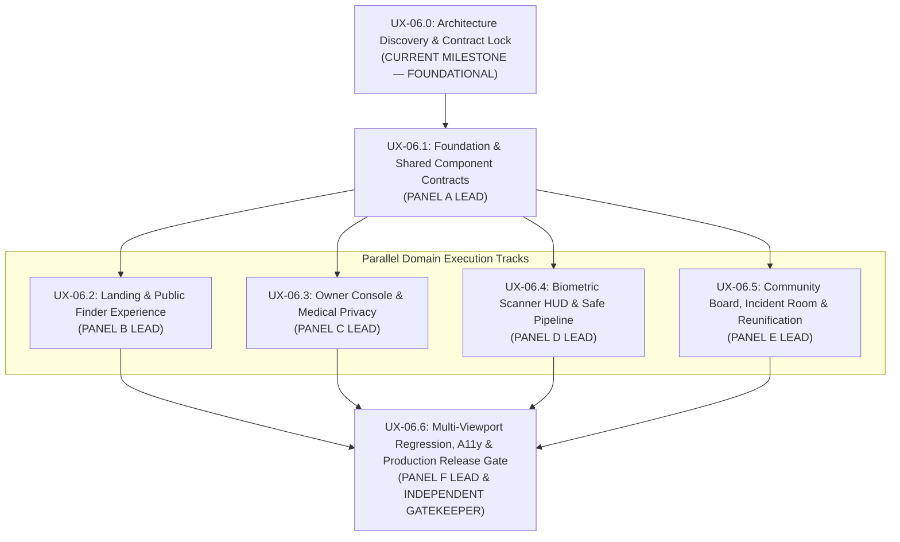
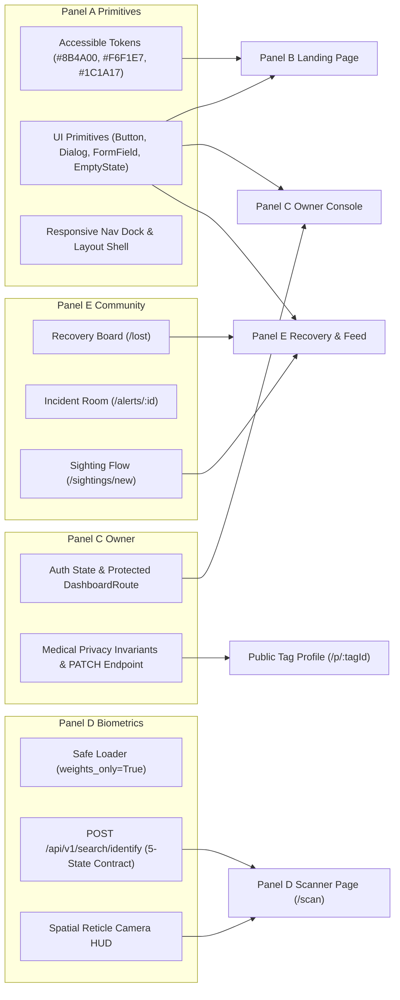

# SAFEPAWS — UX-06 DEPENDENCY GRAPH
## Sequential & Parallel Execution Topologies, Critical Paths & Cross-Panel Handoffs

**Document Status:** Final Official Architecture Specification  
**Milestone:** Phase UX-06.0 Initial Discovery & Architecture Lock  
**Command Authority:** Master Orchestrator  
**Repository:** `/home/samudra/Projects/VisualSCode/VisualCode/Vscoding/Projects/SAFEPAWS/safepaws_sih`  

---

## 1. Master Program Dependency Topology

The UX-06 transformation program is structured into clear phases governed by strict prerequisites. No dependent implementation may begin until its parent contract is locked:



---

## 2. Cross-Panel Contract Mappings

Each panel requires explicit data, UI, or service contracts from other panels before its implementation can be certified:



---

## 3. Critical Path & Blocker Topology

The path to production release is governed by three critical paths that cannot be bypassed:

```
[ CRITICAL PATH 1: UI & ACCESSIBILITY ]
UX-06.0 (Inventory) -> UX-06.1 (Primitives) -> UX-06.2..06.5 (Page Refinements) -> UX-06.6 (Playwright 10 Viewports & WCAG 2.2 AA)

[ CRITICAL PATH 2: BIOMETRIC IDENTITY INTEGRITY ]
UX-06.0 (Weights Audit) -> Safe State-Dict Checkpoint (weights_only=True) -> Multi-Identity Gallery Discrimination -> 5-State Result HUD

[ CRITICAL PATH 3: MANDATORY PRODUCTION INFRASTRUCTURE (GATE 4) ]
Linux Host Binaries Check -> Containerized PostgreSQL 16 + PostGIS Setup -> Alembic Migration Upgrade/Downgrade -> 4 Live Integration Tests Passing
```

### Mandatory Infrastructure Invariant
Critical Path 3 (Gate 4: Live PostgreSQL / PostGIS Integration) is a hard blocker. If an external or containerized Linux PostgreSQL database is unavailable in the execution environment:
- SQLite runs will be cleanly reported as SQLite developer testing.
- The 4 skipped PostgreSQL integration tests will remain honestly reported as SKIPPED.
- The production gate will remain on **`HOLD — PRODUCTION RELEASE NOT APPROVED`**.
- Under no circumstances will mock databases be claimed as live PostgreSQL verification.
