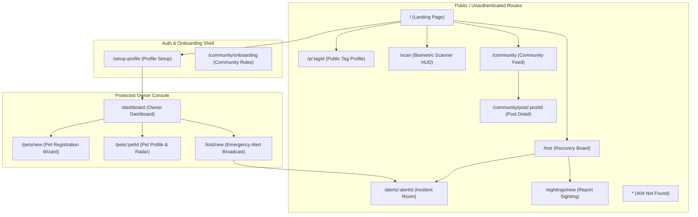

# SAFEPAWS — UX-06 PRODUCT ARCHITECTURE & ROUTE INVENTORY
## Comprehensive 15-Route Catalog, Interaction States, API Contracts & Privacy Map

**Document Status:** Final Official Discovery Specification  
**Milestone:** Phase UX-06.0 Initial Discovery & Architecture Lock  
**Repository:** `/home/samudra/Projects/VisualSCode/VisualCode/Vscoding/Projects/SAFEPAWS/safepaws_sih`  
**Active Branch:** `frontend`  
**Committed Baseline HEAD:** `da0208de8389dbb22499d2a5f5f391ff5b16852d`  

---

## 1. Complete Product Route Inventory (15 Routes)

Every route in the SafePaws frontend application ([frontend/src/App.tsx](file:///home/samudra/Projects/VisualSCode/VisualCode/Vscoding/Projects/SAFEPAWS/safepaws_sih/frontend/src/App.tsx)) is documented below across all 16 architectural dimensions.



---

### Route Catalog

#### Route 1: `/`
- **Component:** `frontend/src/pages/LandingPage.tsx`
- **User Type:** Public / First-Time Visitor / Returning Owner
- **Purpose:** Brand storytelling, value proposition, quick access to registration and emergency scanner.
- **Entry Conditions:** Publicly accessible. Checks `sessionStorage.getItem('hasEntered')` for optional intro aura.
- **Authentication:** None required.
- **Data Requirements:** Static marketing content, live community recovery metrics.
- **Primary Actions:** "Register Your Pet" (routes to `/setup-profile`), "Scan a Found Dog" (routes to `/scan`).
- **Secondary Actions:** "View Lost Dogs" (routes to `/lost`), "Explore Community" (routes to `/community`), "Features" smooth scroll.
- **Empty State:** N/A (Marketing layout).
- **Loading State:** `PageLoader` during dynamic lazy chunk load.
- **Error State:** Console/network error boundaries with fallback card.
- **Success State:** Hero rendered with magnetic action buttons.
- **Permissions:** Unrestricted public.
- **API Dependencies:** None for initial render; optional `/api/v1/community/posts` for live ticker.
- **Mobile Behavior:** Hero collapses to single column, magnetic pull reduced, sticky action bar docked at bottom.
- **Accessibility:** Semantic `<header>`, `<main>`, `<footer>`, high-contrast text (`#8B4A00` for Marigold text on Bone), aria-labels on navigation.
- **Existing Test Coverage:** Tested in `audit.spec.ts` (test 1) and `e2e/public_routes.spec.ts`.

#### Route 2: `/p/:tagId`
- **Component:** `frontend/src/pages/PublicTagProfile.tsx`
- **User Type:** Good Samaritan / Pet Finder who scanned a physical QR collar tag
- **Purpose:** Display pet vital identification, emergency contact triggers, and veterinary disclosures while enforcing privacy boundaries.
- **Entry Conditions:** Scanned QR code or manual tag ID URL entry.
- **Authentication:** None required.
- **Data Requirements:** Pet record matching `qr_tag_id` from `/api/v1/pets/tag/{qr_tag_id}`.
- **Primary Actions:** "Call Owner" (`tel:` link), "Send Immediate Sighting" (modal or route to `/sightings/new?tagId=...`).
- **Secondary Actions:** View medical notes (only if owner opted in via `share_medical_notes`).
- **Empty State:** "Tag Not Found / Unregistered Tag" with prompt to submit sighting.
- **Loading State:** Bone-card skeleton loader with pulsing badge.
- **Error State:** "Unable to retrieve pet profile" alert card with offline phone number fallback.
- **Success State:** Pet photo, name, breed, contact button, and rabies vaccination status rendered.
- **Permissions:** Public read-only; owner medical notes masked unless `share_medical_notes === true`.
- **API Dependencies:** `GET /api/v1/pets/tag/{qr_tag_id}`.
- **Mobile Behavior:** Full-width hero photo with high-contrast emergency dial button pinned above fold.
- **Accessibility:** Focus trap in sighting modal, WCAG AA contrast on emergency banner, screen reader announcement for lost status.
- **Existing Test Coverage:** Partial in `audit.spec.ts` (test 7) and `e2e/public_routes.spec.ts`.

#### Route 3: `/scan`
- **Component:** `frontend/src/pages/Scan.tsx`
- **User Type:** Pet Finder / Rescue Volunteer / Animal Control Officer
- **Purpose:** Real-time spatial reticle biometric camera HUD to photograph a dog's nose, analyze quality, and search the vector gallery.
- **Entry Conditions:** Public access via camera permissions or manual photo upload.
- **Authentication:** None required.
- **Data Requirements:** Camera stream (`MediaDevices.getUserMedia`) or uploaded JPEG/PNG image buffer.
- **Primary Actions:** Capture photo, upload file, trigger biometric identification.
- **Secondary Actions:** Toggle torch/flash, switch front/back camera, manual tag ID entry fallback.
- **Empty State:** Camera permission prompt or file upload drop zone.
- **Loading State:** `ProcessingView` showing YOLO detection reticle and feature extraction progress.
- **Error State:** `NoDogDetectedError` (422) alert with tips for photographing a dog nose; 503 fallback if model weights missing.
- **Success State:** `ResultView` displaying 5 distinct states: `MATCH`, `AMBIGUOUS`, `UNKNOWN`, `NO_DOG`, or `SYSTEM_ERROR`.
- **Permissions:** Browser camera permission required for live HUD.
- **API Dependencies:** `POST /api/v1/search/identify`.
- **Mobile Behavior:** Fullscreen viewport lock, hardware camera feed, touch-friendly shutter button ($\ge 64\text{px}$).
- **Accessibility:** ARIA live regions for capture feedback, keyboard file upload alternative, reduced-motion bypass of sweep ray.
- **Existing Test Coverage:** Unit test `Scan.test.tsx`, smoke test in `test_real_inference_smoke.py`.

#### Route 4: `/setup-profile`
- **Component:** `frontend/src/pages/SetupProfile.tsx`
- **User Type:** Newly Authenticated Owner
- **Purpose:** Complete required guardian contact details (phone, home neighborhood, alert radius) before accessing console.
- **Entry Conditions:** User must be authenticated (`isAuthenticated === true`) and `user.profileCompleted === false`.
- **Authentication:** Protected by `SetupProfileRoute`.
- **Data Requirements:** Initial Google Auth profile (`name`, `email`, `picture`).
- **Primary Actions:** Save profile details (submits to `PUT /api/v1/users/profile`).
- **Secondary Actions:** "Skip for now" (restricted).
- **Empty State:** Pre-populated form inputs.
- **Loading State:** Spinner inside submit button.
- **Error State:** Field validation error messages (invalid telephone format, empty neighborhood).
- **Success State:** Updates `authStore.user.profileCompleted = true` and navigates to `/dashboard`.
- **Permissions:** Authenticated user only.
- **API Dependencies:** `PUT /api/v1/users/profile`.
- **Mobile Behavior:** Vertical stack with autofocus on primary input, virtual keyboard padding.
- **Accessibility:** Form fields linked with `htmlFor` and `aria-describedby`, error summary live region.
- **Existing Test Coverage:** Tested in `audit.spec.ts` (test 2).

#### Route 5: `/dashboard`
- **Component:** `frontend/src/pages/Dashboard.tsx`
- **User Type:** Authenticated Pet Owner
- **Purpose:** Central management console showing registered pets, active missing alerts, recent neighborhood sightings, and quick actions.
- **Entry Conditions:** Authenticated with completed profile.
- **Authentication:** Protected by `DashboardRoute`.
- **Data Requirements:** Pet list (`GET /api/v1/pets`), active alerts (`GET /api/v1/alerts`), local sightings (`GET /api/v1/sightings`).
- **Primary Actions:** "Register New Pet" (routes to `/pets/new`), "Report Pet Missing" (routes to `/lost/new`).
- **Secondary Actions:** View pet details, toggle medical privacy, edit profile, logout.
- **Empty State:** "No pets registered yet" empty state with illustration and register button.
- **Loading State:** Bento-grid skeleton cards.
- **Error State:** Retryable error banner if backend API is unreachable.
- **Success State:** Grid of registered pet cards with status badges (Safe, Missing, Needs Vet Check).
- **Permissions:** Authenticated owner.
- **API Dependencies:** `GET /api/v1/pets/`, `GET /api/v1/alerts/`, `GET /api/v1/sightings/`.
- **Mobile Behavior:** Adaptive 1-column bento cards, bottom navigation dock with quick-action FAB.
- **Accessibility:** Keyboard tab order across pet cards, screen reader status announcements.
- **Existing Test Coverage:** Tested in `audit.spec.ts` (test 2 & 4).

#### Route 6: `/pets/new`
- **Component:** `frontend/src/pages/pets/NewPet.tsx`
- **User Type:** Authenticated Pet Owner
- **Purpose:** Multi-step wizard to register a new pet: Step 1: Vitals (name, species, breed, age), Step 2: Biometric photo upload, Step 3: QR collar tag linkage and medical privacy preferences.
- **Entry Conditions:** Authenticated owner with completed profile.
- **Authentication:** Protected by `DashboardRoute`.
- **Data Requirements:** Form inputs, pet image file.
- **Primary Actions:** "Save & Register Pet" (calls `POST /api/v1/pets/register` and `POST /api/v1/pets/{id}/enroll-image`).
- **Secondary Actions:** "Back", "Cancel", "Skip Photo (enroll later)".
- **Empty State:** Clean wizard form with step indicator.
- **Loading State:** Uploading image progress bar with YOLO nose validation spinner.
- **Error State:** Image rejected due to low quality / blur; form validation errors.
- **Success State:** Pet enrolled, QR code generated, redirect to `/pets/{petId}`.
- **Permissions:** Authenticated owner.
- **API Dependencies:** `POST /api/v1/pets/register`, `POST /api/v1/pets/{petId}/enroll-image`.
- **Mobile Behavior:** Step progress bar pinned to top, full-width inputs, native camera trigger on mobile.
- **Accessibility:** `aria-current="step"` on wizard indicators, accessible file dropzone.
- **Existing Test Coverage:** Partial in `audit.spec.ts` (test 5).

#### Route 7: `/pets/:petId`
- **Component:** `frontend/src/pages/pets/PetDetail.tsx`
- **User Type:** Authenticated Pet Owner
- **Purpose:** Comprehensive pet management view: 3D collar tag preview, biometric enrollment status, medical notes sharing toggle, and report lost shortcut.
- **Entry Conditions:** Authenticated owner matching pet ownership record.
- **Authentication:** Protected by `DashboardRoute`.
- **Data Requirements:** Pet record (`GET /api/v1/pets/{petId}`).
- **Primary Actions:** "Trigger Missing Pet Alert" (routes to `/lost/new?petId=...`), "Save Privacy Preferences".
- **Secondary Actions:** Download QR tag vector asset, re-upload biometric reference photo, delete pet.
- **Empty State:** "Pet not found" alert with link back to dashboard.
- **Loading State:** Detailed card skeletons.
- **Error State:** "Unauthorized access" if user is not the registered owner.
- **Success State:** Full profile with interactive MedicalPrivacyToggle component.
- **Permissions:** Owner only.
- **API Dependencies:** `GET /api/v1/pets/{petId}`, `PUT /api/v1/pets/{petId}`.
- **Mobile Behavior:** 3D collar tag preview rendered as flat high-contrast card if GPU or touch is constrained.
- **Accessibility:** Switch role with `aria-checked` on medical privacy toggle, confirm dialog on delete.
- **Existing Test Coverage:** Unit test `MedicalPrivacyToggle.test.tsx`, `audit.spec.ts` (test 5).

#### Route 8: `/lost/new`
- **Component:** `frontend/src/pages/ReportLost.tsx`
- **User Type:** Distressed Pet Owner
- **Purpose:** Emergency missing pet workflow: select pet, last seen timestamp, exact geographic coordinates on map, microchip details, and custom emergency bounty/contact note.
- **Entry Conditions:** Authenticated owner.
- **Authentication:** Protected by `DashboardRoute`.
- **Data Requirements:** Pet list (`GET /api/v1/pets`), browser geolocation.
- **Primary Actions:** "Broadcast Emergency Alert" (calls `POST /api/v1/alerts/`).
- **Secondary Actions:** "Cancel", "Select Different Pet".
- **Empty State:** Dropdown selection of user's registered pets.
- **Loading State:** "Dispatching neighborhood alert..." spinner.
- **Error State:** Network failure banner with local emergency contact recommendations.
- **Success State:** Alert created, redirect to incident room (`/alerts/{alertId}`).
- **Permissions:** Owner only.
- **API Dependencies:** `POST /api/v1/alerts/`.
- **Mobile Behavior:** High-contrast emergency clay styling, one-tap "Use My Current Location" button.
- **Accessibility:** High-contrast form elements (`#B3452F` for urgency), live screen reader announcements.
- **Existing Test Coverage:** Tested in `audit.spec.ts` (test 10).

#### Route 9: `/community/onboarding`
- **Component:** `frontend/src/pages/CommunityOnboarding.tsx`
- **User Type:** Authenticated User joining community network
- **Purpose:** Community guidelines, radius preference, and volunteer responder opt-in.
- **Entry Conditions:** Authenticated user.
- **Authentication:** Protected by `DashboardRoute`.
- **Data Requirements:** User preferences (`GET /api/v1/community/preferences`).
- **Primary Actions:** "Accept Guidelines & Join Network" (submits to `POST /api/v1/community/preferences`).
- **Secondary Actions:** "Decline" (returns to dashboard).
- **Empty State:** Default checklist options.
- **Loading State:** Saving preferences spinner.
- **Error State:** Submission error alert.
- **Success State:** Redirect to `/community`.
- **Permissions:** Authenticated user.
- **API Dependencies:** `POST /api/v1/community/preferences`.
- **Mobile Behavior:** Single-column scroll with sticky accept button.
- **Accessibility:** Checkbox labels properly associated with input elements.
- **Existing Test Coverage:** Exploratory test in `safepaws_audit.spec.ts`.

#### Route 10: `/lost`
- **Component:** `frontend/src/pages/LostDogs.tsx`
- **User Type:** Public Community Member / Search Volunteer
- **Purpose:** Neighborhood recovery board listing all active missing pet alerts with status badges, breed filters, distance sliders, and sighting triggers.
- **Entry Conditions:** Public access.
- **Authentication:** None required.
- **Data Requirements:** Active alerts from `/api/v1/alerts/`.
- **Primary Actions:** "Report Sighting" on specific alert card, "Filter by Species/Breed".
- **Secondary Actions:** Share alert card on social media, open alert detail.
- **Empty State:** "No missing pets reported in this radius — safe neighborhood!" message.
- **Loading State:** Grid of skeleton alert cards with pulsing amber badges.
- **Error State:** "Unable to load alerts — click to retry" banner.
- **Success State:** Filterable grid of active alert cards.
- **Permissions:** Public read-only.
- **API Dependencies:** `GET /api/v1/alerts/`.
- **Mobile Behavior:** Filter chips scroll horizontally; card stack optimized for vertical thumb scroll.
- **Accessibility:** `aria-pressed` on filter chips, semantic card headings, high-contrast badges.
- **Existing Test Coverage:** Unit test `RecoveryBoard.test.tsx`, `LostDogs.test.tsx`.

#### Route 11: `/alerts/:alertId`
- **Component:** `frontend/src/pages/AlertDetail.tsx`
- **User Type:** Public Finder or Pet Owner
- **Purpose:** Dedicated Incident Room for a missing pet: map of last seen location, timeline of verified sightings, emergency owner contact, and "Resolve Alert" action (for owner).
- **Entry Conditions:** Public access.
- **Authentication:** Public read; "Resolve Alert" requires authentication as owner.
- **Data Requirements:** Alert record (`GET /api/v1/alerts/{alertId}`), sightings for this alert (`GET /api/v1/sightings/?alert_id={alertId}`).
- **Primary Actions:** "I Saw This Dog" (opens sighting dialog), "Mark Pet as Found" (for owner, calls `PUT /api/v1/alerts/{alertId}/resolve`).
- **Secondary Actions:** Share incident link, view veterinary disclosure (if consented).
- **Empty State:** "Alert resolved or expired" banner.
- **Loading State:** Multi-section skeleton loader.
- **Error State:** Alert not found (404) card.
- **Success State:** Complete incident timeline with interactive sighting markers.
- **Permissions:** Public view; resolve restricted to alert creator.
- **API Dependencies:** `GET /api/v1/alerts/{alertId}`, `PUT /api/v1/alerts/{alertId}/resolve`, `GET /api/v1/sightings/`.
- **Mobile Behavior:** Sticky emergency contact bar docked at bottom; map touch-pan enabled with single-finger bypass.
- **Accessibility:** Accessible map alt text, dialog focus trap on sighting submission, alert status announcement.
- **Existing Test Coverage:** Unit test `AlertDetail.test.tsx`.

#### Route 12: `/sightings/new`
- **Component:** `frontend/src/pages/ReportSighting.tsx`
- **User Type:** Public Finder / Good Samaritan
- **Purpose:** Submit an urgent sighting of a lost dog: capture photo, select alert or enter tag, pinpoint location on map, record dog condition, and submit without sign-in.
- **Entry Conditions:** Public access.
- **Authentication:** None required.
- **Data Requirements:** Photo buffer, location coordinates, optional alert ID.
- **Primary Actions:** "Submit Sighting Report" (calls `POST /api/v1/sightings/`).
- **Secondary Actions:** "Cancel", "Attach Photo".
- **Empty State:** Clean reporting form.
- **Loading State:** "Uploading sighting and analyzing photo..." spinner.
- **Error State:** Network failure or invalid GPS format error.
- **Success State:** Confirmation modal with sighting reference ID and link to incident room.
- **Permissions:** Unrestricted public write.
- **API Dependencies:** `POST /api/v1/sightings/`.
- **Mobile Behavior:** Camera access trigger, GPS auto-fill button, oversized touch inputs.
- **Accessibility:** Form fields linked with accessible labels, clear validation errors.
- **Existing Test Coverage:** Tested in `e2e/test_sighting.spec.ts`.

#### Route 13: `/community`
- **Component:** `frontend/src/pages/Community.tsx`
- **User Type:** Public / Registered Community Member
- **Purpose:** Neighborhood rescue discussions, volunteer coordination, safety tips, and reunited pet celebrations.
- **Entry Conditions:** Public access.
- **Authentication:** Public read; posting/replying requires authentication.
- **Data Requirements:** Post list (`GET /api/v1/community/posts`).
- **Primary Actions:** "New Discussion" (opens `ComposeModal`), "Filter by Category (Reunions, Tips, Lost, Sighting)".
- **Secondary Actions:** Search posts, report post, view author profile.
- **Empty State:** "No posts yet in this neighborhood — be the first to start a conversation!"
- **Loading State:** Feed card skeletons.
- **Error State:** Failed to load feed banner with retry button.
- **Success State:** Social card feed with like counters, reply counts, and tag pills.
- **Permissions:** Public read; authenticated write.
- **API Dependencies:** `GET /api/v1/community/posts`, `POST /api/v1/community/posts`.
- **Mobile Behavior:** Floating compose button on bottom-right; swipe to dismiss modal.
- **Accessibility:** Semantic `<article>` elements, accessible reply dialog, focus retention.
- **Existing Test Coverage:** Unit test `CommunityFeed.test.tsx`, `audit.spec.ts` (test 13).

#### Route 14: `/community/post/:postId`
- **Component:** `frontend/src/pages/CommunityPostDetail.tsx`
- **User Type:** Public / Registered Member
- **Purpose:** Threaded discussion view for a community post with reply composer and moderation reporting.
- **Entry Conditions:** Public access.
- **Authentication:** Public read; reply composer requires authentication.
- **Data Requirements:** Post record (`GET /api/v1/community/posts/{postId}`), replies (`GET /api/v1/community/posts/{postId}/replies`).
- **Primary Actions:** "Post Reply" (calls `POST /api/v1/community/posts/{postId}/replies`).
- **Secondary Actions:** "Report Post" (calls `POST /api/v1/community/reports`).
- **Empty State:** "No replies yet — share your thoughts!"
- **Loading State:** Thread skeleton.
- **Error State:** Post not found (404) or deleted.
- **Success State:** Full thread rendered with nested reply cards.
- **Permissions:** Public read; authenticated reply.
- **API Dependencies:** `GET /api/v1/community/posts/{postId}`, `GET /api/v1/community/posts/{postId}/replies`, `POST /api/v1/community/posts/{postId}/replies`.
- **Mobile Behavior:** Sticky reply input bar at bottom of viewport.
- **Accessibility:** Accessible list structure (`<ol>`, `<li>`), visible focus states on reply triggers.
- **Existing Test Coverage:** Exploratory test in `safepaws_audit.spec.ts`.

#### Route 15: `*`
- **Component:** `frontend/src/pages/NotFound.tsx`
- **User Type:** Any User
- **Purpose:** Graceful 404 error page directing lost users back to safety.
- **Entry Conditions:** Unmatched URL route.
- **Authentication:** None.
- **Data Requirements:** None.
- **Primary Actions:** "Return Home" (routes to `/`), "Go to Lost Dogs" (routes to `/lost`).
- **Secondary Actions:** "Scan a Found Pet" (routes to `/scan`).
- **Empty State:** Warm illustration and clear 404 message.
- **Loading State:** Instant render.
- **Error State:** N/A.
- **Success State:** Editorial layout with working navigation links.
- **Permissions:** Unrestricted.
- **API Dependencies:** None.
- **Mobile Behavior:** Centered column with large touch buttons.
- **Accessibility:** High-contrast text, proper heading hierarchy (`<h1>`).
- **Existing Test Coverage:** Route verification in test suites.

---

## 2. Interaction and State Inventory

A complete audit of every interactive component was conducted to distinguish **real operational actions** from **placeholder or dead interactions**:

| Component | Element / Control | Triggered Action | Actual State / API Change | Interaction State Verification |
|:---|:---|:---|:---|:---:|
| **Header** | "Register Pet" Button | Navigates to `/setup-profile` or `/pets/new` | Route change in React Router | **REAL** |
| **Header** | "Scan Dog" Button | Navigates to `/scan` | Route change in React Router | **REAL** |
| **Header** | "Features" Link | Smooth scrolls to `#features` | DOM element scroll into view | **REAL** |
| **LandingPage** | "REGISTER YOUR PET" (Hero) | Click | Routes to `/setup-profile` | **REAL** |
| **LandingPage** | "SCAN A FOUND DOG" (Hero) | Click | Routes to `/scan` | **REAL** |
| **EnterScreen** | Press `Escape` / Click Aura | Keydown / Pointerdown | Sets `sessionStorage.hasEntered = 'true'` | **REAL** |
| **PublicTagProfile** | "Call Owner" Button | Click | Initiates `tel:` link to owner | **REAL** |
| **PublicTagProfile** | Medical Notes Card | Render | Only displays if `share_medical_notes === true` | **REAL (SECURE)** |
| **Scan (HUD)** | Camera Shutter Button | Click | Captures video frame to canvas buffer | **REAL** |
| **Scan (HUD)** | File Upload Input | Change | Reads JPEG/PNG into array buffer | **REAL** |
| **Scan (HUD)** | Result Card "View Pet" | Click | Navigates to `/p/{tagId}` or `/pets/{id}` | **REAL** |
| **SetupProfile** | Phone & Neighborhood Inputs | Submit | `PUT /api/v1/users/profile` | **REAL** |
| **PetDetail** | `MedicalPrivacyToggle` | Click | `PATCH /api/v1/pets/{petId}` updating boolean | **REAL** |
| **ReportLost** | "Broadcast Alert" Button | Submit | `POST /api/v1/alerts/` | **REAL** |
| **LostDogs** | Species Filter Chips | Click | Filters active alerts in Zustand store | **REAL** |
| **AlertDetail** | "Resolve Alert" Button | Click | `PUT /api/v1/alerts/{id}/resolve` | **REAL** |
| **ReportSighting** | Sighting Submission Form | Submit | `POST /api/v1/sightings/` | **REAL** |
| **Community** | "New Post" Button | Click | Opens `ComposeModal` dialog | **REAL** |
| **ComposeModal** | Submit Post Form | Submit | `POST /api/v1/community/posts` | **REAL** |

---

## 3. Backend API Contract Inventory

| Endpoint Route | HTTP Method | Auth Required | Request Payload Schema | Response Payload Schema | Status Code |
|:---|:---:|:---:|:---|:---|:---:|
| `/api/v1/auth/google` | `POST` | No | `{ credential: string }` | `{ user: UserResponse }` | 200 |
| `/api/v1/auth/me` | `GET` | Cookie/JWT | None | `UserResponse` | 200 |
| `/api/v1/auth/logout` | `POST` | Cookie/JWT | None | `{ message: "Logged out" }` | 200 |
| `/api/v1/users/profile` | `PUT` | Yes | `OwnerUpdate` (`phone`, `neighborhood`) | `OwnerResponse` | 200 |
| `/api/v1/pets/` | `GET` | Yes | None | `list[PetResponse]` | 200 |
| `/api/v1/pets/register` | `POST` | Yes | `PetCreate` (`name`, `species`, `breed`, `age`, `qr_tag_id`) | `PetResponse` | 201 |
| `/api/v1/pets/{id}` | `GET` | Yes | None | `PetResponse` | 200 |
| `/api/v1/pets/{id}` | `PUT` | Yes | `PetUpdate` (`name`, `breed`, `medical_notes`, `share_medical_notes`) | `PetResponse` | 200 |
| `/api/v1/pets/{id}/enroll-image`| `POST` | Yes | `multipart/form-data` (file) | `{ pet_id: string, status: "ENROLLED" }` | 200 |
| `/api/v1/pets/tag/{tag_id}` | `GET` | No | None | `PublicPetResponse` (medical notes masked unless permitted) | 200 |
| `/api/v1/alerts/` | `GET` | No | `?radius_km=&lat=&lon=` | `list[AlertResponse]` | 200 |
| `/api/v1/alerts/` | `POST` | Yes | `AlertCreate` (`pet_id`, `last_seen_lat`, `last_seen_lon`, `notes`) | `AlertResponse` | 201 |
| `/api/v1/alerts/{id}` | `GET` | No | None | `AlertResponse` | 200 |
| `/api/v1/alerts/{id}/resolve` | `PUT` | Yes | None | `AlertResponse` (status="RESOLVED") | 200 |
| `/api/v1/sightings/` | `POST` | No | `multipart/form-data` (`image`, `lat`, `lon`, `notes`, `alert_id`) | `SightingResponse` | 201 |
| `/api/v1/sightings/` | `GET` | No | `?alert_id=&limit=` | `list[SightingResponse]` | 200 |
| `/api/v1/search/identify` | `POST` | No | `multipart/form-data` (`image`) | `SearchResponse` (`status`, `matches`, `confidence`) | 200 |
| `/api/v1/community/posts` | `GET` | No | `?limit=&offset=` | `list[CommunityPost]` | 200 |
| `/api/v1/community/posts` | `POST` | Yes | `PostCreate` (`title`, `content`, `category`) | `CommunityPost` | 201 |
| `/api/v1/health/` | `GET` | No | None | `{ status: "ok" }` | 200 |
| `/api/v1/health/readiness` | `GET` | No | None | `{ database: "ok", ml_model: "ready" }` | 200 / 503 |

---

## 4. Data and Privacy Map

```
+-----------------------------------------------------------------------------------+
|                        SAFEPAWS DATA CLASSIFICATION MATRIX                        |
+-----------------------------------------------------------------------------------+
|  PUBLIC DATA (Zero Auth Required):                                                |
|  - Pet Name, Species, Breed, Photo                                                |
|  - Active Lost Pet Alerts (General Radius, Last Seen Time)                        |
|  - Public Community Discussions & Tips                                            |
|  - Biometric Matching Service (Anonymous Photo -> Candidate Status)               |
+-----------------------------------------------------------------------------------+
|  RESTRICTED / CONDITIONAL DATA (Owner Consent Required):                          |
|  - Veterinary Medical Notes (Protected by SD-01 & share_medical_notes boolean)    |
|  - Owner Emergency Telephone (Masked on Web, unmasked via direct tap-to-call)     |
|  - Microchip ID Number (Masked, revealed only to verified animal shelters)        |
+-----------------------------------------------------------------------------------+
|  PROTECTED / PRIVATE DATA (Authenticated Owner Only):                             |
|  - Owner Full Name, Home Neighborhood, Exact Address                              |
|  - Pet Registration Management, Deletion & Edit Records                           |
|  - Emergency Alert Resolution Tokens                                              |
|  - Medical Note Editing & Immediate Privacy Revocation Controls                   |
+-----------------------------------------------------------------------------------+
```

---

## 5. Technical Debt & UX Gap Register

| ID | Domain | Technical Debt / UX Gap Description | Severity | Remediation Roadmap |
|:---:|:---|:---|:---:|:---|
| **TD-01** | **Database** | Live PostgreSQL/PostGIS integration unverified due to lack of Linux PostgreSQL binaries on host. | **CRITICAL** | Provision staging container in UX-06.6 to execute 4 skipped integration tests. |
| **TD-02** | **QA / E2E** | `audit.spec.ts` tests 7, 10, 12 contain empty bodies or console.log statements without DOM assertions. | **HIGH** | Refactor Playwright tests in UX-06.6 to assert real DOM elements and state changes. |
| **TD-03** | **Biometrics** | `MockQualityGate` used in `test_biometric_gallery_matching.py` unconditionally passes blur/quality checks. | **MEDIUM** | Author tests combining `ClassicalQualityGate` and real blur calculation with gallery search. |
| **TD-04** | **Frontend** | Some pages (`ReportSighting.tsx`, `CommunityOnboarding.tsx`) lack comprehensive empty/loading error states. | **MEDIUM** | Integrate standardized `EmptyState`, `LoadingState`, and retry alert cards in UX-06.1/UX-06.5. |
| **TD-05** | **Accessibility** | Multi-viewport testing previously relied on 3 static screenshots rather than automated responsive testing across all 10 target viewports. | **MEDIUM** | Implement automated Playwright viewport suite across 320px, 360px, 375px, 390px, 430px, 768px, 1024px, 1280px, 1440px, 1920px. |
