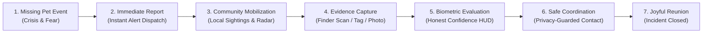
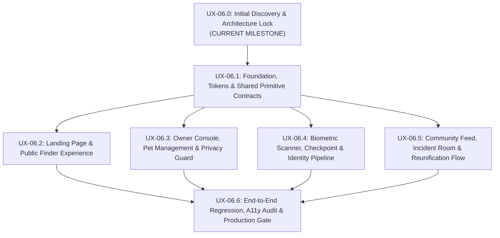

# SAFEPAWS — UX-06 PRODUCT TRANSFORMATION MASTER PLAN
## Program Charter, Architectural North Star & End-to-End Reunification Blueprint

**Program Milestone:** Phase UX-06 Master Transformation Program  
**Program Phase:** UX-06.0 Initial Discovery & Architecture Lock  
**Command Authority:** Chief Product Architect, Principal Software Architect, Experience Design Director & Independent Release Authority  
**Repository Root:** `/home/samudra/Projects/VisualSCode/VisualCode/Vscoding/Projects/SAFEPAWS/safepaws_sih`  
**Active Branch:** `frontend`  
**Committed Baseline HEAD:** `da0208de8389dbb22499d2a5f5f391ff5b16852d`  
**Evaluation Status:** ARCHITECTURE LOCKED — READY FOR SPECIALIST ORCHESTRATION  

---

## 1. Program Mission & Charter

SafePaws is not merely an animal registry, a pet directory, or a biometric technology demo. 

**SafePaws is a mission-critical, human-centered pet identity, rescue, community discovery, and safe reunification ecosystem.**

The program charter of **Phase UX-06** is to elevate SafePaws from an ensemble of independently built screens, mock endpoints, and experimental scripts into an **exceptional, cohesive, production-grade product** that inspires deep trust, operates flawlessly under emotional crisis, protects sensitive human and veterinary data, and provides authentic, verified technological assistance when a beloved pet is lost.

### The Master Orchestrator Mandate
The Master Orchestrator exercises comprehensive authority across the entire product lifecycle:
- Product vision, boundaries, and scope.
- User experience, information architecture, and emotional tone.
- Visual design system, typography, and purposeful motion choreography.
- Frontend architecture, state synchronization, and offline resilience.
- Backend services, spatial queries, and database transaction integrity.
- ML inference, checkpoint safety, and honest biometric confidence scoring.
- Privacy-by-default, explicit consent, and security error sanitization.
- WCAG 2.2 AA accessibility and multi-viewport responsive engineering.
- Independent, adversarial quality verification and evidence-driven release gates.

---

## 2. Product North Star: The Reunification Journey

The fundamental measure of SafePaws is whether it successfully moves a vulnerable pet and an anxious guardian through the complete life cycle of separation and reunion:

### The 9 Core Capabilities
1. **Frictionless Pet Registration & Management:** Create comprehensive digital pet profiles, physical collar QR metadata, and biometric nose-print baseline embeddings without cognitive overload.
2. **Definitive Biometric Identity Records:** Capture high-resolution dog nose-print textures, extract 1280-dimensional unit-norm feature vectors using verified neural networks, and enroll them into persistent, searchable galleries.
3. **Emergency Missing Pet Reporting:** Empower distressed pet owners to trigger local neighborhood alerts, generate printable recovery cards, and push real-time broadcasts in under 60 seconds.
4. **Anonymous & Responsible Sighting Submissions:** Enable community finders to submit geotagged sightings, photos, and condition reports without requiring account creation or app installation.
5. **Responsible Biometric Scanning HUD:** Provide a real-time, spatial reticle camera HUD that validates focus and blur, provides honest feedback, and prevents false certainty.
6. **Localized Community Discovery:** Surface interactive lost-pet recovery boards, incident rooms, and neighborhood community updates filtered by geographic proximity.
7. **Privacy-Guarded Communication:** Connect pet finders with owners through secure, mediated channels that reveal contact details only when mutual intent is established.
8. **Owner-Governed Medical & Personal Privacy:** Ensure veterinary diagnoses, sensitive medications, and personal telephone numbers remain private by default, requiring explicit, revocable owner consent.
9. **Transparent Action & Verification Status:** Clearly communicate whether biometric matches are `CONFIRMED MATCH` ($\ge 0.85$), `AMBIGUOUS CANDIDATE` ($0.70 - 0.85$), or `UNIDENTIFIED` ($< 0.70$), eliminating false hope and automated mistakes.

---

## 3. Product Principles (Non-Negotiable)

1. **Trust Before Spectacle:** Visual flair must never obscure vital status, panic controls, or contact information.
2. **Clarity Before Complexity:** A distraught user reporting a missing dog must experience absolute clarity, single-focus inputs, and zero jargon.
3. **Real Functionality Before Decorative UI:** No dummy buttons, no dead links, no mock success toasts without actual state changes.
4. **Privacy by Default:** Medical notes and owner contact details are hidden on public tag scans until explicitly unmasked by the owner.
5. **Explicit Consent:** Revocation of shared data takes effect immediately on the server, invalidating cached public views.
6. **Honest Uncertainty:** If a camera capture is blurry or an animal is unknown, the system must say so clearly rather than guessing or fabricating identity.
7. **Accessible Interactions:** Full WCAG 2.2 AA conformance: $\ge 4.5:1$ text contrast, $\ge 44\times 44\text{px}$ touch targets, visible keyboard focus rings, and complete screen-reader semantics.
8. **Mobile-First Usability:** 80% of lost-pet sightings occur in the field on mobile devices under direct sunlight. Contrast and touch targets must excel outdoors.
9. **Zero Fabricated Claims:** No synthetic rescue numbers, no fabricated success rates, and no unsupported biometric accuracy claims.

---

## 4. Visual Identity & Design System Foundation

SafePaws is built upon a distinct, editorial-cinematic visual language inspired by field guides, modern Swiss typography, and warm tactile earth tones:

| Token Name | Hex Code | Semantic Role & Hierarchy | Contrast on Bone |
|:---|:---:|:---|:---:|
| **Ink** | `#1C1A17` | Primary text, deep dark backgrounds, high-contrast borders | $13.6:1$ (AAA) |
| **Bone** | `#F6F1E7` | Canvas background, soft cards, warm paper surface | Base Canvas |
| **Marigold** | `#E2811F` | Accent button fill, active indicators, brand spark | $2.3:1$ (UI Large) |
| **Accent-Text** | `#8B4A00` | Dedicated accessible text token for Marigold on Bone | **$6.06:1$ (AA Pass)** |
| **Trail** | `#63684B` | Secondary badges, botanical accents, calm metadata | $5.12:1$ (AA Pass) |
| **Alert-Clay** | `#B3452F` | Emergency state, missing pet banners, destructive actions | $5.45:1$ (AA Pass) |
| **Ink-Soft** | `#6E665C` | Secondary body text, field labels, muted timestamps | **$5.02:1$ (AA Pass)** |

### Typography Hierarchy
- **Serif Display:** `Newsreader` (700 / 600 weight) — Used for editorial hero statements, pet names on commemorative profile headers, and high-impact section dividers.
- **Modern Sans:** `Plus Jakarta Sans` (400 / 500 / 600 / 700) — Primary interface workhorse, form inputs, navigation links, and alert detail cards.
- **System Monospace:** `JetBrains Mono` (500) — Biometric coordinates, bounding box metrics, QR tag serials, and cryptographic verification hashes.

---

## 5. Master Transformation Milestones (UX-06 Program)

### Detailed Milestone Breakdown
- **UX-06.0 (Current):** Forensic repository baseline audit, complete route/API/data inventory, technical debt catalog, design reference register, agent orchestration matrix, and architecture lock.
- **UX-06.1 (Panel A Lead):** Design token consolidation, accessible component primitive contracts (`Button`, `Dialog`, `FormField`, `EmptyState`, `AlertCard`), and shared navigation architecture.
- **UX-06.2 (Panel B Lead):** Editorial landing page redesign, public route narrative, and streamlined anonymous finder scanning entry points.
- **UX-06.3 (Panel C Lead):** Linear-inspired owner dashboard, 3-step pet registration with biometric photo upload, and interactive medical privacy consent manager.
- **UX-06.4 (Panel D Lead):** Spatial reticle biometric camera HUD, real YOLOv8 + MobileNetV2 state-dict inference, and 5-state result cards (`MATCH`, `AMBIGUOUS`, `UNKNOWN`, `NO_DOG`, `ERROR`).
- **UX-06.5 (Panel E Lead):** Real-time lost-pet recovery board, map-based proximity filtering, interactive incident rooms (`/alerts/:id`), and safe community communication.
- **UX-06.6 (Panel F Lead & Independent Gatekeeper):** Multi-viewport Playwright regression across 10 viewports, axe-core WCAG 2.2 AA audit, PostgreSQL/PostGIS container staging verification, and final production sign-off.

---

## 6. Zero-Fabrication Production Gate Invariants

1. **Gate 4 Live PostgreSQL/PostGIS Requirement:** A passing SQLite test suite will never be represented as PostgreSQL verification. Production release authorization remains on `HOLD` until verified against live PostgreSQL 16+ with PostGIS.
2. **PyTorch Serialization Safety:** All model weights must load with `weights_only=True`. Whole-object Python pickling is strictly forbidden.
3. **Biometric Integrity:** Identity matching must be evaluated against a multi-identity enrolled gallery. Mock quality gates that bypass blur detection must not be claimed as complete biometric validation.
4. **E2E Test Authenticity:** Every Playwright test must contain explicit assertions on actual DOM content, state transitions, and server responses. Empty test functions and `console.log`-only tests are strictly prohibited.
